# dsh-superagent: a proactive coding agent for one GitHub repository

`dsh-superagent` is a proactive coding agent for a single GitHub repository, packaged as a bundle that DeepSeek Harness (DSH) loads into its own profile. It watches GitHub — and optionally Feishu — evaluates each request under a Policy the team writes, turns authorized requests into Tickets, and works on each Ticket in its own agent Session and directory before answering in the original conversation, usually with a pull request. A browser panel shows what needs a person, and the repository also carries the setup instructions, editable prompts, Source skills and documentation that make the agent operable.

## Whole-project functional diagram

```mermaid
flowchart LR
    request_001["Someone asks for work on GitHub or Feishu"] --> entry_002["The plugin entry mounts the Runtime"]
    entry_002 --> sources_003["Sources turn messages into Triggers"]
    sources_003 --> policy_004["Policy decides who may start work"]
    policy_004 --> engine_005["The Engine records decisions and Tickets"]
    engine_005 --> worker_006["An Executor Session works on each Ticket"]
    worker_006 --> panel_007["The panel shows what needs a person"]
```



<div id="info.md:1">
<!-- {
  "mermaid_info": {
    "name": "dsh-superagent functional flow",
    "nodes": [
      {
        "id": "request_001",
        "name": "Someone asks for work on GitHub or Feishu",
        "path": "",
        "hint": "An allowed person mentions the agent or comments on an issue in the watched repository",
        "isJumpable": false,
        "position": { "startLine": 0, "endLine": 0 },
        "references": []
      },
      {
        "id": "entry_002",
        "name": "The plugin entry mounts the Runtime",
        "path": "src/index.ts",
        "hint": "apply() reads the machine configuration and constructs the Runtime",
        "isJumpable": true,
        "position": { "startLine": 10, "endLine": 24 },
        "references": []
      },
      {
        "id": "sources_003",
        "name": "Sources turn messages into Triggers",
        "path": "src/sources/github.ts",
        "hint": "The GitHub plugin registers its kind and polls for messages",
        "isJumpable": true,
        "position": { "startLine": 112, "endLine": 122 },
        "references": []
      },
      {
        "id": "policy_004",
        "name": "Policy decides who may start work",
        "path": "src/policy.ts",
        "hint": "settingsPolicy builds the gate from the allowed lists and admission table",
        "isJumpable": true,
        "position": { "startLine": 167, "endLine": 211 },
        "references": []
      },
      {
        "id": "engine_005",
        "name": "The Engine records decisions and Tickets",
        "path": "src/core/engine.ts",
        "hint": "The single transactional entry point for Triggers, Evals, Tickets and Assignments",
        "isJumpable": true,
        "position": { "startLine": 19, "endLine": 38 },
        "references": []
      },
      {
        "id": "worker_006",
        "name": "An Executor Session works on each Ticket",
        "path": "src/executor/dsh.ts",
        "hint": "DshExecutor runs each Assignment in a persistent worker Session",
        "isJumpable": true,
        "position": { "startLine": 201, "endLine": 236 },
        "references": []
      },
      {
        "id": "panel_007",
        "name": "The panel shows what needs a person",
        "path": "src/client/index.tsx",
        "hint": "The browser plugin registers the Superagent sidebar entry and management panel",
        "isJumpable": true,
        "position": { "startLine": 50, "endLine": 58 },
        "references": []
      }
    ]
  }
} -->
<div style="display: flex; align-items: flex-end; margin-top: 12px;">
    <span style="background-color: var(--tag-graph-bg); margin: 8px 0 8px 14px; padding: 6px 12px; border-radius: 4px; border-left: 4px solid var(--tag-graph-border); color: var(--tag-graph-fg); font-size: 14px; font-weight: 500;">
        <a target="_self" href="#info.md:1?class=graph" style="color: inherit; text-decoration: none;">Graph: dsh-superagent functional flow</a>
    </span>
</div>
</div>

The path starts as configuration: a DSH profile activates the bundle, whose patch inserts the agent plugins, and the plugin entry builds the `Runtime` from the machine configuration. Sources then translate remote messages into Triggers, the Policy decides whether a Trigger may become work, the Engine records the outcome as a Decision or Ticket, and the executor turns an accepted Ticket into a worker Session whose state the panel displays.

## At a glance

- **Main role**: extension-point — the project is a DSH bundle that plugs the agent into the harness and grows along declared seams: a Source-kind contract for new message channels, a bundle patch that lists plugins, and prompt and skill files a team edits without touching code.
- **Confidence**: High — the bundle patch, package exports, the `SourceKind` contract and the "Add a Source" cookbook all agree on how new behavior is added and discovered.

## Getting started

### Prerequisites

Node.js 22.19+ or 24+, pnpm, git 2.32+, Python 3.8+ and tmux, plus the GitHub CLI (`gh`) 2.48 or later and a DSH version inside the `engines.dsh` range of the manifest. A model provider must be configured for DSH; a repository on github.com is required, and Feishu additionally needs a `lark-cli` bot setup.

### Install and configure

```text
npm install -g @deepseek-ai/dsh@0.2.1-rc.3
git clone <this repository> dsh-superagent && cd dsh-superagent
pnpm install && pnpm build
dsh superagent --from-default-profile web --dump-config > /dev/null
dsh plugin --profile superagent add "link:$PWD"
```

Then copy the example profile file to `~/.dsh/profiles/superagent/cordis.patch.yml` and replace its placeholders — above all the absolute `stateDir`, without which the plugin refuses to start.

### Start or use

```text
scripts/dsh-superagent start
scripts/dsh-superagent status
```

`start` launches `dsh --profile superagent` in tmux and waits for readiness; open the printed URL and choose **Superagent** in the sidebar, then have an allowed account comment `@<agent login> <request>` on an issue. `status` exits 0 when the service is healthy, 1 when it is down or unhealthy, 2 when a part such as a Source reports an error, and 3 while it waits for setup.

### Build and test

```text
pnpm check     # typecheck, tests and build in one go
pnpm build     # tsdown bundles into lib/
pnpm test      # vitest run
```

<div style="display: flex; align-items: flex-end;">
    <span style="background-color: var(--tag-text-bg); margin: 8px 0 8px 14px; padding: 6px 12px; border-radius: 4px; border-left: 4px solid var(--tag-text-border); color: var(--tag-text-fg); font-size: 14px; font-weight: 500;">
        <a target="_self" href="#README.md?class=text" style="color: inherit; text-decoration: none;">Document: README.md</a>
    </span>
</div>

<div style="display: flex; align-items: flex-end;">
    <span style="background-color: var(--tag-text-bg); margin: 8px 0 8px 14px; padding: 6px 12px; border-radius: 4px; border-left: 4px solid var(--tag-text-border); color: var(--tag-text-fg); font-size: 14px; font-weight: 500;">
        <a target="_self" href="#SETUP.md?class=text" style="color: inherit; text-decoration: none;">Document: SETUP.md</a>
    </span>
</div>

<div style="display: flex; align-items: flex-end;">
    <span style="background-color: var(--tag-text-bg); margin: 8px 0 8px 14px; padding: 6px 12px; border-radius: 4px; border-left: 4px solid var(--tag-text-border); color: var(--tag-text-fg); font-size: 14px; font-weight: 500;">
        <a target="_self" href="#docs/006-deployment.md?class=text" style="color: inherit; text-decoration: none;">Document: docs/006-deployment.md</a>
    </span>
</div>

The README describes the product and the numbered documentation; `SETUP.md` is the interview an agent follows to install and configure everything, and `docs/006-deployment.md` is the manual reference for accounts, startup, upgrades and troubleshooting.

## Main areas

### `src`

The source root: the plugin entry, the layered implementation (core domain, Sources, executor, management app, browser panel) and the shared root modules the layers agree on.

<div style="display: flex; align-items: flex-end;">
    <span style="background-color: var(--tag-text-bg); margin: 8px 0 8px 14px; padding: 6px 12px; border-radius: 4px; border-left: 4px solid var(--tag-text-border); color: var(--tag-text-fg); font-size: 14px; font-weight: 500;">
        <a target="_self" href="#src/src.info.md?class=text" style="color: inherit; text-decoration: none;">Document: src/src.info.md</a>
    </span>
</div>

### `cordis.patch.yml`

The bundle layer DSH applies: it inserts the main plugin, the always-on GitHub Source, the disabled-by-default Feishu Source, and two agent presets (`dsh-superagent-worker`, `dsh-superagent-router`) that define the tools each Session may use.

### `docs`

Nine numbered documents read in order, from philosophy and domain model through authorization, execution, prompts, panel, deployment, architecture and the extension cookbook; consecutive numbering and resolvable links are enforced by a test.

### `examples/profile.cordis.patch.yml`

The per-profile configuration template that supplies `stateDir`, the panel's port, and the optional Feishu switch to enable the chat Source.

### `scripts/dsh-superagent`

A Python service script that starts, stops, restarts and reports on the agent's DSH profile with four documented exit codes, without touching other tmux sessions.

### `prompts` and `skills`

Built-in instructions (`prompts/*.md`, including team-editable `communication`, `delivery` and `scope` sections) and Source skills (`skills/dsh-superagent-github`, `skills/dsh-superagent-feishu`); both are shipped as package files, so a team can change the agent's behavior by editing text.

### `locale`

English and Chinese dictionaries published as `locale/*.json` and loaded by the panel.

### `tests`

Vitest specs for domain rules, Sources, runtime, executor, HTTP API, panel components, bundle patch and documentation consistency.

### `package.json`, `tsdown.config.ts`, `vitest.config.ts`, `tsconfig.json`

The manifest declares the DSH bundle patch, the plugin exports and the Node and DSH version ranges; the build recipe produces three Node ESM bundles plus the self-registering browser script; the test config limits collection to `tests/**/*.spec.{ts,tsx}` and shares one React instance.

<div>Read about the build recipe in <div style="display: inline; padding: 0 6px; border-radius: 4px; background-color: var(--tag-text-bg); color: var(--tag-text-fg); font-size: inherit; font-weight: 500;"><a target="_self" href="#tsdown.config.ts.info.md?class=text" style="color: inherit; text-decoration: none;">tsdown.config.ts.info.md</a></div> and the test setup in <div style="display: inline; padding: 0 6px; border-radius: 4px; background-color: var(--tag-text-bg); color: var(--tag-text-fg); font-size: inherit; font-weight: 500;"><a target="_self" href="#vitest.config.ts.info.md?class=text" style="color: inherit; text-decoration: none;">vitest.config.ts.info.md</a></div>.</div>

## How the main areas work together

A DSH profile installs this package as a bundle, so DSH reads <div style="display: inline; padding: 0 6px; border-radius: 4px; background-color: var(--tag-code-bg); color: var(--tag-code-fg); font-size: inherit; font-weight: 500;"><a target="_self" href="#cordis.patch.yml:4-12?class=code" style="color: inherit; text-decoration: none;">cordis.patch.yml:4-12</a></div> and loads the plugin entries. The main entry validates the machine configuration and builds the `Runtime`, the composition root that opens the state directory, starts the Sources, installs Session hooks and serves the management routes. Source plugins poll their CLIs, translate messages into Triggers, and hand them to the Engine through the runtime; the Policy gate, the assessment step and the executor turn an authorized request into a Ticket worked in a worker Session, and replies travel back out through the same Source. The panel and its HTTP API read the same state, so a person can see pending Tickets, health and setup problems and act on them, while `SETUP.md` and `docs/` describe and drive that whole path.

## How to extend it

- **Extension capability**: add a new Source kind so another service can create work (the cookbook walks through a `webhook` queue), edit the team prompt sections to change how Sessions talk and deliver, or add a Source skill that teaches the agent a service's commands and record shapes.
- **Contract**: a new kind implements `SourceKind` — required `kind`, `title`, `description`, a `schema` with defaults, the `fields` that generate its settings form, the `health` entries it owns, plus optional `scope`, `channel`, `threadContext`, `find`, `policy` and `environment` pieces.
- **Registration or discovery**: the kind's module is built as its own entry in the build recipe, exported in `exports`, inserted into the bundle patch (disabled, like Feishu), enabled in a profile's patch, and registered at startup by the plugin's own `apply` inside a `ctx.effect`.
- **Use path**: once registered, the Source appears in Sources settings and under **Eval → On each Source**, the registry routes incoming Triggers to the Engine, replies go back through the registry's channel adapter, and disposal unregisters the kind — so a disabled or unloaded Source stops receiving without touching other layers.

### Compatibility boundary

Trigger ids, Thread keys and Channel addresses are persisted, so a kind must choose stable mappings and never change them casually. Health entry names are claimed when a kind registers, so they cannot collide with other parts. A new kind does not automatically get a built-in skill, original-record resources or pull-request binding, and it must be added to the module and test tables of `docs/007-architecture.md`, which the documentation test enforces — see <div style="display: inline; padding: 0 6px; border-radius: 4px; background-color: var(--tag-code-bg); color: var(--tag-code-fg); font-size: inherit; font-weight: 500;"><a target="_self" href="#src/sources/kind.ts:85-113?class=code" style="color: inherit; text-decoration: none;">kind.ts:85-113</a></div> and <div style="display: inline; padding: 0 6px; border-radius: 4px; background-color: var(--tag-code-bg); color: var(--tag-code-fg); font-size: inherit; font-weight: 500;"><a target="_self" href="#src/sources/github.ts:112-122?class=code" style="color: inherit; text-decoration: none;">github.ts:112-122</a></div>.

## Configurable behavior

- **Controls**: which plugins the bundle inserts and whether the Feishu Source is enabled; the state directory and machine limits (`promptMaxChars`, `admissionContextMaxPages`, `admissionContextTimeoutMs`); and, through the panel, the Sources, Policy allowed lists, execution environment and prepare command, and prompt sections.
- **Value source**: bundle entries come from the repository's own patch, the state directory and port come from the profile's `cordis.patch.yml`, and everything else is saved through the panel or the local Management API; the service script also reads `DSH_SUPERAGENT_PROFILE` and `DSH_SUPERAGENT_URL`.
- **Takes effect**: `stateDir` is read at startup and cannot be changed in the panel, while every other plugin configuration key is volatile — it is read when used, so a change applies without a restart, except a save that changes a setup account field, which restarts the plugin.

### Common adjustment

`stateDir` — it holds the database, lock, command shims, the agent's git configuration and the Ticket directories, so pointing it at a real absolute path is the one setting a first run cannot skip; change it only while the service is stopped, then restart.

## Behavior being protected

- **Contract**: the bundle patch DSH applies must match the presets the code expects, documentation indexes must stay complete, panel components must render the state the API returns, and domain rules must hold for every accepted or refused request.
- **Main scenarios**: policy and admission decisions, Eval and Ticket lifecycles, runtime passes, outbox delivery, Source translation and polling, executor concurrency and recovery, alongside React specs that mount the panel in jsdom.
- **Regression boundary**: the worker and router presets drifting away from `WORKER_PRESET`/`ROUTER_PRESET` used by Sessions, a Source kind or module missing from the architecture tables, a numbered document or local link breaking, and a class in `src` losing its documentation block.

### Test setup that matters

Vitest collects only files under `tests/` and forces `react`/`react-dom` to resolve to one copy, so client code and panel specs share a React instance; panel specs opt into jsdom per file, and Source and Engine tests build a real Store in a temporary directory while mocking the external CLIs. The patch-and-docs specs are the fastest place to see these invariants spelled out, for example <div style="display: inline; padding: 0 6px; border-radius: 4px; background-color: var(--tag-code-bg); color: var(--tag-code-fg); font-size: inherit; font-weight: 500;"><a target="_self" href="#tests/bundle-patch.spec.ts:29-52?class=code" style="color: inherit; text-decoration: none;">bundle-patch.spec.ts:29-52</a></div>.

## Recommended starting points

1. `README.md` — the shortest statement of what the agent does and the order in which the numbered documents build on each other.
2. `src/src.info.md` — the map of the source layers, so you know which directory owns the behavior you want to change before reading `src/index.ts`.
3. `docs/001-domain.md` — the vocabulary (Trigger, Thread, Ticket, Mandate) every other document and most file names assume.
4. `docs/008-cookbook.md` — the worked "Add a Source" recipe that turns the extension contract above into concrete code, build entries and tests.


---
name: .

update-time: 2026-11-02 14:12

description: `dsh-superagent` is a proactive coding agent for a single GitHub repository, packaged as a bundle that DeepSeek Harness (DSH) loads into its own profile. It watches GitHub — and optionally Feishu — evaluates each request under a Policy the team writes, turns authorized requests into Tickets, and works on each Ticket in its own agent Session and directory before answering in the original conversation, usually with a pull request. A browser panel shows what needs a person, and the repository also carries the setup instructions, editable prompts, Source skills and documentation that make the agent operable.

---
