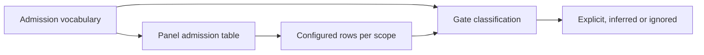

# admission.ts

This 14-line module is the shared vocabulary for the **admission table** — the per-scope setting that decides whether an incoming message becomes an explicit request, an inferred candidate, or is ignored. It does not perform any gating itself: it names the three possible outcomes, declares which outcomes each table cell may legally take, describes the shape of one scope's row, and supplies the fallback values for unset cells. Both the server-side gate and the settings panel import it, which is why the same rules appear identically in configuration validation and in the user interface.

## Whole-unit functional flow

The vocabulary in `src/admission.ts` is shared by two directions of travel: the panel edits per-scope rows using the same legal value lists and defaults, while the gate reads those saved rows to classify each incoming message. The outcome of that classification is the strength (or refusal) that authorization depends on.

## At a glance

- **Primary role (data contract)**: Defines the shared terms and shapes that the policy gate and the settings panel must agree on: the outcome names, each cell's allowed choices, a row type, and the defaults.
- **Secondary role (configuration)**: The exported defaults are what an operator implicitly gets for any cell they leave unset, so this file also fixes the out-of-the-box admission behavior.
- **Confidence**: High — the file was read in full (14 lines) and every consumer was verified in source: the policy schema and gate in `src/policy.ts`, the panel table in `src/client/eval.tsx`, and the scope row descriptors in `src/sources/`.

## What this file does

- **Names the three admission outcomes.** A message can be `explicit`, `inferred`, or `ignore`, and that vocabulary is the single source of truth used by the gate, the mandate basis, and the panel labels.
- **Declares each cell's legal choices.** Two cells for unaddressed messages offer only `inferred` or `ignore`; only the unlisted-but-addressed cell may grant `explicit`. This is what prevents an unaddressed message from ever becoming an explicit request.
- **Ties those choices to the cell set.** The option record is declared with `satisfies Record<AdmissionCell, …>`, so TypeScript flags the file if a cell is added to the domain model without its options here.
- **Describes one scope's row.** `AdmissionRow` is a map from cell to an optional value taken from that cell's own option list, so an invalid combination cannot be written accidentally.
- **Supplies the fallback behavior.** `ADMISSION_DEFAULTS` makes an unset cell behave like the pre-table system: chat messages from listed people that do not address the agent are inferred candidates, and unlisted senders are ignored.
- **Re-exports the cell names.** `AdmissionCell` originates in the core domain model but is re-exported here, so a consumer of the admission vocabulary needs only one import.

## Key types and values

This file contains no functions or classes; its public surface is four symbols plus one re-export.

### `Admission`

The union of the three outcomes a table cell can produce, and the value type the panel selects and the gate compares against.

### `ADMISSION_OPTIONS`

For each cell, the ordered list of values that may be chosen there; the panel builds its dropdowns from it, and the policy schema mirrors the same restriction.

Inspect 
<a target="_self" href="#src/admission.ts:9-10?class=code" style="color: inherit; text-decoration: none;">admission.ts:9-10</a>
 for the option lists and 
<a target="_self" href="#src/admission.ts:11?class=code" style="color: inherit; text-decoration: none;">admission.ts:11</a>
 for the row type derived from them.

### `AdmissionRow`

One receiving scope's entries: a partial map whose every value must be legal for the cell it is stored under, which is what the strict schema in the policy layer re-checks at runtime.

### `ADMISSION_DEFAULTS`

The complete per-cell fallback used whenever a scope's row is missing or leaves a cell unset, keeping unconfigured scopes behaviorally identical to how the system worked before the table existed.

### `AdmissionCell` (re-export)

The three cell names (`listedUnaddressed`, `unlistedAddressed`, `unlistedUnaddressed`) defined in the domain model and forwarded here so callers get the vocabulary in one place.

## Main inputs and results

- **Inputs**: the cell being asked about (derived from whether the sender is listed and whether the message addresses the agent) plus, at runtime, the per-scope rows saved in policy settings.
- **Results**: for a configured or unset cell, one of `explicit`, `inferred`, or `ignore`; for the panel, the legal option list and the displayed default for every dropdown.
- **Visible side effects**: which dropdown values an operator can pick in the admission table, which value a dropdown shows before they touch it, and whether mentioning the agent in a given scope can create an explicit request.

## Information contract

- **Represents**: the meaning of one scope's row in the admission table — which cells exist, which outcomes each cell may grant, and what happens when a cell is left blank.
- **Produced by**: authored declarations in this file, with the cell names themselves owned by the core domain model.
- **Consumed by**: the policy layer, which validates saved rows and consults them when accepting a message or re-validating a mandate; the panel, which renders and edits the same rows; and source integrations, which decide which cells a scope can even offer.
- **Behavior-shaping parts**: `explicit` is only reachable through the unlisted-addressed cell, so it is the only value that can let an unknown person request work; and the defaults decide the behavior of every cell an operator has not set, which is where most scopes start.

### Compatibility notes

All three cells of `AdmissionRow` are optional, so older or partial settings remain valid and simply inherit defaults. A listed sender who addresses the agent never uses a table cell at all — that case is always explicit, and the gate handles it before any lookup. Adding a new cell to the domain model is a breaking change for this file by design: the `satisfies` clause and the defaults record both fail to compile until they are extended, and the policies for admission are described in 
<a target="_self" href="#docs/002-authorization.md?class=text" style="color: inherit; text-decoration: none;">002-authorization.md</a>
.

## Configurable behavior

- **Controls**: what each receiving scope does with a message, split by sender membership (on the source's allowed list or not) and by whether the message addresses the agent. Scopes are chats and direct messages for chat sources, and issues, pull requests, comments and CI for code sources; a scope that cannot receive every message only offers the addressed cell.
- **Value source**: `policy.sources.<source>.admission.<row>` in settings, edited in the panel's admission table; runtime validation of the same shape lives in 
<a target="_self" href="#src/policy.ts:73-77?class=code" style="color: inherit; text-decoration: none;">policy.ts:73-77</a>
 and source-specific normalization in `src/sources/registry.ts`.
- **Takes effect**: immediately per incoming message at gate time — no restart — although the table participates in the policy version hash, so weakening a cell can revoke an already-open ticket's mandate when it is re-validated before resuming.
- **Common adjustment**: setting the unlisted-addressed cell to `explicit` lets anyone in that scope request work simply by mentioning the agent, which is useful for a dedicated support chat; the panel shows a warning for exactly that selection, since it is the only way an unknown sender gains explicit authority.

---
name: admission.ts

update-time: 2026-11-02 10:16

description: This 14-line module is the shared vocabulary for the **admission table** — the per-scope setting that decides whether an incoming message becomes an explicit request, an inferred candidate, or is ignored. It does not perform any gating itself: it names the three possible outcomes, declares which outcomes each table cell may legally take, describes the shape of one scope's row, and supplies the fallback values for unset cells. Both the server-side gate and the settings panel import it, which is why the same rules appear identically in configuration validation and in the user interface.

---
