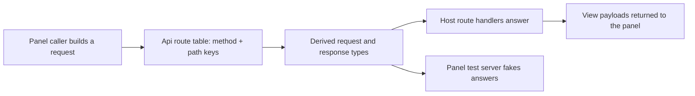

# api.ts

This file is the shared, type-only contract for the orchestrator's management HTTP API: one table that names every operation the web panel can perform, what each operation accepts, and what it returns. It contains almost no runtime code — just two exported filter lists — so the panel can import it without bundling host logic, while the host routes, the panel caller, and the panel's test server all check themselves against it. Read it when you need to know which operations exist or what a given request/response looks like.

## Whole-unit functional diagram

The `Api` table is the single origin of route names; conditional helper types turn each key into its accepted parameters and its result type. Because the host route table, the panel caller, and the test fixture are all typed by those helpers, adding or renaming an operation breaks compilation until every side is updated.

## At a glance

- **Primary role**: API boundary — it publishes the list of management operations together with what each accepts and returns, without implementing them.
- **Secondary roles**: Data contract — it names and re-exports the shared view/payload shapes, paging options and filter vocabulary that the panel and host exchange.
- **Confidence**: High — the file is 53 lines and was read in full, and all three consumers (host routing, panel caller, panel test server) were checked against it.

## What this file does

- **Names every operation in one place** as a `"METHOD path"` string key such as `'GET tickets/:id'` or `'PUT settings/:block'`; the wire path is literally that string with the method prefix removed, so the key is also the URL contract.
- **Spells out accepted input per operation**: `:name` path segments, an optional typed `query` (with paging via `Paged`), and a `body` for writes. Operations with nothing to send can be called with no argument.
- **Spells out the result per operation** by pointing at the modules that build the real payloads — the views for overview, settings, sources, threads, tickets, the prompts types, the policy history view, and the model catalog.
- **Publishes the two filter vocabularies** (`TICKET_FILTERS`, `THREAD_FILTERS`) as real runtime arrays, so the host can validate a `state`/`filter` query and the panel can render the same options without a second copy.
- **Derives signatures instead of repeating them**: `RouteParams`, `ApiRequest` and `ApiResponse` are computed from a route key, so neither side hand-writes a signature per route.
- **Stays importable by the browser bundle** because it imports only types; the panel pulls types from here and the host is free to change implementation details behind them.

## Key functions or classes

### `TICKET_FILTERS` and `THREAD_FILTERS`

The closed list of ticket states and thread filters, used as the accepted `state`/`filter` query values on the host and as the selectable options in the panel.

    
        <a target="_self" href="#src/app/api.ts:12-15?class=code" style="color: inherit; text-decoration: none;">Code: src/app/api.ts:12-15</a>
    

### `Delivery`

A two-value marker, `'injected'` or `'pending'`, reporting whether a context update has already been delivered into the main Session or is still queued.

    
        <a target="_self" href="#src/app/api.ts:17-18?class=code" style="color: inherit; text-decoration: none;">Code: src/app/api.ts:17-18</a>
    

### `Api`

The contract itself: one entry per operation, each with an optional `query`/`body` and a required `response`.

    
        <a target="_self" href="#src/app/api.ts:20-46?class=code" style="color: inherit; text-decoration: none;">Code: src/app/api.ts:20-46</a>
    

### `RouteParams`

Turns a route key into the record of path placeholders it expects — for example `'GET threads/:key'` requires `{ key: string }`, and a key without placeholders yields `unknown`.

    
        <a target="_self" href="#src/app/api.ts:47-50?class=code" style="color: inherit; text-decoration: none;">Code: src/app/api.ts:47-50</a>
    

### `ApiRequest`

Combines the path parameters with the declared `query` and `body` to form what a caller must send; the panel uses it to decide whether a call may omit its argument entirely.

    
        <a target="_self" href="#src/app/api.ts:51?class=code" style="color: inherit; text-decoration: none;">Code: src/app/api.ts:51</a>
    

### `ApiResponse`

Resolves a route key to exactly the payload that operation returns, so views can be typed from the contract rather than from the handler that produced them.

    
        <a target="_self" href="#src/app/api.ts:52?class=code" style="color: inherit; text-decoration: none;">Code: src/app/api.ts:52</a>
    

## Main inputs and results

- **Inputs**: a route key plus, depending on the operation, path parameters, a `query` object (paging, filters, revision) and a `body` (settings values, prompt config, pause flag).
- **Results**: a type describing that operation's response — a view built by the host, a small acknowledgement such as `{ dismissed: true }`, a model catalog, or a prompt preview.
- **Visible side effects**: none at import time; the only runtime values are the two filter arrays, which shape the panel's filter pills and the host's accepted query values. Registration of the actual HTTP endpoints, loopback and same-origin enforcement happen elsewhere.

## Public contract

- **Caller**: the web panel, through its typed `caller` in 
<a target="_self" href="#src/client/api.ts:105-116?class=code" style="color: inherit; text-decoration: none;">api.ts:105-116</a>
; the host route table that must implement every key in 
<a target="_self" href="#src/app/http.ts:134-214?class=code" style="color: inherit; text-decoration: none;">http.ts:134-214</a>
; and the fake panel server used by tests in 
<a target="_self" href="#tests/fixtures/panel-server.ts:282-293?class=code" style="color: inherit; text-decoration: none;">panel-server.ts:282-293</a>
.
- **Operation**: management capabilities grouped by area — current state and overview, search, sources and label refresh, threads (list, detail, unsubscribe), triggers requeue, decisions (list, dismiss), tickets (list, detail, retry, stop), executor pause, settings block saves, policy history and sync, setup check, models, and prompts (read, save, preview).
- **Accepted input**: a `"METHOD path"` key with `:name` placeholders; `params` filled from those placeholders; an optional `query` typed per route; a `body` for write routes. Some bodies are deliberately loose at this level (`{ value: unknown }`, `{ config: PromptConfig, baseRevision }`) and are narrowed with runtime schemas where the route is served.
- **Result**: the `response` type of the chosen key, delivered as JSON. Errors are not modeled as response variants here; the host maps failures to HTTP status codes and an `{ error, ... }` payload at the route layer, and the panel rethrows them as a client-side `ApiError`.

### Access or validation requirements

The contract states shape, not permission. Access rules live with the routes that serve it: the management server must be loopback-only, requests must look same-origin and carry the panel's request header, and only the host decides which bodies are valid. Treat this file as the vocabulary of the boundary, and the route registration as its enforcement.

    
        <a target="_self" href="#src/app/http.ts:230-246?class=code" style="color: inherit; text-decoration: none;">Code: src/app/http.ts:230-246</a>
    

## Information contract

- **Represents**: the shape of the conversation between the browser panel and the orchestrator — route identity, request material and response payloads.
- **Produced by**: the view builders and service modules it imports types from — 
<a target="_self" href="#src/app/views/threads.ts?class=code" style="color: inherit; text-decoration: none;">threads.ts</a>
, 
<a target="_self" href="#src/app/views/tickets.ts?class=code" style="color: inherit; text-decoration: none;">tickets.ts</a>
, 
<a target="_self" href="#src/app/views/overview.ts?class=code" style="color: inherit; text-decoration: none;">overview.ts</a>
, 
<a target="_self" href="#src/app/views/settings.ts?class=code" style="color: inherit; text-decoration: none;">settings.ts</a>
, 
<a target="_self" href="#src/app/views/sources.ts?class=code" style="color: inherit; text-decoration: none;">sources.ts</a>
, plus `http.ts` itself for state, ticket-detail and prompts views, 
<a target="_self" href="#src/app/settings-history.ts?class=code" style="color: inherit; text-decoration: none;">settings-history.ts</a>
 for policy history, and 
<a target="_self" href="#src/app/prompts.ts?class=code" style="color: inherit; text-decoration: none;">prompts.ts</a>
 for prompt config and preview.
- **Consumed by**: the panel, which types its fetching, polling and view models from these shapes, and the panel test server, which must answer every key in the table.
- **Behavior-shaping parts**: the filter arrays constrain which lists a user can ask for; `revision` and `baseRevision` drive the conflict protection on settings and prompt saves; `restarting` tells the panel a change needs a new process; `context_delivery` distinguishes a context update that already reached the main Session from one still pending.

### Compatibility notes

The declared response types are a *view* of reality, not the whole payload: the settings save handler, for instance, also returns fields such as `saved` and `policy_changed`, which the panel does not read but the deployment documentation promises to agents. Extra fields therefore pass through the type without error. Route keys are the hard part of the contract — they are the URLs under `/orchestrator/api/`, so renaming one changes the wire interface. The deployment documentation marks `GET state` as the operation agents may rely on and describes the remaining routes as belonging to the panel and changing with it.

    
        <a target="_self" href="#docs/006-deployment.md?class=text" style="color: inherit; text-decoration: none;">Document: docs/006-deployment.md</a>
    

<!-- {
  "mermaid_info": {
    "name": "Management API contract flow",
    "nodes": [
      {
        "id": "panel_001",
        "name": "Panel caller builds a request",
        "path": "src/client/api.ts",
        "hint": "Typed caller that turns a route key into a URL, query string and body",
        "isJumpable": true,
        "position": { "startLine": 105, "endLine": 116 },
        "references": []
      },
      {
        "id": "table_002",
        "name": "Api route table: method + path keys",
        "path": "src/app/api.ts",
        "hint": "Every management operation as a \"METHOD path\" key",
        "isJumpable": true,
        "position": { "startLine": 20, "endLine": 46 },
        "references": []
      },
      {
        "id": "derived_003",
        "name": "Derived request and response types",
        "path": "src/app/api.ts",
        "hint": "RouteParams, ApiRequest and ApiResponse computed from a route key",
        "isJumpable": true,
        "position": { "startLine": 47, "endLine": 52 },
        "references": []
      },
      {
        "id": "host_004",
        "name": "Host route handlers answer",
        "path": "src/app/http.ts",
        "hint": "Route table that must implement every key and match incoming paths",
        "isJumpable": true,
        "position": { "startLine": 134, "endLine": 214 },
        "references": []
      },
      {
        "id": "fixture_005",
        "name": "Panel test server fakes answers",
        "path": "tests/fixtures/panel-server.ts",
        "hint": "Test double typed by the same contract",
        "isJumpable": true,
        "position": { "startLine": 282, "endLine": 293 },
        "references": []
      },
      {
        "id": "views_006",
        "name": "View payloads returned to the panel",
        "path": "",
        "hint": "The JSON payload a requester observes",
        "isJumpable": false,
        "position": { "startLine": 0, "endLine": 0 },
        "references": []
      }
    ]
  }
} -->

    
        <a target="_self" href="#src/app/api.ts:1?class=graph" style="color: inherit; text-decoration: none;">Graph: Management API contract flow</a>
    

---
name: api.ts

update-time: 2026-11-02 10:29

description: This file is the shared, type-only contract for the orchestrator's management HTTP API: one table that names every operation the web panel can perform, what each operation accepts, and what it returns. It contains almost no runtime code — just two exported filter lists — so the panel can import it without bundling host logic, while the host routes, the panel caller, and the panel's test server all check themselves against it. Read it when you need to know which operations exist or what a given request/response looks like.

---
