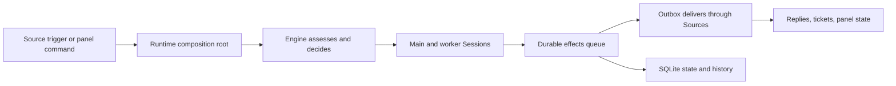

# Application layer (`src/app`)

`src/app` is the application layer of dsh-superagent. It turns the project's domain rules and external Source plugins into one running orchestrator: it opens durable state, creates and decorates the AI sessions, schedules background work, serves the management panel, and sends replies back to people. Read it when you want to follow a message from “arrived from Feishu or GitHub” to “assessed, ticketed, worked on, answered”. The `tools/` and `views/` subdirectories then define what the models may do and what the panel shows.

## Whole-unit functional diagram

<!-- {
  "mermaid_info": {
    "name": "Application layer orchestration flow",
    "nodes": [
      {
        "id": "incoming_001",
        "name": "Source trigger or panel command",
        "path": "",
        "hint": "An incoming message from a Source or a management request",
        "isJumpable": false,
        "position": { "startLine": 0, "endLine": 0 },
        "references": []
      },
      {
        "id": "runtime_002",
        "name": "Runtime composition root",
        "path": "src/app/runtime.ts",
        "hint": "Builds and starts the application collaborators",
        "isJumpable": true,
        "position": { "startLine": 59, "endLine": 166 },
        "references": []
      },
      {
        "id": "engine_003",
        "name": "Engine assesses and decides",
        "path": "src/core/engine.ts",
        "hint": "The domain engine the application layer drives",
        "isJumpable": true,
        "position": { "startLine": 24, "endLine": 24 },
        "references": []
      },
      {
        "id": "sessions_004",
        "name": "Main and worker Sessions",
        "path": "src/app/sessions.ts",
        "hint": "Creates and decorates DSH agents for orchestration and ticket work",
        "isJumpable": true,
        "position": { "startLine": 88, "endLine": 100 },
        "references": []
      },
      {
        "id": "effects_005",
        "name": "Durable effects queue",
        "path": "src/app/effects.ts",
        "hint": "Runs deferred side effects after the transaction that queued them",
        "isJumpable": true,
        "position": { "startLine": 42, "endLine": 74 },
        "references": []
      },
      {
        "id": "outbox_006",
        "name": "Outbox delivers through Sources",
        "path": "src/app/outbox.ts",
        "hint": "Persists receipts and retries channel delivery",
        "isJumpable": true,
        "position": { "startLine": 17, "endLine": 32 },
        "references": []
      },
      {
        "id": "result_007",
        "name": "Replies, tickets, panel state",
        "path": "",
        "hint": "The observable outcomes: sent messages, advanced tickets and panel JSON",
        "isJumpable": false,
        "position": { "startLine": 0, "endLine": 0 },
        "references": []
      },
      {
        "id": "store_008",
        "name": "SQLite state and history",
        "path": "src/app/store.ts",
        "hint": "Durable records, settings history, receipts and effects",
        "isJumpable": true,
        "position": { "startLine": 51, "endLine": 100 },
        "references": []
      }
    ]
  }
} -->

    
        <a target="_self" href="#src/app:1?class=graph" style="color: inherit; text-decoration: none;">Graph: Application layer orchestration flow</a>
    

A Source trigger or a panel command enters the application layer through the runtime. The runtime owns the coordinated pass, which drives the domain engine, the DSH sessions and the durable effect queue; replies leave through the outbox while the store keeps the record that later passes and panel views read.

## At a glance

- **Main role:** Orchestration. `src/app` is the layer that composes the domain engine with durable storage, AI sessions, Source plugins, the management API and background timers, then sequences that work so the right coordinator runs at the right time.
- **Confidence:** High — the composition root explicitly constructs and starts `Store`, `Setup`, `Engine`, `Sessions`, `Effects`, `Outbox`, `Passes`, `Settings`, `Prompts`, tools and HTTP routes as one Cordis service.

## Responsibilities and non-responsibilities

- **Responsible for:** process lifecycle and startup order; durable state and schema migration; serialized background passes; session creation, prompt decoration and tool limits; exactly-once message delivery; candidate assessment; outbound replies; the management HTTP API and its read models; settings, prompts and setup readiness; the scoped context given to Source plugins.
- **Kept elsewhere:** domain decisions and aggregate rules live in `src/core`; platform protocols and Source integrations live in `src/sources`; shell and process mechanics live in `src/executor` and `src/infra`; the web panel UI lives in `src/client`; machine and deployment discovery live in `src/deployment.ts`.

## Important direct children

### `runtime.ts`

Composition root and lifecycle manager: 
<a target="_self" href="#src/app/runtime.ts:59-166?class=code" style="color: inherit; text-decoration: none;">runtime.ts:59-166</a>
 locks the state directory, opens the database, constructs every collaborator, registers the management routes, waits for setup, then starts and stops the background machinery in a safe order.

### `passes.ts`

The heartbeat: 
<a target="_self" href="#src/app/passes.ts:22-68?class=code" style="color: inherit; text-decoration: none;">passes.ts:22-68</a>
 serializes on-demand and periodic passes, kicking due effects first and then asking the Engine to evaluate due work. Sources, tools, settings and HTTP routes request a pass instead of running background work themselves.

### `effects.ts`

The durable work queue: 
<a target="_self" href="#src/app/effects.ts:42-74?class=code" style="color: inherit; text-decoration: none;">effects.ts:42-74</a>
 records side effects inside the caller's database transaction, then dispatches them later with per-kind limits, ordering, retry backoff and health reporting. This is how deferred work survives a restart.

### `store.ts` and `store-read.ts`

Durable memory and read models: 
<a target="_self" href="#src/app/store.ts:51-100?class=code" style="color: inherit; text-decoration: none;">store.ts:51-100</a>
 owns the SQLite schema, transactions, migration, settings history, receipts and typed state; 
<a target="_self" href="#src/app/store-read.ts:6-8?class=code" style="color: inherit; text-decoration: none;">store-read.ts:6-8</a>
 exposes typed query functions so views, tools and Source polling can read without writing SQL.

### `sessions.ts` and `delivery.ts`

AI session life and exactly-once messages: 
<a target="_self" href="#src/app/sessions.ts:88-100?class=code" style="color: inherit; text-decoration: none;">sessions.ts:88-100</a>
 creates and decorates the main and per-ticket worker agents with role models, prompts, skills and restricted tools; 
<a target="_self" href="#src/app/delivery.ts:26-85?class=code" style="color: inherit; text-decoration: none;">delivery.ts:26-85</a>
 assigns stable message IDs and checks live events, persisted history and pending inboxes before sending.

### `assessment.ts`

Proactive candidate assessment: 
<a target="_self" href="#src/app/assessment.ts:48-64?class=code" style="color: inherit; text-decoration: none;">assessment.ts:48-64</a>
 implements the Engine's `Assessor` port by queueing a candidate card for the main Session, serving bounded thread and repository context, and turning the Session's answer into an outcome that policy can verify.

### `outbox.ts`

Reliable replies: 
<a target="_self" href="#src/app/outbox.ts:17-32?class=code" style="color: inherit; text-decoration: none;">outbox.ts:17-32</a>
 turns each outbound message into a persistent receipt and a `reply` effect, preserves per-conversation order, retries temporary channel failures, and settles permanently unreachable targets as dropped.

### `resources.ts`

Paginated context for models: 
<a target="_self" href="#src/app/resources.ts:23-57?class=code" style="color: inherit; text-decoration: none;">resources.ts:23-57</a>
 is the catalogue and router behind `orchestrator_read`; large bodies such as tickets, transcripts, prompt versions and Feishu or GitHub originals stay out of the prompt until a Session asks for one page, and worker access is limited to its own ticket.

### `http.ts`, `api.ts` and `views/`

The management boundary: 
<a target="_self" href="#src/app/api.ts:12-46?class=code" style="color: inherit; text-decoration: none;">api.ts:12-46</a>
 is the type-only table of operations, inputs and responses; 
<a target="_self" href="#src/app/http.ts?class=code" style="color: inherit; text-decoration: none;">http.ts</a>
 gates loopback requests, validates routes and maps results or errors to JSON; 
<a target="_self" href="#src/app/views/views.info.md?class=text" style="color: inherit; text-decoration: none;">views.info.md</a>
 builds the page-shaped read models behind the panel.

### `settings.ts`, `prompts.ts` and `setup.ts`

Configuration and readiness: 
<a target="_self" href="#src/app/settings.ts:76-82?class=code" style="color: inherit; text-decoration: none;">settings.ts:76-82</a>
 is the only write path for settings blocks, with revision checks and panel-only guards; 
<a target="_self" href="#src/app/prompts.ts:13-42?class=code" style="color: inherit; text-decoration: none;">prompts.ts:13-42</a>
 versions role prompts, team sections, skills and built-in overrides; 
<a target="_self" href="#src/app/setup.ts:24-52?class=code" style="color: inherit; text-decoration: none;">setup.ts:24-52</a>
 probes the deployment, writes worker command shims and environment settings, and reports whether the orchestrator may start.

### `source-context.ts` and `tools/`

The boundaries for Source plugins and model actions: 
<a target="_self" href="#src/app/source-context.ts:29-33?class=code" style="color: inherit; text-decoration: none;">source-context.ts:29-33</a>
 exposes only the reads and writes one Source kind may use, instead of the whole Store or Engine; 
<a target="_self" href="#src/app/tools/tools.info.md?class=text" style="color: inherit; text-decoration: none;">tools.info.md</a>
 defines the actual main-Session and worker-Session tool suites.

The remaining files are focused helpers rather than separate layers: `cards.ts` shapes the bounded model-facing cards, `notices.ts` and `links.ts` build background messages and candidate cards, `versions.ts`, `settings-history.ts` and `migration.ts` handle configuration history and schema upgrade, `cache.ts` keeps bounded in-memory text, and `retry-health.ts`, `role-models.ts`, `execution-environment.ts`, `context.ts` and `skill-files.ts` cover model waits, role model seeding, worker environment and packaged prompt assets.

## How the children work together

The layer behaves like a loop rather than a single request handler. A Source plugin records an incoming message and asks for a pass; `Passes` serializes that request, lets `Effects` start whatever deferred work is due, and then asks the `Engine` to assess candidates, resume waiting tickets and expire overdue work. `Engine` is the decision-maker, but it reaches the outside world through the application layer's ports: `MasterAssessor` for candidate judgement, the executor and `Sessions` for model work, `Store` for records, and `Outbox` for replies.

The same state is then read through other faces of the directory. `http.ts` and `views/` turn stored records into panel JSON, `settings.ts` and `prompts.ts` change future behaviour through versioned writes, and `source-context.ts` lets Source plugins contribute triggers and health without bypassing the application's rules.

## Coordinated flow

1. **Intake.** A Source converts a platform message into a `Trigger` and calls the runtime's receive path. `Passes.receive` hands it to the `Engine` and requests a pass; a panel request can also trigger an action or a pass.
2. **Coordinated pass.** `Passes` keeps work serialized: it kicks due `Effects`, then calls `Engine.evaluateDue()` so candidates, waiting tickets and overdue work advance in one consistent step.
3. **Model work.** `MasterAssessor` gives the main Session a bounded candidate card, with context reads provided on demand. `Sessions` makes sure that message is delivered once and exposes only the prompt, skills and tools for that role. Accepted work becomes a ticket, and the executor launches a worker Session for it.
4. **Durable result.** `Engine` records decisions and queues effects for launches, deliveries, relays, notices and replies. `Effects` runs them later, `Outbox` sends replies through the installed Source, and `http.ts` with `views/` exposes the resulting state to the panel.

### Important branching or concurrency

- `Passes` coalesces concurrent requests into at most one running pass plus one follow-up pass.
- `Effects` honours per-kind limits and ordering; failures retry with backoff, and ordered kinds can hold later rows behind an earlier one.
- Processing can be paused or blocked on setup. Sources still record incoming triggers, but assessments, worker dispatch and outbound delivery wait.
- Session delivery is deduplicated across live events, persisted history and pending inboxes. Outbound messages keep per-conversation order until an earlier message fails repeatedly.

## Public contract

- **Caller:** The management panel and helper scripts such as the status command use the HTTP routes mounted under `/orchestrator/api/`.
- **Operation:** The typed table includes state and overview reads, search, sources, settings, threads, triggers, decisions, tickets, executor pause, policy history and sync, setup checks, models and prompt management.
- **Accepted input:** Query parameters and JSON bodies, including page offsets and limits. Settings and prompt saves must carry the revision they were based on; account and execution-environment fields are restricted to panel-origin saves.
- **Result:** Typed JSON matching `api.ts`, or a structured error: `400` for malformed or invalid input, `404` for a missing record, `409` for a stale settings or prompt revision, and `500` for an unexpected failure.

### Access or validation requirements

Requests are accepted only from the loopback host with the panel's same-origin marker header. Request bodies are bounded, and route inputs are validated before they reach the store or Engine.

## Configurable behavior

- **Controls:** Processing pause, evaluation mode and role model, executor limits and command environment, policy rules, Source instance configuration, and the prompt and skill configuration.
- **Value source:** Stored settings blocks and numbered prompt records in SQLite, with built-in defaults coming from code and packaged Markdown assets.
- **Takes effect:** A settings save validates against the current revision, writes a new history entry, notifies the main Session and requests a pass. Changes to setup-read account or command fields ask setup to run again and may restart the orchestrator. Prompt saves create the next numbered revision and notify the main Session when the change did not come from its own tool call.

### Common adjustment

`eval.model` and `executor.model` choose the role model used when a new Session is created. Saving one checks that the live provider can serve the provider/model pair; a bad pair is rejected instead of leaving a Session unable to start.

## Stored state lifecycle

- **Stores:** Domain records for triggers, dispositions, threads, tickets and decisions; outbox receipts; queued effects; saved settings and their history; numbered prompt versions; and general typed key-value state.
- **Read path:** The Engine reads and writes through `Store`; views, tools and Source polling use the typed read queries in `store-read.ts`.
- **Write path:** Engine changes normally run inside `Store.atomic`. `Outbox` and `Effects` add their own rows, settings and prompts write versioned records, and Source plugins use the scoped state helpers.
- **Visible result:** Restarts can resume work from the same records, the panel can show configuration history, replies can be retried without duplication, and queued effects remain until they run or are cancelled.

### Important persistence behavior

The database runs in WAL mode with restrictive file permissions, and the state directory is locked before SQLite is opened so two processes cannot migrate or write concurrently. The current schema is version 11; a supported schema 10 database is converted once at startup. `TextCache` is only an in-memory convenience for paginated snapshots and resolved links, so it is not part of the durable record.

## Recommended starting points

1. `runtime.ts` — read this first to see every collaborator and the startup order that connects them.
2. `passes.ts` and `effects.ts` — continue here to understand how background work is scheduled, serialized and retried.
3. `sessions.ts` and `delivery.ts` — then look at how the main and worker agents are created, decorated and messaged exactly once.
4. `http.ts`, `api.ts` and `views/` — finally, follow how the panel reads and changes the running orchestrator.

---
name: app

update-time: 2026-11-02 11:56

description: `src/app` is the application layer of dsh-superagent. It turns the project's domain rules and external Source plugins into one running orchestrator: it opens durable state, creates and decorates the AI sessions, schedules background work, serves the management panel, and sends replies back to people. Read it when you want to follow a message from “arrived from Feishu or GitHub” to “assessed, ticketed, worked on, answered”. The `tools/` and `views/` subdirectories then define what the models may do and what the panel shows.

---
