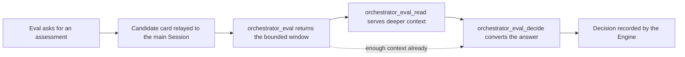

# assessment.ts

This file is where a proactive candidate — a message the system thinks may be asking for work — is handed to the main Session and turned into a recorded decision. It implements the `Assessor` port that the core `Engine` depends on: it queues the delivery of a candidate card, serves bounded thread and repository context while the Session thinks about it, and converts the Session's answer into an `AssessmentOutcome` that policy then verifies. Read it when you want to understand what the `orchestrator_eval`, `orchestrator_eval_read` and `orchestrator_eval_decide` tools actually do behind the scenes.

## Whole-unit functional diagram

The left half is delivery: the Engine asks for an assessment and the assessor relays a card, which starts the evaluation deadline. The middle is reading: the Session is given one bounded window and can then fetch individual messages, thread pages, images, files or directories. The right end is the recorded decision, which the Engine — not this file — owns.

## At a glance

- **Primary role — orchestration**: the file coordinates several collaborators (Engine, effect queue, Sessions delivery, Source thread context, Policy conversion) in one ordered path from "a candidate exists" to "a decision exists".
- **Secondary role — API boundary**: it defines the accepted input of the three assessment tools, including the read request grammar and the assessment answer shape, so callers get precise, guided validation errors.
- **Secondary role — state storage**: it keeps an in-memory per-evaluation read cache (messages, images, snapshots, cursors) that lives only as long as the evaluation does.
- **Confidence**: High — the whole file was read, together with the `Assessor`/`Candidate` ports, the effect queue handler signature, the tool wiring and the policy conversion it calls.

## What this file does

- Exposes the `MasterAssessor` class, the single implementation of the core `Assessor` port used by the running application.
- Registers the durable `assessment` effect handler that delivers one candidate card per evaluation, with a concurrency limit of four and zero while processing is paused.
- Produces the `orchestrator_eval` payload: the trigger's own text, batch peers, related tickets, the policy version the evaluation was built from, and an initial bounded thread window.
- Serves follow-up reads for a running evaluation — full messages, thread pages by cursor, images as attachments, and repository files or directories — with character-level pagination.
- Converts the main Session's assessment into an `AssessmentOutcome` under current settings, checks the acknowledgement text, and passes it to `Engine.decide` for policy verification.
- Maps a "no active evaluation" or "this is an explicit request" situation into clear errors so the Session knows to route instead of assess.

## Coordinated flow

1. **The Engine asks for judgement.** `request` enqueues an `assessment` effect keyed by the evaluation ID, carrying the first trigger of the candidate. Nothing is delivered yet; the effect queue owns retries and ordering.
2. **The candidate card reaches the main Session.** The constructor-registered handler looks up the live candidate, drops the delivery if the evaluation has since been replaced, builds the card through the host's `candidateCard`, and delivers it once per evaluation. Only after delivery does `candidateDelivered` start the evaluation deadline, so a busy Session does not consume its own thinking time.
3. **The Session reads bounded facts.** `context` loads the initial thread window once per evaluation (through the Source's `TriggerContext` and the admission-context reader) and prepares a compact payload; `read` then serves any message, stub, thread page, image, file or directory the Session asks for, always scoped to that trigger ID.
4. **The answer becomes a decision.** `decide` validates the assessment against the enabled rules through `assessmentOutcome`, downgrades unclear acceptances per policy, and hands the outcome to `Engine.decide`. The caller receives the resulting state, an optional ticket ID, and a readable reason.

### Important branching and concurrency

Two behaviours change what a Session observes. `org.orchestrator`-style explicit requests are refused with the instruction to route instead, because routing is not assessment. And the initial window is loaded at most once per evaluation: concurrent callers share a single in-flight load, the load is guarded against the evaluation ending or being replaced mid-flight, and a failure is cached as a readable "context unavailable" hint rather than retried on every read.

## Key functions or classes

### `MasterAssessor`

The whole unit's implementation of the `Assessor` port: delivery, context and reads, and decision conversion.

    
        <a target="_self" href="#src/app/assessment.ts:89-282?class=code" style="color: inherit; text-decoration: none;">Code: src/app/assessment.ts:89-282</a>
    

### `AssessorHost`

The dependencies the assessor is given: the Engine's candidate/decide surface, the command runner, deployment limits, the effect queue, settings, pause state, the Source's thread context, and the two delivery callbacks.

    
        <a target="_self" href="#src/app/assessment.ts:49-64?class=code" style="color: inherit; text-decoration: none;">Code: src/app/assessment.ts:49-64</a>
    

### `AssessmentSchema`

The answer the main Session must give: a decision, one assessment per enabled rule, a direction, title, optional worktree name, scope, and reason — with a cross-field rule that accepted work needs a short English worktree name when direction is settled.

    
        <a target="_self" href="#src/app/assessment.ts:21-34?class=code" style="color: inherit; text-decoration: none;">Code: src/app/assessment.ts:21-34</a>
    

### `EvalReadSchema`

The read request grammar, with per-field guidance and cross-field checks that keep `path`, `message_id`, `cursor` and `image_id` attached to the resource that uses them.

    
        <a target="_self" href="#src/app/assessment.ts:67-82?class=code" style="color: inherit; text-decoration: none;">Code: src/app/assessment.ts:67-82</a>
    

### `request`

Queues the `assessment` effect that will deliver a candidate card to the main Session.

    
        <a target="_self" href="#src/app/assessment.ts:104?class=code" style="color: inherit; text-decoration: none;">Code: src/app/assessment.ts:104</a>
    

### `context`

Builds the `orchestrator_eval` payload: source and actor facts, capped trigger text, batch peers, related tickets, the policy version, and the truncated initial thread window with image IDs and a continuation cursor.

    
        <a target="_self" href="#src/app/assessment.ts:183-220?class=code" style="color: inherit; text-decoration: none;">Code: src/app/assessment.ts:183-220</a>
    

### `read`

Serves one bounded, paginated read from the evaluation's cached thread context or from the repository, returning images as attachments to the main Session.

    
        <a target="_self" href="#src/app/assessment.ts:225-270?class=code" style="color: inherit; text-decoration: none;">Code: src/app/assessment.ts:225-270</a>
    

### `decide`

Turns the validated assessment into an outcome under current settings and candidate strength, then records it through the Engine and returns the resulting state, ticket and reason.

    
        <a target="_self" href="#src/app/assessment.ts:272-279?class=code" style="color: inherit; text-decoration: none;">Code: src/app/assessment.ts:272-279</a>
    

## Public contract

- **Callers**: the main Session's tools (`orchestrator_eval`, `orchestrator_eval_read`, `orchestrator_eval_decide`), plus the core `Engine`, which calls `request`, `release` and `stop` through the `Assessor` port.
- **Operations**: `request(candidate)` queues delivery; `context(triggerId)` returns the first payload; `read(agent, read, signal)` returns one more piece of context; `decide(triggerId, assessment)` records the decision.
- **Accepted input**: every operation is scoped to a `trigger_id` that still names an active evaluation. Reads additionally require a `resource` (`message`, `root`, `parent`, `thread`, `file`, `directory`, `image`), the matching optional field, and an `offset` for pagination. The assessment must decide once, judge every enabled rule exactly once, and supply a direction.
- **Result**: a JSON payload for `context`, a text page or an image attachment for `read`, and `{ state, ticket_id?, reason }` for `decide`.

### Access and validation requirements

Validation is designed to teach correct usage rather than just reject input: mismatched fields produce a hint naming the right resource, an unknown message or cursor asks the caller to read the root, parent or thread first, and offset pages must start at offset 0. Reads attempted after an evaluation has finished, timed out or been replaced fail with a message explaining that the assessment is over, and explicit requests are redirected to routing.

## Stored state lifecycle

- **Stores**: an in-memory map of per-evaluation read caches — message texts, image references, generated snapshots keyed by the read arguments, and the set of valid thread cursors — plus the loaded thread window or its error.
- **Read path**: created on the first `context` or `read` for a live evaluation, seeded with the trigger's own message and every image it references, then extended as further messages, thread pages and reads arrive.
- **Write path**: `release(evalId)` is called whenever an evaluation ends, and `stop()` aborts in-flight context and repository commands when the runtime shuts down.
- **Visible result**: repeated reads reuse the same cached text, so a Session cannot fetch a different version of a message by asking twice, and finished evaluations leave nothing behind.

Nothing here is persisted: the cache is rebuilt on demand, including after a host restart, and a stale evaluation immediately refuses new reads instead of serving them from memory.

## Main inputs and results

- **Inputs**: a `Candidate` from the Engine, the main Session's tool calls for context, reads and decisions, the current `Settings`, the pause flag, the Source's `TriggerContext`, and deployment limits for context timeout and page count.
- **Results**: the `orchestrator_eval` payload, paginated text or image attachments from `orchestrator_eval_read`, and the `{ state, ticket_id?, reason }` object that the decision tool reports back into the Session.
- **Visible side effects**: the candidate card appears in the main Session exactly once per evaluation (with a link lookup that may delay it), and the recorded decision becomes an `accept`, `ignore`, `unavailable` or `stop` outcome that the Engine carries forward — for an accept, a ticket with the requested title, scope and short worktree name.

---
name: assessment.ts

update-time: 2026-11-02 10:24

description: This file is where a proactive candidate — a message the system thinks may be asking for work — is handed to the main Session and turned into a recorded decision. It implements the `Assessor` port that the core `Engine` depends on: it queues the delivery of a candidate card, serves bounded thread and repository context while the Session thinks about it, and converts the Session's answer into an `AssessmentOutcome` that policy then verifies. Read it when you want to understand what the `orchestrator_eval`, `orchestrator_eval_read` and `orchestrator_eval_decide` tools actually do behind the scenes.

---
