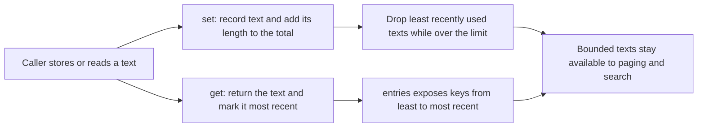

# cache.ts

`cache.ts` holds one small class, `TextCache`, that keeps a limited amount of text in memory for the orchestrator process. Its budget is measured in UTF-16 code units rather than entry count, and when the budget is exceeded it drops the least recently used texts first — but it never drops the entry that was just written. The runtime uses separate instances of it to keep paginated resource snapshots readable and to remember resolved Feishu message links so search can match them later.

## Whole-unit functional diagram

The main path is a two-way contract: writes add text and enforce the size budget, reads return text and refresh its recency, and both flows feed the same bounded store that other parts of the app read back. Eviction is deliberately proportional to total characters, so a few very large snapshots shrink the number of retained entries instead of growing memory without limit.

<!-- {
  "mermaid_info": {
    "name": "TextCache store, read and eviction flow",
    "nodes": [
      {
        "id": "request_001",
        "name": "Caller stores or reads a text",
        "path": "",
        "hint": "An abstract entry point: any caller asking the cache to keep or return text",
        "isJumpable": false,
        "position": { "startLine": 0, "endLine": 0 },
        "references": []
      },
      {
        "id": "store_002",
        "name": "set: record text and add its length to the total",
        "path": "src/app/cache.ts",
        "hint": "Stores the text under the key, replacing any earlier value, and keeps the running size total",
        "isJumpable": true,
        "position": { "startLine": 14, "endLine": 18 },
        "references": []
      },
      {
        "id": "read_003",
        "name": "get: return the text and mark it most recent",
        "path": "src/app/cache.ts",
        "hint": "Returns the stored text or undefined, and re-inserts it so recency order reflects the read",
        "isJumpable": true,
        "position": { "startLine": 9, "endLine": 13 },
        "references": []
      },
      {
        "id": "evict_004",
        "name": "Drop least recently used texts while over the limit",
        "path": "src/app/cache.ts",
        "hint": "Iterates from the oldest entry and removes entries until the total fits, skipping the key just set",
        "isJumpable": true,
        "position": { "startLine": 19, "endLine": 23 },
        "references": []
      },
      {
        "id": "order_005",
        "name": "entries exposes keys from least to most recent",
        "path": "src/app/cache.ts",
        "hint": "Read-only iterator over key and text pairs in recency order",
        "isJumpable": true,
        "position": { "startLine": 25, "endLine": 26 },
        "references": []
      },
      {
        "id": "reuse_006",
        "name": "Bounded texts stay available to paging and search",
        "path": "",
        "hint": "The abstract outcome: callers reuse retained text without refetching it",
        "isJumpable": false,
        "position": { "startLine": 0, "endLine": 0 },
        "references": []
      }
    ]
  }
} -->

    
        <a target="_self" href="#src/app/cache.ts:1?class=graph" style="color: inherit; text-decoration: none;">Graph: TextCache store, read and eviction flow</a>
    

## At a glance

- Primary role: Cache state. The file owns a retained in-memory store, decides what is kept, and defines how that stored text is read and replaced.
- Confidence: High — the whole file (28 lines) was read, together with its test and every call site that constructs or consumes it.

## What this file does

- **Caps memory by characters, not by entry count.** The constructor takes a `limit`, and the class tracks the number of UTF-16 code units it currently holds. Two callers therefore pick two very different budgets: 200,000 for Feishu links and 4,000,000 for paginated resource snapshots.
- **Keeps the most recently used texts.** A successful `get` moves that key to the newest position, and a `set` moves the key to the newest position as well, so recent reads survive while stale ones are the ones dropped.
- **Never evicts the entry just written.** Eviction walks from the oldest entry and stops before the key that was just stored, so even a single text larger than the whole limit remains retrievable until something else replaces it.
- **Replaces values without double counting.** Setting the same key twice subtracts the old length before adding the new one, so the running total stays accurate.
- **Exposes recency order for read-only consumers.** `entries()` yields key/text pairs from least to most recent, which lets a caller scan everything cached — for example, search matches a Feishu AppLink URL and then derives the message ID from the key.
- **Keeps instances independent.** Nothing is shared or global: each instance has its own budget and contents, so a large resource cache cannot crowd out the link cache.

## Key functions or classes

### `TextCache`

One class with a fixed-size text store behind it; every consumer either creates an instance or accepts a narrow `Pick` of it.

### `constructor(limit)`

Takes the character budget for that instance, so callers choose between a small link cache and a large page cache.

### `get(key)`

Returns the cached text or `undefined`, and refreshes recency when a hit occurs.

### `set(key, text)`

Stores or replaces text and then enforces the budget by dropping the oldest entries.

### `entries()`

Provides a read-only, recency-ordered iterator used for lookups such as URL matching in search.

Two files show how the class is meant to be used: the paging path around 
<a target="_self" href="#src/app/resources.ts:103-110?class=code" style="color: inherit; text-decoration: none;">resources.ts:103-110</a>
 and the link path around 
<a target="_self" href="#src/app/links.ts:21-40?class=code" style="color: inherit; text-decoration: none;">links.ts:21-40</a>
.

## Main inputs and results

- Inputs: a numeric `limit` per instance, a string key chosen by the caller (composite keys such as `sessionId:resource` or `chatId:messageId` are the norm), and the text to retain.
- Results: `get` returns the cached string or `undefined`; `set` returns nothing and silently enforces the budget; `entries` yields key/text pairs ordered from least to most recently used.
- Visible side effects: retained text lives only in process memory, and both the resource and link caches are per-instance, so process lifetime is the effective retention period.

## Stored state lifecycle

- Stores: a map of keys to text plus a running total of characters, held entirely in memory for one `TextCache` instance.
- Read path: `orchestrator_read` serving an offset greater than 0 for a source resource reads the snapshot stored at offset 0 for that session; `sourceLink` checks the link cache before calling Feishu; search scans `entries()` to recognize a previously resolved AppLink URL.
- Write path: a successful offset-0 fetch of a Feishu or GitHub resource stores the serialized body, and a successful Feishu link resolution stores the URL under its chat and message key.
- Visible result: a Session can page through a large original record without refetching it, and link-based search finds a trigger whose Feishu URL has been resolved during the current run.

### Important persistence behavior

Nothing here is durable. The architecture notes record the consequences plainly: after a restart the resource cache is empty so a Session must reread offset 0 before paging further, and link search only matches a message once that link has been read in the current process lifetime (see 
<a target="_self" href="#docs/007-architecture.md?class=text" style="color: inherit; text-decoration: none;">007-architecture.md</a>
). The eviction rule itself is verified by 
<a target="_self" href="#tests/cache.spec.ts:4-16?class=code" style="color: inherit; text-decoration: none;">cache.spec.ts:4-16</a>
: reading a key demotes the other entry, and a text that exceeds the limit on its own is still kept. A limit of `0` therefore means only the just-written entry is retained, which some runtime tests rely on to force fresh fetches.

---
name: cache.ts

update-time: 2026-11-02 10:23

description: `cache.ts` holds one small class, `TextCache`, that keeps a limited amount of text in memory for the orchestrator process. Its budget is measured in UTF-16 code units rather than entry count, and when the budget is exceeded it drops the least recently used texts first — but it never drops the entry that was just written. The runtime uses separate instances of it to keep paginated resource snapshots readable and to remember resolved Feishu message links so search can match them later.

---
