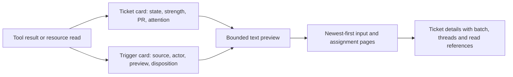

# cards.ts

`src/app/cards.ts` turns internal records — triggers, tickets, threads and decisions — into small, bounded JSON cards that a model actually reads in tool results and resource output. Every card keeps the long bodies out of the prompt: it shows a whitespace-collapsed preview, a character count, and a `read:` reference such as `ticket/<id>` or `trigger/<id>` that the reader can open later. The file is the single place where field names, preview lengths and page sizes for that machine-facing view are decided, which is why the resource router, the main tools, notices and assessment all spread its output into their own replies.

## Whole-unit functional diagram

<!-- {
  "mermaid_info": {
    "name": "Card projection flow",
    "nodes": [
      {
        "id": "read_001",
        "name": "Tool result or resource read",
        "path": "",
        "hint": "Abstract entry: a session asks for ticket, trigger, thread or decision context",
        "isJumpable": false,
        "position": { "startLine": 0, "endLine": 0 },
        "references": []
      },
      {
        "id": "ticket_002",
        "name": "Ticket card: state, strength, PR, attention",
        "path": "src/app/cards.ts",
        "hint": "ticketCard and cardState build the short ticket view",
        "isJumpable": true,
        "position": { "startLine": 26, "endLine": 33 },
        "references": []
      },
      {
        "id": "trigger_003",
        "name": "Trigger card: source, actor, preview, disposition",
        "path": "src/app/cards.ts",
        "hint": "triggerCard with an optional delivery disposition",
        "isJumpable": true,
        "position": { "startLine": 9, "endLine": 15 },
        "references": []
      },
      {
        "id": "text_004",
        "name": "Bounded text preview",
        "path": "src/app/cards.ts",
        "hint": "preview collapses whitespace and truncates to 160 characters",
        "isJumpable": true,
        "position": { "startLine": 8, "endLine": 8 },
        "references": []
      },
      {
        "id": "page_005",
        "name": "Newest-first input and assignment pages",
        "path": "src/app/cards.ts",
        "hint": "newestPage slices recent items and hints the next page",
        "isJumpable": true,
        "position": { "startLine": 53, "endLine": 57 },
        "references": []
      },
      {
        "id": "details_006",
        "name": "Ticket details with batch, threads and read references",
        "path": "src/app/cards.ts",
        "hint": "ticketDetails merges the card with threads, batch and first pages",
        "isJumpable": true,
        "position": { "startLine": 60, "endLine": 69 },
        "references": []
      }
    ]
  }
} -->

    
        <a target="_self" href="#src/app/cards.ts:1?class=graph" style="color: inherit; text-decoration: none;">Graph: Card projection flow</a>
    

A caller hands in domain state from `src/core`, the matching card builder picks the fields worth showing, long text becomes a fixed-size preview, and long lists become newest-first pages. The result is a compact object that still tells the reader where to open the untouched original.

## At a glance

- **Primary role — presentation**: this file decides what a session sees about a ticket, trigger, thread or decision, including which words survive truncation and which references replace a full body.
- **Secondary role — data contract**: the emitted snake_case keys (`ticket_id`, `state`, `read`, `next_offset`, `undelivered`) are a stable payload shape; other modules merge their own fields into it, and exact key sets are pinned by `tests/cards.spec.ts`.
- **Confidence**: High — the file is short and read in full, its consumers were verified in `resources.ts`, `tools/main.ts`, `links.ts`, `notices.ts` and `assessment.ts`, and its output is asserted by dedicated tests.

## What this file does

- **Builds compact cards** for triggers, tickets, threads and decisions, each ending in a `read:` path to the full text instead of carrying it along.
- **Names a ticket's state from a closed vocabulary.** `TICKET_STATES` lists every value a card may show: an open ticket's stage (`person/delivery`, `person/answer`, `person/review`, `person/blocked`, `person/failed`, `working`, `working/queued`, `idle`) and an ended ticket's outcome (`completed`, `merged`, `closed`, `dropped`, `stopped`). `cardState` derives that value from the shared stage rules in `stage.ts`; an ended ticket simply reports how it ended.
- **Bounds what a reader receives.** Previews stop at 160 characters, an inline input text is shown only up to 80 characters, and a ticket detail carries at most 10 inputs and 3 assignments, each with the next page's resource name and offset.
- **Protects worker Sessions from decisions.** When a Session works on one ticket, `ticketDetails` and `inputLine` leave out decision IDs, so a worker never learns which other decisions exist.
- **Summarizes neighbours of a request.** `relatedTickets` orders the tickets a candidate or assessment touches — open tickets first, newest first — and caps the list at 8 with a total count.
- **Keeps long bodies pageable.** `textPage` returns a slice plus `total_chars` and the next offset, so concatenating pages rebuilds the exact original string.

## What the reader of a card experiences

- **Presents**: one flat object per record with snake_case keys, a single-line preview, a `chars` count showing how much text was left out, the field `read` naming the full body, and — for ticket details — the batch of triggers, subscribed threads, worktree directory, scope and requesting actor.
- **Interaction**: the reader follows references rather than scrolling. `read:` opens a whole trigger, ticket, thread, decision, assignment report or input; `next_resource` plus `next_offset` opens the next page of a long list; `textPage` returns offsets to continue from.
- **Prepared data**: the builders expect already-resolved domain values — a `Ticket` with its latest assignment report, mandate and attention, a `Trigger` with its threads and source, an optional `TriggerDisposition`, and, for `ticketDetails`, the subscribed thread list and the trigger batch gathered by the caller.

### Important states a ticket card can show

A card's `state` is the fastest signal a reader gets, and it is always exactly one value from `TICKET_STATES`. A failed input delivery shows `person/delivery`, a pending question shows `person/answer`, a ready report waits as `person/review`, blocked or failed reports surface as `person/blocked` or `person/failed`, a queued assignment reads `working/queued`, and an idle worker reads `idle`. The card additionally exposes the ended summary (`at`, `by`, and reason or outcome), the current `attention` question with the trigger that asked it, and `pr_number` when the ticket follows a GitHub pull request.

## Key functions or classes

### `preview`

Flattens runs of whitespace and truncates to 160 characters, deliberately leaving backticks, angle brackets and Markdown link targets readable for a model.

<a target="_self" href="#src/app/cards.ts:8?class=code" style="color: inherit; text-decoration: none;">cards.ts:8</a>

### `triggerCard`

Describes one incoming trigger — source, actor, thread key, human flag, preview and character count — and, when a disposition is passed, where it was delivered, which decision took it, and why it was filtered.

<a target="_self" href="#src/app/cards.ts:9-15?class=code" style="color: inherit; text-decoration: none;">cards.ts:9-15</a>

### `ticketCard`

The short ticket view: id, title, state, mandate strength, pull-request number, ended summary, open attention question and a preview of the latest report.

<a target="_self" href="#src/app/cards.ts:26-33?class=code" style="color: inherit; text-decoration: none;">cards.ts:26-33</a>

### `ticketDetails`

Extends the card with the origin trigger, the trigger batch, threads, scope, requester and the first pages of assignments and inputs, plus read paths for the assignment text, the latest result and the transcript; it drops the card preview because the newest report is already previewed on the first assignment entry.

<a target="_self" href="#src/app/cards.ts:60-69?class=code" style="color: inherit; text-decoration: none;">cards.ts:60-69</a>

### `inputLine`

Summarizes one input: a short text inline, anything longer as preview plus character count and a read path, a trigger or resumed input as its trigger id, and a reopen input by its decision id only for non-worker readers; `undelivered: true` marks input that never reached the worker.

<a target="_self" href="#src/app/cards.ts:39-47?class=code" style="color: inherit; text-decoration: none;">cards.ts:39-47</a>

### `newestPage`

Returns the newest `size` items from an offset, mapping each through a line builder, and adds `next_resource` and `next_offset` only while more items remain.

<a target="_self" href="#src/app/cards.ts:53-57?class=code" style="color: inherit; text-decoration: none;">cards.ts:53-57</a>

### `threadCard`

Summarizes a subscribed thread: key, human label, source, its ticket ids, the running assessment window, pending trigger count, and any polling error or link.

<a target="_self" href="#src/app/cards.ts:71-77?class=code" style="color: inherit; text-decoration: none;">cards.ts:71-77</a>

### `textPage`

Slices long text by UTF-16 code units so that concatenated pages reconstruct the exact string, reporting `resource`, `offset`, `total_chars` and a `next_offset` or `null`.

<a target="_self" href="#src/app/cards.ts:89-92?class=code" style="color: inherit; text-decoration: none;">cards.ts:89-92</a>

## Information contract

- **Represents**: the model-facing form of a trigger, ticket, thread or decision — enough identity, state and short text to decide what to do, plus references to everything else.
- **Produced by**: the exported builders in this file, fed with `Ticket`, `Trigger`, `Thread`, `Decision` and `TicketInput` values from `src/core`, the pull-request lookup from `src/sources/github-pull.ts`, and the batch/input helpers from `src/executor/dsh.ts`.
- **Consumed by**: the resource router builds the `tickets`, `ticket/<id>`, `trigger/<id>` and paged assignment/input responses from these cards; main tools attach `ticketCard` to their results; notices, link building and assessment reuse `ticketCard` and `relatedTickets`; `context.ts` re-exports `textPage` for its own paged output. Callers typically spread the card into a larger object and may strip fields they replace — see `resources.ts` removing a trigger's preview when the full text follows.
- **Behavior-shaping parts**: `state` is the reader's single summary of a ticket and is restricted to `TICKET_STATES`; the `worker` flag silently removes decision IDs, so a worker's payload is not a subset by accident but by design; `chars` versus preview length tells the reader whether it has seen the whole text; the presence of `next_resource`/`next_offset` means more pages exist; `undelivered` marks input the worker never received; and internal hashes such as a mandate's `policyVersion` are stripped because nobody queries by them.

### Compatibility notes

Cards are additive by convention: optional details (pull-request number, `ended`, `attention`, `error`, `url`, page hints) appear only when the underlying data exists, so a reader must treat them as optional, while tests pin the exact key sets for the common cases.

## Main inputs and results

- **Inputs**: domain records from `src/core` — `Ticket` (with mandate, assignments, inputs, origin, optional attention/delivery/ended), `Trigger` with an optional `TriggerDisposition`, `Thread`, `Decision`, `TicketInput` — plus caller-supplied context such as the subscribed `TicketThread` list, the trigger batch, a `worker` flag, and offset/limit values for paging.
- **Results**: plain JSON-shaped objects with snake_case keys and at least one `read` reference; page objects holding `items` plus optional `next_resource`/`next_offset`; and `textPage` slices carrying `total_chars` and the next offset.
- **Visible side effects**: none — every function here is a pure projection that copies lists before reversing or sorting, writes no state, and only reshapes data for a reader.

---
name: cards.ts

update-time: 2026-11-02 10:26

description: `src/app/cards.ts` turns internal records — triggers, tickets, threads and decisions — into small, bounded JSON cards that a model actually reads in tool results and resource output. Every card keeps the long bodies out of the prompt: it shows a whitespace-collapsed preview, a character count, and a `read:` reference such as `ticket/<id>` or `trigger/<id>` that the reader can open later. The file is the single place where field names, preview lengths and page sizes for that machine-facing view are decided, which is why the resource router, the main tools, notices and assessment all spread its output into their own replies.

---
