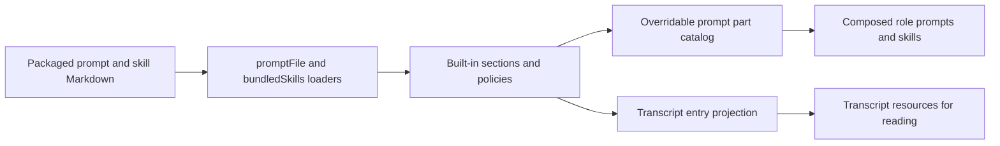

# context.ts

This file is the single place where `dsh-superagent` collects the built-in instruction text that its two agent roles — the orchestrator and the worker — receive. It reads packaged Markdown prompt files, groups them into the sections the prompt composer expects, supplies the default text for team-editable sections, and provides one small projection that trims Session events down to what a transcript reader should see. A new contributor can read this file to learn *what the agents are told by default* and which parts of that text a team is allowed to replace.

## Whole-unit functional diagram

The left side of the flow is the prompt path: shipped Markdown becomes named text sections, which `prompts.ts` registers as overridable parts and assembles into each role's system prompt. The lower branch is unrelated to prompting in the narrow sense: the same file also exports the projection used when a Session transcript is turned into readable resource pages.

## At a glance

- **Primary role**: Configuration — the file resolves built-in default text and role policies that determine agent behavior, and marks which of them a team may override.
- **Secondary role**: Utility — a small, focused projection helper decides which Session events become transcript entries.
- **Confidence**: High — every export is read directly and each consumer was checked in `prompts.ts`, `http.ts`, `migration.ts`, `assessment.ts`, and `resources.ts`.

## What this file does

- Loads the three role instruction texts (`shared`, `orchestrator`, `worker`), so both roles start from the same host rules and then diverge by role.
- Groups the smaller policy sections — subscriptions, replies, dispatch, and work — into a lookup that the prompt composer addresses by name and by role.
- Publishes the two bundled Source skills (`feishu`, `github`) together with the shared CLI usage note that is appended to each skill text.
- Holds the default text for the team-writable sections (`communication`, `scope`, `delivery`), which is what a team reads until it saves its own wording.
- Composes the orchestrator-only admission policy and a handoff policy that is built as shared text plus one role-specific paragraph.
- Supplies the model-facing transcript projection and re-exports the text-paging helper used by assessment reads.

Related sources: 
<a target="_self" href="#src/app/skill-files.ts:1-33?class=code" style="color: inherit; text-decoration: none;">skill-files.ts:1-33</a>
 reads the Markdown, 
<a target="_self" href="#src/app/prompts.ts:55-70?class=code" style="color: inherit; text-decoration: none;">prompts.ts:55-70</a>
 turns these texts into the overridable part catalog, and 
<a target="_self" href="#src/app/resources.ts:283-289?class=code" style="color: inherit; text-decoration: none;">resources.ts:283-289</a>
 uses the transcript projection.

## Key functions or classes

### `sharedPrompt`, `masterPrompt`, `workerPrompt`

The three top-level instruction texts: rules shared by all Sessions, the orchestrator's own prompt, and the worker's own prompt.

### `guides`

Subscription, reply, dispatch, and work policy sections, keyed by name so the composer can pick the ones a given role reads.

### `sourceSkills` and `cliNotes`

The content of the bundled `feishu` and `github` skills, plus the CLI note that the prompt composer appends under each skill's usage heading.

### `teamDefaults`

The starting wording for the communication, scope, and delivery sections that a team edits; it is also the base that migration rewrites when a delivery setting changes.

### `mainAdmissionPolicy`

The admission rules only the orchestrator receives, deciding how proactive candidates are judged.

### `handoffPolicy`

Returns the handoff guidance for a role by joining the shared handoff text with that role's paragraph, so callers never assemble it themselves.

    
        <a target="_self" href="#src/app/context.ts:23-24?class=code" style="color: inherit; text-decoration: none;">Code: src/app/context.ts:23-24</a>
    

### `autoMergeThreshold`

Renders the single sentence about how small a change may be for automatic merging, so the delivery template and the migration path describe the same rule with different limits.

### `transcriptEntry`

Reduces one Session event to a transcript entry — its type plus the message role and non-reasoning content — or returns nothing for events that should not appear in a transcript.

    
        <a target="_self" href="#src/app/context.ts:29-33?class=code" style="color: inherit; text-decoration: none;">Code: src/app/context.ts:29-33</a>
    

## Configurable behavior

- **Controls**: the wording of every built-in prompt section, the two Source skill texts, the default team sections, and the line-count sentence used for automatic merging. Teams can replace any built-in part through the prompt configuration; the fixed names and which roles read them are decided here.
- **Value source**: packaged files under `prompts/` (for example `prompts/shared.md`, `prompts/admission.md`, `prompts/handoff-worker.md`, `prompts/team/delivery.md`) and the packaged skill definitions read by `skill-files.ts`. These are the defaults; a saved team override in the prompt configuration takes precedence for the parts it names.
- **Takes effect**: the exported texts are constants resolved when the module is imported, so editing a packaged prompt file only shows up after the process is restarted with the new package. A saved team override is different — the prompt composer reads configuration per request, so an override is reflected in the next model request without a restart.

### Common adjustment

`autoMergeThreshold` — an operator who changes the auto-merge limit needs the delivery template to state the new number; the migration path rewrites the sentence produced for the previous limit, which is why the phrase is generated instead of hard-coded.

## Reusable capability

- **Solves**: reading a Session transcript would otherwise expose streamed chunks, usage accounting, and reasoning blocks that are noise or internal.
- **Input**: a single Session event of the `user/message`, `tool/result`, or `assistant/message` kind.
- **Result**: a compact `{ type, message }` entry with the message role and its content minus reasoning blocks, or `undefined` for any other event kind.
- **Main usage area**: transcript resources and single-entry reads, where the projection both builds the summary listing and the JSON body of one message.

### Important usage constraint

A caller must treat `undefined` as "this event is not part of the transcript" rather than as an error value; the resource layer uses exactly that distinction to skip events and to reject an unreadable entry index.

## Main inputs and results

- **Inputs**: packaged prompt and skill Markdown files, the team's saved prompt overrides, and Session events handed to the transcript projection.
- **Results**: ready-to-use prompt section strings (role prompts, guides, admission and handoff policies, team defaults, skill texts), a function that renders the auto-merge sentence, the projected transcript entries, and the re-exported text paging helper.
- **Visible side effects**: nothing is written or stored here; the observable effect is what the agents are told and what a transcript reader can page through. A missing or empty packaged file surfaces immediately as an error naming that file, which is why the loader refuses to continue silently.

---
name: context.ts

update-time: 2026-11-02 10:21

description: This file is the single place where `dsh-superagent` collects the built-in instruction text that its two agent roles — the orchestrator and the worker — receive. It reads packaged Markdown prompt files, groups them into the sections the prompt composer expects, supplies the default text for team-editable sections, and provides one small projection that trims Session events down to what a transcript reader should see. A new contributor can read this file to learn *what the agents are told by default* and which parts of that text a team is allowed to replace.

---
