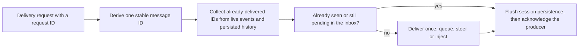

# delivery.ts

`delivery.ts` holds the rule that makes message delivery to a DSH agent *idempotent*: the same request ID is delivered at most once, even when the process restarts, the session is restored from history, or a queued effect is retried. It gives every request a stable message ID, remembers which IDs a session has already received by combining live session events, persisted history and pending inbox entries, and only then hands one frozen message to the agent. Its consumer is `Sessions`, which routes `relay` and `notice` effects through it, so first-time readers can treat this file as the "never send the same message twice" gate of the application layer.

## Whole-unit functional diagram

<!-- {
  "mermaid_info": {
    "name": "Idempotent delivery flow",
    "nodes": [
      {
        "id": "request_001",
        "name": "Delivery request with a request ID",
        "path": "src/app/sessions.ts",
        "hint": "Sessions.prompt and the notice injector start a delivery with a caller-supplied request ID",
        "isJumpable": true,
        "position": { "startLine": 161, "endLine": 167 },
        "references": []
      },
      {
        "id": "id_002",
        "name": "Derive one stable message ID",
        "path": "src/app/delivery.ts",
        "hint": "messageId maps a request ID to the same message ID on every retry",
        "isJumpable": true,
        "position": { "startLine": 15, "endLine": 24 },
        "references": []
      },
      {
        "id": "seen_003",
        "name": "Collect already-delivered IDs from live events and persisted history",
        "path": "src/app/delivery.ts",
        "hint": "AgentDelivery history loading combines session events with persisted user messages",
        "isJumpable": true,
        "position": { "startLine": 32, "endLine": 60 },
        "references": []
      },
      {
        "id": "check_004",
        "name": "Already seen or still pending in the inbox?",
        "path": "src/app/delivery.ts",
        "hint": "holds and the pending inbox check decide whether a message must be skipped",
        "isJumpable": true,
        "position": { "startLine": 61, "endLine": 75 },
        "references": []
      },
      {
        "id": "deliver_005",
        "name": "Deliver once: queue, steer or inject",
        "path": "src/app/delivery.ts",
        "hint": "A frozen dsh-superagent message is queued, steered, or injected without waking the agent",
        "isJumpable": true,
        "position": { "startLine": 76, "endLine": 82 },
        "references": []
      },
      {
        "id": "flush_006",
        "name": "Flush session persistence, then acknowledge the producer",
        "path": "src/app/delivery.ts",
        "hint": "send flushes session persistence after delivering and before returning to the caller",
        "isJumpable": true,
        "position": { "startLine": 83, "endLine": 84 },
        "references": []
      }
    ]
  }
} -->

    
        <a target="_self" href="#src/app/delivery.ts:1?class=graph" style="color: inherit; text-decoration: none;">Graph: Idempotent delivery flow</a>
    

Every delivery takes the same shape: a request ID becomes a stable message ID, the file gathers the IDs that session already holds, and only a genuinely new message is handed to the agent. The flush at the end means the producer is only acknowledged once the delivered message is durable, so a crash after acknowledging cannot lose the message.

## At a glance

- **Primary role**: Domain rules — the file encodes the real-world policy "one message per request ID, never more", and everything else (event listeners, persistence paging, inbox inspection) exists to support that decision.
- **Secondary roles**: Stored state — it keeps a per-session set of already-delivered IDs in memory, lazily rebuilds it from persisted session history, and flushes persistence before acknowledging.
- **Confidence**: High — the file's own header comment, the class docstring, and all three public entry points state the at-most-once rule directly.

## What this file does

- Gives each request ID a deterministic message ID, so a retry of the same request produces the byte-identical identifier and can be recognised as a duplicate.
- Rescues the idempotency key from older message shapes, including messages written by the former plugin source and by the old user RPC path, so restored sessions and migrated data are still deduplicated.
- Rebuilds each session's "already delivered" knowledge from three sources: live `session/event` notifications, the session's persisted event history, and the agent's own pending `nextTurn` / `nextStep` inbox.
- Delivers in three modes — queue for the next turn, steer the current turn, or inject a notice without waking the agent — while tagging the message with `dsh-superagent`'s own source so it is never mistaken for something a person typed.
- Flushes session persistence before returning, so callers such as the durable `relay` and `notice` effects can acknowledge a request safely.
- Refuses to deliver to an agent that has been disposed, and honours an abort signal before touching the session.

## Key functions or classes

### `messageId`

Turns a request ID into the one message ID that every retry of that request will reuse.

    
        <a target="_self" href="#src/app/delivery.ts:15-16?class=code" style="color: inherit; text-decoration: none;">Code: src/app/delivery.ts:15-16</a>
    

### `deliveryId`

Reads the idempotency key back out of a `UserMessage`, accepting the current `dsh-superagent` source, the legacy plugin source, and the retired user-RPC shape.

    
        <a target="_self" href="#src/app/delivery.ts:17-24?class=code" style="color: inherit; text-decoration: none;">Code: src/app/delivery.ts:17-24</a>
    

### `AgentDelivery`

The delivery service itself: one instance per application, constructed with the plugin `Context` and subscribed to session events.

    
        <a target="_self" href="#src/app/delivery.ts:26-31?class=code" style="color: inherit; text-decoration: none;">Code: src/app/delivery.ts:26-31</a>
    

### `history`

Returns the per-session record of delivered IDs, loading it from persisted history exactly once per session.

### `holds`

Answers "does this session already hold the message for this request ID?" by checking known IDs and the pending inbox, without delivering anything.

### `send`

Performs the guarded delivery: abort check, history load, liveness check, optional authorisation callback, duplicate check, then queue, steer or inject, followed by a persistence flush.

    
        <a target="_self" href="#src/app/delivery.ts:65-85?class=code" style="color: inherit; text-decoration: none;">Code: src/app/delivery.ts:65-85</a>
    

## Main inputs and results

- **Inputs**: an `Agent` resolved from a session, a caller-owned request ID, the message text, a delivery mode (`'queue'`, `'steer'` or `{ inject: summary }`), an abort `signal` tied to the plugin lifetime, and optional `authorize` / `accepted` callbacks used by callers that must act exactly around a real delivery.
- **Results**: `holds` returns a boolean; `send` returns `void` but resolves only after the delivered message has been flushed to session persistence. A delivery attempt for a disposed agent fails with an error instead of silently dropping the message.
- **Visible side effects**: the target agent receives at most one frozen user message tagged as `dsh-superagent`; injected notices appear in the session history without starting a turn, and queued or steered messages join the agent's inbox.
- **Main consumer**: `Sessions` creates the instance and calls `holds` / `send` for `Sessions.prompt`, the ordered `relay` effect and the `notice` injector.

## Rules and decisions

- **Decision**: should this message be handed to the agent at all? The answer is "no" whenever the session's known IDs or its pending inbox already contain the message ID derived from the request ID.
- **Important conditions**: the ID must be reconstructible from stored messages, so the source kind matters — `dsh-superagent`, the legacy `plugin` source with that plugin name, and the retired user-RPC source all count as this producer's messages. A message that is still sitting in `nextTurn` or `nextStep` counts as delivered even though no event has recorded it yet.
- **Outcomes**: a new message is queued for the next turn, steered into the current one, or injected as a notice; a duplicate is skipped entirely, but persistence is still flushed so the caller's acknowledgement stays safe.
- **Invariant**: for one request ID, a session never receives more than one `dsh-superagent` user message, across restarts and retries.
- **Invariant**: delivered messages are attributed to `dsh-superagent` (`relay` form, or `notice` form with the injected summary), never to a human user.

### Small example

An `ordered` `relay` effect is retried after a restart. On the second attempt the request ID is unchanged, so `messageId` yields the same ID, `history` finds that ID in the reopened session log, and `send` delivers nothing — yet it still flushes persistence and returns, which lets the durable queue mark the effect done instead of re-sending the report to the agent.

## Stored state lifecycle

- **Stores**: a `WeakMap` from `Session` to a small record holding the set of delivered message IDs and, while loading, the in-flight history promise. Nothing is written outside DSH's own session persistence.
- **Read path**: on first use for a session, the record flushes pending writes, opens the session's persisted event log for reading, and pages through it collecting `user/message` IDs; later calls reuse the in-memory set. Live `session/event` notifications keep the set current while the session runs.
- **Write path**: the set grows as `user/message` events arrive and as `send` recognises its own newly delivered IDs; injecting a notice records the ID immediately, while queued and steered messages are additionally covered by the pending-inbox check until their event lands.
- **Visible result**: delivery decisions survive process restarts, restored sessions and effect retries, so a user does not see the same relayed report or the same notice twice.

### Important persistence behavior

History loading is guarded by a single shared promise per session, so concurrent deliveries do not rescan the log; if the load fails, the promise is cleared and the next caller retries instead of caching a half-built set. The in-memory record is keyed by `Session` in a `WeakMap`, so entries disappear with the session object rather than growing for the lifetime of the process. Because the record is only populated for sessions this service has already touched, the live listener updates existing records only and never creates one for unrelated sessions.

---
name: delivery.ts

update-time: 2026-11-02 10:23

description: `delivery.ts` holds the rule that makes message delivery to a DSH agent *idempotent*: the same request ID is delivered at most once, even when the process restarts, the session is restored from history, or a queued effect is retried. It gives every request a stable message ID, remembers which IDs a session has already received by combining live session events, persisted history and pending inbox entries, and only then hands one frozen message to the agent. Its consumer is `Sessions`, which routes `relay` and `notice` effects through it, so first-time readers can treat this file as the "never send the same message twice" gate of the application layer.

---
