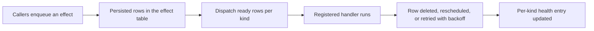

# effects.ts

`src/app/effects.ts` is the durable work queue of the orchestrator. Other parts of the app (assessment, worker launches, input delivery, session relays/notices, outbound replies) record side effects as rows inside their own database transaction, and this class later runs them — surviving restarts, honoring per-kind concurrency and stopping rules, retrying with backoff, and reporting health. Read it to understand how deferred work stays consistent with committed state, and how a new kind of deferred work is registered.

## Whole-unit functional diagram

A caller writes an effect row in the same transaction as the domain change; after commit a microtask-driven dispatch pass picks up due rows whose kind still has free capacity, runs the handler, and then either deletes the row, defers it, or schedules a retry — always refreshing the kind's health entry so an operator can see waiting and failing work.

## At a glance

- Primary role: Infrastructure — shared runtime support (a persistent job queue with scheduling, concurrency, retry and health) that product behavior relies on.
- Secondary roles: API boundary — the `enqueue`/`handle`/`pending`/`cancel`/`idle`/`drain` contract other modules program against; State storage — it owns the lifecycle of the `effect` table rows, including payload replacement and retry bookkeeping.
- Confidence: High — the file's responsibilities, lifecycle hooks, and every consumer (`MasterAssessor`, `DshExecutor`, `Sessions`, `Outbox`, `Passes`, `Runtime`) are directly visible in the source and call sites.

## What this file does

- **Durable queueing inside transactions:** `enqueue` inserts into the `effect` table using the caller's open transaction, so a side effect and the state change that caused it commit or roll back together. Work queued before startup waits instead of running early.
- **Per-kind handler registration:** `handle` binds one handler to one effect kind and fixes its run-time policy — concurrency `limit()`, `retry` delay pair, `ordered` sequencing, and `quiet` health behavior. Registering the same kind twice is an error.
- **Scheduling with capacity control:** dispatch runs only between `start()` and `drain()`, groups work by kind, skips keys already running, and asks the handler's `limit()` for room — returning `0` is how "processing is paused" holds work without losing it.
- **Retry, deferral and backoff:** a thrown error increments the attempt count and schedules an exponential retry capped at the handler's maximum delay. Throwing `Later` instead reschedules after the initial delay without counting a failure, which is how callers say "not now" (paused, no worker slot, source off).
- **Coalescing and cancellation:** re-enqueueing the same kind and key updates the payload in place, increments `generation`, resets attempts, and keeps the original queue position; `pending` and `cancel` let callers inspect or withdraw queued work.
- **Health reporting:** each kind owns a health entry on the health board; the entry shows how many rows wait and flips to `error` once consecutive failures reach `FAILURES_BEFORE_ERROR` (`3`), unless the handler is marked `quiet`.

## Key functions or classes

### `Effects`

The queue itself: holds registered handlers, running tasks, and health entries, and exposes the whole queue lifecycle.

    
        <a target="_self" href="#src/app/effects.ts:46-161?class=code" style="color: inherit; text-decoration: none;">Code: src/app/effects.ts:46-161</a>
    

### `EffectPayloads` and `EffectKind`

The shared contract of the six known effect kinds — their payload shapes and the meaning of the key each row is stored under. Adding a kind starts here.

    
        <a target="_self" href="#src/app/effects.ts:11-25?class=code" style="color: inherit; text-decoration: none;">Code: src/app/effects.ts:11-25</a>
    

### `enqueue(kind, key, payload)`

Persists or refreshes a waiting effect in the caller's transaction and nudges the dispatcher; this is the only way producers add work.

    
        <a target="_self" href="#src/app/effects.ts:61-66?class=code" style="color: inherit; text-decoration: none;">Code: src/app/effects.ts:61-66</a>
    

### `handle(kind, run, options)`

Registers the single handler for a kind, claims its health entry, and applies defaults (`limit` 1, retry 2s→60s, unordered, non-quiet); an `ordered` kind is automatically capped at one concurrent run.

    
        <a target="_self" href="#src/app/effects.ts:67-74?class=code" style="color: inherit; text-decoration: none;">Code: src/app/effects.ts:67-74</a>
    

### `pending(kind, key?)` and `cancel(kind, key)`

Report whether work is still queued (for a kind or one key) and drop a queued row; cancelling a row that is already running lets that attempt finish normally.

### `start()` and `kick()`

Open the queue for work after startup and request a dispatch pass, coalesced into a single microtask so bursty enqueues do not run the scheduler repeatedly.

### `idle(kind?)`

Resolves once nothing of the requested kind (or of any kind) is running and nothing more can start right now — used by tests, passes and `Outbox.sent()` to wait for quiescence.

### `drain()`

Stops starting new effects and awaits running ones; rows that failed during shutdown stay in the table so they retry on the next start.

## Main inputs and results

- Inputs: `enqueue` calls with a kind, key and JSON payload; handler registrations with their limit, retry, ordering and quiet options; and the objects constructed in `runtime`, the shared `Store` and the health board's `claim`.
- Results: rows exercised by handlers, rows deleted on success, retried rows with updated attempt counts and errors, and per-kind health entries showing waiting counts or an error state.
- Visible side effects: an operator sees effect health in the overview and status panels; queued work is preserved across restarts, and work held by a `limit()` returning `0` simply waits instead of disappearing.

## Runtime support

- Provides: a persistent, restart-safe queue for deferred side effects, with per-kind concurrency, ordering, backoff retry and health reporting.
- Starts or activates: registered when `Runtime` builds its components, but work only flows after `initialize` calls `start()` once setup, sessions and policy sync have completed.
- Used by: `MasterAssessor` (`assessment`), `DshExecutor` (`launch`, `delivery`), `Sessions` (`relay`, `notice`), `Outbox` (`reply`), and `Passes`, which kicks the queue on every scheduling pass.
- Operational effect: shutdown calls `drain()` so in-flight effects finish and unfinished rows remain for the next start; a paused runtime holds work by having handlers report a concurrency limit of zero.

## Public contract

- Caller: any module that must defer work, plus the modules that own a kind's handler.
- Operation: `enqueue` to persist work, `handle` to register execution, `pending`/`cancel` to inspect or withdraw, and `idle`/`drain` to wait for quiescence or shutdown.
- Accepted input: a kind from `EffectPayloads`, a stable key (effect ID, ticket ID, assignment ID, message ID, …), and a payload matching that kind; handlers must accept the parsed payload and key and return a promise.
- Result: handlers run with the payload and key rather than returning values to the caller; failures surface as retries, a `Later` deferral, or a health `error` after three consecutive failures.

## Stored state lifecycle

- Stores: one row per kind and key in the `effect` table — payload JSON, a monotonically increasing `seq` for queue order, a `generation` counter, failure `attempts` and last `error`, the `due` timestamp, and `since` for waiting time.
- Read path: at construction the queue seeds its sequence from the highest stored `seq`, then reads due rows for each kind on every dispatch; health reads aggregate waiting counts and the latest error.
- Write path: writes come from `enqueue` (upsert), dispatch-driven handler attempts (delete, defer or retry), `cancel` (delete), and startup reconciliation in `store` which adds the `generation` column to older databases.
- Visible result: effects committed with their domain change are never lost on a crash or restart, and repeated enqueues of the same key collapse into one waiting row rather than piling up duplicates.

Three details shape that behavior: attempts are guarded by `seq` and `generation`, so a row replaced while running is not overwritten by its older attempt; retries escalate exponentially up to the handler's maximum delay; and migrations insert rows directly so previously recorded failure counts survive an upgrade.

---
name: effects.ts

update-time: 2026-11-02 10:28

description: `src/app/effects.ts` is the durable work queue of the orchestrator. Other parts of the app (assessment, worker launches, input delivery, session relays/notices, outbound replies) record side effects as rows inside their own database transaction, and this class later runs them — surviving restarts, honoring per-kind concurrency and stopping rules, retrying with backoff, and reporting health. Read it to understand how deferred work stays consistent with committed state, and how a new kind of deferred work is registered.

---
