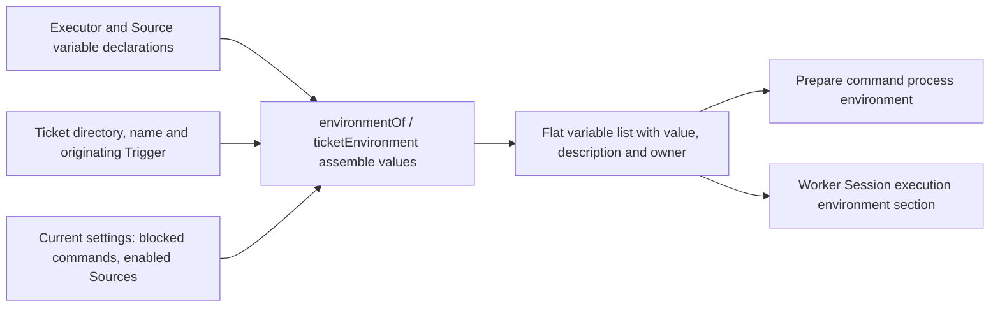

# execution-environment.ts

This file is the single place where `dsh-superagent` describes *the environment a worker works in*: the ticket directory, the ticket's short name and id, the commands the worker may not call, and whatever the installed Sources (GitHub, Feishu, …) want to add. It turns those declarations plus the current settings into a flat list of key/value pairs with human-readable descriptions. That same list feeds two consumers — the shell used by the workspace prepare command and the worker Session's system-prompt section — so both always agree on the exact same variable names and values.

## Whole-unit functional diagram

<!-- {
  "mermaid_info": {
    "name": "Execution environment assembly flow",
    "nodes": [
      {
        "id": "decl_001",
        "name": "Executor and Source variable declarations",
        "path": "src/app/execution-environment.ts",
        "hint": "The built-in executor variables plus each Source kind's declared variables",
        "isJumpable": true,
        "position": { "startLine": 10, "endLine": 25 },
        "references": []
      },
      {
        "id": "resolve_002",
        "name": "environmentOf / ticketEnvironment assemble values",
        "path": "src/app/execution-environment.ts",
        "hint": "Combines declarations with ticket attributes, settings and enabled Sources",
        "isJumpable": true,
        "position": { "startLine": 27, "endLine": 43 },
        "references": []
      },
      {
        "id": "vars_003",
        "name": "Ticket directory, name and originating Trigger",
        "path": "",
        "hint": "Per-ticket values recorded on the ticket and its Trigger",
        "isJumpable": false,
        "position": { "startLine": 0, "endLine": 0 },
        "references": []
      },
      {
        "id": "settings_004",
        "name": "Current settings: blocked commands, enabled Sources",
        "path": "",
        "hint": "Execution settings and Source enablement read at assembly time",
        "isJumpable": false,
        "position": { "startLine": 0, "endLine": 0 },
        "references": []
      },
      {
        "id": "list_005",
        "name": "Flat variable list with value, description and owner",
        "path": "src/app/execution-environment.ts",
        "hint": "The returned Variable array: key, value, localized description, owner",
        "isJumpable": true,
        "position": { "startLine": 16, "endLine": 16 },
        "references": []
      },
      {
        "id": "prepare_006",
        "name": "Prepare command process environment",
        "path": "src/executor/dsh.ts",
        "hint": "The prepare command runs with these variables in its process environment",
        "isJumpable": true,
        "position": { "startLine": 247, "endLine": 262 },
        "references": []
      },
      {
        "id": "prompt_007",
        "name": "Worker Session execution environment section",
        "path": "src/app/prompts.ts",
        "hint": "The same variables, rendered as one prompt line each",
        "isJumpable": true,
        "position": { "startLine": 83, "endLine": 86 },
        "references": []
      }
    ]
  }
} -->

    
        <a target="_self" href="#src/app/execution-environment.ts:1?class=graph" style="color: inherit; text-decoration: none;">Graph: Execution environment assembly flow</a>
    

The left side collects two kinds of declarations: the executor's own four variables and whatever each installed Source kind declares. Assembly then fills in values from the ticket and the current settings, skipping Sources that are switched off, and the resulting list is used twice — once as a real process environment for the prepare command, once as readable prompt text for the worker.

## At a glance

- **Primary role**: Data contract — this file defines the shape of a resolved execution variable and the shared list that the prepare command, worker prompt and settings panel all rely on.
- **Confidence**: High — the declarations, the assembly functions and their three consumers are all present in the source (runtime wiring, executor preparation, prompt composition and settings view).

## What this file does

- Declares the executor's own execution variables: the ticket directory, the ticket's short name, the ticket id, and the space-separated list of blocked command names. A file comment states explicitly that credentials are never part of this environment.
- Marks ticket-dependent variables, so a ticket-less context (such as setup or a deployment-wide view) receives only the variables that make sense without a ticket.
- Asks every *enabled* Source kind to compute its own variable values, then appends them to the executor's, so a GitHub repository or a Feishu chat contributes its variables without this file knowing anything about GitHub or Feishu.
- Provides the ticket convenience wrapper: a ticket's stored `execution` directory and name plus its originating Trigger are exactly what the per-ticket assembly needs.
- Answers "which variables exist at all?" for the management panel, including Sources that are currently switched off, so operators can see the full vocabulary even when a Source is disabled.
- Resolves where ticket workspaces live: the configured execution directory, or `<stateDir>/work` when none is configured.
- Renders the resolved list as one bullet per variable for the worker's prompt, in English, with the value JSON-quoted so an empty or spaced value stays unambiguous.

## Key functions or classes

### `EXECUTOR_VARIABLES`

The constant inventory of variables the executor itself owns — `DSH_SUPERAGENT_DIR`, `DSH_SUPERAGENT_NAME`, `DSH_SUPERAGENT_TICKET` (all ticket-only) and `DSH_SUPERAGENT_BLOCKED_COMMANDS` — each with a bilingual description.

<a target="_self" href="#src/app/execution-environment.ts:10-15?class=code" style="color: inherit; text-decoration: none;">execution-environment.ts:10-15</a>

### `Variable`

One resolved entry: the variable name, its value, a localized description, and the `owner` that registered it (the executor or a Source kind id). This is the actual contract handed to callers.

### `executionRoot`

Returns the directory under which ticket workspaces are created, falling back to a `work` directory inside the state directory.

<a target="_self" href="#src/app/execution-environment.ts:18?class=code" style="color: inherit; text-decoration: none;">execution-environment.ts:18</a>

### `declaredVariables`

Lists every variable grouped by owner with an `enabled` flag, so the settings panel can show switched-off Sources' variables as declared but inactive.

<a target="_self" href="#src/app/execution-environment.ts:21-25?class=code" style="color: inherit; text-decoration: none;">execution-environment.ts:21-25</a>

### `environmentOf`

The core assembly function: given the deployment, the Source registry, settings and optionally a ticket plus its Trigger, it returns the complete `Variable[]`. Missing values become empty strings rather than absent keys.

<a target="_self" href="#src/app/execution-environment.ts:27-36?class=code" style="color: inherit; text-decoration: none;">execution-environment.ts:27-36</a>

### `ticketEnvironment`

Turns a `Ticket` into the `environmentOf` input, taking the directory and name the executor recorded in the ticket's `execution` attributes and passing its origin Trigger along.

<a target="_self" href="#src/app/execution-environment.ts:39-43?class=code" style="color: inherit; text-decoration: none;">execution-environment.ts:39-43</a>

### `environmentLines`

Renders the list as prompt text: one `- KEY = "value": description.` line per variable, using the English description.

<a target="_self" href="#src/app/execution-environment.ts:44-46?class=code" style="color: inherit; text-decoration: none;">execution-environment.ts:44-46</a>

## Main inputs and results

- **Inputs**: the current execution settings (workspace directory, blocked command list, Source enablement), the installed Source registry's environment declarations, a ticket's recorded directory and name, and the Trigger that started the ticket.
- **Results**: a `Variable[]` where every entry carries a name, an always-present string value (possibly empty), a bilingual description and its owner; plus the resolved workspace root from `executionRoot`.
- **Visible side effects**: the worker's prepare command runs with these names in its process environment (so a command can reference `$DSH_SUPERAGENT_DIR`), the worker Session's prompt gains an "execution environment" section listing each variable with its guidance, and the management panel shows the resolved workspace root together with the declared variables grouped by owner.

## Information contract

- **Represents**: the non-secret facts about a ticket's workspace and the accounts the worker's CLI tools act as — enough for a shell command to run in the right directory and for the worker to know where it is and what it must not call.
- **Produced by**: `EXECUTOR_VARIABLES` for the executor's own entries, and each Source kind's own `environment` declaration for source-specific entries, resolved through the Source registry so only enabled Sources contribute values.
- **Consumed by**: the executor's workspace preparation (as a subprocess environment), prompt composition (as the worker's execution environment section), and the settings view (as a read-only listing).
- **Behavior-shaping parts**: the `ticket` marker decides whether a variable appears at all versus appearing with an empty value; Source enablement decides whether a whole group is present; the `owner` field keeps groups attributable; the description is what the worker actually reads, so its wording changes behavior rather than just documentation. Values are empty strings when unknown (for example, the ticket did not start on GitHub), so consumers can rely on stable keys.

### Compatibility notes

Source kinds implement the shared `VariableSpec` contract, and this file widens it only with an optional `ticket` marker for its own entries. A new Source kind therefore adds variables without touching this module, and the settings panel picks up its declarations automatically through the registry. Disabling a Source removes its values from the worker environment but keeps its declarations visible to operators.

---
name: execution-environment.ts

update-time: 2026-11-02 10:27

description: This file is the single place where `dsh-superagent` describes *the environment a worker works in*: the ticket directory, the ticket's short name and id, the commands the worker may not call, and whatever the installed Sources (GitHub, Feishu, …) want to add. It turns those declarations plus the current settings into a flat list of key/value pairs with human-readable descriptions. That same list feeds two consumers — the shell used by the workspace prepare command and the worker Session's system-prompt section — so both always agree on the exact same variable names and values.

---
