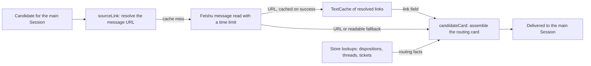

# links.ts

This file is the small translation layer between a raw incoming message and what the main Session actually sees. It resolves the original web address of a Trigger's message (or a readable fallback when that lookup fails), and it assembles the "candidate card" that is handed to the main Session when a message needs to be routed or assessed. Everything a router needs to decide — where the message came from, which tickets it already reached, what it replies to, and which tickets its text points at — is produced here.

## Whole-unit functional diagram

The main path is: a candidate is due for the main Session, its trigger's message URL is resolved once and remembered, and then the card is built from that link plus routing facts read from the store. The finished card is what the assessment layer delivers; this file never sends anything itself.

<!-- {
  "mermaid_info": {
    "name": "Link resolution and candidate card assembly",
    "nodes": [
      {
        "id": "candidate_001",
        "name": "Candidate for the main Session",
        "path": "",
        "hint": "An evaluation candidate that needs a card before the main Session can decide",
        "isJumpable": false,
        "position": { "startLine": 0, "endLine": 0 },
        "references": []
      },
      {
        "id": "link_002",
        "name": "sourceLink: resolve the message URL",
        "path": "src/app/links.ts",
        "hint": "Returns the trigger's URL from its own field, a cache, or a bounded Feishu lookup",
        "isJumpable": true,
        "position": { "startLine": 21, "endLine": 40 },
        "references": []
      },
      {
        "id": "feishu_003",
        "name": "Feishu message read with a time limit",
        "path": "src/sources/feishu-read.ts",
        "hint": "readFeishuLink reads the message's AppLink through the lark CLI",
        "isJumpable": true,
        "position": { "startLine": 30, "endLine": 37 },
        "references": []
      },
      {
        "id": "cache_004",
        "name": "TextCache of resolved links",
        "path": "src/app/cache.ts",
        "hint": "Size-bounded in-memory cache keyed by chat and message id",
        "isJumpable": true,
        "position": { "startLine": 5, "endLine": 27 },
        "references": []
      },
      {
        "id": "card_005",
        "name": "candidateCard: assemble the routing card",
        "path": "src/app/links.ts",
        "hint": "Combines the formatted trigger, dispositions, ticket lists and a next action",
        "isJumpable": true,
        "position": { "startLine": 55, "endLine": 71 },
        "references": []
      },
      {
        "id": "store_006",
        "name": "Store lookups: dispositions, threads, tickets",
        "path": "src/app/links.ts",
        "hint": "The LinkHost interface exposes exactly the store slices the card needs",
        "isJumpable": true,
        "position": { "startLine": 12, "endLine": 18 },
        "references": []
      },
      {
        "id": "delivery_007",
        "name": "Delivered to the main Session",
        "path": "src/app/assessment.ts",
        "hint": "The assessment effect handler sends the card to the main Session",
        "isJumpable": true,
        "position": { "startLine": 96, "endLine": 101 },
        "references": []
      }
    ]
  }
} -->

    
        <a target="_self" href="#src/app/links.ts:1?class=graph" style="color: inherit; text-decoration: none;">Graph: Link resolution and candidate card assembly</a>
    

## At a glance

- Primary role: Orchestration — the file sequences several concrete steps (early exits, cache lookup, a bounded external read, store reads, ticket scans) and returns two finished values rather than exposing the steps.
- Secondary roles: External adapter — it is the project-level bridge to Feishu message metadata, with a deliberate fallback shape when the bridge fails. Presentation — it decides which sections the main Session's routing card contains and how each part is summarised.
- Confidence: High — the whole file was read together with its collaborators (`cards.ts`, `cache.ts`, the Feishu reader, the assessment delivery), its composition in Runtime, its prompt documentation, and the tests that pin card contents.

## What this file does

- Gives a Trigger a usable source reference: a stored `trigger.url` wins, otherwise the Feishu web link is looked up once and cached under its chat and message ids, otherwise a readable resource path is returned instead so the message stays inspectable.
- Keeps that optional enrichment from breaking intake: the lookup has the configured time limit, honours both the caller's signal and the runtime's lifetime, and a failed lookup is treated as "no link" unless the work itself was cancelled.
- Builds the candidate card the main Session reads: the primary trigger formatted the same way a worker receives input, its strength, the current eval mode, the earlier triggers of the same batch, and worker handbacks with their reasons.
- Answers "what else is involved": the thread's related tickets (open ones first, ended ones included, with a total), the tickets the trigger was already delivered to, and the tickets whose pull requests or issues the message text names.
- Ends each card with a short `next_action` line chosen by strength, so an explicit request is routed while anything else follows the ignore-or-assess path.

## Key functions or classes

### `LinkHost`

The exact dependency surface this file needs: a slice of the store (settings, triggers, threads, tickets), the link cache, the command runner, the source registry, and the runtime lifetime signal.

<a target="_self" href="#src/app/links.ts:12-18?class=code" style="color: inherit; text-decoration: none;">links.ts:12-18</a>

### `sourceLink`

Resolves and caches a trigger's external message URL, returning either `source_url` or the `source_url_read` resource path.

<a target="_self" href="#src/app/links.ts:21-40?class=code" style="color: inherit; text-decoration: none;">links.ts:21-40</a>

### `repliedTo`

Looks up the Trigger that a message answers, using the source kind's own reply relation and then the stored trigger.

### `referencedTickets`

Finds tickets subscribed to threads the trigger text mentions (such as `#12` or a URL), drops tickets the candidate already lists, and keeps at most four.

### `candidateCard`

Assembles everything above into the card object that is delivered to the main Session.

<a target="_self" href="#src/app/links.ts:55-71?class=code" style="color: inherit; text-decoration: none;">links.ts:55-71</a>

## Main inputs and results

- Inputs: a `LinkHost` (store slice, link cache, commands, source registry, lifetime), a `Trigger` or a `Candidate`, and optionally an `AbortSignal` from the caller.
- Results: `sourceLink` returns `{ source_url }`, `{ source_url_read }`, or `{}` when the trigger has no Feishu message behind it; `candidateCard` returns the routing card object that is serialised and delivered.
- Visible side effects: Feishu message metadata is read through the CLI, successful lookups are cached, and the main Session receives a card whose arrival a slow lookup can delay.

## Coordinated flow

1. A candidate reaches the assessment layer, which asks this file for its card. The card needs the trigger's original message page, so `sourceLink` runs first.
2. `sourceLink` short-circuits on an already stored `trigger.url`, then on the link cache, and only then builds a Feishu reference from the trigger's metadata and reads the message link. The read is wrapped in a time limit combined with the caller's signal and the runtime lifetime, through the command runner.
3. On success the URL is cached under `chatId:messageId` and returned as `source_url`. On failure — but only if nothing was actually cancelled — the function returns a readable `feishu/<trigger>/message` path instead, so the card still points somewhere useful.
4. `candidateCard` then combines that link with store reads: the primary trigger's disposition (fanout targets plus handbacks), the thread's related tickets, the ticket cards for text references, and the eval mode from settings; it formats the trigger with the same helper workers use and appends the strength-dependent next step.
5. Delivery and the evaluation deadline belong to `MasterAssessor`, which sends the card to the main Session and only then starts the clock.

<a target="_self" href="#src/app/runtime.ts:115-116?class=code" style="color: inherit; text-decoration: none;">runtime.ts:115-116</a>

### Important branching and concurrency

A slow link lookup delays only the card that needs it: another candidate on another thread can still be delivered and decided first, and a paused runtime simply holds the assessment work. If the runtime lifetime or the caller's signal aborts during the lookup, the error is rethrown instead of being turned into a fallback path, so cancellation never looks like a missing link.

## External connection

- External system: Feishu message metadata, read through the lark CLI (`+messages-mget`) rather than a direct HTTP client.
- Outbound translation: the trigger's `source` and message metadata become a Feishu reference (`chatId`, `messageId`, `triggerId`), and the call is made through a command runner bound to the combined abort signal.
- Inbound translation: the message's AppLink becomes `source_url`; a failed or unavailable message becomes `source_url_read` with the trigger-scoped resource path. Triggers from other sources yield `{}` and simply carry no link.

### Operating requirements

Link resolution depends on the Feishu source's settings being readable: the lookup time limit is the configured `linkTimeoutMs` (default 5000 ms, at most 90000 ms), and while the Feishu plugin is disabled the schema defaults are used. The `sourceLink` cache is a bounded in-memory cache, so a restart starts it empty.

## What the user experiences

- Presents: the routing card the main Session reads — trigger id, author, thread, timestamp, the message text or a truncated preview with a `read` path, the source URL or its fallback, the replied-to message, `strength`, the eval `mode`, a `batch` of earlier triggers, `handed_back` items with worker reasons, `related_tickets` with `tickets_total`, `delivered_to`, `referenced_tickets`, and `next_action`.
- Interaction: the last field is the only steering this file does. With `strength=explicit` it points at `orchestrator_route` with the dispatch guidance; otherwise it suggests ignoring a card that touches no enabled rule, or assessing it with the `orchestrator_eval` tools.
- Prepared data: everything must be ready before the card is sent, because the evaluation deadline starts on delivery — dispositions, thread subscriptions, ticket cards from `cards.ts`, and the resolved link.

### Important interaction states

Sections appear only when they have content: no batch, no handbacks, no delivered targets and no referenced tickets means those keys are absent rather than empty, and a card that shows only a fallback link still routes correctly because the source message text is always present. The field vocabulary is documented for the main Session in 
<a target="_self" href="#prompts/dispatch.md?class=text" style="color: inherit; text-decoration: none;">dispatch.md</a>
, and the file's place in the module map is described in 
<a target="_self" href="#docs/007-architecture.md?class=text" style="color: inherit; text-decoration: none;">007-architecture.md</a>
.

---
name: links.ts

update-time: 2026-11-02 10:22

description: This file is the small translation layer between a raw incoming message and what the main Session actually sees. It resolves the original web address of a Trigger's message (or a readable fallback when that lookup fails), and it assembles the "candidate card" that is handed to the main Session when a message needs to be routed or assessed. Everything a router needs to decide — where the message came from, which tickets it already reached, what it replies to, and which tickets its text points at — is produced here.

---
