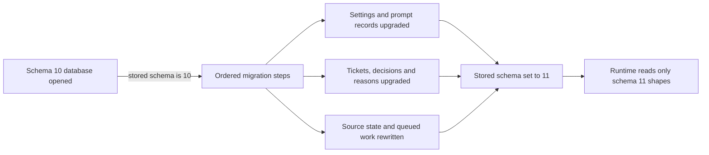

# migration.ts

`migration.ts` is the one-time upgrade path for the orchestrator's saved state: it rewrites a schema 10 SQLite database into the schema 11 record shapes that the rest of the program assumes. It exists so runtime readers, tools and Sources never have to handle legacy shapes — the conversion happens once, at startup, before anything else reads the file. The most useful takeaway is that this file is a *batch of ordered record converters*, not a live service: you call it once with an open `Store`, and every stored record is rewritten in place.

## Whole-unit functional diagram

<!-- {
  "mermaid_info": {
    "name": "Schema 10 to schema 11 upgrade path",
    "nodes": [
      {
        "id": "open_001",
        "name": "Schema 10 database opened",
        "path": "src/app/store.ts",
        "hint": "The Store reads the stored schema key before runtime readers start",
        "isJumpable": true,
        "position": { "startLine": 65, "endLine": 69 },
        "references": []
      },
      {
        "id": "steps_002",
        "name": "Ordered migration steps",
        "path": "src/app/migration.ts",
        "hint": "migrateTo11 runs every conversion inside an error-prefixing step",
        "isJumpable": true,
        "position": { "startLine": 36, "endLine": 91 },
        "references": []
      },
      {
        "id": "records_003",
        "name": "Settings and prompt records upgraded",
        "path": "src/app/migration.ts",
        "hint": "Flat settings become domain blocks and prompt revisions get current sections",
        "isJumpable": true,
        "position": { "startLine": 187, "endLine": 331 },
        "references": []
      },
      {
        "id": "tickets_004",
        "name": "Tickets, decisions and reasons upgraded",
        "path": "src/app/migration.ts",
        "hint": "Mandate bases, ticket ends, followed PRs and reason codes are rebuilt",
        "isJumpable": true,
        "position": { "startLine": 366, "endLine": 507 },
        "references": []
      },
      {
        "id": "sources_005",
        "name": "Source state and queued work rewritten",
        "path": "src/app/migration.ts",
        "hint": "Feishu topics, GitHub cursors, outbox receipts and assessment effects",
        "isJumpable": true,
        "position": { "startLine": 521, "endLine": 616 },
        "references": []
      },
      {
        "id": "version_006",
        "name": "Stored schema set to 11",
        "path": "src/app/store.ts",
        "hint": "The same transaction records schema 11 so the migration never runs again",
        "isJumpable": true,
        "position": { "startLine": 88, "endLine": 91 },
        "references": []
      },
      {
        "id": "result_007",
        "name": "Runtime reads only schema 11 shapes",
        "path": "",
        "hint": "Abstract outcome: no later code path needs legacy handling",
        "isJumpable": false,
        "position": { "startLine": 0, "endLine": 0 },
        "references": []
      }
    ]
  }
} -->

    
        <a target="_self" href="#src/app/migration.ts:1?class=graph" style="color: inherit; text-decoration: none;">Graph: Schema 10 to schema 11 upgrade path</a>
    

The Store opens the database, sees a stored schema of 10, and calls into this file inside the same atomic transaction that creates the tables. The migration walks its converter groups, and only after every record has been rewritten does the Store stamp schema 11 — so a failure anywhere leaves the original file untouched and the next start retries the whole upgrade.

## At a glance

- **Primary role — orchestration**: the file is a fixed sequence of conversion steps with real ordering dependencies, run once by the Store during startup.
- **Secondary role — data-contract**: it defines the concrete target shapes of stored records (tickets, mandate bases, reasons, receipts, effects, settings and prompt revisions) that everything else reads afterwards.
- **Secondary role — domain-rules**: many conversions are judgement calls about what a legacy fact *means* — a sender basis, a ticket outcome, a reason code, a removed source kind.
- **Confidence**: High — the module header, the calling code in `store.ts`, the architecture notes and `tests/migration.spec.ts` all agree on the single-step, startup-only behaviour.

## What this file does

- **Gates which databases may open.** It exports the current version (`SCHEMA_VERSION = 11`), the oldest openable version (`OLDEST_SCHEMA = 10`), and `tooOld`, which produces the operator-facing message telling someone that pre-schema-10 state needs a fresh state directory.
- **Runs the whole upgrade as ordered steps.** `migrateTo11` performs every conversion under a `step` wrapper that names the failing record, which is how startup errors end up saying "the settings: …" or "ticket t1: …" instead of a bare exception.
- **Rewrites settings and prompt history.** Flat legacy settings (chat lists, one pause flag, cross-source member list) become per-Source configuration blocks, and prompt revisions are lifted to current sections, tool names and skill references.
- **Rebuilds ticket records from `meta`.** Ticket origin, execution details, human-marked inputs, resumed `reopen` inputs, followed pull requests and end outcomes are all derived from legacy metadata the ticket used to carry.
- **Turns prose into codes.** Fixed legacy sentences for decision reasons, disposition filters and assignment ends are mapped to the reason codes that the panel localizes.
- **Migrates side state and pending work.** Feishu topic maps and direct-message flags, GitHub cursors, the removed `github-issue` source, outbox receipts converted to `pending`/`sent`/`dropped`, and assessment effects all arrive in their current form.

## Coordinated flow

1. **The trigger is a startup, not a call from business code.** `Store` reads the schema key, refuses a newer database, refuses anything below schema 10 through `tooOld`, and — only when a stored version is below 11 — invokes `migrateTo11` inside its `atomic` block ([store.ts:58-101](#src/app/store.ts:65-91?class=code)). A brand-new database has no schema key and skips this file entirely.
2. **A pre-scan collects facts later steps need.** Before touching tickets, the migration gathers which triggers were answered (`answer-ready:` keys), which triggers came from a person, and how each PR ended — because the ticket converter needs all three to fill in answers, `human` inputs and `follows`.
3. **Converter groups run in a deliberate order.** Settings records and prompt revisions are upgraded first (prompt migration still reads the `settings-before-9` snapshot, which a later cleanup step deletes), then tickets, decisions and threads, then storage-level rewrites: obsolete keys, caches that moved to memory, earlier queues folded into the `effect` table, outbox receipts, settings-as-versions, Source records, dismissed problems, reason codes and timestamp widths.
4. **The Store owns the observable outcome.** It writes the new schema version inside the same transaction and rethrows any failure as "database unchanged at schema 10"; the database file is left as it was and the SQLite handle is closed, so a later attempt in the same process can open it again.

### Important ordering

- `withoutCopies` runs *after* `ticketOf`, because it strips fields (`state`, `summary`, `execution.session`) that the first pass needs.
- `dropPullEnds` only deletes the `github-ended:<number>` records after `followsOf` has copied their close outcomes onto tickets.
- `reasonsAsCodes` runs last on tickets so it sees the already-reduced assignment fields.
- Re-running parts of the work is guarded where it matters: the outbox step stops when the legacy `sent` column is gone, effects are inserted with `INSERT OR IGNORE` / `ON CONFLICT DO NOTHING`, and a couple of steps check their own marker keys first.

## Key functions or classes

### `migrateTo11(store)`

The single entry point: performs every conversion step in order on an already-open `Store`.

    
        <a target="_self" href="#src/app/migration.ts:36-91?class=code" style="color: inherit; text-decoration: none;">Code: src/app/migration.ts:36-91</a>
    

### `migrateSettings(value)`

Converts flat legacy settings, or pre-schema-11 domain settings, into the current domain blocks and drops fields that rules and prompts now own.

    
        <a target="_self" href="#src/app/migration.ts:205-222?class=code" style="color: inherit; text-decoration: none;">Code: src/app/migration.ts:205-222</a>
    

### `migratePrompts(store)`

Normalizes every saved prompt revision and, when the old settings asked for them, adds one new revision carrying the auto-merge threshold and cross-source identity skill.

    
        <a target="_self" href="#src/app/migration.ts:301-331?class=code" style="color: inherit; text-decoration: none;">Code: src/app/migration.ts:301-331</a>
    

### `ticketOf(old, answers, human, closed)`

Rebuilds a schema 10 ticket: pulls `meta` into `origin`/`execution`, marks human inputs, converts undelivered `reopen` inputs into worker text inputs, and attaches `follows`.

    
        <a target="_self" href="#src/app/migration.ts:366-393?class=code" style="color: inherit; text-decoration: none;">Code: src/app/migration.ts:366-393</a>
    

### `basisOf(stored)`

Translates every older way of recording why a Decision had authority (chat, admission cell, follow-up, legacy authority) into today's tagged `MandateBasis`.

    
        <a target="_self" href="#src/app/migration.ts:339-360?class=code" style="color: inherit; text-decoration: none;">Code: src/app/migration.ts:339-360</a>
    

### `withoutCopies(old)`

Removes fields a ticket no longer stores twice, moves a leftover top-level `summary` onto the latest Assignment as progress, and drops a redundant `ended.reason` when it repeats the outcome.

    
        <a target="_self" href="#src/app/migration.ts:418-438?class=code" style="color: inherit; text-decoration: none;">Code: src/app/migration.ts:418-438</a>
    

### `reasonsOf(stored)`

Parses a stored free-form reason (including `triggerId: reason` batches) into reason codes, wrapping anything unrecognized as human text.

    
        <a target="_self" href="#src/app/migration.ts:467-473?class=code" style="color: inherit; text-decoration: none;">Code: src/app/migration.ts:467-473</a>
    

### `migrateSourceRecords(store)`

Groups the per-Source upgrades: Feishu topic maps, direct-message flags, thread chat links, the removed `github-issue` source, GitHub cursors and pending assessments.

    
        <a target="_self" href="#src/app/migration.ts:521-528?class=code" style="color: inherit; text-decoration: none;">Code: src/app/migration.ts:521-528</a>
    

## Information contract

- **Represents**: the persisted condition of a whole running orchestrator — tickets, decisions, threads, triggers, ticket inputs, outbox messages, queued effects, saved settings and prompt revisions, plus per-Source cursors and markers.
- **Produced by**: earlier builds of this project, which wrote those records into the `kv` table and the domain tables. This file is the only place that knows both the old and the new shape.
- **Consumed by**: the `Store` and everything that opens it afterwards — the Engine, read queries, views, tools and Source polls. They are written against the schema 11 shapes only, which is exactly why the conversion must complete before startup finishes.
- **Behavior-shaping parts**: `mandate.basis` decides why work was allowed; `ended.outcome` and `reason.code` decide how a finished ticket is described and localized; the outbox `status` decides whether a message is still owed to someone; `follows` decides which PR threads a ticket still watches; settings `sources` / `policy.sources` decide where the orchestrator listens and who it treats as a member; prompt `config` sections decide what sessions are told.

### Compatibility notes

- Databases newer than 11 are refused, and databases below 10 cannot be migrated at all — the operator is told to start with a new state directory.
- Unreadable historical entries do not block startup: a settings revision that fails validation is kept as-is, and a prompt revision that cannot be normalized is replaced by the last readable configuration with the original preserved under `legacy`.
- Removed Source kinds (`github-issue`) are filtered out of active settings but retained in historical revisions, so past state stays auditable.

## Rules and decisions

- **Decision — what did an old mandate basis mean?** A stored basis with `followup: true` becomes a follow-up basis; one carrying an admission cell becomes an admission basis (plus observation mode when recorded); one with an addressed sender, a sender and a source becomes an addressed basis; anything else came from a *listed sender* and becomes a listed basis. Bases with no admission cell never claim admission authority, which is the rule that keeps old tickets from looking more authorized than they were.
- **Decision — how did a ticket end?** A stop by a person is `stopped`; otherwise the recorded reason becomes the outcome when it is one of `completed`, `merged`, `closed` or `dropped`, and defaults to `closed`.
- **Decision — what does a legacy sentence say?** Fixed sentences map to codes such as `timeout`, `policyChanged`, `humanStop`, `directionUnsettled`; parameterized sentences keep their value (the ticket that the work was routed to, or the observe-mode text); an unknown snake_case word is already a code; any other prose is treated as spoken text and kept.
- **Decision — is this configuration still meaningful?** Fields replaced by rules, prompts or runtime behaviour are dropped rather than reinterpreted: reviewer and branch-prefix settings, the rule `visual` flag, the auto-merge line limit, Source `authority`, and the GitHub merge account. A paused system moves to the top level, and a single member list splits into per-Source allow lists.
- **Decision — should old work be resumed?** A `reopen` input that was never delivered becomes a text input telling the worker that the ticket ended earlier and resumed under the same mandate, so it inspects the worktree and PR state instead of repeating completed external operations. A ticket stopped by a person keeps no undelivered inputs at all.
- **Invariant**: after a successful run, no record is left in a shape that only a pre-11 build could read — the schema version is stamped only once that is true.

### Small example

Consider a schema 10 ticket marked `state: 'ended'`, with a GitHub channel carrying only a PR number (the old marker for "this ticket opened that PR"), a `meta.prNumber`, and an undelivered input. The migration drops the derived `state`, records that the PR is followed and marked as its own, turns the undelivered input into a worker instruction, and derives an end outcome — after which the ticket is described by exactly the same fields as one created by the current build.

## Main inputs and results

- **Inputs**: an already-open `Store` over a state directory whose `kv` table records schema 10, together with the legacy key-value queues, markers and cache keys that older builds wrote.
- **Results**: `migrateTo11` returns nothing; every stored record is rewritten in place, and the caller stamps the new schema version in the same transaction. The exported `SCHEMA_VERSION`, `OLDEST_SCHEMA` and `tooOld` values are what make that gate readable from the outside.
- **Visible side effects**: an operator sees startup fail with the offending record named (and the database unchanged) instead of a half-migrated file; state directories below schema 10 are rejected with a "start with a new state directory" message; messages that were still owed and assessments that were still pending are queued again so work resumes after the upgrade.

See the calling code in 
<a target="_self" href="#src/app/store.ts:65-91?class=code" style="color: inherit; text-decoration: none;">store.ts:65-91</a>
 for the transaction, version check and failure message that surround this file's work.

---
name: migration.ts

update-time: 2026-11-02 10:31

description: `migration.ts` is the one-time upgrade path for the orchestrator's saved state: it rewrites a schema 10 SQLite database into the schema 11 record shapes that the rest of the program assumes. It exists so runtime readers, tools and Sources never have to handle legacy shapes — the conversion happens once, at startup, before anything else reads the file. The most useful takeaway is that this file is a *batch of ordered record converters*, not a live service: you call it once with an open `Store`, and every stored record is rewritten in place.

---
