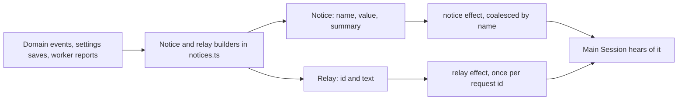

# notices.ts

This file is the vocabulary the application uses to tell the main Session — the orchestrating agent — about things that happened in the background: a domain event, a saved setting, a worker's report, or a person's follow-up message. It defines two message shapes, a background `Notice` that is injected without waking the agent, and a `Relay` that steers it, and it provides the small builder functions that fill them in from stored state. Its most useful takeaway is that the *name* of a notice decides whether a repeat occurrence is merged into a waiting one or delivered as a separate message.

## How the pieces fit together

Everything produced here is a plain value; nothing is delivered from this file. The caller hands the value to the session layer, which enqueues it in the durable effect queue, and the queue injects or steers the main Session later.

<!-- {
  "mermaid_info": {
    "name": "Notice and relay flow to the main Session",
    "nodes": [
      {
        "id": "source_001",
        "name": "Domain events, settings saves, worker reports",
        "path": "",
        "hint": "Abstract origin: runtime event emission, settings saves, worker tool calls",
        "isJumpable": false,
        "position": { "startLine": 0, "endLine": 0 },
        "references": []
      },
      {
        "id": "build_002",
        "name": "Notice and relay builders in notices.ts",
        "path": "src/app/notices.ts",
        "hint": "Pure builders that turn stored state into one notice or relay value",
        "isJumpable": true,
        "position": { "startLine": 14, "endLine": 129 },
        "references": []
      },
      {
        "id": "notice_003",
        "name": "Notice: name, value, summary",
        "path": "src/app/notices.ts",
        "hint": "Tuple whose first element is the coalescing key",
        "isJumpable": true,
        "position": { "startLine": 10, "endLine": 14 },
        "references": []
      },
      {
        "id": "relay_004",
        "name": "Relay: id and text",
        "path": "src/app/notices.ts",
        "hint": "Steering payload with an idempotent request id and a JSON body",
        "isJumpable": true,
        "position": { "startLine": 76, "endLine": 77 },
        "references": []
      },
      {
        "id": "queue_005",
        "name": "notice effect, coalesced by name",
        "path": "src/app/effects.ts",
        "hint": "Effect payload for injecting a background notice without waking the agent",
        "isJumpable": true,
        "position": { "startLine": 20, "endLine": 21 },
        "references": []
      },
      {
        "id": "queue_006",
        "name": "relay effect, once per request id",
        "path": "src/app/effects.ts",
        "hint": "Effect payload for steering a report or message into the main Session",
        "isJumpable": true,
        "position": { "startLine": 18, "endLine": 19 },
        "references": []
      },
      {
        "id": "session_007",
        "name": "Main Session hears of it",
        "path": "",
        "hint": "Abstract consumer: the orchestrating agent receiving a notice or steering message",
        "isJumpable": false,
        "position": { "startLine": 0, "endLine": 0 },
        "references": []
      }
    ]
  }
} -->

    
        <a target="_self" href="#src/app/notices.ts:1?class=graph" style="color: inherit; text-decoration: none;">Graph: Notice and relay flow to the main Session</a>
    

## At a glance

- Primary role: Data contract — it fixes the shapes and field names of the messages the application sends to its own main Session.
- Secondary roles: Domain rules — it also decides which reports and events are worth telling the main Session at all.
- Confidence: High — the whole file was read together with every call site that consumes its builders.

## What this file does

- Defines the two outbound message shapes: a `Notice` tuple injected into the main Session in the background, and a `Relay` object that steers it.
- Builds notices for configuration changes (prompt revisions and settings blocks), naming them so a newer unsent notice replaces an older waiting one instead of queueing duplicates.
- Reports state changes such as a ticket ending, a trigger being requeued, a thread being unsubscribed, or a ticket following a thread for context only.
- Turns worker output into either a `worker_attention` question or a `worker_report` result, with long summaries truncated and readable behind a resource path.
- Decides whether a person's follow-up message should be relayed to the main Session at all, and packages it with the exact tickets it reached.
- Computes the changed dot-separated settings paths, so a settings notice can say what actually changed rather than just that something changed.

## Key functions

### `Notice` and `Relay`

The two contract types: a notice is `[name, value, summary]`, a relay is `{ id, text }`. The name coalesces waiting notices; the id makes steering delivery at most once.

<a target="_self" href="#src/app/notices.ts:10-14?class=code" style="color: inherit; text-decoration: none;">notices.ts:10-14</a>

### `settingsNotice` and `promptsNotice`

Build the notices for a saved settings block (named per block) or a saved prompt configuration revision (named `prompts`), each pointing at a readable resource for the full value.

### `changedPaths`

Returns up to 20 dot-separated paths where two settings objects differ, which is what makes a settings notice informative.

<a target="_self" href="#src/app/notices.ts:25-32?class=code" style="color: inherit; text-decoration: none;">notices.ts:25-32</a>

### `receiptNotice`

Creates a one-off notice whose name is unique per occurrence, so the same kind of event twice produces two deliveries instead of collapsing into one.

### `eventNotice`

Maps an unsolicited domain event to a notice, or to nothing when the main Session needs no message. It is the main entry point for background events.

<a target="_self" href="#src/app/notices.ts:44-68?class=code" style="color: inherit; text-decoration: none;">notices.ts:44-68</a>

### `followupNotice`

Looks up a person's follow-up trigger and returns a relay only when some ticket's worker actually owns that message and at least one reached ticket is live.

### `resultRelay`

Formats a `worker_report` relay with a content-derived id, the ticket card, the reported state, and a truncated summary plus its character count.

### `reportRelay`

Chooses between a `worker_attention` relay for a question a person must answer, a `worker_report` relay for results, blockers, ends and answers, and no relay at all for routine progress.

<a target="_self" href="#src/app/notices.ts:115-129?class=code" style="color: inherit; text-decoration: none;">notices.ts:115-129</a>

## Main inputs and results

- Inputs: a domain event plus a ticket lookup, a trigger id with the store and source registry, a `Ticket` plus a worker report or result text, a settings block with old and new values, or a prompt revision number.
- Results: either a `Notice` tuple ready for background injection, a `Relay` ready for steering, or `undefined` when nothing should reach the main Session.
- Visible side effects: none from this file; the observable effect appears only when a caller enqueues the value and the main Session later receives a notice or steering message.

## The message contract

- Represents: the bounded, model-facing summary of a background change — enough for the orchestrator to know what happened and where to read more, never the full text.
- Produced by: the runtime when it emits domain events, the settings and prompts code when configuration is saved, the migration code when old data is reconciled, and the executor-side tool and executor shutdown paths when a worker reports.
- Consumed by: the session layer, which enqueues notices as `notice` effects keyed by the notice name and relays as `relay` effects keyed by the relay id; from there they reach the main Session.
- Behavior-shaping parts: the notice `name` decides coalescing (a shared name replaces a still-waiting notice, a unique name always delivers), the relay `id` decides idempotence, `read` fields point at the full resource behind a summary, `state` distinguishes attention from ordinary reports, and the `note` fields tell the orchestrator what it may and may not do about the message.

### Compatibility notes

`settingsNotice` with no block argument is still meaningful: it produces the older whole-settings notice named `settings`, which the migration path uses when a historical save recorded no block. Per-block notices use `settings:<block>`, so both forms can coexist without colliding.

## Rules and decisions

- Decision: what does the main Session get to hear about work it did not start itself, and what may it do in response?
- Important conditions: the event type decides which notice is built; a thread unsubscribed by a person is reported as a subscription removal, while one unsubscribed by an executor becomes a "no longer follows thread" notice with an explanatory note. A follow-up is relayed only when a ticket's worker owns it and it reached a live ticket. A report is relayed when it carries a question or is not routine progress.
- Outcomes: a queued notice (coalescing or one-off), a queued steering relay, or nothing at all.
- Invariant: coalescing only affects notices that are still waiting to be delivered; it never permanently suppresses later notices of the same kind, and routine `progress` reports without answers stay internal to the ticket.

### Small example

A person replies on a thread that one open ticket is working on. That message belongs to the ticket's worker, so the main Session receives a `follow_up` relay listing the ticket it reached, with a note saying it should act only if the person asks to stop the work. A later routine `progress` report from that worker produces no relay; a question needing a person produces a `worker_attention` relay instead.

---
name: notices.ts

update-time: 2026-11-02 10:25

description: This file is the vocabulary the application uses to tell the main Session — the orchestrating agent — about things that happened in the background: a domain event, a saved setting, a worker's report, or a person's follow-up message. It defines two message shapes, a background `Notice` that is injected without waking the agent, and a `Relay` that steers it, and it provides the small builder functions that fill them in from stored state. Its most useful takeaway is that the *name* of a notice decides whether a repeat occurrence is merged into a waiting one or delivered as a separate message.

---
