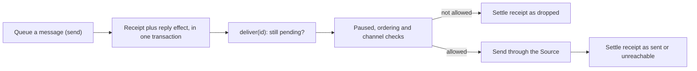

# outbox.ts

This file is the application's answer to one question: what happens to a message the Engine wants to put into a person's chat? `Outbox` turns each message into a permanent receipt, queues a durable `reply` effect, and later delivers the message through the installed Source, retrying when the channel is temporarily unavailable and dropping it when the conversation can never receive it. It is the concrete implementation of the core `Outbox` port that the domain Engine, `Replies`, and the worker tools all depend on.

## Whole-unit functional diagram

<a target="_self" href="#src/app/outbox.ts?class=code" style="color: inherit; text-decoration: none;">Code: src/app/outbox.ts</a>

A message is first recorded and scheduled atomically, so nothing is queued without a receipt and no receipt exists without a queued delivery. Delivery is a separate, retried step: it re-reads the receipt, waits while the runtime is paused or an earlier message to the same conversation is still pending, and finally either sends the message or settles the receipt with a final outcome.

## At a glance

- **Primary role — domain rules:** the file encodes the delivery policy of the product: what counts as delivered, when a message may be dropped, how strictly one conversation's messages must stay in order, and when a message is simply "not now".
- **Secondary role — API boundary:** it implements the `Outbox` port (`send`, `status`, `withdraw`) that the domain layer calls, plus `sent()` which callers use to wait for delivery to finish.
- **Confidence:** High — the file is short and was read in full, together with the core port definition, the receipt store, the effect queue, and the Source registry that define the behavior it relies on.

## What this file does

- **Records every outgoing message idempotently.** A message ID that was already queued keeps its first receipt, so re-running a command cannot send the same acknowledgement, reply, or notice twice.
- **Keeps the receipt and the delivery job together.** The receipt insert and the `reply` effect enqueue happen in one `store.atomic` transaction, so a crash cannot leave a message recorded but never scheduled, or scheduled with no record of what it was.
- **Guards the input the product cares about.** A `reply` for a Feishu conversation is checked against the IM word limit when queued; other kinds (such as acknowledgements) are validated earlier, where they are decided.
- **Delivers later, in order per conversation.** Each ticket's messages to the same conversation wait behind an earlier pending one, so a person does not see a result before the acknowledgement it belongs to.
- **Distinguishes "later" from "failed".** Unavailable or paused conditions throw `Later`, which reschedules the message after the short retry delay without counting as a failure; genuine send errors back off and eventually surface as a health error.
- **Drops what can never arrive.** If the conversation is no longer allowed by its Source, or the Source reports the target is gone, the receipt settles as dropped with a reason instead of being retried forever.

## Delivery rules and decisions

- **Decision — has this message already been queued?** Answered by the permanent receipt for its ID. `send` only enqueues when the receipt is new, and `status` reports `pending`, `sent`, `dropped`, or `undefined` for an unknown ID.
- **Important conditions — may it go out right now?** The message must still be `pending`, its Source instance must be installed and enabled, processing must not be paused, and no earlier message of the same ticket to the same conversation may be pending.
- **Important conditions — is ordering still binding?** An earlier pending message holds later ones back only until it has failed three consecutive delivery attempts; after that threshold, later messages are released so one stuck message cannot block a whole conversation.
- **Outcomes — what can a receipt become?** `sent` (the Source accepted it), `dropped` with reason `channelIgnored` (the Source no longer listens to that conversation) or `channelGone` (a recalled message, deleted issue, or a Source kind without channels), or it stays `pending` while waiting.
- **Invariant — withdrawn means gone for good.** Withdrawing a pending message deletes its receipt and cancels its queued job together; if the message is already in flight and still gets sent, the receipt is recreated as settled so the same ID can never be queued again.
- **Invariant — a pause delays rather than fails.** While the runtime is paused or awaiting setup, the delivery handler's concurrency limit is zero, so messages wait without accumulating failures.

A small example: a ticket's acknowledgement `ack-a` fails once in a Feishu chat. Its result `result-a` stays pending even though other tickets' messages in the same chat go out, because a failed attempt below the threshold still counts as "not yet settled". Once `ack-a` succeeds, `result-a` follows immediately.

## Public contract for callers

- **Caller:** the domain Engine and its `Replies` part queue acknowledgements, answers, results, and attention messages; worker and main-session tools call the runtime's `sendReplies()` (which forwards to `sent()`) to flush outgoing messages before returning control.
- **Operation:** queue a message for delivery, read what became of one, withdraw one that has not gone out, and wait for the reply queue to become idle.
- **Accepted input:** an `OutboundMessage` with a unique `id`, a `channel` (Source plus address), `text`, a `kind` of `acknowledgement`, `reply`, or `notice`, and an optional `ticketId`. Oversized Feishu replies are rejected at queue time.
- **Result:** queueing returns nothing; the outcome is observable later through `status(id)` and through the receipt itself. `sent()` resolves when no `reply` effect is running and none can start.

## Key functions or classes

### `OutboxHost`

The narrow set of collaborators the outbox needs — the store's transaction and receipt slices, the effect queue's enqueue/cancel/handle/idle operations, the Source registry, the Source commands, and a `paused()` probe — which keeps the class easy to construct in the runtime and in tests.

### `Outbox`

The port implementation itself; its constructor registers the single `reply` effect handler with a paused-aware concurrency limit and a 5-second-to-5-minute retry window.

<a target="_self" href="#src/app/outbox.ts:22-25?class=code" style="color: inherit; text-decoration: none;">Code: src/app/outbox.ts:22-25</a>

### `send(message)`

Validates a Feishu reply's length, then records the receipt and enqueues its delivery in one transaction, ignoring duplicate message IDs.

<a target="_self" href="#src/app/outbox.ts:27-32?class=code" style="color: inherit; text-decoration: none;">Code: src/app/outbox.ts:27-32</a>

### `status(id)`

Reports the delivery status of a message ID, which callers use to avoid re-sending or to describe what happened to a message.

### `withdraw(id)`

Removes a message that has not gone out, canceling its queued delivery in the same transaction.

### `sent()`

Resolves once the reply queue is idle, so a tool can report a result only after the messages it caused have actually been delivered.

### `deliver(id)` (private)

The whole delivery policy in one place: pending check, pause and ordering gates, channel permission, the actual send through the Source, and the final receipt settlement.

<a target="_self" href="#src/app/outbox.ts:39-51?class=code" style="color: inherit; text-decoration: none;">Code: src/app/outbox.ts:39-51</a>

## Main inputs and results

- **Inputs:** `OutboundMessage` values from the domain layer, the host's `paused()` state, the Source instance configuration and channel permissions, and the effects queued for the `reply` kind.
- **Results:** a persistent receipt per message ID with a status of `pending`, `sent`, or `dropped` (plus drop reason and timestamp), and a message actually delivered to the Feishu chat or GitHub conversation its channel names.
- **Visible side effects:** operators see stuck messages listed as `outgoing` problems with their attempt count, and these disappear as soon as the message is withdrawn or delivered; the `reply` health entry reports how many messages are waiting and turns to an error state after repeated failures. Related definitions live in 
<a target="_self" href="#src/core/ports.ts:71-83?class=code" style="color: inherit; text-decoration: none;">ports.ts:71-83</a>
, the receipt store in 
<a target="_self" href="#src/app/store.ts:251-288?class=code" style="color: inherit; text-decoration: none;">store.ts:251-288</a>
, and the retry machinery in 
<a target="_self" href="#src/app/effects.ts?class=code" style="color: inherit; text-decoration: none;">effects.ts</a>
.

---
name: outbox.ts

update-time: 2026-11-02 10:27

description: This file is the application's answer to one question: what happens to a message the Engine wants to put into a person's chat? `Outbox` turns each message into a permanent receipt, queues a durable `reply` effect, and later delivers the message through the installed Source, retrying when the channel is temporarily unavailable and dropping it when the conversation can never receive it. It is the concrete implementation of the core `Outbox` port that the domain Engine, `Replies`, and the worker tools all depend on.

---
