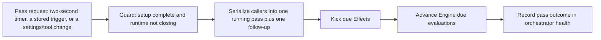

# passes.ts

This file is the heartbeat of the orchestrator: it decides *when* the runtime is allowed to do background work and then performs one coordinated "pass" of that work. A pass first lets the durable `Effects` queue start whatever side effects are due, then asks the `Engine` to advance evaluations, resume waiting work, and expire overdue ones. Everything else in the runtime — sources, tools, settings, HTTP routes — only asks for a pass, while this class keeps those requests serialized, guarded, and visible in the orchestrator's health entry.

## Whole-unit functional diagram

<!-- {
  "mermaid_info": {
    "name": "Orchestration pass flow",
    "nodes": [
      {
        "id": "trigger_001",
        "name": "Pass request: two-second timer, a stored trigger, or a settings/tool change",
        "path": "src/app/passes.ts",
        "hint": "Entry points that ask for a pass: the periodic timer, receive(), and request()",
        "isJumpable": true,
        "position": { "startLine": 28, "endLine": 46 },
        "references": []
      },
      {
        "id": "guard_002",
        "name": "Guard: setup complete and runtime not closing",
        "path": "src/app/passes.ts",
        "hint": "A pass is skipped while setup is incomplete or the runtime is stopping",
        "isJumpable": true,
        "position": { "startLine": 58, "endLine": 58 },
        "references": []
      },
      {
        "id": "coalesce_003",
        "name": "Serialize callers into one running pass plus one follow-up",
        "path": "src/app/passes.ts",
        "hint": "pump() coalesces concurrent requests instead of running passes in parallel",
        "isJumpable": true,
        "position": { "startLine": 59, "endLine": 62 },
        "references": []
      },
      {
        "id": "kick_004",
        "name": "Kick due Effects",
        "path": "src/app/passes.ts",
        "hint": "The first step of a pass asks the effects queue to dispatch what is due",
        "isJumpable": true,
        "position": { "startLine": 63, "endLine": 65 },
        "references": []
      },
      {
        "id": "evaluate_005",
        "name": "Advance Engine due evaluations",
        "path": "src/app/passes.ts",
        "hint": "The second step lets the Engine requeue, start, or wake due work",
        "isJumpable": true,
        "position": { "startLine": 66, "endLine": 68 },
        "references": []
      },
      {
        "id": "health_006",
        "name": "Record pass outcome in orchestrator health",
        "path": "src/app/passes.ts",
        "hint": "A failed pass reports an error; a later successful pass clears it",
        "isJumpable": true,
        "position": { "startLine": 40, "endLine": 46 },
        "references": []
      }
    ]
  }
} -->

    
        <a target="_self" href="#src/app/passes.ts:1?class=graph" style="color: inherit; text-decoration: none;">Graph: Orchestration pass flow</a>
    

The main path is short: something asks for a pass, the request is checked and merged with any pass already running, and the single pass hands work to the effects queue and the Engine in that order. The health entry is the observable outcome, showing operators whether the orchestrator's background work is healthy.

## At a glance

- Primary role: Orchestration — the file owns the order and serialization of the runtime's background work: it decides when effects may run, then when the Engine evaluates due work.
- Secondary roles: Infrastructure — it also provides the scheduling and lifecycle support other parts rely on: a periodic timer, a start/stop pair, a quiescence wait, and health reporting.
- Confidence: High — the whole file is small and was read in full, together with its wiring in 
<a target="_self" href="#src/app/runtime.ts:154-158?class=code" style="color: inherit; text-decoration: none;">runtime.ts:154-158</a>
 and the collaborators it calls.

## What this file does

- **Keeps the runtime moving on a schedule.** Once started, a timer asks for a pass every two seconds, so due effects and overdue evaluations are not left waiting for incoming traffic.
- **Turns incoming work into immediate progress.** When a source hands over a trigger and the Engine stores it, a pass is requested at once so the new work is picked up without waiting for the next tick.
- **Serves on-demand requests from other parts.** Settings changes and main-session tools can request a pass directly, which is why a policy or pause change becomes visible quickly.
- **Prevents overlapping background work.** Concurrent requests are folded into one running pass plus at most one follow-up pass, so effects and evaluations are not started twice over the same work.
- **Holds work back while the runtime is not ready.** Nothing is assessed, dispatched, or sent while setup is incomplete or the runtime is closing; queued work waits for the restart that finishes setup.
- **Reports pass failures and recoveries.** A failed pass marks the orchestrator health entry as `error`, and a later successful pass clears it back to `ready`.

## Coordinated flow

1. **A request arrives.** The two-second timer, a newly stored trigger, a settings change, or a tool calls 
<a target="_self" href="#src/app/passes.ts:40-46?class=code" style="color: inherit; text-decoration: none;">passes.ts:40-46</a>
, which starts a pass and attaches the health bookkeeping for its outcome.
2. **The pass is checked and serialized.** 
<a target="_self" href="#src/app/passes.ts:55-62?class=code" style="color: inherit; text-decoration: none;">passes.ts:55-62</a>
 returns early while setup is incomplete or the runtime is closing; otherwise it runs one pass, or, when a pass is already running, arranges exactly one follow-up.
3. **Effects go first.** The pass calls into the effects queue to start due side effects — assessments, launches, deliveries, relays, notices, replies — which is the runtime's only path from queued intent to actually happening.
4. **The Engine catches up.** It then asks the Engine to handle due evaluations and waiting threads, so triggers that arrived while an evaluation was running get processed on the next opportunity.
5. **Health reflects the result.** Failures surface through the orchestrator health entry, and the next successful pass clears the error, so the overview panel mirrors real runtime state.

### Important branching and concurrency

Two kinds of waiting exist and readers should not confuse them. Requesting a pass never stacks up passes: while one is running, later requests collapse into a single follow-up run after it finishes. Separately, 
<a target="_self" href="#src/app/passes.ts:47-54?class=code" style="color: inherit; text-decoration: none;">passes.ts:47-54</a>
 is the "everything settled" wait: it repeatedly waits for passes and for effects, then re-checks, so callers such as shutdown or verification code only continue once nothing runnable remains.

## Key functions or classes

### `PassesHost`

The contract the class is built against: the Engine calls it needs, the effects queue, its health entry, the lifetime signal, and two predicates — `configured()` and `closing()` — that decide whether work may run. Runtime supplies the real implementations, so the same class works with narrowed or substituted collaborators.

    
        <a target="_self" href="#src/app/passes.ts:6-13?class=code" style="color: inherit; text-decoration: none;">Code: src/app/passes.ts:6-13</a>
    

### `Passes`

The scheduling and serialization object itself: it holds the timer, the running and follow-up pass promises, and the stopped flag.

    
        <a target="_self" href="#src/app/passes.ts:22-69?class=code" style="color: inherit; text-decoration: none;">Code: src/app/passes.ts:22-69</a>
    

### `start()` and `stop()`

`start()` begins the periodic pass timer; `stop()` stops it immediately and resolves once any running or queued pass has settled, so shutdown does not race ongoing work.

### `receive(trigger)`

The path a source uses to hand a trigger to the Engine. It rejects calls made while the runtime is closing, asks the Engine to store and fan out the trigger, and requests a pass when the result is `stored` — duplicates and filtered triggers produce no extra work.

### `request()`

The fire-and-forget entry used by the timer, settings, and tools. It runs a pass and mirrors the outcome into health without making the caller wait.

### `pump()`

The serialization point: skipped while setup is incomplete or the runtime is closing, otherwise one pass runs and every concurrent caller shares it or its single follow-up.

### `idle()`

Waits until no pass and no startable effect remains, looping because finishing an effect can request another pass.

## Runtime support

- **Provides:** a single, guarded trigger for all background progress — the periodic tick plus the on-demand request that sources, settings, and tools reuse.
- **Starts or activates:** only after setup succeeds and the runtime is not closing. In 
<a target="_self" href="#src/app/runtime.ts:215-217?class=code" style="color: inherit; text-decoration: none;">runtime.ts:215-217</a>
 the runtime calls `passes.start()` and then `effects.start()` before reporting itself ready.
- **Used by:** the runtime as its `receive`, `idle`, and `pump` surface; sources through the runtime's host deps; `Settings` and main-session tools through `requestPass()`; and HTTP routes that need to nudge the runtime after a management action.
- **Operational effect:** scheduling and lifecycle only. A pass failure shows up as the orchestrator health entry in `error` state with a "A pass failed" detail, which becomes `ready` again on the next successful pass — that is what operators see in the health overview.

    
        <a target="_self" href="#src/app/passes.ts:28-33?class=code" style="color: inherit; text-decoration: none;">Code: src/app/passes.ts:28-33</a>
    

## Main inputs and results

- Inputs: the host's `configured()` and `closing()` predicates plus `lifetime`; the two-second timer tick; incoming `Trigger` values passed to `receive()`; and pass requests from settings, tools, and HTTP actions.
- Results: `receive()` reports `stored`, `duplicate`, or `filtered`, or throws while the runtime is stopping; `pump()` and `idle()` resolve when work settles; `stop()` resolves once running and queued passes have finished.
- Visible side effects: due effects start executing, overdue evaluations and waiting threads advance, and the orchestrator health entry flips between `ready` and `error` as passes succeed or fail.

---
name: passes.ts

update-time: 2026-11-02 10:30

description: This file is the heartbeat of the orchestrator: it decides *when* the runtime is allowed to do background work and then performs one coordinated "pass" of that work. A pass first lets the durable `Effects` queue start whatever side effects are due, then asks the `Engine` to advance evaluations, resume waiting work, and expire overdue ones. Everything else in the runtime — sources, tools, settings, HTTP routes — only asks for a pass, while this class keeps those requests serialized, guarded, and visible in the orchestrator's health entry.

---
