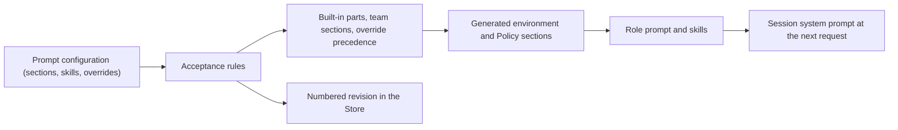

# prompts.ts

`prompts.ts` decides exactly what text each agent is told: the fixed built-in instructions, the three team-written sections, the team's own skills, and any overrides of built-in parts. It composes those pieces into a role system prompt for the orchestrator and worker, and stores each configuration as a numbered revision that the management panel and tools can preview, compare, and restore. The key idea: prompt text is versioned and editable, but what the agents are *allowed* to do never changes with it.

## Overall flow

A configuration arrives from the panel or a tool, is checked against the rules, and is then either persisted as a new revision or turned into a per-role prompt. Composition always re-reads the live execution environment and the current settings, so the main Session's Policy section reflects the settings as they are at each model request rather than as they were when the revision was saved.

## At a glance

- **Primary role — domain rules**: this file answers which text wins for which role, which edits a team may make to built-in text, and which revisions exist. Those are policy decisions, not plumbing.
- **Secondary role — data contract**: it defines the configuration and version shapes that the HTTP views, the `orchestrator_read` resources, the Session builder, and the browser panel all agree on.
- **Secondary role — stored state**: it owns numbered prompt revisions, the baseline revision 0, and the retained copy of built-in text an override was edited from.
- **Confidence**: High — the whole file was read together with its collaborators (`versions.ts`, `context.ts`, `execution-environment.ts`, `kv.ts`, `sessions.ts`, `http.ts`, `resources.ts`).

## What this file does

- **Names the editable surface.** Team sections (`communication`, `scope`, `delivery`), team skills, and overrides of built-in parts are the only things a team can change; everything else follows the shipped text.
- **Composes both role prompts in a fixed order.** Shared rules, the role's own instructions, the three team sections, the role's guides, the admission policy (orchestrator only), the handoff policy, the execution environment, and finally the Policy section — so a change to one part leaves the rest untouched.
- **Generates the volatile sections from live data.** The execution environment comes from the resolved variables (or an explicit "waiting for setup" line), and the Policy section lists the Policy version, accept mode, and every enabled rule from current settings.
- **Enforces the rules that make edits safe.** Overrides must name a known part, hold non-empty text, and keep their template's placeholders; overrides that no longer differ from the built-in text disappear; oversized configurations are refused.
- **Versions saves against a stale base.** Saving with an outdated revision throws `PromptConflict`, which the management routes turn into a 409 so the panel can compare before retrying.
- **Reports upgrade impact.** When the shipped text of a part changes, `defaultChanged` lists the affected overrides together with the built-in text they were written against, so a team can see what it may have missed.

## Key functions or classes

### `Prompts`

The service that owns revisions and composition; `Sessions` asks it for prompts and skills, while the HTTP routes and `orchestrator_*` tools validate, preview, and save through it.

    
        <a target="_self" href="#src/app/prompts.ts:135-237?class=code" style="color: inherit; text-decoration: none;">Code: src/app/prompts.ts:135-237</a>
    

### `builtInParts`

The catalogue of every overridable part, keyed by the name an override uses, together with the roles that read it and the placeholders an override must keep.

    
        <a target="_self" href="#src/app/prompts.ts:55-70?class=code" style="color: inherit; text-decoration: none;">Code: src/app/prompts.ts:55-70</a>
    

### `promptParts`

Builds the ordered list of sections for one role and drops empty ones, which is what makes the assembled prompt reproducible and diff-able.

    
        <a target="_self" href="#src/app/prompts.ts:102-116?class=code" style="color: inherit; text-decoration: none;">Code: src/app/prompts.ts:102-116</a>
    

### `Prompts.compose`

Returns the finished prompt for a role, regenerating the environment and Policy sections on every call.

    
        <a target="_self" href="#src/app/prompts.ts:142-144?class=code" style="color: inherit; text-decoration: none;">Code: src/app/prompts.ts:142-144</a>
    

### `Prompts.validate`

Turns untrusted input into a storable configuration, applying the override, placeholder, naming, and size rules.

    
        <a target="_self" href="#src/app/prompts.ts:164-181?class=code" style="color: inherit; text-decoration: none;">Code: src/app/prompts.ts:164-181</a>
    

### `Prompts.save`

Writes the next revision atomically after checking the base revision, keeping revision 0 as the built-in baseline and recording the built-in text each override was edited from.

    
        <a target="_self" href="#src/app/prompts.ts:202-216?class=code" style="color: inherit; text-decoration: none;">Code: src/app/prompts.ts:202-216</a>
    

### `Prompts.history`

Pages back through revisions and says which sections, skills, or overrides changed in each, marking pre-team-section revisions as non-comparable legacy entries.

    
        <a target="_self" href="#src/app/prompts.ts:217-236?class=code" style="color: inherit; text-decoration: none;">Code: src/app/prompts.ts:217-236</a>
    

### `Prompts.defaultChanged`

Lists overrides whose shipped text has moved on, or whose part no longer exists, with the older built-in text when this installation kept it.

    
        <a target="_self" href="#src/app/prompts.ts:186-194?class=code" style="color: inherit; text-decoration: none;">Code: src/app/prompts.ts:186-194</a>
    

### `savePrompts`

Wraps `save` with the user-visible follow-up: it notifies the main Session about the new revision unless the save came from the main Session's own tool call, and reports when the change takes effect.

    
        <a target="_self" href="#src/app/prompts.ts:239-247?class=code" style="color: inherit; text-decoration: none;">Code: src/app/prompts.ts:239-247</a>
    

## Main inputs and results

- **Inputs**: a prompt configuration (team section text, team skills, optional overrides), a role (`orchestrator` or `worker`), the resolved execution-environment variables, current `Settings`, a base revision plus a save origin (`panel`, `tool`, or `sync`), and the configured character limit.
- **Results**: an assembled prompt string per role, a list of `[name, text]` skills to register, a validated configuration, a saved `PromptVersion`, a paginated history with change markers, or a `DefaultChange` list.
- **Visible side effects**: the panel shows the preview, history, and conflict messages; a saved revision produces a main-Session notice (unless it came from the main Session's own tool); the next model request uses the new text, and each Session's prompt is prefixed with its revision number. Rejected input surfaces as a user error for an unknown part, empty part, missing placeholder, or a configuration over the limit.

## Rules and decisions

- **Decision**: for each role, which text is told — fixed built-in instructions, team-written sections, or a team override — and in what order.
- **Important conditions**: whether the named part exists in this version; whether the override text still differs from the shipped text; whether the required placeholders survived; whether the base revision still matches; whether a Feishu bot is configured (feishu skill only then); whether setup has resolved environment variables yet.
- **Outcomes**: a configuration is stored as the next revision, or refused with a user error naming the offending part; a stale base revision raises `PromptConflict`; an override whose part vanished from a later version is dropped when the saved version already held it and refused otherwise.
- **Invariant**: prompt text changes what agents are told, never what the system permits — tool permissions, the gate, and account wrappers stay in force regardless of what a team writes.
- **Invariant**: the main Session's Policy section always comes last and nothing follows it, and it is regenerated from current settings rather than frozen into the revision.

### Small example

Suppose a team overrides the execution-environment part to add its own wording but deletes `{variables}`. Validation refuses the save and names the missing placeholder, because composition fills that slot with the live variable list. If the team instead edits the text back to exactly the shipped wording, the override is quietly dropped and the part follows the built-in text again.

## Information contract

- **Represents**: a `PromptConfig` — three team section bodies, a map of team skill names to text, and optional overrides of built-in parts — and a `PromptVersion`, a numbered snapshot of that configuration with its revision, previous revision, save time, save origin, and optionally a preserved legacy configuration.
- **Produced by**: team edits from the management panel and the `orchestrator_*` prompt tools; defaults are derived from the shipped team-section text.
- **Consumed by**: the panel views and the orchestrator resources (current revision, one revision by number, the built-in defaults), the Session builder, and the client editor.
- **Behavior-shaping parts**: an override's `base` decides whether an upgrade changed the text it was edited from; `legacy` prevents misleading field-by-field diffs; a skill name must look like a slug and must not collide with the built-in `feishu` or `github` skills, since those two names always resolve to bundled text.

### Compatibility notes

Revisions written before team sections existed are flagged as legacy and are compared only coarsely, and an override naming a part that a later version removed is dropped rather than failing the save — both keep older stored configurations loadable.

## Stored state lifecycle

- **Stores**: numbered prompt revisions plus a pointer to the current one, the built-in baseline as revision 0, and the shipped text of a part keyed by its own hash so a later upgrade can show what changed beneath an override.
- **Read path**: `current()` and `version(n)` serve the panel, resources, and Session creation; before any save, revision 0 resolves to the built-in defaults without needing a stored record.
- **Write path**: `save` runs inside a single atomic store operation that re-checks the base revision, records the baseline on the very first custom save, retains the referenced built-in texts, and then advances the pointer to the new snapshot.
- **Visible result**: the panel can walk the revision history, see which fields changed, and load an earlier configuration back into the editor; each Session reports the revision it is working under.

### Important persistence behavior

A save that loses the race against another save fails loudly instead of overwriting, and the caller is expected to compare the latest revision first — the management routes translate that into an HTTP 409. Saves also report which delivery the main Session will see the change through on its next request.

---
name: prompts.ts

update-time: 2026-11-02 10:33

description: `prompts.ts` decides exactly what text each agent is told: the fixed built-in instructions, the three team-written sections, the team's own skills, and any overrides of built-in parts. It composes those pieces into a role system prompt for the orchestrator and worker, and stores each configuration as a numbered revision that the management panel and tools can preview, compare, and restore. The key idea: prompt text is versioned and editable, but what the agents are *allowed* to do never changes with it.

---
