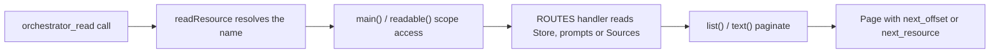

# resources.ts

This file is the catalogue and router behind `orchestrator_read`, the tool both the main Session and a ticket's worker Session use to fetch context. Large bodies — ticket details, transcripts, prompt versions, Feishu and GitHub originals — stay out of the model's prompt until a Session asks for one page of them. Every page it returns names the next offset to read, so a Session can walk from a list to a single object without hashes or hidden identifiers. It is also the place where the project decides which resources a worker may read for its own ticket at all.

## Whole-unit functional flow

A tool call arrives with a resource name such as `tickets`, `thread/<key>` or `ticket/<id>/result`; `readResource` finds the matching route, the route first checks whether this Session is allowed to see it, then projects the stored data through the shared card helpers and returns a slice sized by the caller's offset and limit. External originals take the same path, with their body fetched once and cached so later offsets read the same snapshot.

## At a glance

- **Primary role**: API boundary — it defines one callable operation (`readResource`), the resource names callers may pass, the page shapes they receive, and the errors they get for unknown or unreachable names.
- **Secondary role**: Domain rules — it encodes the project's real access policy: a worker Session sees only its own ticket, its own threads, the messages that actually reached it, and the prompt revisions it ran under.
- **Confidence**: High — the behaviour is read directly from the 309-line source, its two call sites in `src/app/tools/main.ts` and `src/app/tools/executor.ts`, and the "Read resources" table in `docs/007-architecture.md`.

## What this file does

- **Publishes the resource catalogue.** `RESOURCES` lists every readable name with a plain-language description of what it holds, and marks with `executor: true` the ones a worker Session may read. `resourceGrammar` turns that list into the `resource` parameter description of the tool schema, so the documentation the model sees is generated from the same table the router uses.
- **Resolves a resource name to a handler.** Path-style names such as `ticket/<id>/report/<id>` and `prompts/3` are matched by prefix, the remainder becoming `rest`; legacy prefixes `event/`, `task/` and `observation/` are rewritten to their current names so references in older Session history stay readable.
- **Separates the two audiences.** A worker call carries a ticket id and is refused the main-Session-only resources, while the main Session receives the richer variants that include decision ids, other tickets and settings blocks.
- **Returns self-describing pages.** Lists come back as `{ items, next_offset }` with newest-first ordering where it matters, text as `{ resource, offset, total_chars, next_offset, text }` sliced so pages concatenate back into the exact string.
- **Reuses the shared projections.** Pages are built from the same card helpers the UI uses, so a Session and a human operator see the same ticket, thread and decision shapes.
- **Keeps source originals coherent.** Feishu and GitHub bodies are fetched through the command runner, cached per Session and resource, and required to be read from offset 0 first.

## Key functions or classes

### `RESOURCES`

The descriptor table of readable resources with their descriptions and the worker-readable flag.

    
        <a target="_self" href="#src/app/resources.ts:24-55?class=code" style="color: inherit; text-decoration: none;">Code: src/app/resources.ts:24-55</a>
    

### `resourceGrammar`

Renders the catalogue, optionally filtered to worker-readable entries, as the text of the tool's `resource` parameter.

    
        <a target="_self" href="#src/app/resources.ts:56-57?class=code" style="color: inherit; text-decoration: none;">Code: src/app/resources.ts:56-57</a>
    

### `readResource`

The single exported operation: normalises the name, picks the route, chooses the Session identity and dispatches with the page request.

    
        <a target="_self" href="#src/app/resources.ts:295-308?class=code" style="color: inherit; text-decoration: none;">Code: src/app/resources.ts:295-308</a>
    

### `ROUTES`

The prefix table of handlers, one per resource family, each producing either a paged list, a card object or a text page.

    
        <a target="_self" href="#src/app/resources.ts:118-293?class=code" style="color: inherit; text-decoration: none;">Code: src/app/resources.ts:118-293</a>
    

### `main`

The guard that refuses main-Session-only resources to a worker call, and narrows the host type once the check passes.

    
        <a target="_self" href="#src/app/resources.ts:82-86?class=code" style="color: inherit; text-decoration: none;">Code: src/app/resources.ts:82-86</a>
    

### `sourcePage`

Fetches a Feishu or GitHub original on offset 0, stores it in the per-Session page cache, and serves later offsets from that snapshot.

    
        <a target="_self" href="#src/app/resources.ts:103-110?class=code" style="color: inherit; text-decoration: none;">Code: src/app/resources.ts:103-110</a>
    

### `list`

The list pager: default 20 items, at most 50, returning the page plus the next offset or `null`.

    
        <a target="_self" href="#src/app/resources.ts:88-92?class=code" style="color: inherit; text-decoration: none;">Code: src/app/resources.ts:88-92</a>
    

## Main inputs and results

- **Inputs**: a resource name string; a character or item `offset`; an optional `limit`; an optional `ticketId` that marks the call as coming from a worker Session for that ticket; an optional abort signal used when fetching originals; and the host bundle supplying the store, page cache, prompts, settings, commands, session controller and `sourceLink`.
- **Results**: an object whose shape follows the resource — `{ items, next_offset }` for lists, `{ resource, offset, total_chars, next_offset, text }` for text, or a card/detail object such as `ticketDetails`, `decisionDetails` or a prompt version — plus resource-name hints like `read:` and `next_resource:` that point at the next hop.
- **Visible side effects**: the only writes are in-memory page snapshots in the shared `TextCache`, keyed by Session and resource; nothing is persisted, so a refresh of the process simply means the next read starts again from offset 0. Unknown, inaccessible or wrongly ordered reads surface as thrown errors that the tool layer reports back to the model.

## Public contract

- **Caller**: the `orchestrator_read` tool implementation, built once for the main Session and once per worker Session, which forwards the model's `resource`, `offset` and `limit` plus its own ticket id and abort signal.
- **Operation**: read exactly one page of one named context resource.
- **Accepted input**: a name from the catalogue, optionally extended with an id segment; `offset` counting characters for text and items for lists; `limit` defaulting to 4000 characters / 20 items and capped at 8000 characters / 50 items by the tool schema. `settings`, `models`, `prompts` history and the preview resource are main-Session only, and `feishu/…` / `github/…` additionally need a trigger whose source supports them.
- **Result**: the requested page, or a distinct error — "unknown resource", "unknown trigger", "not reached" style refusals, a wrong-ticket refusal, or the reminder to read a source resource from offset 0 first.

### Access and validation requirements

The ticket id is the whole authorisation context: when it is present the call is a worker call and every route that needs the richer view refuses it, while the main Session passes no ticket id and reaches the wider resources. Prompt versions are additionally checked against the revisions that Session actually ran under, and the preview resource is looked up under the caller's own Session key so one Session cannot read another's preview.

## Rules and decisions

- **Decision**: what may a Session see of the system's state? The answer differs by role — the main Session orchestrates and needs the whole picture, a worker needs only what concerns its own ticket.
- **Important conditions**: a worker reading `thread/<key>` must find its ticket subscribed to, or following, that thread; `trigger/<id>` must have reached the ticket through delivery, ticket origin or a followed thread; `ticket/<id>` must be the worker's own ticket; and worker pages deliberately omit decision ids, other tickets' fan-out and other threads' decisions.
- **Outcomes**: a full page, a reduced worker page with the same shape but fewer fields, or a refusal that names the reason instead of leaking whether the object exists.
- **Invariant**: every id that appears on a page can itself be read through some resource, so a Session can always walk from a list to the object it just saw. Text pagination slices by code unit so consecutive pages reassemble the original string exactly.

### Small example

A worker working on ticket `t1` calls `orchestrator_read trigger/<id>`. The route loads the trigger, checks that it reached `t1`, then returns the text plus only the replied-to and neighbouring messages `t1` could read anyway; a trigger the ticket never received answers with the "not reached" refusal, and the worker learns nothing else about it.

---
name: resources.ts

update-time: 2026-11-02 10:35

description: This file is the catalogue and router behind `orchestrator_read`, the tool both the main Session and a ticket's worker Session use to fetch context. Large bodies — ticket details, transcripts, prompt versions, Feishu and GitHub originals — stay out of the model's prompt until a Session asks for one page of them. Every page it returns names the next offset to read, so a Session can walk from a list to a single object without hashes or hidden identifiers. It is also the place where the project decides which resources a worker may read for its own ticket at all.

---
