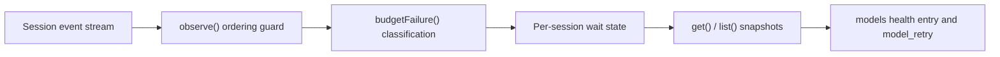

# retry-health.ts

This file answers one operational question for the rest of the application: *which managed sessions are currently stuck waiting on a model budget retry?* It watches the ordered event stream each session already produces and keeps a small per-session picture of an active budget wait, without changing the retry policy, the model choice or the logs. `Sessions` feeds it events and mirrors the result into the `models` health entry and into per-session retry status, so operators can see a budget problem instead of a silently stalled team.

## Whole-unit functional diagram

The main path is short by design: `Sessions` forwards every session event, `observe` discards anything it cannot trust (bad ordinals, duplicates, older turns or steps) and only then asks `budgetFailure` whether the retried failure is really budget exhaustion. A confirmed wait becomes per-session state, which `get` and `list` expose as detached copies to the health entry and status listings.

## At a glance

- Primary role: Domain rules — the file encodes the policy for "a session is waiting on a model budget retry", including what counts as budget exhaustion and when the wait is over.
- Secondary roles: Data contract — it defines the event shape it accepts and the status shape it hands to callers.
- Confidence: High — the whole 92-line source was read, together with its consumer in `sessions.ts` and its test suite in `tests/retry-health.spec.ts`.

## What this file does

- Builds a per-session view of budget retries purely by replaying events, so nothing in the model or retry path is modified.
- Recognizes budget exhaustion from structured failure metadata (`budget_exceeded` type or code, including inside a JSON error body) or the known plain-text provider message, while explicitly refusing to treat auth, rate-limit and context/token-limit errors as budget waits.
- Protects that picture from messy streams: duplicate or out-of-order events, older turns and steps, and late events after a final state are ignored rather than reviving a stale wait.
- Decides when a wait ends — a non-interrupted model message from the same provider, an older turn or step starting, turn end, or an explicit `clear` — and refuses to end it merely because a retry attempt started.
- Publishes bounded, detached status values so callers cannot mutate internal state and failure text or policy data never leaks into health output.

## Rules and decisions

- Decision: is this session blocked because its model budget ran out, and for how many attempts? The answer is derived only from retry events that carry a genuine budget failure, never from assistant or user message text.
- Important conditions: a retry event only counts when it has a valid retry id, a valid provider, a positive integer attempt counter, and turn/step values that are not older than the current position. Authentication, rate-limit and context/token-limit failures are excluded even if their text mentions a budget, and a new attempt for the same chain is ignored unless its attempt number increased.
- Outcomes: the session either has no active wait (not reported at all), or one active wait with provider, attempt count, first-seen time and last-updated time.
- Invariant: sequence numbers only move forward, and the reported status is always a copy — `get` and `list` callers can mutate what they receive without changing the tracked wait.

### Small example

A worker's provider answers `400` with a body saying the budget has been exceeded, and the retry schedule reports attempt 1. The session now appears as waiting, with `since` set to that event's time. When the retry is actually started the status stays, because starting an attempt is not recovery; when the same provider finally returns an uninterrupted model message, the wait disappears. If the next retry instead fails with a `429` rate-limit error, the budget wait is cleared, since the cause has changed.

## Information contract

- Represents: `RetryHealthEvent` is the minimal slice of a session event this file needs (type, sequence, timestamp, opaque data), and `BudgetRetryStatus` is the compact public statement of a wait: session, provider, attempts, `since` and `lastAt`.
- Produced by: the status is produced here from `observe` and `restore`; events come from the native session streams that `Sessions` subscribes to.
- Consumed by: `Sessions` reads a single session's status into the `model_retry` field of status listings and aggregates `list()` into the `models` health entry's error detail.
- Behavior-shaping parts: `attempts` drives the reported retry count, `since` and `lastAt` give operators the wait duration, and `provider` is the anchor that ties success detection to the chain that is actually waiting; an unrecognizable provider label is reported as `unknown` so it cannot inject unexpected text into health output.

## Key functions or classes

### `RetryHealth`

Owns the private map from session id to tracked position and active wait; all other methods are views or mutations of that map.

<a target="_self" href="#src/app/retry-health.ts:29-91?class=code" style="color: inherit; text-decoration: none;">retry-health.ts:29-91</a>

### `budgetFailure`

The classifier: decides whether a retried failure is model budget exhaustion, favoring structured metadata over free text.

<a target="_self" href="#src/app/retry-health.ts:10-23?class=code" style="color: inherit; text-decoration: none;">retry-health.ts:10-23</a>

### `RetryHealth.observe`

The only writer of live state: validates the event, advances the sequence watermark, handles turn and step boundaries, and records, keeps or clears the active wait.

### `RetryHealth.restore`

Replays an ordered snapshot for a session from scratch, so a restored or freshly decorated agent reconstructs only its active wait.

### `RetryHealth.clear`

Clears the visible wait while keeping the sequence watermark, so late replayed events cannot bring the wait back.

### `RetryHealth.get` / `RetryHealth.list`

Return detached copies for one session or for every currently waiting session, which is what status listings and the health entry actually show.

## Main inputs and results

- Inputs: session ids plus ordered session events (`turn/start`, `turn/end`, `step/start`, `llm/retry`, `assistant/message`, and ignored ones such as `llm/retry-started`), each with a sequence, a timestamp and a data payload containing turn, step, provider, retry id, attempt number and failure metadata.
- Results: a `BudgetRetryStatus` per waiting session, or nothing at all for sessions that are not waiting, plus replay and clearing operations that update that set.
- Visible side effects: the `models` health entry reports an error naming the affected sessions, their providers, attempt counts and wait start times, and ticket-card status listings carry the same information as `model_retry`. Health output is deliberately bounded and free of failure messages, retry policy keys and provider text that fails the safe-label check.

---
name: retry-health.ts

update-time: 2026-11-02 10:34

description: This file answers one operational question for the rest of the application: *which managed sessions are currently stuck waiting on a model budget retry?* It watches the ordered event stream each session already produces and keeps a small per-session picture of an active budget wait, without changing the retry policy, the model choice or the logs. `Sessions` feeds it events and mirrors the result into the `models` health entry and into per-session retry status, so operators can see a budget problem instead of a silently stalled team.

---
