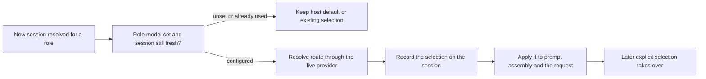

# role-models.ts

This file decides which model a newly created session actually runs on. It takes the per-role model configured in settings (the evaluator/orchestrator role or the worker role) and seeds it onto a brand-new session *before* that session's first request — without changing the global DSH default that every other session inherits. It also exposes the same route-resolution step so settings can reject a provider/model pair that the live provider cannot serve.

## Whole-unit functional diagram

<!-- {
  "mermaid_info": {
    "name": "New session role model seeding",
    "nodes": [
      {
        "id": "trigger_001",
        "name": "New session resolved for a role",
        "path": "src/app/sessions.ts",
        "hint": "Session setup passes the configured eval or executor model for the role",
        "isJumpable": true,
        "position": { "startLine": 149, "endLine": 150 },
        "references": []
      },
      {
        "id": "check_002",
        "name": "Role model set and session still fresh?",
        "path": "src/app/role-models.ts",
        "hint": "Guards that a model exists and the session has no request header or selection yet",
        "isJumpable": true,
        "position": { "startLine": 15, "endLine": 17 },
        "references": []
      },
      {
        "id": "inherit_003",
        "name": "Keep host default or existing selection",
        "path": "src/app/role-models.ts",
        "hint": "Unset or resumed sessions are left exactly as they are",
        "isJumpable": true,
        "position": { "startLine": 16, "endLine": 17 },
        "references": []
      },
      {
        "id": "resolve_004",
        "name": "Resolve route through the live provider",
        "path": "src/app/role-models.ts",
        "hint": "Turns the configured provider/model into a concrete call config",
        "isJumpable": true,
        "position": { "startLine": 8, "endLine": 12 },
        "references": []
      },
      {
        "id": "seed_005",
        "name": "Record the selection on the session",
        "path": "src/app/role-models.ts",
        "hint": "Appends a model/selection event without touching the global default",
        "isJumpable": true,
        "position": { "startLine": 18, "endLine": 20 },
        "references": []
      },
      {
        "id": "apply_006",
        "name": "Apply it to prompt assembly and the request",
        "path": "src/app/role-models.ts",
        "hint": "Prepended listeners pin the initial prompt variables and the first request",
        "isJumpable": true,
        "position": { "startLine": 23, "endLine": 42 },
        "references": []
      },
      {
        "id": "later_007",
        "name": "Later explicit selection takes over",
        "path": "src/app/role-models.ts",
        "hint": "Once the session records a header or a new selection, the seed stops applying",
        "isJumpable": true,
        "position": { "startLine": 37, "endLine": 39 },
        "references": []
      }
    ]
  }
} -->

    
        <a target="_self" href="#src/app/role-models.ts:1?class=graph" style="color: inherit; text-decoration: none;">Graph: New session role model seeding</a>
    

The main path starts when session setup asks for a role model for a session it just resolved. If a model is configured and the session is untouched, the route is resolved and seeded, then applied to exactly the first assembled step; anything after that belongs to whoever selects a model next.

## At a glance

- **Primary role — domain rules**: the file encodes the rule for *when* a configured role model may influence a session and when it must stay out of the way.
- **Secondary role — orchestration**: it sequences several steps — guard checks, provider resolution, session event recording, request-time interception, and a persistence flush — against DSH's session and agent lifecycle.
- **Confidence**: High — both exported functions, their callers in session setup and settings saving, and a dedicated behavior test suite are readable in the workspace.

## What this file does

- **Pins the role's configured model to new sessions.** A freshly created evaluator or worker session starts its first request on the provider/model chosen in settings, instead of inheriting the generic default.
- **Leaves the global DSH default alone.** The selection is injected for the initial request only, deliberately avoiding the API that would mutate the shared default for every session.
- **Protects existing work.** Sessions that already carry a request header or a recorded model selection are skipped entirely — a resumed session keeps whatever it was using, and the provider is not even asked about the configured route.
- **Lets a human override later.** After the session records a header or a new selection, the seeded model stops being forced, so a manual model change in the UI governs subsequent turns.
- **Fails loudly on unusable routes.** The resolver goes through the live provider (catalog membership is not treated as a restriction), so an unknown provider or model surfaces as an error before anything is written to the session, and settings saving turns that into a "model unavailable" rejection.

## Rules and decisions

- **Decision**: should this session run on the role's configured model, or on whatever the host/session already has?
- **Important conditions**: no configured role model (`null`) means "do nothing"; an existing request header or an existing `model/selection` event means "do nothing"; otherwise the configured route must resolve through the live provider before it is recorded.
- **Outcomes**: the session is seeded and its first step routes to the role model; or the session is left untouched and inherits the host default; or the call throws because the provider/model combination cannot be resolved, with no selection recorded.
- **Invariant**: seeding never changes the global DSH default, and it never rewrites a session that has already recorded a model decision.

### Small example

Settings configure the worker role as provider `worker-provider`, model `worker-model`. A new worker session is created: its opening prompt assembly and its first request both go to `worker-model`, and no other session is affected. If an operator then switches that session to a different model, the switch wins for every following turn, and if the session is later resumed, the seeded logic does nothing at all.

## Coordinated flow

1. Session setup resolves or creates the session for a role and reads that role's model from settings: the evaluator model for the orchestrator role, the executor model for the worker role.
2. `initializeRoleModel` applies the guard checks, so unset models and already-used sessions return before any provider call.
3. The configured route is resolved into a concrete selection, appended to the session as a `model/selection` event, and persisted by flushing session persistence. The selection is also pinned to prompt assembly and the agent request through prepended handlers that are removed again when the effect is disposed.
4. DSH's own request pipeline owns the observable outcome: the first request and its retries run on the role model, and any later explicit selection takes over from the next assembly onward.

### Important branching or concurrency

The first assembled step keeps the role model even if a different selection arrives while that step is still in flight; the change only takes effect on the following assembly, which matches how retries of an in-progress step must not silently switch models.

Related files that make this behavior observable: 
<a target="_self" href="#src/app/sessions.ts:149-150?class=code" style="color: inherit; text-decoration: none;">sessions.ts:149-150</a>
 for the new-session trigger, 
<a target="_self" href="#src/app/settings.ts:160-165?class=code" style="color: inherit; text-decoration: none;">settings.ts:160-165</a>
 for save-time validation, and 
<a target="_self" href="#tests/role-models.spec.ts?class=code" style="color: inherit; text-decoration: none;">tests/role-models.spec.ts</a>
 for the verified behavior.

## Key functions or classes

### `resolveRoleModel`

Asks the live provider to turn a configured provider/model (plus optional reasoning effort) into the concrete model selection a request can use, and rethrows provider errors so callers can report an unusable route.

    
        <a target="_self" href="#src/app/role-models.ts:8-12?class=code" style="color: inherit; text-decoration: none;">Code: src/app/role-models.ts:8-12</a>
    

### `initializeRoleModel`

Seeds the resolved role model onto a brand-new session before its first request, then lets later manual or durable selections take precedence.

    
        <a target="_self" href="#src/app/role-models.ts:15-44?class=code" style="color: inherit; text-decoration: none;">Code: src/app/role-models.ts:15-44</a>
    

## Main inputs and results

- **Inputs**: the plugin context with its live provider (`ctx.llm`), session persistence, and event bus; the target agent and its session; and the role's configured model (`provider`, `model`, optional `reasoningEffort`) from the shared settings schema, or `null` when the role runs on defaults.
- **Results**: a resolved model selection, a `model/selection` event recorded on the session, role-model provider/model carried in the assembled system prompt variables and in the first agent request, and a persistence flush that makes the seed durable.
- **Visible side effects**: new role sessions start on the model chosen in settings while the global default stays unchanged, resumed or already-switched sessions keep their own model, and a bad provider/model pair shows up as an error when settings are saved rather than as a silently different model in a running session.

---
name: role-models.ts

update-time: 2026-11-02 10:47

description: This file decides which model a newly created session actually runs on. It takes the per-role model configured in settings (the evaluator/orchestrator role or the worker role) and seeds it onto a brand-new session *before* that session's first request — without changing the global DSH default that every other session inherits. It also exposes the same route-resolution step so settings can reject a provider/model pair that the live provider cannot serve.

---
