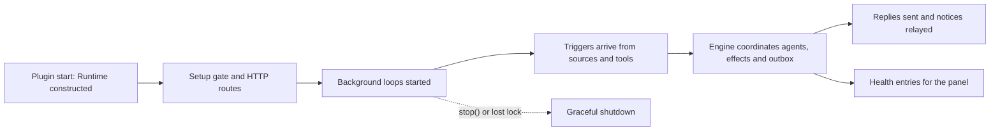

# runtime.ts

`src/app/runtime.ts` is the composition root of dsh-superagent: one class that builds every other part of the application, starts it in a safe order, and shuts it down cleanly. If you want to understand how the store, setup checks, engine, sources, sessions, tools, HTTP panel and background loops fit together, this is the file to read first — every other module is handed its collaborators here. It also owns the process-level safeguards: the state-directory lock, the shared abort signal, the health board, and the `orchestrator` Cordis service that source plugins talk to.

## Overall functional flow

The left branch is startup: build the object graph, lock the state directory, register management routes, then open the gates on background work. The middle branch is steady state, where incoming triggers are handed to the `Engine`, which drives agent work and produces replies, notices and health information. The dashed edge is the exit path taken by `stop()` or by a lock compromise.

<!-- {
  "mermaid_info": {
    "name": "Runtime composition and lifecycle flow",
    "nodes": [
      {
        "id": "startup_001",
        "name": "Plugin start: Runtime constructed",
        "path": "src/app/runtime.ts",
        "hint": "Constructor locks the state directory, opens the SQLite store and instantiates every collaborator",
        "isJumpable": true,
        "position": { "startLine": 87, "endLine": 98 },
        "references": []
      },
      {
        "id": "setup_002",
        "name": "Setup gate and HTTP routes",
        "path": "src/app/runtime.ts",
        "hint": "Management routes are registered first, then setup resolves the deployment or leaves the runtime paused",
        "isJumpable": true,
        "position": { "startLine": 201, "endLine": 207 },
        "references": []
      },
      {
        "id": "loops_003",
        "name": "Background loops started",
        "path": "src/app/runtime.ts",
        "hint": "Installs sessions and executor, ensures the master session, syncs settings, then starts passes and effects",
        "isJumpable": true,
        "position": { "startLine": 208, "endLine": 217 },
        "references": []
      },
      {
        "id": "intake_004",
        "name": "Triggers arrive from sources and tools",
        "path": "src/app/runtime.ts",
        "hint": "receive() forwards an incoming trigger to the pass coordinator",
        "isJumpable": true,
        "position": { "startLine": 194, "endLine": 194 },
        "references": []
      },
      {
        "id": "engine_005",
        "name": "Engine coordinates agents, effects and outbox",
        "path": "src/app/runtime.ts",
        "hint": "The Engine is wired with policy, assessor, executor, outbox and an emit callback for domain events",
        "isJumpable": true,
        "position": { "startLine": 137, "endLine": 153 },
        "references": []
      },
      {
        "id": "delivery_006",
        "name": "Replies sent and notices relayed",
        "path": "src/app/runtime.ts",
        "hint": "Outbox delivery and main-session notices expose results outside the process",
        "isJumpable": true,
        "position": { "startLine": 197, "endLine": 197 },
        "references": []
      },
      {
        "id": "health_007",
        "name": "Health entries for the panel",
        "path": "src/app/runtime.ts",
        "hint": "Read-only health snapshot composed from the runtime health board",
        "isJumpable": true,
        "position": { "startLine": 173, "endLine": 173 },
        "references": []
      },
      {
        "id": "stop_008",
        "name": "Graceful shutdown",
        "path": "src/app/runtime.ts",
        "hint": "Idempotent stop cancels agents, drains work, closes the store and releases the directory lock",
        "isJumpable": true,
        "position": { "startLine": 228, "endLine": 253 },
        "references": []
      }
    ]
  }
} -->

    
        <a target="_self" href="#src/app/runtime.ts:1?class=graph" style="color: inherit; text-decoration: none;">Graph: Runtime composition and lifecycle flow</a>
    

## At a glance

- **Primary role — Orchestration**: the file coordinates several meaningful steps — building collaborators, ordering startup, gating work on setup readiness, and sequencing shutdown — rather than implementing business rules itself.
- **Secondary role — Infrastructure**: it also hosts shared runtime support: the state-directory lock, the `lifetime` abort signal, the health board, and the `orchestrator` service other modules and source plugins consume.
- **Confidence**: High — the class doc comment, constructor body, `initialize()` and `shutdown()` together show one composition root that wires every subsystem and owns startup and teardown.

## What this file does

- **Builds the whole application in one place**: the constructor creates the SQLite `Store`, `Setup`, `Prompts`, `Effects`, `SourceRegistry`, `Sessions`, `Settings`, `DshExecutor`, `MasterAssessor`, `Outbox`, `Engine` and `Passes`, then hands each one the collaborators it needs.
- **Protects persistent state**: before the database is opened it creates the state directory and takes a file lock, so a second process cannot migrate or write concurrently; losing the lock marks the runtime unhealthy and aborts the shared lifetime signal.
- **Exposes the host contract to source plugins**: `Runtime` implements `SourceHost` and registers itself as the Cordis service `orchestrator`, giving each source kind a `SourceContext` with deployment data, state helpers, ticket access and health reporting.
- **Orders startup so people are never locked out**: management HTTP routes are registered before setup runs, so an operator can open the panel and fix deployment problems while the runtime is still waiting.
- **Pauses sensibly instead of failing**: when setup has not resolved or processing is paused, evaluation, dispatch and outbound delivery are held while sources keep recording incoming triggers.
- **Shuts down gracefully and idempotently**: `stop()` returns one shared promise that cancels agents, drains effect work, stops worker processes, disposes subscriptions, flushes session persistence, closes the store and releases the lock.

## Coordinated flow

1. **Plugin start.** `apply` in 
<a target="_self" href="#src/index.ts:10-25?class=code" style="color: inherit; text-decoration: none;">index.ts:10-25</a>
 constructs `Runtime` with the Cordis context, the resolved `Machine` settings and a restart callback, then awaits `runtime.ready`. The constructor locks the state directory and opens the store before anything reads persistent data.
2. **Late-bound collaborators.** Nearly every subsystem is created with closures or getters that read `this.engine`, `this.sessions`, `this.passes` later, so the mutual dependencies between engine, executor, sessions and settings resolve without import cycles. The `Engine` receives policy, assessor, executor, outbox and a `prepareTicket` hook in this same step.
3. **Handoffs through the event callback.** The `emit` callback passed to the `Engine` is the main seam: domain events become main-session notices, follow-up relays for messages that reached an open ticket, and end-of-ticket notifications sent through the `Outbox` when a pull request closes the work. A private `quiet` counter suppresses notices for events the main session triggered itself.
4. **Startup and background work own the observable state.** `initialize()` registers routes, runs setup, installs sessions and the executor, ensures the master session, syncs source settings, and only then starts `Passes`, `Effects` and marks runtime health `ready`. `shutdown()` unwinds that order in reverse and is the only place the store is closed and the lock released.

### Important branching and concurrency

- **Setup failure is a pause, not a crash**: if `setup.run()` reports a `SetupProblem`, the runtime records a `paused`/`setupPending` health entry and returns without starting background loops; a later restart retries.
- **Restart during startup is respected**: `closing()` is re-checked after each awaited step so a `stop()` that arrives mid-initialization does not leave loops running.
- **The lock is the last safety net**: a compromised lock marks the runtime `error` and aborts `lifetime`, which cancels in-flight reads and subprocesses; the store is still closed before the lock is released.
- **Setup changes schedule restarts** (through the callback handed in by the plugin entry) rather than mutating a live deployment, so account changes take effect on a fresh runtime.

## Runtime support

- **Provides**: one `HealthBoard` shared by runtime, executors and settings; a single `lifetime` abort signal; the state-directory lock; management HTTP route registration; a bounded source-link text cache; and the `SourceHost` / `SourceContext` surface source plugins depend on.
- **Starts or activates**: locking and the database open happen in the constructor, routes and health claims are prepared during construction, and `initialize()` flips the runtime health to `ready` after setup succeeds.
- **Used by**: source plugins through the `orchestrator` context service, the management panel through the HTTP host view, `Sessions` and `DshExecutor` through health entries and the paused/closing predicates, and `Settings` for source synchronisation.
- **Operational effect**: warnings are logged for failed setup, restart or lock release; health entries appear for `runtime`, `models`, `worker` and `evals`; the state directory `orchestrator.sqlite` and a `proper-lockfile` lock are created there; the master session named `dsh-superagent orchestrator` is created on first real startup.

## Key functions or classes

### `Runtime`

The composition root and lifecycle manager: a Cordis `Service` named `orchestrator` that owns every collaborator and implements `SourceHost`.

<a target="_self" href="#src/app/runtime.ts:59-254?class=code" style="color: inherit; text-decoration: none;">runtime.ts:59-254</a>

### `constructor`

Locks the state directory, opens the store, and builds the entire object graph; on any failure it closes the database and releases the lock so a restart can reacquire them.

<a target="_self" href="#src/app/runtime.ts:87-172?class=code" style="color: inherit; text-decoration: none;">runtime.ts:87-172</a>

### `initialize()`

The startup sequence behind the public `ready` promise: routes, setup, session and executor installation, master session, settings sync, then background loops.

<a target="_self" href="#src/app/runtime.ts:201-218?class=code" style="color: inherit; text-decoration: none;">runtime.ts:201-218</a>

### `context()`

The `SourceHost` entry point: returns a `SourceContext` for one source kind, scoped to the health entries that kind declared.

<a target="_self" href="#src/app/runtime.ts:176-176?class=code" style="color: inherit; text-decoration: none;">runtime.ts:176</a>

### `receive()`

Hands an incoming trigger to the pass coordinator and reports what happened to it, which is how sources know whether they may advance their read cursors.

<a target="_self" href="#src/app/runtime.ts:194-194?class=code" style="color: inherit; text-decoration: none;">runtime.ts:194</a>

### `ticketEnvironment()`

Builds the per-ticket environment variables appended to a worker's execution environment, from the resolved deployment, source facts and current settings.

<a target="_self" href="#src/app/runtime.ts:188-192?class=code" style="color: inherit; text-decoration: none;">runtime.ts:188-192</a>

### `stop()`

Idempotent shutdown entry: repeated and concurrent calls share one promise produced by the private `shutdown()` routine.

<a target="_self" href="#src/app/runtime.ts:228-253?class=code" style="color: inherit; text-decoration: none;">runtime.ts:228-253</a>

## Main inputs and results

- **Inputs**: the Cordis context, the `Machine` settings (state directory, prompt size limit) and a restart callback from the plugin entry; triggers arriving from source plugins or main-session tools; stored settings and KV records; the outcome of the deployment setup probe; and a `stop()` call during plugin shutdown.
- **Results**: the `ready` promise awaited by the plugin entry; `configured()`, `deployment`, `setupProblem` and `feishuProblem` for readiness questions; a `health` snapshot for the panel; `receive()` results, `idle()`/`pump()` pass control and `sendReplies()` for test and tool use; and the `SourceContext` objects handed to source plugins.
- **Visible side effects**: the state directory is created and locked, `orchestrator.sqlite` is opened, management HTTP routes become available, the orchestrator master session appears, replies and notices leave through the outbox, and startup or shutdown problems surface as health entries and log lines.

---
name: runtime.ts

update-time: 2026-11-02 10:40

description: `src/app/runtime.ts` is the composition root of dsh-superagent: one class that builds every other part of the application, starts it in a safe order, and shuts it down cleanly. If you want to understand how the store, setup checks, engine, sources, sessions, tools, HTTP panel and background loops fit together, this is the file to read first — every other module is handed its collaborators here. It also owns the process-level safeguards: the state-directory lock, the shared abort signal, the health board, and the `orchestrator` Cordis service that source plugins talk to.

---
