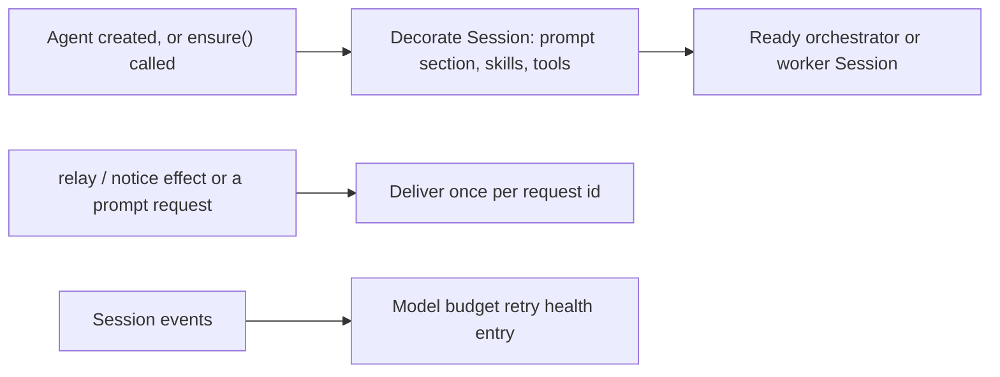

# sessions.ts

This file owns the life of every DSH `Agent` session the orchestrator uses: the single main "orchestrator" session and the per-ticket "worker" sessions. It resolves or creates a session, seeds its role model, decorates it with the prompt section, runtime skills and a restricted tool set that fit its role, then delivers messages to it exactly once per request id. It also turns session events into a `models` health report when a session is stuck waiting on a model budget retry, and it remembers which prompt revisions each session has actually run under.

## Whole-unit functional diagram

<!-- {
  "mermaid_info": {
    "name": "Session lifecycle and delivery flow",
    "nodes": [
      {
        "id": "lifecycle_001",
        "name": "Agent created, or ensure() called",
        "path": "src/app/sessions.ts",
        "hint": "install() subscribes to DSH agent and session events so new sessions are decorated",
        "isJumpable": true,
        "position": { "startLine": 107, "endLine": 136 },
        "references": []
      },
      {
        "id": "decorate_002",
        "name": "Decorate Session: prompt section, skills, tools",
        "path": "src/app/sessions.ts",
        "hint": "Adds the composed prompt section, runtime skills and role-specific tool limits",
        "isJumpable": true,
        "position": { "startLine": 232, "endLine": 269 },
        "references": []
      },
      {
        "id": "ready_003",
        "name": "Ready orchestrator or worker Session",
        "path": "src/app/sessions.ts",
        "hint": "ensure() resolves or creates the session, seeds its role model, permissions and title",
        "isJumpable": true,
        "position": { "startLine": 137, "endLine": 155 },
        "references": []
      },
      {
        "id": "effects_004",
        "name": "relay / notice effect or a prompt request",
        "path": "src/app/sessions.ts",
        "hint": "Durable relay and notice handlers registered in the constructor",
        "isJumpable": true,
        "position": { "startLine": 100, "endLine": 106 },
        "references": []
      },
      {
        "id": "delivery_005",
        "name": "Deliver once per request id",
        "path": "src/app/sessions.ts",
        "hint": "prompt() and inject() send through AgentDelivery, keyed by the request id",
        "isJumpable": true,
        "position": { "startLine": 161, "endLine": 186 },
        "references": []
      },
      {
        "id": "events_006",
        "name": "Session events",
        "path": "src/app/sessions.ts",
        "hint": "session/event and agent/status feed the budget retry tracker",
        "isJumpable": true,
        "position": { "startLine": 114, "endLine": 120 },
        "references": []
      },
      {
        "id": "retry_007",
        "name": "Model budget retry health entry",
        "path": "src/app/sessions.ts",
        "hint": "updateModelHealth() mirrors waiting sessions into the models health entry",
        "isJumpable": true,
        "position": { "startLine": 222, "endLine": 227 },
        "references": []
      }
    ]
  }
} -->

    
        <a target="_self" href="#src/app/sessions.ts:1?class=graph" style="color: inherit; text-decoration: none;">Graph: Session lifecycle and delivery flow</a>
    

The upper path is the creation side: a session appears (or is requested through `ensure`) and immediately gets the prompt, skills and tool limits of its role. The lower paths are the runtime side: queued relays and notices become messages in that session, and the same session events are folded into one health entry so an operator can see who is stuck on a model budget.

## At a glance

- **Primary role**: Orchestration — the file sequences several collaborators (DSH session controller, workspace registry, prompts, skills scope, tool registry, effects queue, store, retry tracker) into one session lifecycle, from creation to delivery and cleanup.
- **Secondary role**: Domain rules — it also decides what a main Session versus a worker Session is allowed to do, and enforces it through tool allow lists and guards.
- **Confidence**: High — the class, its host contract and every collaborator are read directly from this file, and its callers in `src/app/runtime.ts` and `src/executor/dsh.ts` confirm the usage.

## What this file does

- **Creates sessions on demand.** `ensure()` looks up a session, creates its workspace and session when missing, seeds the configured model for that role, and returns the runnable `Agent`.
- **Decorates each agent with its role identity.** Every managed agent gets a `dsh-superagent-policy` system-prompt section that carries the current prompt revision, the composed prompt text and — for workers — the ticket's mandate instructions and environment values.
- **Keeps runtime skills in step with the prompt revision.** Skills declared by the active prompt version are registered in the agent's skill scope, and later revisions replace the earlier registration instead of stacking up.
- **Restricts tools by role.** The main Session is narrowed to a small allow list and may not wait; a worker keeps only the profile's work tools while its ticket is live; a worker's subagents inherit the same worker limits.
- **Delivers messages idempotently.** `prompt()`, `relay()`, `notify()` and their helpers make sure a retried request does not duplicate a message, and let callers observe whether a notice has actually landed.
- **Reports budget waits and prompt revisions.** Waiting sessions surface as the `models` health entry, and each session's used prompt revisions are persisted so later reads can be authorized.

## Key functions or classes

### `Sessions`

The class that holds all session state: a decorated-agent binding registry, the delivery helper, the retry tracker, and the effect handlers for `relay` and `notice`.

    
        <a target="_self" href="#src/app/sessions.ts:93-352?class=code" style="color: inherit; text-decoration: none;">Code: src/app/sessions.ts:93-352</a>
    

### `Sessions.install()`

Subscribes once at startup to agent and session events: decorate new agents, release disposed ones, keep retry health current, and re-select this project's agent preset when DSH's registry picks another one for a session that has not had its first turn yet.

    
        <a target="_self" href="#src/app/sessions.ts:107-136?class=code" style="color: inherit; text-decoration: none;">Code: src/app/sessions.ts:107-136</a>
    

### `Sessions.ensure(id, cwd, title, role)`

The entry point callers use to get a usable session: resolve or create it in the given workspace, apply the worker or router preset, initialize the role model from settings, decorate it, grant `danger-full-access` permissions and rename it.

    
        <a target="_self" href="#src/app/sessions.ts:137-155?class=code" style="color: inherit; text-decoration: none;">Code: src/app/sessions.ts:137-155</a>
    

### `Sessions.prompt(...)`

Delivers one message to one session under a request id, choosing between the next turn (`queue`), the current turn (`steer`) or a labeled injection that does not wake the agent.

    
        <a target="_self" href="#src/app/sessions.ts:161-167?class=code" style="color: inherit; text-decoration: none;">Code: src/app/sessions.ts:161-167</a>
    

### `relay() / notify() / delivery()`

Queue durable work for the main Session and then observe it: a relay is a steering message, a notice is an injected one, and `delivery(name)` reports `'injected'` or `'pending'` after waiting for runnable notice effects to settle.

    
        <a target="_self" href="#src/app/sessions.ts:170-178?class=code" style="color: inherit; text-decoration: none;">Code: src/app/sessions.ts:170-178</a>
    

### `status() / promptVersion() / mayRead()`

The prompt-revision bookkeeping surface: what revision is current, which loaded sessions run under which revision, whether a `prompts` notice is still queued, and whether a session is allowed to read a given revision.

    
        <a target="_self" href="#src/app/sessions.ts:187-204?class=code" style="color: inherit; text-decoration: none;">Code: src/app/sessions.ts:187-204</a>
    

### `noWait(...)`

The main Session's guard: it inspects a tool call and returns the advisory text to show when that call would make the session wait instead of ending its turn.

    
        <a target="_self" href="#src/app/sessions.ts:71-86?class=code" style="color: inherit; text-decoration: none;">Code: src/app/sessions.ts:71-86</a>
    

## Coordinated flow

1. **Trigger.** Either DSH reports a newly created agent (`agent/created`) or a caller asks for a session through `ensure()`. Both routes end up in the same decoration step.
2. **Resolve and prepare.** `ensure()` resolves the session, creates the workspace and session with the matching preset if it does not exist, and seeds the role model — the evaluation model for the orchestrator, the executor model for a worker.
3. **Decorate.** The prompt section is registered with the host's prompt composer, a skill scope is acquired and filled from the current prompt version, the host's tools for that agent are registered, and the role-specific tool restriction and guards are attached. Before that, the retry tracker replays the session's existing events so restarts do not lose an in-flight budget wait.
4. **Deliver.** Messages reach the session through the delivery helper, which keys each message by request id and flushes session persistence before the producer is acknowledged. Relays and notices arrive through the effect queue instead, in the order they were queued.
5. **Report and clean up.** Session events update the `models` health entry; command and HTTP callers read revision or delivery status; `release()` unwinds everything registered for an agent in reverse order when it is disposed or when the whole `Sessions` object is disposed.

### Important branching or concurrency

Three branches change what a caller sees. First, an agent that is neither the main Session nor a ticket session is not decorated at all, but is treated as a possible subagent: if a worker is found up its parent chain, it receives the worker's tool limits only. Second, decoration can be interleaved with disposal, so the code re-checks its binding after awaiting the skill scope and bails out if the agent went away. Third, the preset branch fires asynchronously: if DSH reselects a default preset for one of our sessions before its first turn, the selection is corrected in the background, and after the first turn DSH refuses selection so the session is left alone.

## Rules and decisions

- **Decision**: which capabilities a managed session may use, and when a message counts as already delivered.
- **Important conditions**: the main Session is limited to the skill, bash, read, image-read and background-job tools, and its shell and job waits are guarded; a worker keeps the profile's work tools and keeps them even after a failed or blocked ticket, so a person can continue it; subagents of a worker inherit the worker's limits; a message is a duplicate when the session already holds the same request id.
- **Outcomes**: a tool call proceeds, is refused with an explanation text, or the session gets no tool list at all beyond the profile's work tools. Delivery either happens once, silently no-ops because it already happened, or waits in the effect queue as `'pending'`.
- **Invariant**: a worker's automated input stays shut after its ticket ends, while its session stays usable by a person — the guard message tells the worker that new work needs a new authorized ticket.

### Small example

On a main Session created before the router preset applies, a `bash` call without an explicit timeout is answered with guidance to pass `timeoutMs` of at most 30 seconds or use the background option. A job-output call that asks to wait longer than five seconds is refused outright. Once the router preset is in effect, the same calls are no longer nagged about defaults, because that preset already ends waits early.

## Main inputs and results

- **Inputs**: DSH lifecycle events (`agent/created`, `session/event`, `agent/status`, `agent/disposed`, `agent-preset/selected`); host calls such as `ensure()`, `prompt()`, `relay()`, `notify()`, `holds()`, `status()`; settings for the role models; the current prompt revision and its skills; and the `SessionsHost` dependency bundle declared at the top of the file.
- **Results**: runnable `Agent` objects; registered prompt sections, skills and tools; deduplicated messages placed in a session's inbox; the `models` health entry; persisted prompt revisions per session under the store's session key; and small status objects for listings.
- **Visible side effects**: the model-budget text shown in health, refusal messages returned to the model inside a tool call, session titles renamed to the ticket title, sessions running with full-access permissions, and notices that appear in the main Session's history without waking it.

Related reading: the delivery helper itself is 
<a target="_self" href="#src/app/delivery.ts?class=code" style="color: inherit; text-decoration: none;">delivery.ts</a>
, the retry projection is 
<a target="_self" href="#src/app/retry-health.ts?class=code" style="color: inherit; text-decoration: none;">retry-health.ts</a>
, the object that constructs this class is 
<a target="_self" href="#src/app/runtime.ts:121-124?class=code" style="color: inherit; text-decoration: none;">runtime.ts:121-124</a>
, and the surrounding directory guide is 
<a target="_self" href="#src/app/app.info.md?class=text" style="color: inherit; text-decoration: none;">app.info.md</a>
.

---
name: sessions.ts

update-time: 2026-11-02 10:32

description: This file owns the life of every DSH `Agent` session the orchestrator uses: the single main "orchestrator" session and the per-ticket "worker" sessions. It resolves or creates a session, seeds its role model, decorates it with the prompt section, runtime skills and a restricted tool set that fit its role, then delivers messages to it exactly once per request id. It also turns session events into a `models` health report when a session is stuck waiting on a model budget retry, and it remembers which prompt revisions each session has actually run under.

---
