# settings-history.ts

This file turns the stored record of settings saves into a short, human-readable list of what actually changed in each save — the data behind the management panel's **Configuration history**. It decides which differences are worth reporting, how each one is phrased, and when two revisions cannot be compared at all. It is also the place to look when you add a new setting or a source-plugin field and want that change to appear in history.

## Whole-unit flow

```mermaid
flowchart LR
    request_001["GET policy/history request"] --> load_revisions_002["Load newest settings revisions"]
    load_revisions_002 --> baseline_check_003["Baseline check per revision"]
    baseline_check_003 --> diff_settings_004["Diff rules, sources and global settings"]
    diff_settings_004 --> change_entries_005["Structured change entries"]
    change_entries_005 --> history_view_006["History view with notified Tickets"]
    history_view_006 --> panel_lines_007["Localized change lines in the panel"]
```

The HTTP route asks for the history, the file loads the 30 newest revisions newest-first, compares each revision with the one immediately before it, and emits a list of typed change entries per entry. The panel then renders each entry as a localized sentence, which is why the codes never contain display text.

## At a glance

- **Primary role**: Domain rules — it encodes the policy of "what counts as a settings change" and how each kind of change is described.
- **Secondary roles**: Data contract — the `SettingsChange` entries and their `code` values are the shared vocabulary between the server and the web panel's `change.<code>` locale keys.
- **Confidence**: High — the whole file was read, together with the consuming route in `src/app/http.ts`, the rendering code in `src/client/settings-kit.tsx`, and the `SettingsVersion`/`FieldSpec` definitions it builds on.

## What this file does

- Builds the revision timeline the panel shows: revision number, save time, origin, settings block, policy version, and whether that save produced a new policy version.
- Resolves "who was notified": stored ticket IDs are replaced by the ticket titles, falling back to the raw ID when the ticket is gone.
- Decides comparability: a revision is only diffed against the revision numbered exactly one lower; otherwise the entry reports "nothing to compare" rather than a wrong diff.
- Describes rule changes at the level a human cares about — a rule was added, renamed, had its condition edited, was enabled or disabled, or was removed.
- Describes source changes: the enabled flag, each configuration field, row-list add/remove/edit summarized by a human label, and admission-table edits collapsed into a single entry per source.
- Reports global runtime settings such as accept mode, eval time limit and model, executor model and concurrency, pause state, execution directory, prepare command, and blocked commands.

## Key functions or classes

### `policyHistory`

The only exported function: it collects the newest revisions and returns the whole history view including the current revision number and the policy version passed in.

<a target="_self" href="#src/app/settings-history.ts:82-90?class=code" style="color: inherit; text-decoration: none;">settings-history.ts:82-90</a>

### `settingsChanges`

The top-level comparison of two settings snapshots: policy rules, per-source policy, global settings, then each source instance.

<a target="_self" href="#src/app/settings-history.ts:47-76?class=code" style="color: inherit; text-decoration: none;">settings-history.ts:47-76</a>

### `fieldChanges`

Compares one form-like group of fields using the source plugin's own field descriptions, treating row lists specially so individual rows can be named.

<a target="_self" href="#src/app/settings-history.ts:19-39?class=code" style="color: inherit; text-decoration: none;">settings-history.ts:19-39</a>

### `sourceChanges`

Adds the enabled/disabled entry for one source and then diffs its configuration, after filling defaults through the source kind's schema.

<a target="_self" href="#src/app/settings-history.ts:40-46?class=code" style="color: inherit; text-decoration: none;">settings-history.ts:40-46</a>

### `changesOf`

A safety wrapper: if an older revision no longer validates against today's schemas, it returns "no diff available" instead of failing the whole history request.

<a target="_self" href="#src/app/settings-history.ts:78-80?class=code" style="color: inherit; text-decoration: none;">settings-history.ts:78-80</a>

### `SettingsChange` and `SettingsChangeCode`

The entry shape and the fixed set of change codes that the panel translates; the type of these codes is the contract the web client relies on.

<a target="_self" href="#src/app/settings-history.ts:9-17?class=code" style="color: inherit; text-decoration: none;">settings-history.ts:9-17</a>

## Main inputs and results

- **Inputs**: the store's saved settings revisions and the current revision pointer, the ticket titles for notified IDs, the source registry (each kind's schema, configuration fields, and policy fields), and the current policy version string.
- **Results**: an object with the current revision number, the policy version, and a newest-first list of items; each item carries its save metadata plus either a list of change entries, an empty list when nothing changed, or `null` when there is no usable previous revision.
- **Visible side effects**: none — this file only reads. Its output appears as the Configuration history disclosure in the management panel.

## Rules and decisions

- **Decision**: given two consecutive settings snapshots, what is worth telling an operator, and how should each difference be named?
- **Important conditions**: values are considered equal by their serialized form, so a value that comes back unchanged produces no entry. Row-list fields are compared per row keyed by their first column, and rows are named by their second column (the human-readable one) when available. Source configuration is normalized through the source kind's schema first, so an added default is not misreported as a manual edit. Per-source policy fields skip the admission table, and any admission-table difference becomes one summarized entry for that source. Policy rules are matched by ID, so a renamed rule is a rename rather than a remove-plus-add.
- **Outcomes**: a list of change entries; an empty list meaning "this save changed nothing comparable"; or `null` meaning the pair could not be compared (missing previous revision, a gap in revision numbering, or an older revision that fails current schema validation).
- **Invariant**: history is always read-only and always honest about uncertainty — a `null` never silently degrades into "no changes".

### Small example

Suppose one save renames the rule "Triage" to "First pass" and adds a chat to a source's allowed-rows list. The result contains two entries: one `ruleRenamed` carrying the old and new names, and one `sourceRowsAdded` carrying the display label of the added chat. The panel turns them into two sentences using the rule name and the source's own field label — no wording is stored in the history record itself.

## Information contract

- **Represents**: one human-oriented change line about a settings save — not a raw patch, but a fact an operator can read.
- **Produced by**: this file, on demand, from stored revisions; change entries are never persisted.
- **Consumed by**: the panel's history renderer, which maps `code` to `change.<code>` and fills placeholders (`source`, `field`, `from`, `to`, `name`, `items`), resolving source and field labels from the live source listing.
- **Behavior-shaping parts**: `code` selects the sentence template; `source` plus `field` select the label lookups, with `part: true` marking a policy field rather than a configuration field; `from`/`to` carry the before and after values; `name` identifies a rule; `items` lists affected row keys, which the panel replaces with known display names.
- **Compatibility notes**: every code needs a matching `change.<code>` locale entry, and adding a new code without one leaves the panel unable to describe that change. `from`/`to` are only present for value-style changes, so consumers must tolerate entries that carry just a name or just an item list. Old revisions can legitimately report `null` changes, which the panel presents as "the previous revision was not recorded".

---
name: settings-history.ts

update-time: 2026-11-02 10:38

description: This file turns the stored record of settings saves into a short, human-readable list of what actually changed in each save — the data behind the management panel's **Configuration history**. It decides which differences are worth reporting, how each one is phrased, and when two revisions cannot be compared at all. It is also the place to look when you add a new setting or a source-plugin field and want that change to appear in history.

---
