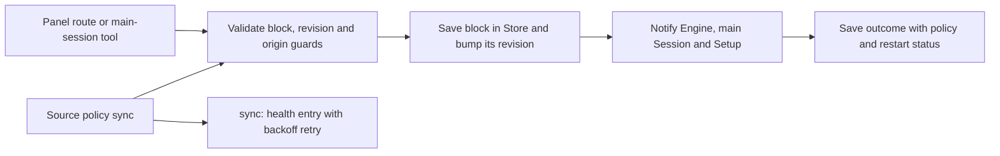

# settings.ts

This file is the settings service of the orchestrator: it is the only place where stored settings blocks are validated, versioned and saved. It gives the management panel and the main agent's tools one write path that refuses stale edits, restricts dangerous fields to the panel, and tells the rest of the system what changed. It also keeps each Source's policy section in step with that Source's external truth and reports sync failures through the health board.

## Whole-unit functional diagram

A save request enters from a panel route or an agent tool, is checked against the block's current revision and the caller's origin, and only then written and announced. Source policy synchronization reuses the same save path, so a synced policy change reaches the Engine and the main Session exactly like a hand-edited one.

<!-- {
  "mermaid_info": {
    "name": "Settings save and policy sync flow",
    "nodes": [
      {
        "id": "caller_001",
        "name": "Panel route or main-session tool",
        "path": "src/app/http.ts",
        "hint": "The PUT settings/:block route that forwards panel saves, including revision and value",
        "isJumpable": true,
        "position": { "startLine": 196, "endLine": 202 },
        "references": []
      },
      {
        "id": "check_002",
        "name": "Validate block, revision and origin guards",
        "path": "src/app/settings.ts",
        "hint": "Revision check, schema parsing, model and account checks, panel-only guards",
        "isJumpable": true,
        "position": { "startLine": 148, "endLine": 171 },
        "references": []
      },
      {
        "id": "store_003",
        "name": "Save block in Store and bump its revision",
        "path": "src/app/settings.ts",
        "hint": "Atomic save of the merged settings plus the block revision increment",
        "isJumpable": true,
        "position": { "startLine": 182, "endLine": 186 },
        "references": []
      },
      {
        "id": "announce_004",
        "name": "Notify Engine, main Session and Setup",
        "path": "src/app/settings.ts",
        "hint": "Command shim rewrite, session notice delivery, restart or immediate pass request",
        "isJumpable": true,
        "position": { "startLine": 187, "endLine": 195 },
        "references": []
      },
      {
        "id": "outcome_005",
        "name": "Save outcome with policy and restart status",
        "path": "",
        "hint": "The abstract result a caller observes after a save",
        "isJumpable": false,
        "position": { "startLine": 0, "endLine": 0 },
        "references": []
      },
      {
        "id": "sync_006",
        "name": "Source policy sync",
        "path": "src/app/settings.ts",
        "hint": "Pulls one Source's policy section from its external source of truth",
        "isJumpable": true,
        "position": { "startLine": 231, "endLine": 252 },
        "references": []
      },
      {
        "id": "health_007",
        "name": "sync:<id> health entry with backoff retry",
        "path": "src/app/settings.ts",
        "hint": "Claims a per-source health entry and schedules exponential-backoff retries",
        "isJumpable": true,
        "position": { "startLine": 91, "endLine": 105 },
        "references": []
      }
    ]
  }
} -->

    
        <a target="_self" href="#src/app/settings.ts:1?class=graph" style="color: inherit; text-decoration: none;">Graph: Settings save and policy sync flow</a>
    

## At a glance

- **Primary role — Orchestration**: it runs the multi-step save pipeline across validation, persistence, notification and side effects, without owning the storage or transport itself.
- **Secondary role — API boundary**: `view`, `block`, `save`, `pause`, `sync` and `refreshLabels` are the contract the HTTP routes and agent tools call, including which inputs are accepted and which errors they return.
- **Secondary role — Domain rules**: it enforces real rules of the product — only the panel may change shell execution paths and Source accounts, and a save built on a stale revision must not win.
- **Confidence**: High — the whole file was read, together with its callers (the panel route and the `orchestrator_settings_save` tool), the `Store` revision mechanics, and the concurrency/retry tests that exercise it.

## What this file does

- **Block-scoped reads**: `view()` gives a dashboard-friendly overview of every settings block with its revision, and `block()` returns one block exactly as `save()` would accept it.
- **Safe writes**: `save()` validates a block, refuses it if the block's revision moved, and records a new revision only when the stored settings actually change.
- **Undo-friendly concurrency**: each block keeps its own revision counter, so editing the executor while someone else edits the policy does not cause spurious conflicts.
- **Panel-only guardrail**: changing shell execution paths, prepare commands, blocked commands, or a Source's account CLI from a tool call is rejected, which protects against prompt-injected agent writes.
- **Processing pause**: `pause()` flips the `paused` flag in its own block so it never collides with other configuration edits.
- **Source policy synchronization**: `syncable()` and `sync()` pull a Source's allowed-sender policy from where that Source keeps it, save it as a policy revision, and report success or failure under `sync:<id>` in the health board with exponential-backoff retries.

## Coordinated flow

1. A caller (the `PUT settings/:block` panel route, the `orchestrator_settings_save` tool, or an internal policy sync) supplies the block, its full value, the revision the caller saw, and an origin of `'panel'`, `'tool'` or `'sync'`.
2. `save()` checks the revision first, parses the value with the block's own schema, merges it onto current settings, and runs the checks that need async work: resolving a newly chosen model, verifying accounts when setup-read fields change, and the origin guard.
3. It re-checks the revision after those checks so a concurrent save cannot be silently overwritten, then compares the result with stored settings; when nothing changed, the caller simply gets the current revision back.
4. When settings did change, it writes the new revision and the block counter atomically, notifies the main Session (except for tool-originated saves that the Session already knows about), reports a changed policy version to the Engine together with the affected open tickets, rewrites worker command shims if blocked commands changed, and finally either schedules a restart or requests an immediate processing pass.

### Important branching or concurrency

- A revision that moved before or during the checks raises `SettingsConflict`, and the management route turns that into an HTTP 409 so the panel can reload instead of overwriting.
- `restarting` is true when a setup-read field changed (such as an account CLI) or when settings are saved while setup is still unconfigured; in that case the session notice stays pending until the restart, and no immediate pass is requested.
- Sync failures are recorded on the `sync:<id>` health entry and retried after one minute, doubling up to one hour; pending timers are cleared when the runtime lifetime aborts.

## Key functions or classes

### `Settings`

The service itself: constructed once by `Runtime` from a `SettingsHost` of store, sources, engine, health, context, lifetime, sessions, source host, setup, and a pass trigger.

<a target="_self" href="#src/app/settings.ts:82-89?class=code" style="color: inherit; text-decoration: none;">settings.ts:82-89</a>

### `save(block, value, revision, origin)`

The central write path; returns `{ saved, revision, policy_changed, restarting, context_delivery }`.

<a target="_self" href="#src/app/settings.ts:148-196?class=code" style="color: inherit; text-decoration: none;">settings.ts:148-196</a>

### `view()`

Summarizes all blocks for the dashboard: full values for pause, eval and executor, rule summaries with allowed-sender counts for policy, and per-Source status switches with follow-up read paths.

### `block(block)`

Returns one block's current value and revision in the shape `save()` accepts, and raises `unknownBlock` for anything else.

<a target="_self" href="#src/app/settings.ts:130-138?class=code" style="color: inherit; text-decoration: none;">settings.ts:130-138</a>

### `pause(paused, origin)`

Pauses or resumes new evaluations, worker dispatch and channel delivery in its own settings block; Sources keep recording triggers, and a no-op call saves nothing.

<a target="_self" href="#src/app/settings.ts:202-214?class=code" style="color: inherit; text-decoration: none;">settings.ts:202-214</a>

### `syncable()` / `sync(id)`

List the Sources that can synchronize right now, and pull one Source's policy section, save it as a policy revision when it differs, and return it.

<a target="_self" href="#src/app/settings.ts:216-252?class=code" style="color: inherit; text-decoration: none;">settings.ts:216-252</a>

### `refreshLabels(id)`

Rereads a Source's display names and returns the sorted new ones, or raises `noLabels` when that Source supports no label refresh.

<a target="_self" href="#src/app/settings.ts:258-266?class=code" style="color: inherit; text-decoration: none;">settings.ts:258-266</a>

### `SettingsConflict`

The error a caller receives when the block it edited moved underneath it; the management routes map it to HTTP 409.

<a target="_self" href="#src/app/settings.ts:17-21?class=code" style="color: inherit; text-decoration: none;">settings.ts:17-21</a>

## Main inputs and results

- **Inputs**: a settings block name (`policy`, `eval`, `executor`, `pause`, or `source:<id>`), the complete block value, the caller's revision, and the caller's origin; plus a `SettingsHost` wiring of store, source registry, engine callback, health board, sessions, setup, lifetime and pass trigger.
- **Results**: `view()` and `block()` return revision-aware snapshots; `save()` and `pause()` return `{ saved, revision, policy_changed, restarting, context_delivery }` or `{ paused }`; `sync()` returns the synchronized policy section; `refreshLabels()` returns `{ added }`.
- **Visible side effects**: a new settings revision with its history entry, the invalidation of open tickets whose authorization the new policy affects, a notice delivered to the main Session, rewritten worker command shims when blocked commands change, a scheduled restart, an immediate processing pass, and `sync:<id>` health status in the dashboard.

## Public contract

- **Caller**: the management HTTP routes (`PUT settings/:block`, `POST executor/pause`, `POST policy-sync/:id`), the main agent's `orchestrator_settings_save` and `orchestrator_policy_sync` tools, and internal synchronization.
- **Operation**: read the settings overview, read one block, save one block, pause or resume processing, list syncable Sources, synchronize one Source, refresh Source labels.
- **Accepted input**: values are validated by the block's schema from `policy.ts`; `pause` takes `{ paused }` and ignores revisions, `source:<id>` takes `{ enabled, config }` and must name an installed Source, and an `executor` block cannot carry `paused`, which only the pause block sets.
- **Result**: a plain object describing what happened, or an error — `SettingsConflict` for stale revisions (HTTP 409), `UserError` codes such as `unknownBlock`, `sourceNotInstalled`, `nothingToSync`, `noLabels`, `panelOnlyEnvironment`, `panelOnlyAccounts` or `modelUnavailable`, and validation errors from the schemas.

### Access or validation requirements

Every `save()` and `pause()` caller must state an origin explicitly; there is no default, so no caller accidentally receives panel privileges. Model changes are validated against the live provider before anything is written, and account-checking runs whenever setup-read fields such as an account CLI change.

## Rules and decisions

- **Decision**: which settings writes are allowed, and what a valid write does to the running system.
- **Important conditions**: the block's revision must still match; the origin must be `'panel'` for execution-environment and Source-account CLI fields; a newly chosen model must resolve; a Source must be installed before its block can be saved or synced.
- **Outcomes**: saved with a new revision, saved as a no-op with the existing revision, rejected as a conflict, rejected as invalid, or applied together with a restart request.
- **Invariant**: settings that affect work authorization only reach open tickets through a new policy version, so a changed policy never silently leaves earlier ticket decisions using old rules.

### Small example

An agent tool that tries to change `executor.prepare` or a Source's `cli` is refused with `panelOnlyEnvironment` or `panelOnlyAccounts`, while a tool save that only changes something like `maxWorkers` succeeds — the panel is the only path for fields that reshape how worker processes run.

---
name: settings.ts

update-time: 2026-11-02 10:46

description: This file is the settings service of the orchestrator: it is the only place where stored settings blocks are validated, versioned and saved. It gives the management panel and the main agent's tools one write path that refuses stale edits, restricts dangerous fields to the panel, and tells the rest of the system what changed. It also keeps each Source's policy section in step with that Source's external truth and reports sync failures through the health board.

---
