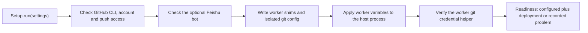

# setup.ts

`src/app/setup.ts` holds the `Setup` class, the orchestrator that turns plugin configuration into a usable deployment: it probes the GitHub and Feishu CLIs, writes the worker command shims and isolated git configuration into the state directory, applies the worker environment to the host process, and reports whether `dsh-superagent` is ready to run. Its result is the gate the rest of the app reads — the orchestrator waits on setup before starting work, and the settings panel re-runs it after account-related edits. Everything a worker later does with `gh`, `git` or `lark-cli` depends on this file having succeeded.

## Whole-unit functional diagram

<!-- {
  "mermaid_info": {
    "name": "Setup readiness flow",
    "nodes": [
      {
        "id": "run_001",
        "name": "Setup.run(settings)",
        "path": "src/app/setup.ts",
        "hint": "Entry point that runs setup and converts expected failures into a recorded problem",
        "isJumpable": true,
        "position": { "startLine": 45, "endLine": 52 },
        "references": []
      },
      {
        "id": "github_002",
        "name": "Check GitHub CLI, account and push access",
        "path": "src/app/setup.ts",
        "hint": "Resolves the deployment repository and GitHub identity through the CLI probe",
        "isJumpable": true,
        "position": { "startLine": 79, "endLine": 79 },
        "references": []
      },
      {
        "id": "feishu_003",
        "name": "Check the optional Feishu bot",
        "path": "src/app/setup.ts",
        "hint": "Feishu failures are recorded instead of aborting setup",
        "isJumpable": true,
        "position": { "startLine": 80, "endLine": 85 },
        "references": []
      },
      {
        "id": "env_004",
        "name": "Write worker shims and isolated git config",
        "path": "src/app/setup.ts",
        "hint": "Writes the worker command shims and git configuration into the state directory",
        "isJumpable": true,
        "position": { "startLine": 91, "endLine": 91 },
        "references": []
      },
      {
        "id": "apply_005",
        "name": "Apply worker variables to the host process",
        "path": "src/app/setup.ts",
        "hint": "Applies the agent git variables and restored PATH to the host process",
        "isJumpable": true,
        "position": { "startLine": 92, "endLine": 92 },
        "references": []
      },
      {
        "id": "verify_006",
        "name": "Verify the worker git credential helper",
        "path": "src/app/setup.ts",
        "hint": "Checks that worker git resolves the deployment credential helper, otherwise restores the environment",
        "isJumpable": true,
        "position": { "startLine": 93, "endLine": 96 },
        "references": []
      },
      {
        "id": "ready_007",
        "name": "Readiness: configured plus deployment or recorded problem",
        "path": "src/app/setup.ts",
        "hint": "Exposes the resolved deployment, the configured flag and the recorded setup problems",
        "isJumpable": true,
        "position": { "startLine": 39, "endLine": 43 },
        "references": []
      }
    ]
  }
} -->

    
        <a target="_self" href="#src/app/setup.ts:1?class=graph" style="color: inherit; text-decoration: none;">Graph: Setup readiness flow</a>
    

The main path runs from a single `run(settings)` call through account probing, environment writing and verification to one readiness answer. GitHub problems stop the flow, while Feishu problems are downgraded to a recorded warning so an installation without a bot still becomes ready.

## At a glance

- Primary role: Orchestration — the file sequences probing, file writing, environment application and verification into one start-up procedure.
- Secondary roles: API boundary — it is the surface the runtime, the settings panel and the HTTP layer call; Domain rules — it decides when a restart is refused, which failures are fatal, and which errors belong to the block being edited.
- Confidence: High — the whole file was read together with its helpers in `src/deployment.ts`, `src/infra/environment.ts` and its callers in `src/app/runtime.ts` and `src/app/settings.ts`.

## What this file does

- **Gates orchestration readiness.** `Runtime` calls `run()` during start-up and skips session creation, dispatch and background loops until setup succeeds, leaving the management routes registered so an operator can fix the problem in the UI.
- **Probes real binaries, not the shims.** CLIs are executed through a probe that removes the worker shim directory from `PATH`, so a `gh` wrapper script still reaches the real executable while the host itself is being configured.
- **Separates fatal from degradable failures.** Missing repository, missing or signed-out GitHub CLI, unreadable repository and missing push permission record a setup problem; a failing Feishu CLI only records `feishuProblem` and logs a warning.
- **Produces the worker command environment.** It writes the `gh`/`lark-cli` shims plus any blocked-command shims and an isolated git configuration, applies the agent git variables to the host process, then verifies that worker git resolves the deployment credential helper.
- **Re-checks accounts before a settings save.** `checkAccounts()` validates a changed source block first, so a typo in a CLI path fails the save instead of the next restart.
- **Keeps the host and the workers separated.** Host CLI calls use `commandEnvironment` (shim directory removed from `PATH`), while workers get the shim directory prepended, so the host never calls its own shims.

## Key functions or classes

### `Setup`

The class that owns the whole procedure and the resulting state: the resolved `deployment`, the recorded `problem` and `feishuProblem`, and the precomputed host `PATH`/variables used by `commandEnvironment`.

    
        <a target="_self" href="#src/app/setup.ts:24-99?class=code" style="color: inherit; text-decoration: none;">Code: src/app/setup.ts:24-99</a>
    

### `SetupHost`

The narrow contract the class needs from its owner: the Cordis `Context`, the `Machine` settings (notably `stateDir`), a `lifetime` abort signal and a `restart()` callback. `Runtime` supplies all four, which keeps `Setup` independent of the rest of the orchestration graph.

### `setupChanged`

Compares only the fields that setup reads, using `SETUP_FIELDS` from the deployment module. `Settings` uses it twice: before saving to decide whether accounts need re-checking, and after saving to decide whether the process must restart.

    
        <a target="_self" href="#src/app/setup.ts:16-18?class=code" style="color: inherit; text-decoration: none;">Code: src/app/setup.ts:16-18</a>
    

### `Setup.run`

Runs the whole procedure and reports success as a boolean. Expected `SetupError` failures are stored in `problem` and return `false`; anything unexpected is rethrown so a real bug is not mistaken for a configuration mistake.

    
        <a target="_self" href="#src/app/setup.ts:45-52?class=code" style="color: inherit; text-decoration: none;">Code: src/app/setup.ts:45-52</a>
    

### `Setup.check` and `Setup.restart`

`check()` is what an operator-facing "retry setup" action calls: it refuses with a `UserError('setupComplete')` when setup and Feishu are already healthy, so a running assignment is not interrupted. Otherwise `restart()` defers the restart to the next macrotask, letting the current HTTP or tool caller receive its response first.

### `Setup.checkAccounts`

Validates the account configuration of the source block being edited before it is saved. Errors belonging to other blocks are ignored, so editing the Executor block never fails because of a stale GitHub problem.

    
        <a target="_self" href="#src/app/setup.ts:61-66?class=code" style="color: inherit; text-decoration: none;">Code: src/app/setup.ts:61-66</a>
    

### `Setup.blockCommands`

Rewrites the generated shims straight away when the blocked-command list changes, without waiting for a restart. It is a no-op until setup has produced a deployment.

### `Setup.commandEnvironment`

Returns the host command environment: the agent git variables plus a `PATH` with the worker shim directory removed. The command runner in `src/app/runtime.ts` is constructed with this value, which is why the host's own `gh` and `git` calls reach the real binaries while workers go through the shims.

### `Setup.restore`

Rolls back the environment changes applied during the successful run. `Runtime` calls it during shutdown so the process environment returns to its previous values.

## Main inputs and results

- **Inputs**: the saved `Settings` (GitHub source config, Feishu source config and `executor.blockedCommands`), the `Machine` configuration (notably `stateDir`), the Cordis `Context` with its subprocess runtime and logger, a `lifetime` abort signal, and the `restart()` callback.
- **Results**: `configured()` as the readiness flag, the resolved `Deployment` (repository, GitHub login, optional Feishu bot), `problem`/`feishuProblem` records, and the host `commandEnvironment` map.
- **Visible side effects**: generated shim scripts and an isolated git configuration file inside the state directory, temporarily modified host process environment variables, and a scheduled plugin restart after setup-affecting setting changes.

## Coordinated flow

1. `Runtime.initialize()` first registers the management HTTP routes, then calls `setup.run(store.settings())` — so the panel is reachable even when setup fails.
2. `Setup.resolve()` builds a probe that runs CLIs the way worker shells do, then asks the deployment module to check the GitHub CLI, its account identity and push access to the configured repository.
3. The Feishu bot check is attempted next; a `SetupError` there is caught, translated into `feishuProblem` and a logged warning, and the resolved deployment simply omits the bot.
4. The worker environment is written (shims for `gh`, `lark-cli` and blocked commands, plus the isolated git configuration), applied to the host process, and then verified by asking worker git which credential helper it resolves. A verification failure restores the environment and becomes `environmentFailed`.
5. `Runtime` reads the outcome: a `false` from `run()` sets a "paused, setupPending" health state, while success lets sessions, dispatch and background loops start with `setup.deployment` available everywhere.

### Important branching and concurrency

The Feishu branch is the only degradable step — everything else either succeeds or blocks readiness. Restarts are deliberately asynchronous (`setTimeout`) because `Settings.save()` triggers them while an HTTP response is still pending, and `restore()` is kept as a stored callback so a failed verification does not leave the host process with worker variables applied.

Collaborators visible from this flow: 
<a target="_self" href="#src/deployment.ts?class=code" style="color: inherit; text-decoration: none;">deployment.ts</a>
 performs the account probing, 
<a target="_self" href="#src/infra/environment.ts?class=code" style="color: inherit; text-decoration: none;">environment.ts</a>
 writes and verifies the environment, and 
<a target="_self" href="#src/runtime.ts?class=code" style="color: inherit; text-decoration: none;">runtime.ts</a>
 decides when setup runs.

## Public contract

- **Caller**: `Runtime` (start-up, shutdown, health and readiness getters) and `Settings` (account validation before a save, shim rewriting, restart scheduling); the HTTP layer forwards `problem`/`feishuProblem` to the management panel.
- **Operation**: run setup once, retry it through `check()`, validate a candidate account block, refresh blocked-command shims, expose readiness and the deployment, and restore the environment at shutdown.
- **Accepted input**: a full `Settings` value, a `SettingsBlock` name together with candidate settings, and a list of blocked command names; the constructor takes a `SetupHost`.
- **Result**: `true`/`false` from `run()`, a `Deployment` from the `deployment` getter (which throws while setup has not succeeded), and structured `SetupProblem` values whose `place` is `deployment`, `github` or `feishu` so the panel can localize them.

### Access or validation requirements

`deployment` is intentionally unsafe to read before `configured()` — callers such as `Runtime.deployment` are documented as throwing while setup is pending, and `Runtime.paused()` keeps the pipeline idle in that state. Blocked commands cannot include `gh`, `git` or `lark-cli`, because workers need them.

    
        <a target="_self" href="#src/app/settings.ts.info.md?class=text" style="color: inherit; text-decoration: none;">Document: src/app/settings.ts.info.md</a>
    

## Rules and decisions

- **Decision**: is this installation ready to run workers, and if not, what exactly must the operator fix?
- **Important conditions**: a repository name, a GitHub CLI path that resolves to an executable, a readable account and push permission are all required; the Feishu CLI is optional but, when configured, must be authenticated as a bot in strict mode `bot`; the verified worker git configuration must resolve the deployment's credential helper, which implies a sufficiently recent git.
- **Outcomes**: ready with a deployment; ready with a recorded problem and a paused runtime; or ready with a Feishu warning while GitHub access still works. A retry is refused outright when both setup and Feishu are healthy.
- **Invariant**: the host process never executes the worker shims, and workers never see the operator's own GitHub tokens or ambient git configuration — both directions are enforced by which `PATH` each side receives, not by permissions.

### Small example

An operator changes the GitHub CLI path in the panel while the installation is already running. `Settings.save()` sees a change in `SETUP_FIELDS`, calls `checkAccounts('source:github', candidate)` to probe the new CLI first, then — because the changed field affects setup — marks the save as restarting and asks `Setup` to restart. The restart re-runs this whole procedure, so the new shims and credentials are in place before any worker command is executed.

---
name: setup.ts

update-time: 2026-11-02 10:37

description: `src/app/setup.ts` holds the `Setup` class, the orchestrator that turns plugin configuration into a usable deployment: it probes the GitHub and Feishu CLIs, writes the worker command shims and isolated git configuration into the state directory, applies the worker environment to the host process, and reports whether `dsh-superagent` is ready to run. Its result is the gate the rest of the app reads — the orchestrator waits on setup before starting work, and the settings panel re-runs it after account-related edits. Everything a worker later does with `gh`, `git` or `lark-cli` depends on this file having succeeded.

---
