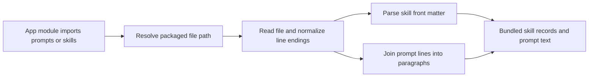

# skill-files.ts

This file is the single doorway through which `dsh-superagent` reads its own built-in text assets: the Markdown prompt library under `prompts/` and the packaged skill definitions under `skills/dsh-superagent-*/SKILL.md`. It exists so the rest of the application never has to repeat file-reading code, and so every prompt and skill arrives with the same normalization, validation, and clear failure messages. If you are about to change wording in a prompt or a skill, this is the loader that decides what the model actually receives.

## Whole-unit functional diagram

<!-- {
  "mermaid_info": {
    "name": "Packaged text loading flow",
    "nodes": [
      {
        "id": "trigger_001",
        "name": "App module imports prompts or skills",
        "path": "",
        "hint": "Another application module asks for built-in prompt text or a bundled skill",
        "isJumpable": false,
        "position": { "startLine": 0, "endLine": 0 },
        "references": []
      },
      {
        "id": "resolve_002",
        "name": "Resolve packaged file path",
        "path": "src/infra/paths.ts",
        "hint": "packagePath locates the package root from the source tree or compiled output",
        "isJumpable": true,
        "position": { "startLine": 7, "endLine": 20 },
        "references": []
      },
      {
        "id": "read_003",
        "name": "Read file and normalize line endings",
        "path": "src/app/skill-files.ts",
        "hint": "The packaged helper reads UTF-8 text and converts CRLF to LF",
        "isJumpable": true,
        "position": { "startLine": 8, "endLine": 17 },
        "references": []
      },
      {
        "id": "parse_004",
        "name": "Parse skill front matter",
        "path": "src/app/skill-files.ts",
        "hint": "load extracts the skill name, description and body",
        "isJumpable": true,
        "position": { "startLine": 18, "endLine": 23 },
        "references": []
      },
      {
        "id": "join_005",
        "name": "Join prompt lines into paragraphs",
        "path": "src/app/skill-files.ts",
        "hint": "promptFile reflows one-sentence source lines back into paragraphs",
        "isJumpable": true,
        "position": { "startLine": 29, "endLine": 32 },
        "references": []
      },
      {
        "id": "result_006",
        "name": "Bundled skill records and prompt text",
        "path": "",
        "hint": "Callers receive ready-to-use prompt strings or structured skill records",
        "isJumpable": false,
        "position": { "startLine": 0, "endLine": 0 },
        "references": []
      }
    ]
  }
} -->

    
        <a target="_self" href="#src/app/skill-files.ts:1?class=graph" style="color: inherit; text-decoration: none;">Graph: Packaged text loading flow</a>
    

Every request for built-in text follows the same route: the path is resolved against the package root, the file is read and line endings are normalized, and then the text either stays plain (prompts) or is split into a structured skill record. Both exports are produced at module import time, which is why a missing asset surfaces as a startup error rather than a later surprise.

## At a glance

- Primary role: Utility — a small, focused helper that turns packaged files into usable text and skill records for the rest of the app.
- Secondary roles: Data contract — it defines the skill record shape (`name`, `description`, `content`, `path`) that other modules consume.
- Confidence: High — the file is 33 lines and was read in full, and both consumers (`src/app/context.ts`, `src/app/sessions.ts`) were inspected to confirm how the results are used.

## What this file does

- **Loads built-in prompt text by short name.** `promptFile('shared')` returns the text of `prompts/shared.md`, so callers name a prompt rather than build a path.
- **Reflows prompt source lines into readable paragraphs.** Prompt files are written one sentence per line for reviewable diffs; the loader joins those lines with spaces while keeping paragraph boundaries.
- **Extracts the two bundled skills.** The Feishu and GitHub skill files are read, their front matter is parsed, and the result is exposed as a ready-to-use record.
- **Normalizes text regardless of checkout platform.** Carriage-return line endings are converted, so prompts and skills reach the model identically on every machine.
- **Fails loudly and specifically.** A missing, empty, or malformed asset produces an error that names the offending file, because the application cannot start without that text.
- **Keeps asset location out of this file.** Path resolution is delegated to 
<a target="_self" href="#src/infra/paths.ts:7-20?class=code" style="color: inherit; text-decoration: none;">paths.ts:7-20</a>
, which works from both the source tree and compiled output.

## Key functions or classes

### `packaged(...parts)`

Reads one packaged text file, normalizes line endings, and rejects empty content, returning both the resolved path and the text.

    
        <a target="_self" href="#src/app/skill-files.ts:8-17?class=code" style="color: inherit; text-decoration: none;">Code: src/app/skill-files.ts:8-17</a>
    

### `load(name)`

Reads `skills/dsh-superagent-<name>/SKILL.md` and splits it into the skill's declared name, description, body content, and file path.

    
        <a target="_self" href="#src/app/skill-files.ts:18-23?class=code" style="color: inherit; text-decoration: none;">Code: src/app/skill-files.ts:18-23</a>
    

### `bundledSkills`

The eagerly loaded record of the two built-in skills, `feishu` and `github`, available as soon as the module is imported.

### `promptFile(name)`

Returns a built-in prompt's text, with each paragraph's source lines joined into flowing prose.

    
        <a target="_self" href="#src/app/skill-files.ts:29-32?class=code" style="color: inherit; text-decoration: none;">Code: src/app/skill-files.ts:29-32</a>
    

## Main inputs and results

- Inputs: a prompt name, optionally with a folder prefix such as `team/communication` (resolved to `prompts/<name>.md`), or a skill name for `load`. The only external dependency the caller supplies indirectly is the packaged file itself.
- Results: for prompts, a normalized string with paragraphs separated by single line breaks; for skills, an object with `name`, `description`, `content`, and the absolute source `path`.
- Visible side effects: because `bundledSkills` is built during import, a missing or malformed skill file stops the application at startup with the failing path in the message.

## Reusable capability

- Solves: the recurring need to read packaged text assets in one consistent way — same path resolution, same line-ending normalization, same emptiness and format checks — instead of repeated file handling in each consumer.
- Input: the caller provides either a short prompt name or the path fragments of a packaged skill file.
- Result: the caller receives either plain normalized text or a validated skill record, with no knowledge of filesystems or package layout required.
- Main usage area: 
<a target="_self" href="#src/app/context.ts:7-24?class=code" style="color: inherit; text-decoration: none;">context.ts:7-24</a>
 composes the role prompts and shared policy sections from `promptFile`, and 
<a target="_self" href="#src/app/sessions.ts:314-327?class=code" style="color: inherit; text-decoration: none;">sessions.ts:314-327</a>
 reuses the bundled skill descriptions and file locations when registering skills on a session.

### Important usage constraint

Prompt reflow means blank lines in a source file do not survive as blank lines in the returned string: paragraph blocks are joined with a single newline, so callers that rely on visually separated Markdown sections should not expect preserved empty lines. Also, a skill file whose header does not follow the expected `name` / `description` front matter order is rejected outright rather than partially loaded.

## Information contract

- Represents: one packaged skill definition — its declared name, its one-line description, its instruction body, and where the file lives.
- Produced by: this file, once per known skill (`feishu`, `github`) while the module is being imported.
- Consumed by: 
<a target="_self" href="#src/app/context.ts:7-24?class=code" style="color: inherit; text-decoration: none;">context.ts:7-24</a>
, which exposes the body as the source skill text, and 
<a target="_self" href="#src/app/sessions.ts:314-327?class=code" style="color: inherit; text-decoration: none;">sessions.ts:314-327</a>
, which uses the description in the model-visible skill listing and the path to point at the skill's own directory.
- Behavior-shaping parts: `description` is what the model sees when deciding whether a skill applies (and overrides the description derived from team-edited text); `content` is the instruction body actually loaded; `path` determines which directory resource references resolve against.

### Compatibility notes

Only the two keys `feishu` and `github` exist in `bundledSkills`; anything else must be a custom runtime skill, which is why consumers check the name before reading this record. The record shape is consumed by field name in more than one module, so renaming a field here changes behavior far away from this file.

---
name: skill-files.ts

update-time: 2026-11-02 10:38

description: This file is the single doorway through which `dsh-superagent` reads its own built-in text assets: the Markdown prompt library under `prompts/` and the packaged skill definitions under `skills/dsh-superagent-*/SKILL.md`. It exists so the rest of the application never has to repeat file-reading code, and so every prompt and skill arrives with the same normalization, validation, and clear failure messages. If you are about to change wording in a prompt or a skill, this is the loader that decides what the model actually receives.

---
