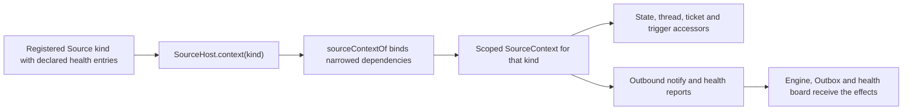

# source-context.ts

This file builds the narrow "world" that each Source plugin (GitHub, Feishu, a future webhook…) is allowed to see. `sourceContextOf` takes the application's real Store, Engine, Outbox, Commands and registry, and hands back a `SourceContext` object exposing only the reads and writes that one kind needs — state records, threads, tickets, triggers, notification, trigger ingestion and health reporting. Its value for a new contributor: it is the single place where "what a Source can do" is decided and where the isolation from direct Store/Engine access is enforced.

## Whole-unit functional diagram

A registered kind asks its host for a context; `sourceContextOf` closes over the shared dependencies, filters them to the kind's declared health entries, and returns an object the plugin can use for reading state and for producing effects that land in the Engine, the Outbox and the health board.

<!-- {
  "mermaid_info": {
    "name": "Source context construction flow",
    "nodes": [
      {
        "id": "registration_001",
        "name": "Registered Source kind with declared health entries",
        "path": "src/sources/registry.ts",
        "hint": "SourceRegistry.register claims the kind's health entries and refuses duplicates",
        "isJumpable": true,
        "position": { "startLine": 20, "endLine": 35 },
        "references": []
      },
      {
        "id": "host_002",
        "name": "SourceHost.context(kind)",
        "path": "src/app/runtime.ts",
        "hint": "Runtime answers a plugin's context request",
        "isJumpable": true,
        "position": { "startLine": 176, "endLine": 176 },
        "references": []
      },
      {
        "id": "builder_003",
        "name": "sourceContextOf binds narrowed dependencies",
        "path": "src/app/source-context.ts",
        "hint": "The builder that assembles the context object",
        "isJumpable": true,
        "position": { "startLine": 33, "endLine": 72 },
        "references": []
      },
      {
        "id": "scoped_004",
        "name": "Scoped SourceContext for that kind",
        "path": "src/sources/host.ts",
        "hint": "The interface a Source kind programs against",
        "isJumpable": true,
        "position": { "startLine": 31, "endLine": 66 },
        "references": []
      },
      {
        "id": "reads_005",
        "name": "State, thread, ticket and trigger accessors",
        "path": "src/app/source-context.ts",
        "hint": "Read and small write surfaces exposed to the plugin",
        "isJumpable": true,
        "position": { "startLine": 48, "endLine": 65 },
        "references": []
      },
      {
        "id": "writes_006",
        "name": "Outbound notify and health reports",
        "path": "src/app/source-context.ts",
        "hint": "Effects the plugin may produce through the context",
        "isJumpable": true,
        "position": { "startLine": 66, "endLine": 70 },
        "references": []
      },
      {
        "id": "effects_007",
        "name": "Engine, Outbox and health board receive the effects",
        "path": "",
        "hint": "The application-side components that observe the plugin's actions",
        "isJumpable": false,
        "position": { "startLine": 0, "endLine": 0 },
        "references": []
      }
    ]
  }
} -->

    
        <a target="_self" href="#src/app/source-context.ts:1?class=graph" style="color: inherit; text-decoration: none;">Graph: Source context construction flow</a>
    

## At a glance

- Primary role: API boundary — it defines, in one object, which application operations a Source kind may call and what those calls accept and return.
- Secondary roles: Extension point — the resulting object is the surface every Source plugin programs against.
- Confidence: High — the whole 73-line file was read, together with the `SourceContext` contract it implements and its call site in the runtime.

## What this file does

- Provides one context per Source kind, so two installed kinds never share a mutable view of the application.
- Narrows shared dependencies to explicit picks: only a subset of `Store`, `Outbox` and `EngineForSources` is reachable, which is why plugin code cannot bypass the host.
- Gates configuration reads: `config(id)` returns a kind's configuration only while that instance is installed and enabled.
- Restricts health reporting to entries the kind declared, and binds those reports to the registration that was active when the context was built.
- Implements small, read-friendly conveniences that plugins would otherwise get wrong: setting `state` to `undefined` removes the record, and `threads.patch` applies key-by-key updates (including removals) to thread metadata.
- Answers setup questions — `configured()`, `ready`, `problem` — so a plugin can poll only once the repository and accounts are resolved, and can surface the setup problem addressed to it.

## Key functions or classes

### `SourceContextDeps`

The dependency bundle the runtime supplies; it names every collaborator the context may use, plus the accessors (`configured`, `receive`, `ready`, `deployment`) that are forwarded to the plugin.

<a target="_self" href="#src/app/source-context.ts:11-27?class=code" style="color: inherit; text-decoration: none;">source-context.ts:11-27</a>

### `sourceContextOf`

Builds the `SourceContext` for one `{ kind, health }` descriptor: it resolves the kind's active health entries once, then returns getters and closures that forward each plugin call to the matching dependency.

<a target="_self" href="#src/app/source-context.ts:33-72?class=code" style="color: inherit; text-decoration: none;">source-context.ts:33-72</a>

## Main inputs and results

- Inputs: a `SourceContextDeps` bundle with the live Store, Outbox, Engine hooks, Commands, `SourceRegistry`, deployment getter, readiness promise and `receive`, plus a kind descriptor carrying the kind's name and its declared health entry names.
- Results: a `SourceContext` value implementing the plugin-facing interface in the host module, with lazy `deployment` and `problem` getters and forwarded `commands`, `ready`, `configured`, `receive`, `atomic`, `state`, `threads`, `tickets`, `triggers`, `notify` and `report`.
- Visible side effects: operator-visible health entries per kind, thread labels/URLs/facts, source-scoped state records, ticket-to-thread bindings, triggers queued for the next evaluation pass, and outbound messages handed to the Outbox.

## Public contract

- Caller: the application host when a plugin requests its context — `Runtime.context(kind)` is what `SourceHost.context` delegates to.
- Operation: produce the capability object for exactly one Source kind.
- Accepted input: the dependency bundle plus `{ kind: string; health: readonly string[] }`; the health names must be the ones the kind declared at registration.
- Result: a plain object matching `SourceContext`. Two calls can end visibly in an error: `report(entry, …)` for a name outside the kind's declared entries, and `deployment` when read before initial setup completes.

### Access or validation requirements

- Health reports are limited twice over: an undeclared entry name throws immediately, and the entries are captured when the context is built, so a report sent after the kind unregisters has no effect even if it registers again.
- `config(id)` never throws for a disabled or uninstalled instance; it simply returns `undefined`, which is what plugins use to go idle.
- `problem` prefers the Feishu-specific setup problem and otherwise takes the setup problem whose `place` matches this kind, so a plugin only sees the problem addressed to it.

## How to extend it

- Extension capability: adding a new Source kind that needs these application capabilities without touching Store or Engine code.
- Contract: the kind must exist in the Source registry with a unique `kind` name and its own `health` entry names (names beginning with `sync:` are refused because another part reports them); it then implements polling or event logic that uses only the returned `SourceContext`.
- Registration or discovery: `SourceRegistry.register` claims the kind's health entries and returns a disposer; the host exposes the kind through `SourceHost.context(kind)`.
- Use path: the plugin calls `sourceContext(kind)` on its host, the runtime builds the context through `sourceContextOf`, and every later plugin call travels through the closures created there into the Store, Engine, Outbox or health board.

### Compatibility boundary

The context surface is deliberately narrower than the application internals: ordinary calls cannot reach the rest of `Store` or `Engine`, extra capabilities are added here rather than by handing plugins more internals, and code tests build the same object through `sourceContextOf`, which is the documented pattern for new Source tests.

---
name: source-context.ts

update-time: 2026-11-02 10:39

description: This file builds the narrow "world" that each Source plugin (GitHub, Feishu, a future webhook…) is allowed to see. `sourceContextOf` takes the application's real Store, Engine, Outbox, Commands and registry, and hands back a `SourceContext` object exposing only the reads and writes that one kind needs — state records, threads, tickets, triggers, notification, trigger ingestion and health reporting. Its value for a new contributor: it is the single place where "what a Source can do" is decided and where the isolation from direct Store/Engine access is enforced.

---
