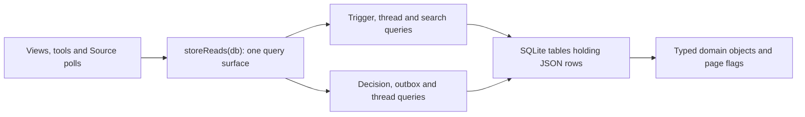

# store-read.ts

This file is the read-only face of the project's SQLite Store. It builds one object of query functions — `storeReads(db)` — that management views, orchestrator tools, and Source polling use to look at what happened, without ever writing anything. If you want to know how the dashboard's counters, a thread's timeline, or a search result are obtained, this is the place to read. The most useful takeaway: every query returns fully typed domain objects (`Trigger`, `Decision`, `Thread`, outbox receipts) parsed from stored JSON, so callers never touch SQL.

## Whole-unit functional diagram

Callers ask the `Store` for its read surface, pick a query, and receive parsed domain objects or a page plus a `more` flag. The queries only ever read the tables that `src/app/store.ts` creates and the Engine writes; nothing in this file mutates state.

## At a glance

- **Primary role**: API boundary — it publishes a small, fixed contract of read operations with clearly typed inputs and results for the rest of the application.
- **Secondary role**: State storage — it defines how retained state is read back: ordering, paging, anchoring, and which indexes serve which access pattern.
- **Confidence**: High — the file contains only query definitions, and every consumer (`views/`, `resources.ts`, `source-context.ts`, `migration.ts`, tests) is visible in the workspace.

## What this file does

- **Feeds the management views.** The overview gets per-source arrival counts, the judged/accepted flow, failing replies, dropped messages, and recent decisions; the threads and sources views get timelines, neighbours, titles, and search results.
- **Powers the orchestrator's resource routes.** Model-facing resources such as `triggers`, `threads`, `thread/<key>`, and `decisions` page through results using `recentTriggers`, `subscribedThreads`, `threadPage`, and `recentDecisions`.
- **Serves Source polling.** A Source can look up the latest trigger of a thread, the threads it is subscribed to, or the first trigger that titles a thread, via the `SourceContext` built in `src/app/source-context.ts`.
- **Answers "recent activity" questions in arrival order.** `recentTriggers` and `recentDecisions` order by insertion (`rowid`), so newly stored rows appear first even if their own timestamps are older.
- **Supports investigation, not just listing.** `search` matches an exact id or message id and does literal text/URL matching, `neighbours` finds the trigger just before and after a point on a thread, and `failingReplies` reports outbox messages whose `reply` effect keeps failing.
- **Stays strictly read-only.** There is no insert, update, or delete anywhere in the file, so it is safe to call from rendering code and polls.

## Key functions or classes

### `storeReads`

Takes the open SQLite handle and returns the whole query surface as one object; `Store` calls it once on startup and exposes it as `read`.

    
        <a target="_self" href="#src/app/store-read.ts:6-8?class=code" style="color: inherit; text-decoration: none;">Code: src/app/store-read.ts:6-8</a>
    

### `recentTriggers`

Returns the newest triggers by arrival order, paged with `offset` and `limit`, for "what just came in" listings.

    
        <a target="_self" href="#src/app/store-read.ts:9-10?class=code" style="color: inherit; text-decoration: none;">Code: src/app/store-read.ts:9-10</a>
    

### `triggerStats`

Groups triggers by source and reports, per source, how many arrived since a cutoff, how many were filtered out, and the last arrival time seen.

    
        <a target="_self" href="#src/app/store-read.ts:11-17?class=code" style="color: inherit; text-decoration: none;">Code: src/app/store-read.ts:11-17</a>
    

### `flow`

Counts triggers that survived source filtering and reached a decision, plus how many accept/reopen decisions those arrivals produced — the intake funnel shown on the overview.

    
        <a target="_self" href="#src/app/store-read.ts:18-27?class=code" style="color: inherit; text-decoration: none;">Code: src/app/store-read.ts:18-27</a>
    

### `triggers`

Filters triggers by source and/or "was it filtered out", newest first, and returns a page plus a `more` flag.

    
        <a target="_self" href="#src/app/store-read.ts:28-32?class=code" style="color: inherit; text-decoration: none;">Code: src/app/store-read.ts:28-32</a>
    

### `threadTriggers`

Returns the latest triggers of one thread **oldest-first** (so they read in timeline order), optionally bounded before or through a given `(at, id)` position.

    
        <a target="_self" href="#src/app/store-read.ts:33-38?class=code" style="color: inherit; text-decoration: none;">Code: src/app/store-read.ts:33-38</a>
    

### `search`

Finds triggers by exact id, exact message id, or literal text/URL substring, escaping user text so `%` and `_` are matched literally rather than as wildcards.

    
        <a target="_self" href="#src/app/store-read.ts:54-57?class=code" style="color: inherit; text-decoration: none;">Code: src/app/store-read.ts:54-57</a>
    

### `subscribedThreads`

Lists threads that still have subscriptions, all of them or only one source's, for Source polling and the threads listing.

    
        <a target="_self" href="#src/app/store-read.ts:76-79?class=code" style="color: inherit; text-decoration: none;">Code: src/app/store-read.ts:76-79</a>
    

## Main inputs and results

- **Inputs**: the open SQLite handle; pagination `offset`/`limit` (defaults 0 and 50 for the newest-first lists); a `since` timestamp string for counts; filter values such as `source`, `filtered`, `kinds`, and `humanOnly`; a thread key for per-thread queries; and an optional `TimelinePlace` (`{ at, id }`) with a `through` switch to anchor a timeline page.
- **Results**: arrays of `Trigger`, `Decision`, and `Thread` objects parsed from the stored JSON; page objects shaped `{ items, more }` where `more` is true when another row exists beyond the page; per-source statistics records; a `{ judged, accepted }` pair; outbox receipts with `attempts` and `error`; and `undefined`/empty results when nothing matches.
- **Visible side effects**: none — the queries do not write, so a view render, tool call, or Source poll cannot change stored state. What a user observes is the resulting view content: overview funnel numbers, a thread timeline with "load more", search hits, and failing-reply warnings.

## Public contract

- **Caller**: management views (`src/app/views/`), the orchestrator's resource routes and tools (`resources.ts`, `src/app/tools/`), Source polling through `src/app/source-context.ts`, and migration checks. Callers reach it as `store.read`, created once when the Store opens.
- **Operation**: a fixed set of read-only queries over triggers, dispositions (used only to detect filtering), decisions, threads, the outbox, and `reply` effects. There is no generic "run this SQL" entry point.
- **Accepted input**: plain values only — numbers for paging, ISO timestamp strings for time windows, string filters, thread keys, and a `{ at, id }` position for timeline anchoring. Defaults are applied by the queries themselves, so `store.read.recentTriggers()` is valid.
- **Result**: parsed domain objects and page wrappers as described above. Empty inputs yield empty lists or `undefined`, not errors.

### Access or validation requirements

This layer performs no authorization. Callers that return thread or ticket content to a worker Session enforce visibility themselves — for example the thread resource route rejects threads a ticket neither subscribes to nor follows. Treat it as an internal contract: it assumes trusted in-process callers and an already-migrated schema.

## Stored state lifecycle

- **Stores**: nothing of its own. It reads the durable rows that `src/app/store.ts` creates — triggers and their dispositions, decisions, threads, outbox receipts, reply effects, and the per-thread trigger index — plus the generated working-set columns the Store maintains.
- **Read path**: on demand, once per view render, tool call, or Source poll, against the same database handle the Store already opened.
- **Write path**: none here. Rows change only through the Engine's repository calls and the outbox, so data seen through these queries is always whatever the last committed write produced.
- **Visible result**: persistence gives the operator history that outlives a restart — arrival statistics, thread timelines, decision history, and outbox health can all be reconstructed after the process restarts.

### Important persistence behavior

- **Two orderings are deliberate.** Recent-activity lists (`recentTriggers`, `recentDecisions`) order by insertion so the newest stored row wins; timeline queries order by the trigger's own timestamp with `id` as tie-breaker, and flip that order so pages read oldest-first.
- **Paging is honest.** Paged queries fetch one extra row and report `more`, so a view can offer "load more" without a second count query; timeline pages use an `(at, id)` anchor instead of offsets so new arrivals do not shift an already-read page.
- **An index is forced on purpose.** The unfiltered subscribed-thread query names the partial index explicitly, with a source comment explaining that this avoids a full scan in insertion order.
- **Generated columns make filters cheap.** Filtering by source, by "filtered out", or by subscription works against the Store's generated columns, which is why these queries stay simple despite the rows living in JSON.

---
name: store-read.ts

update-time: 2026-11-02 10:36

description: This file is the read-only face of the project's SQLite Store. It builds one object of query functions — `storeReads(db)` — that management views, orchestrator tools, and Source polling use to look at what happened, without ever writing anything. If you want to know how the dashboard's counters, a thread's timeline, or a search result are obtained, this is the place to read. The most useful takeaway: every query returns fully typed domain objects (`Trigger`, `Decision`, `Thread`, outbox receipts) parsed from stored JSON, so callers never touch SQL.

---
