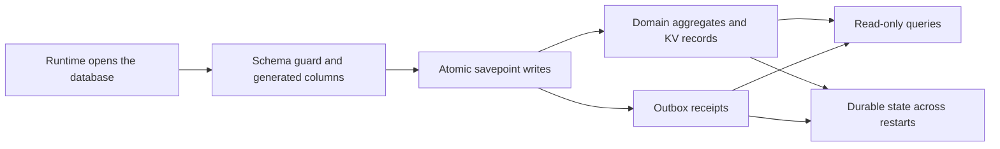

# store.ts

This file is the orchestrator's durable memory: a single SQLite database that holds the domain aggregates (triggers, threads, tickets, decisions), the outbox receipts for channel delivery, saved settings history, and general typed key–value state. It opens and hardens the state file, refuses schemas it cannot handle, and brings supported older databases up to the current schema on startup. Everything else in `src/app` reads and writes state through the `Store` class instead of touching SQL directly — most writes go through its `atomic` transaction helper.

## How the pieces fit

At startup the runtime hands the store a file path; the store creates or opens the file, checks the recorded schema version against the versions this build accepts, and applies pending migration inside one transaction. From then on, callers wrap a unit of work in `atomic`, write domain records or receipts, and read them back through typed accessors or the read-only query set used by views and tools.

<!-- {
  "mermaid_info": {
    "name": "Store startup, writes and reads",
    "nodes": [
      {
        "id": "open_001",
        "name": "Runtime opens the database",
        "path": "src/app/store.ts",
        "hint": "Constructor creates the state directory, opens the SQLite file and restricts its permissions",
        "isJumpable": true,
        "position": { "startLine": 58, "endLine": 64 },
        "references": []
      },
      {
        "id": "schema_002",
        "name": "Schema guard and generated columns",
        "path": "src/app/store.ts",
        "hint": "Rejects unsupported versions, migrates schema 10 to 11, and reconciles working-set columns and indexes",
        "isJumpable": true,
        "position": { "startLine": 62, "endLine": 120 },
        "references": []
      },
      {
        "id": "atomic_003",
        "name": "Atomic savepoint writes",
        "path": "src/app/store.ts",
        "hint": "Nested savepoint transactions with post-commit callbacks",
        "isJumpable": true,
        "position": { "startLine": 140, "endLine": 162 },
        "references": []
      },
      {
        "id": "records_004",
        "name": "Domain aggregates and KV records",
        "path": "src/app/store.ts",
        "hint": "Typed accessors for triggers, threads, tickets, decisions, KV keys and settings history",
        "isJumpable": true,
        "position": { "startLine": 163, "endLine": 247 },
        "references": []
      },
      {
        "id": "outbox_005",
        "name": "Outbox receipts",
        "path": "src/app/store.ts",
        "hint": "Retained delivery receipts with pending, sent and dropped statuses",
        "isJumpable": true,
        "position": { "startLine": 252, "endLine": 288 },
        "references": []
      },
      {
        "id": "reads_006",
        "name": "Read-only queries",
        "path": "src/app/store-read.ts",
        "hint": "Query set for management views, orchestrator tools and source polling",
        "isJumpable": true,
        "position": { "startLine": 1, "endLine": 1 },
        "references": []
      },
      {
        "id": "durable_007",
        "name": "Durable state across restarts",
        "path": "",
        "hint": "Work committed before a restart is still visible afterwards, and message IDs stay idempotent",
        "isJumpable": false,
        "position": { "startLine": 0, "endLine": 0 },
        "references": []
      }
    ]
  }
} -->

    
        <a target="_self" href="#src/app/store.ts:1?class=graph" style="color: inherit; text-decoration: none;">Graph: Store startup, writes and reads</a>
    

## At a glance

- **Primary role — state storage:** `Store` owns the lifetime of the orchestrator's database: it creates it, guards its version, migrates it, and is the only place that describes how saved state is written and read back.
- **Secondary role — data contract:** the file also defines the shapes other modules exchange, notably `Receipt` (a message plus its delivery status) and `SettingsVersion` (a saved settings snapshot with what it changed).
- **Confidence:** High — the full file was read together with the `Repositories` port it implements, the `KV` key registry, the migration module, the versioned-snapshot helper, and real call sites in `runtime.ts` and `outbox.ts`.

## What this file does

- **Opens and protects the state file.** The constructor creates the state directory with private permissions, opens the SQLite database, restricts the file to the owner, and switches on write-ahead logging with full durability so a crash does not silently lose committed work.
- **Refuses databases it cannot trust, and upgrades the ones it can.** A database newer than `SCHEMA_VERSION` or older than `OLDEST_SCHEMA` is rejected outright; a supported older one is migrated inside a single transaction, and if that migration fails the error names the untouched source schema and the handle is closed so a later attempt can reopen.
- **Keeps the "active work" index current.** Generated columns and partial indexes mark which tickets are open or active, which threads are active or subscribed, and which outbox messages are pending per conversation. Older databases get the columns added (or rebuilt when a definition changed) on open, so scheduled passes scan only the rows that matter.
- **Implements the domain repository port.** Triggers (plus their filter dispositions), threads, tickets and decisions are exposed as small object groups with `get`/`save` and filtering helpers, each storing the record as JSON in its own table — this is what satisfies the `Repositories` interface the engine programs against.
- **Provides transaction and post-commit hooks.** `atomic` runs work in a savepoint that nests inside an outer transaction, and `afterCommit` defers in-memory follow-ups until the outermost commit, discarding them if that transaction rolls back.
- **Owns settings snapshots, key–value state and delivery receipts.** Settings are saved as numbered revisions with per-block revision counters, typed KV records are read and written by key, and outbox receipts track a message from `pending` to `sent` or `dropped` so a message ID can never be queued twice.

## Key functions or classes

### `Store`

The class that opens the database and ties together every persistence capability below; its constructor is where path handling, permission hardening, version guarding and migration happen.

    
        <a target="_self" href="#src/app/store.ts:58-101?class=code" style="color: inherit; text-decoration: none;">Code: src/app/store.ts:58-101</a>
    

### `Store.addColumns`

Reconciles the generated working-set columns and their indexes when opening a database written by an earlier version, dropping columns whose definition changed before adding the current ones.

    
        <a target="_self" href="#src/app/store.ts:102-120?class=code" style="color: inherit; text-decoration: none;">Code: src/app/store.ts:102-120</a>
    

### `Store.atomic`

Runs a function inside a savepoint (nested inside the current transaction when one is open) and rolls back its changes if it throws.

    
        <a target="_self" href="#src/app/store.ts:140-153?class=code" style="color: inherit; text-decoration: none;">Code: src/app/store.ts:140-153</a>
    

### `Store.afterCommit`

Registers an in-memory follow-up that runs after the outermost transaction commits, or immediately when called outside a transaction.

    
        <a target="_self" href="#src/app/store.ts:159-162?class=code" style="color: inherit; text-decoration: none;">Code: src/app/store.ts:159-162</a>
    

### `Store.saveSettings`

Validates a raw settings value, stores it as the next revision with the caller's provenance record, and bumps the per-block revision counter used for optimistic concurrency.

    
        <a target="_self" href="#src/app/store.ts:188-199?class=code" style="color: inherit; text-decoration: none;">Code: src/app/store.ts:188-199</a>
    

### `Store.threads.patchMeta`

Re-reads a thread and atomically adds or removes source-specific metadata keys, skipping the save when nothing actually changed.

    
        <a target="_self" href="#src/app/store.ts:224-231?class=code" style="color: inherit; text-decoration: none;">Code: src/app/store.ts:224-231</a>
    

### `Store.receipts`

The outbox ledger: record a pending message, list what is waiting, check ordering per conversation, settle a message as sent or dropped, and withdraw one that has not gone out.

    
        <a target="_self" href="#src/app/store.ts:254-288?class=code" style="color: inherit; text-decoration: none;">Code: src/app/store.ts:254-288</a>
    

### `Receipt`

The stored shape of an outbound message plus its delivery status, and optionally when and why it was dropped; other modules import this type to reason about delivery.

    
        <a target="_self" href="#src/app/store.ts:18?class=code" style="color: inherit; text-decoration: none;">Code: src/app/store.ts:18</a>
    

## Main inputs and results

- **Inputs:** the database file path and an error reporter from the runtime; domain records to save (`Trigger`, `Thread`, `Ticket`, `Decision`, dispositions); typed KV keys from the `KV` registry; raw settings values with a provenance record; outbound messages and thread metadata patches.
- **Results:** typed records and record lists for those same aggregates, the current validated settings and their revision history, `add`/`withdraw` booleans and `replyStatus` lookups for the outbox, and query results from the read-only set used by views.
- **Visible side effects:** an `orchestrator.sqlite` database (with its WAL side files) appears in the state directory with owner-only permissions; a first run records the current schema version; metadata edits made by sources show up in thread listings and detail views.

## Stored state lifecycle

- **Stores:** every aggregate the orchestrator must not forget — triggers with their filter dispositions, threads (including human-facing label, URL and facts), tickets, decisions, the outbox receipt ledger, numbered settings snapshots, and free-form typed key–value records such as source cursors and session IDs.
- **Read path:** the runtime opens the store during startup, before any component that needs settings or state is constructed; the engine, sources, tools and management views then read through the typed accessors or the read-only query set.
- **Write path:** components call the repository methods and let the store wrap the work in `atomic`, so a saved trigger also re-indexes the threads it belongs to, a saved ticket updates its generated working-set columns automatically, and a settled receipt is visible to the delivery loop on its next pass.
- **Visible result:** a restart resumes the same tickets, queue and settings; messages already sent are not sent again; and management views can page back through threads, triggers and settings history.

### Important persistence behavior

- **Version gate before migration.** The schema version lives in the key–value table. Anything newer than the build's schema is rejected immediately, anything older than the oldest supported schema is refused with a message telling the operator to start a new state directory, and a failed migration reports the source schema explicitly so the unchanged file remains diagnosable.
- **Post-commit callbacks are not part of the transaction.** They are queued per savepoint level, merged into the enclosing level when an inner transaction commits, discarded when it rolls back, and their own failures are reported to the constructor's reporter instead of undoing a successful write.
- **Receipts are retained forever.** A message ID that has been recorded can never produce a second delivery attempt; settling also recreates a receipt if the message was withdrawn while it was being sent, so the ID still cannot be queued again.

## Information contract

- **Represents:** a delivery receipt (`Receipt`), a dropped receipt with its timestamp and reason (`Dropped`), a trigger's position on a thread timeline (`TimelinePlace`), and a saved settings snapshot (`SettingsVersion`).
- **Produced by:** `Store.receipts.add` and `settle` for receipts, `Store.saveSettings` for settings versions, and keyset-ordered thread and trigger queries for timeline positions.
- **Consumed by:** the outbox, which decides whether to wait, drop or send based on status; the migration module, which reads and rewrites settings versions and receipts; and the view and tool read layer, which pages threads by timeline position and renders settings history.
- **Behavior-shaping parts:** `status` (`pending`, `sent`, `dropped`) drives what is waiting and what can still be withdrawn; the drop reason distinguishes a conversation that can never receive a message from one that no longer listens; `revision`, `policyVersion`, `policyChanged` and `notified` explain what a settings save changed and who was told; and `block` feeds the per-page revision counters that stop two configuration pages from overwriting each other.

---
name: store.ts

update-time: 2026-11-02 10:41

description: This file is the orchestrator's durable memory: a single SQLite database that holds the domain aggregates (triggers, threads, tickets, decisions), the outbox receipts for channel delivery, saved settings history, and general typed key–value state. It opens and hardens the state file, refuses schemas it cannot handle, and brings supported older databases up to the current schema on startup. Everything else in `src/app` reads and writes state through the `Store` class instead of touching SQL directly — most writes go through its `atomic` transaction helper.

---
