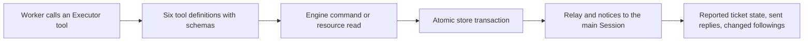

# executor.ts

This file defines the complete set of tools a worker ("Executor") Session can call while it works on one ticket. Everything here is scoped to a single ticket: reading that ticket's own context, acknowledging a person, reporting progress and outcomes, and adjusting which conversations the ticket follows. If you want to know what a worker agent is actually *able* to do — and what it can never do — this is the authoritative list.

## Functional overview

A model turn becomes arguments that the file validates, then becomes an Engine command or a resource read, and finally becomes something an operator or a person can see: an updated ticket, a posted reply, or a notice delivered to the main Session.

## At a glance

- Primary role: **API boundary** — it publishes the callable surface (names, argument schemas, return shapes) that a worker Session is given, rather than doing the work itself.
- Secondary role: **Orchestration** — `orchestrator_report` sequences several collaborators (GitHub pull lookup, PR claiming, report recording, notification) inside one transaction.
- Confidence: **High** — the whole file is read, and each collaborator it calls (Engine, store, sessions, notices, GitHub pull helpers) was checked in source.

## What this file does

- Publishes the six worker tools: `orchestrator_read`, `orchestrator_ack`, `orchestrator_thread_unrelated`, `orchestrator_thread_follow`, `orchestrator_trigger_handback` and `orchestrator_report`.
- Binds every tool to one ticket up front, so a worker can only touch its own ticket's context — the ticket id is captured when the tool array is built, and callers cannot pass a different one.
- Turns each call into a named Engine command (`reply`, `markUnrelated`, `followForContext`, `handback`, `report`) or a scoped resource read, keeping the ticket state in the core rather than in the tool layer.
- Guards the visible edges: a ticket that already ended refuses further reports, a pull request that is not the ticket's is rejected instead of silently bound, and an acknowledgement cannot exceed the message-length limit for chat channels.
- Keeps a report, its PR claim and its notification atomic, so the main Session always hears about a report that was actually recorded.
- Returns small JSON objects to the model (`reported`, `notification`, `queued`, `followed`, `reused`, …) so a turn can see what took effect.

## Public contract

- Caller: the Executor Session of one ticket. The host wires this in 
<a target="_self" href="#src/app/runtime.ts:124?class=code" style="color: inherit; text-decoration: none;">runtime.ts:124</a>
, where a ticket selects these tools instead of the main Session's tools.
- Operation: build and return a `Tool[]` for that ticket; each element carries a name, a model-facing description, a strict Zod schema and an `execute` function.
- Accepted input: one `ExecutorToolsHost` (the capabilities the file is allowed to use) plus the `Ticket`. Per call, arguments must match the tool's schema — unknown keys are refused because every schema is `.strict()`.
- Result: the tool array itself, and for each executed call a plain object describing the outcome, or a thrown error that the model sees as a refusal.

| Tool | What a worker uses it for | Notable result |
| --- | --- | --- |
| `orchestrator_read` | Read one page of a resource this ticket may see (its card, assignment, inputs, result, transcript, relevant threads, originals) | A page with `next_offset` / `next_resource` |
| `orchestrator_ack` | Post a short acknowledgement as a reply to a human message | `acknowledgement` status and whether the reply was `reused` |
| `orchestrator_thread_unrelated` | Drop an attached thread that is not about this ticket | `{ removed: true, thread }` |
| `orchestrator_thread_follow` | Subscribe to a related thread for context only | `{ followed, thread }` |
| `orchestrator_trigger_handback` | Hand a message back for a fresh assessment, once per message | `{ trigger_id, queued }` |
| `orchestrator_report` | Report progress, ready, blocked, failed or dropped, and bind the ticket's PR | `reported`, `notification`, optional `attention` |

### Access and validation requirements

The ticket's own resources are the boundary: `orchestrator_read` is built with the executor-flagged resource grammar, so the model is only offered pages it may see. Thread keys in `orchestrator_thread_follow` must be `<source>:<id>`; the split is validated before the Engine is called. Reasons on handback, follow and un-relate are trimmed and capped at 300 characters, an acknowledgement is limited to the configured chat word budget, and `pr_number` must be either the ticket's source PR or one opened by the agent account from a branch named after the ticket.

## Key functions and classes

### `executorTools`

Builds the six-tool array for one ticket, capturing `ticket.id` once so no tool can address a different ticket.

    
        <a target="_self" href="#src/app/tools/executor.ts:23-105?class=code" style="color: inherit; text-decoration: none;">Code: src/app/tools/executor.ts:23-105</a>
    

### `ExecutorToolsHost`

The declared dependency surface: narrowed `Pick`s of the Engine, the store, and the sessions, the resource host, the GitHub Source context, and a `sendReplies` hook — each narrowed to exactly the methods this file needs.

    
        <a target="_self" href="#src/app/tools/executor.ts:13-21?class=code" style="color: inherit; text-decoration: none;">Code: src/app/tools/executor.ts:13-21</a>
    

The shared pieces it reuses — the `Tool` shape, `readTool` and the acknowledgement schema — live in 
<a target="_self" href="#src/app/tools/tool.ts?class=code" style="color: inherit; text-decoration: none;">tool.ts</a>
, and the main Session's larger tool set sits beside it in 
<a target="_self" href="#src/app/tools/main.ts?class=code" style="color: inherit; text-decoration: none;">main.ts</a>
.

## Coordinated flow

The richest path is `orchestrator_report`, which is where a worker's closing statement becomes durable state and a notification:

1. The worker supplies a `state` (`progress`, `ready`, `blocked`, `failed`, `dropped`), a summary, and optionally a human question, the message that raised it, the question being answered, and a pull request number.
2. The file re-reads the ticket and refuses with "Ticket ended … do not resume it" if the ticket is no longer live, so a stale worker cannot reopen closed work.
3. With a `pr_number`, it fetches the pull request through the GitHub Source context and asks `claimPull` whether the PR belongs to this ticket. A rejection (wrong PR, or a PR already owned by another active ticket) throws, so the following steps never happen.
4. Inside one atomic store transaction it records the report on the ticket's current assignment, then asks `reportRelay` whether the main Session should hear about it.
5. The result is returned as `notification: 'orchestrator'` when a relay was queued, `internal_only` for routine progress, plus `attention` when a question for a person is now pending.

### Important branching and concurrency

Ordering matters more than breadth here: because the PR claim, the report and the relay share a single `atomic` block, a refused PR or an invalid report leaves no half-written state, and a recorded report always reaches the main Session. A complementary pattern appears in `orchestrator_ack`, which calls `sendReplies` only when the reply has not already been sent, and in `orchestrator_thread_follow`, which notifies the main Session only when the follow was genuinely new (`followed === true`).

## Main inputs and results

- Inputs: an `ExecutorToolsHost` (narrowed Engine, store, sessions, resource host, GitHub Source context, `sendReplies`) and the `Ticket` the Session works on; per call, schema-validated arguments from the model.
- Results: a `Tool[]` of exactly six tools, and per invocation a compact JSON object — a resource page, an acknowledgement status, `removed` / `followed` / `queued` flags, or `reported` with its `notification` mode.
- Visible side effects: replies posted to the source channel, ticket state and attention questions changed, thread subscriptions added or dropped, and relays or notices delivered to the main Session.

---
name: executor.ts

update-time: 2026-11-02 11:40

description: This file defines the complete set of tools a worker ("Executor") Session can call while it works on one ticket. Everything here is scoped to a single ticket: reading that ticket's own context, acknowledging a person, reporting progress and outcomes, and adjusting which conversations the ticket follows. If you want to know what a worker agent is actually *able* to do — and what it can never do — this is the authoritative list.

---
