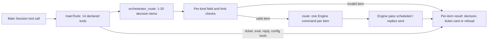

# main.ts

This file defines the tool surface the orchestrator's **main Session** (the model that reads candidates and dispatches work) is allowed to call: routing candidates, managing tickets, assessing proactive work, replying to people, and changing settings or prompts. Every tool here is a plain declaration — a name, a natural-language description, a strict Zod schema and an `execute` function that delegates to the engine, store, assessor or settings objects handed in through `MainToolsHost`. The most useful takeaway for a newcomer: this is the single place where "what the model may do" is written down, including the exact fields each operation accepts and the result shape it gets back.

## Whole-unit functional diagram

The main path starts with a model call into `mainTools`, and the routing branch is the most involved: a batch of decisions is validated item by item, each valid item becomes its own Engine command, and the call finishes by scheduling an Engine pass and returning one result object per item in the original order.

<!-- {
  "mermaid_info": {
    "name": "Main Session tool surface flow",
    "nodes": [
      {
        "id": "caller_001",
        "name": "Main Session tool call",
        "path": "",
        "hint": "The orchestrator model invokes one of the declared tools",
        "isJumpable": false,
        "position": { "startLine": 0, "endLine": 0 },
        "references": []
      },
      {
        "id": "tools_002",
        "name": "mainTools: 14 declared tools",
        "path": "src/app/tools/main.ts",
        "hint": "Builds orchestrator_read plus the routing, ticket, eval, reply and configuration tools",
        "isJumpable": true,
        "position": { "startLine": 155, "endLine": 301 },
        "references": []
      },
      {
        "id": "routing_003",
        "name": "orchestrator_route: 1-20 decision items",
        "path": "src/app/tools/main.ts",
        "hint": "Accepts a batch of accept, attach, stop or ignore items",
        "isJumpable": true,
        "position": { "startLine": 125, "endLine": 153 },
        "references": []
      },
      {
        "id": "checks_004",
        "name": "Per-kind field and limit checks",
        "path": "src/app/tools/main.ts",
        "hint": "FIELDS and invalid decide whether one item may run",
        "isJumpable": true,
        "position": { "startLine": 61, "endLine": 82 },
        "references": []
      },
      {
        "id": "command_005",
        "name": "route: one Engine command per item",
        "path": "src/app/tools/main.ts",
        "hint": "Carries out the decision through the Engine in its own transaction",
        "isJumpable": true,
        "position": { "startLine": 88, "endLine": 120 },
        "references": []
      },
      {
        "id": "pass_006",
        "name": "Engine pass scheduled / replies sent",
        "path": "src/app/tools/main.ts",
        "hint": "routed() requests an Engine pass; replies and settings changes take effect",
        "isJumpable": true,
        "position": { "startLine": 36, "endLine": 41 },
        "references": []
      },
      {
        "id": "result_007",
        "name": "Per-item result: decision, ticket card or refusal",
        "path": "",
        "hint": "The observable answer the model reads back",
        "isJumpable": false,
        "position": { "startLine": 0, "endLine": 0 },
        "references": []
      }
    ]
  }
} -->

    
        <a target="_self" href="#src/app/tools/main.ts:1?class=graph" style="color: inherit; text-decoration: none;">Graph: Main Session tool surface flow</a>
    

## At a glance

- **Primary role — API boundary**: the file is the callable contract between the main Session's model and the system's capabilities; tool names, accepted arguments and result shapes are defined here.
- **Secondary role — Domain rules**: it encodes when a candidate may be accepted, attached, stopped or ignored, when a requeue is refused, and how a refused item differs from a failed one.
- **Secondary role — Orchestration**: `orchestrator_route` runs a multi-item batch in order, each item in its own Engine command, then schedules a single Engine pass.
- **Confidence**: High — the full 302-line source, the sibling `tool.ts` primitives, and `docs/007-architecture.md` agree on the tool inventory and result shapes.

## What this file does

- **Declares the whole main-Session tool inventory.** Fourteen tools are returned by `mainTools`: one shared read tool plus routing, ticket, assessment, reply and configuration tools. Session wiring in `runtime.ts` hands out exactly this list for a main Session, and the executor list for a ticket Session.
- **Routes candidates as a batch.** `orchestrator_route` takes 1–20 items, one per candidate `trigger_id`, and answers each item separately so a single bad decision never blocks the rest.
- **Manages existing tickets.** Retry a failed or blocked ticket, ask an idle worker for a status report, or pass a factual note to a worker without granting authority.
- **Drives the assessment path for inferred work.** `orchestrator_eval`, `orchestrator_eval_read` and `orchestrator_eval_decide` load a candidate's context, read more of it, and record the resulting decision.
- **Speaks to people and configures the deployment.** Send an answer, result or attention reply; unsubscribe a thread; save a settings block; refresh a source's policy members; save prompts — optionally as a preview that saves nothing.
- **Controls side effects deliberately.** Most tools schedule an Engine pass through `requestPass()` so queued work actually runs, while `quietly()` suppresses the main Session's own notifications, and reply sending is awaited so the returned status is the real one.

## Key functions or classes

### `MainToolsHost`

The dependency interface the runtime passes in: narrow `Pick` views of the engine, store, prompts, sessions, settings and assessor, plus `requestPass`, `sendReplies` and `quietly`. It is the only thing the tools know about the rest of the application.

<a target="_self" href="#src/app/tools/main.ts:20-34?class=code" style="color: inherit; text-decoration: none;">main.ts:20-34</a>

### `mainTools`

The export that builds the tool array. It merges the resource host with sessions and settings, then lists the read tool, the routing tool, and the twelve single-purpose tools.

<a target="_self" href="#src/app/tools/main.ts:155-301?class=code" style="color: inherit; text-decoration: none;">main.ts:155-301</a>

### `routeTool`

Declares `orchestrator_route`: it validates each item, runs the valid ones in order, records which triggers an earlier item already decided, and returns one entry per item.

<a target="_self" href="#src/app/tools/main.ts:125-153?class=code" style="color: inherit; text-decoration: none;">main.ts:125-153</a>

### `route`

Carries out one decision: `accept`, `attach`, `stop` and `ignore` each delegate to the corresponding Engine command and translate its outcome into a decision, a ticket id or a refusal string.

<a target="_self" href="#src/app/tools/main.ts:88-120?class=code" style="color: inherit; text-decoration: none;">main.ts:88-120</a>

### `invalid` and `FIELDS`

The per-kind validator: `FIELDS` records which kinds read a field and which kinds require it, and `invalid` returns the first problem for an item instead of failing the whole call.

<a target="_self" href="#src/app/tools/main.ts:61-82?class=code" style="color: inherit; text-decoration: none;">main.ts:61-82</a>

### `routed`

The shared result helper used by most single-purpose tools: it schedules an Engine pass and formats `{ decision?, reason, ticket? }`, attaching a readable ticket card when a ticket id is known.

<a target="_self" href="#src/app/tools/main.ts:36-41?class=code" style="color: inherit; text-decoration: none;">main.ts:36-41</a>

## Main inputs and results

- **Inputs**: a `MainToolsHost` with narrow views of the engine, store, prompts, sessions, settings and assessor; the `Agent` whose id scopes prompt-preview resources; and, per call, the model's JSON arguments checked against each tool's `.strict()` schema.
- **Results**: routing returns `{ results: [...] }` preserving item order, with `trigger_id`, `kind` and then either `decision`, `reason` and `ticket`, or `refused`; single-purpose tools return `{ decision?, reason, ticket? }`; policy sync returns the source, the allowed count and added/removed names; saves return the saved settings or prompt configuration; a prompt preview returns resources readable later with `orchestrator_read`.
- **Visible side effects**: tickets created or resumed, a worker's assignment restarted, replies posted to the original source, settings and prompt revisions saved, a source's allowed member list refreshed, and an Engine pass scheduled so queued work proceeds.

## Public contract

- **Caller**: the orchestrator main Session's model, which receives these definitions through `src/app/runtime.ts`; the same operations back the Web panel's settings, policy-sync and prompt actions described in their tool descriptions.
- **Operation**: fourteen tools — `orchestrator_read`, `orchestrator_route`, `orchestrator_ticket_retry`, `orchestrator_ticket_request_status`, `orchestrator_ticket_note`, `orchestrator_trigger_requeue`, `orchestrator_eval`, `orchestrator_eval_read`, `orchestrator_eval_decide`, `orchestrator_reply`, `orchestrator_thread_unsubscribe`, `orchestrator_settings_save`, `orchestrator_policy_sync`, `orchestrator_prompts_save`.
- **Accepted input**: every schema is strict, so unknown keys are rejected. Routing takes `decisions` with 1–20 items keyed by `trigger_id`; replies take a `purpose` of `answer`, `result` or `attention` plus text; settings saves take a `block` name, an optional `source`, a whole-block `value` and a `revision`; prompt saves take a config, an optional `baseRevision` and a `preview` flag.
- **Result**: a JSON object per tool, described above. Refusals are returned as data (`refused` with a reason) for routing items and thrown as `UserError` elsewhere, so the model can correct a single item without losing the batch.
- **Access or validation requirements**: free text is bounded — routing notes, acknowledgements and IM replies observe word limits, titles are capped at 200 characters, ignore/stop reasons at 500. `orchestrator_prompts_save` demands `baseRevision` unless it is a preview, and `orchestrator_settings_save` requires `source` only together with block `source`.

## Rules and decisions

- **Decision**: which routing kind applies to a candidate, and whether one candidate call may carry several decisions at once.
- **Important conditions**: `accept` needs `title`, `worktree_name` and `acknowledgement`; `attach` and `stop` need `ticket_id`; `ignore` needs `reason`; `note` is optional for `accept` and `attach` only and is length-limited. An `accept` whose Engine decision created no ticket is treated as that item's refusal, and re-accepting an already accepted trigger reports the existing ticket as unchanged.
- **Outcomes**: a recorded decision with its ticket card, a refusal with a specific reason, or — for `attach` — a confirmation that the ticket now follows the trigger's thread.
- **Invariant**: a trigger already decided by an earlier item of the same call cannot be ignored afterwards, because that item's Decision already took its batch. A follow-up that reached a ticket cannot be requeued from here: `orchestrator_trigger_requeue` refuses with `workerDecides` and names the owning tickets, because the worker judges it and hands back what is not its own. `stop` deliberately goes through the Engine's decision path so only a person's message the admission gate accepts with explicit strength can stop a ticket.

### Small example

A model sends one `orchestrator_route` call with an `accept` item missing `worktree_name` and an `ignore` item with a reason. The first comes back as `refused: "accept needs worktree_name"`; the second is recorded and returns its decision. Both answers arrive in a single ordered `results` array.

## Coordinated flow

1. The model calls `orchestrator_route` with up to 20 items; `routeTool` maps over them in order, keeping each item's `trigger_id` and `kind` in the answer.
2. `invalid` checks the item against `FIELDS`; a missing required field or a broken limit produces an immediate `refused` entry, leaving other items untouched.
3. A valid item goes to `route`, which issues exactly one Engine command (`decide` for accept/stop/ignore, `attach` for attach) and records any trigger ids the resulting decision covered, so later items in the same call see them.
4. Successes and `UserError` refusals come back as data; an unexpected error is logged through the context logger and reported as a retryable refusal for that item only.
5. After the batch, `requestPass()` schedules the Engine work the decisions imply, and the tool returns the ordered `results`. Tools outside routing reuse `routed` for the same "schedule a pass, then report" behavior, awaiting `sendReplies()` when a reply must actually be delivered.

Related files: the shared `Tool` shape and `orchestrator_read` builder live in 
<a target="_self" href="#src/app/tools/tool.ts?class=code" style="color: inherit; text-decoration: none;">tool.ts</a>
, the worker-side counterpart is 
<a target="_self" href="#src/app/tools/executor.ts?class=code" style="color: inherit; text-decoration: none;">executor.ts</a>
, and the result shapes are documented in 
<a target="_self" href="#docs/007-architecture.md?class=text" style="color: inherit; text-decoration: none;">007-architecture.md</a>
.

---
name: main.ts

update-time: 2026-11-02 11:46

description: This file defines the tool surface the orchestrator's **main Session** (the model that reads candidates and dispatches work) is allowed to call: routing candidates, managing tickets, assessing proactive work, replying to people, and changing settings or prompts. Every tool here is a plain declaration — a name, a natural-language description, a strict Zod schema and an `execute` function that delegates to the engine, store, assessor or settings objects handed in through `MainToolsHost`. The most useful takeaway for a newcomer: this is the single place where "what the model may do" is written down, including the exact fields each operation accepts and the result shape it gets back.

---
