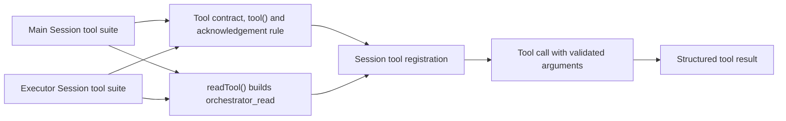

# tool.ts

`src/app/tools/tool.ts` is the small shared vocabulary layer that both tool suites are written in. It says what a tool *is* (a name, a description the model reads, a zod schema for its arguments, and an async executor), offers two helpers for building one, and defines the one text rule both sessions must respect. Because the Main Session suite and the Executor Session suite both import from here, a change to this file reaches every tool the orchestrator exposes.

## Whole-unit functional diagram

Both suites assemble their tools from the primitives defined here, then hand them to the session registrar, which publishes the argument schema to the model; at call time the arguments are validated against that same schema before the executor runs, and the returned value becomes the tool result.

<!-- {
  "mermaid_info": {
    "name": "Shared tool primitives flow",
    "nodes": [
      {
        "id": "main_001",
        "name": "Main Session tool suite",
        "path": "src/app/tools/main.ts",
        "hint": "Builds the orchestrator's tools, including its own read and routing tools",
        "isJumpable": true,
        "position": { "startLine": 155, "endLine": 301 },
        "references": []
      },
      {
        "id": "executor_002",
        "name": "Executor Session tool suite",
        "path": "src/app/tools/executor.ts",
        "hint": "Builds the worker tools for one ticket",
        "isJumpable": true,
        "position": { "startLine": 23, "endLine": 105 },
        "references": []
      },
      {
        "id": "primitives_003",
        "name": "Tool contract, tool() and acknowledgement rule",
        "path": "src/app/tools/tool.ts",
        "hint": "Defines the Tool shape, the identity helper and the shared acknowledgement schema",
        "isJumpable": true,
        "position": { "startLine": 6, "endLine": 17 },
        "references": []
      },
      {
        "id": "readfactory_004",
        "name": "readTool() builds orchestrator_read",
        "path": "src/app/tools/tool.ts",
        "hint": "Factory for the paginated read tool, scoped to a main or executor session",
        "isJumpable": true,
        "position": { "startLine": 22, "endLine": 35 },
        "references": []
      },
      {
        "id": "register_005",
        "name": "Session tool registration",
        "path": "src/app/sessions.ts",
        "hint": "Converts each schema to JSON Schema and parses arguments before executing",
        "isJumpable": true,
        "position": { "startLine": 206, "endLine": 216 },
        "references": []
      },
      {
        "id": "call_006",
        "name": "Tool call with validated arguments",
        "path": "",
        "hint": "The model invokes a tool and its arguments are parsed by the tool's own schema",
        "isJumpable": false,
        "position": { "startLine": 0, "endLine": 0 },
        "references": []
      },
      {
        "id": "result_007",
        "name": "Structured tool result",
        "path": "",
        "hint": "The executor's returned value is rendered as JSON text for the model",
        "isJumpable": false,
        "position": { "startLine": 0, "endLine": 0 },
        "references": []
      }
    ]
  }
} -->

    
        <a target="_self" href="#src/app/tools/tool.ts:1?class=graph" style="color: inherit; text-decoration: none;">Graph: Shared tool primitives flow</a>
    

## At a glance

- **Primary role (data contract)**: this file fixes the shape every tool definition must have, and the schemas that travel with it, so independently written tool suites stay interchangeable.
- **Secondary role (API boundary)**: it also builds one real callable operation, `orchestrator_read`, and defines exactly what arguments it accepts.
- **Confidence**: High — the file is 36 lines, fully read, and both of its importers (`main.ts`, `executor.ts`) plus the registrar in `sessions.ts` were checked to confirm how the definitions are consumed.

## What this file does

- **Defines the tool contract**: a tool carries a `name`, a `description` the model sees, a zod `schema` for its arguments, and an `execute` function that receives parsed arguments plus an `AbortSignal`. The generic schema parameter makes the executor's argument type follow the schema, so a tool's input types and its validation cannot drift apart.
- **Lets mixed tools live in one list**: `tool()` returns a definition with its concrete schema type erased back to plain `Tool`, which is how `mainTools` and `executorTools` can return a `Tool[]` of tools with completely different parameters.
- **Defines one shared wording rule**: `AcknowledgementSchema` accepts a trimmed, non-empty string of at most 100 words (counted with word segmentation, so Chinese text is measured fairly). The same rule governs the orchestrator's acceptance acknowledgements and the worker's `orchestrator_ack` tool.
- **Builds the paginated read tool**: `readTool()` produces the `orchestrator_read` tool with a strict argument object — a resource name plus an offset and optional limit — and forwards them to a `read` callback supplied by the caller.
- **Scopes the visible resource list per session kind**: the `executor` flag chooses which resources the tool description announces, so a worker is only told about the resources it is actually allowed to read.

## Key functions or classes

### `Tool`

The interface that every tool in the project satisfies: name, model-facing description, zod schema, and an async executor returning `unknown`.

<a target="_self" href="#src/app/tools/tool.ts:6-11?class=code" style="color: inherit; text-decoration: none;">tool.ts:6-11</a>

### `tool()`

An identity helper that returns a definition typed as plain `Tool`, keeping heterogeneous tool arrays simple to assemble.

### `RegisterTool`

The type of the function that publishes a tool to a session; it mirrors the `Tool` fields and returns `void`. It is used by `sessions.ts` when binding tools to an agent.

### `AcknowledgementSchema`

Validation for human-facing acknowledgement text: trimmed, non-empty, and no longer than `IM_WORDS` (100) words, with an error message that tells the model to write one short sentence instead of splitting the message.

### `readTool(description, executor, read)`

Assembles `orchestrator_read`: a strict argument object and an executor that passes `resource`, `offset`, `limit` and the signal to the supplied `read` callback.

<a target="_self" href="#src/app/tools/tool.ts:22-35?class=code" style="color: inherit; text-decoration: none;">tool.ts:22-35</a>

## Main inputs and results

- **Inputs**: a per-session `description` string, an `executor` boolean, and a `read` callback `(resource, offset, limit, signal) => Promise<unknown>`; also the resource grammar from `resources.ts` and the word budget from `infra/text.ts`.
- **Results**: `Tool` definitions whose name is fixed to `orchestrator_read` and whose argument schema enforces the documented paging and resource rules; plus a reusable acknowledgement schema callers embed in their own argument objects.
- **Visible side effects**: the model sees the generated tool description (including the list of readable resources) and receives schema validation errors when its arguments do not fit; the tool's returned value is rendered as JSON text for the model after registration.

## Information contract

- **Represents**: one callable operation an AI session may perform — its identity, the instruction that tells the model when to use it, the argument shape, and the behavior behind it.
- **Produced by**: the two tool suites. `main.ts` calls `readTool` with `executor: false` and a read function bound to the orchestrator's resources; `executor.ts` calls it with `executor: true` and a read function bound to the worker's own ticket.
- **Consumed by**: `sessions.ts`, whose registrar converts each `schema` to JSON Schema for the model and parses the incoming arguments with that same schema before invoking `execute`. The returned value is serialized as JSON text, with an image attached when the value carries one.
- **Behavior-shaping parts**: the generic schema type (it types the executor's arguments), the `executor` flag (it decides which resources are advertised), and the strictness of the argument objects (unknown keys are refused rather than ignored).

### Compatibility notes

The `readTool` factory fixes the tool name `orchestrator_read`, so both sessions address the same operation; only the description and the allowed resources differ. Explicit defaults matter here: `offset` defaults to `0`, while `limit` stays optional so the resource layer can apply its own default page size.

## Public contract

- **Caller**: the Main Session's orchestrator and each Executor Session, both of which expose tools to a model that then invokes them by name.
- **Operation**: read one page of a named resource — for example a ticket, a thread, a transcript or a prompt version — instead of pulling a large body into the prompt all at once.
- **Accepted input**: `resource` (a non-empty name drawn from the list in the tool description); `offset` (integer ≥ 0, defaulting to 0, described as the `next_offset` of the previous page, counting text characters and list items); and `limit` (optional integer between 1 and 8000, described as characters of a text — 4000 by default, 8000 at most — or items of a list — 20 by default, 50 at most). Acknowledgement text follows its own contract: trimmed, non-empty, at most 100 words.
- **Result**: whatever the injected `read` callback resolves to; the registration layer then presents it to the model as JSON text, with an image attachment when the result contains one.

### Access or validation requirements

Argument objects are strict, so an unexpected key is refused rather than silently dropped. With `executor: true` the advertised resource list is filtered to the executor-readable entries (its own ticket, threads, triggers, prompt revisions, and source originals); with `executor: false` the orchestrator sees the full list from 
<a target="_self" href="#src/app/resources.ts:24-57?class=code" style="color: inherit; text-decoration: none;">resources.ts:24-57</a>
.

---
name: tool.ts

update-time: 2026-11-02 11:44

description: `src/app/tools/tool.ts` is the small shared vocabulary layer that both tool suites are written in. It says what a tool *is* (a name, a description the model reads, a zod schema for its arguments, and an async executor), offers two helpers for building one, and defines the one text rule both sessions must respect. Because the Main Session suite and the Executor Session suite both import from here, a change to this file reaches every tool the orchestrator exposes.

---
