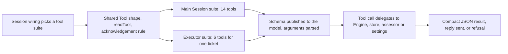

# tools

`src/app/tools` is where the project writes down exactly what its two AI sessions are allowed to do. One suite gives the *main* Session (the model that reads incoming candidates and dispatches work) its routing, ticket, assessment, reply and configuration operations; the other gives a *worker* Session the narrower set of moves it may make while working on a single ticket. If you want to know the model's real capabilities and limits — not just its prompt's promises — this directory is the authoritative answer.

## Whole-unit functional diagram

The main Session's list and a ticket's worker list are both assembled from the same primitives, then handed to the Session registrar, which publishes each argument schema to the model and parses call arguments against that same schema before anything runs. The tool layer therefore decides *what may be asked for*; the actual state change happens in the engine and store those tools delegate to.

<!-- {
  "mermaid_info": {
    "name": "Tool suites and registration flow",
    "nodes": [
      {
        "id": "dispatch_001",
        "name": "Session wiring picks a tool suite",
        "path": "src/app/runtime.ts",
        "hint": "A ticket selects the Executor suite, otherwise the main Session suite",
        "isJumpable": true,
        "position": { "startLine": 124, "endLine": 124 },
        "references": []
      },
      {
        "id": "toolcontract_002",
        "name": "Shared Tool shape, readTool, acknowledgement rule",
        "path": "src/app/tools/tool.ts",
        "hint": "The vocabulary both suites are written in",
        "isJumpable": true,
        "position": { "startLine": 6, "endLine": 35 },
        "references": []
      },
      {
        "id": "main_003",
        "name": "Main Session suite: 14 tools",
        "path": "src/app/tools/main.ts",
        "hint": "Routing, ticket, assessment, reply and configuration tools",
        "isJumpable": true,
        "position": { "startLine": 155, "endLine": 300 },
        "references": []
      },
      {
        "id": "executor_004",
        "name": "Executor suite: 6 tools for one ticket",
        "path": "src/app/tools/executor.ts",
        "hint": "Read, acknowledge, thread, handback and report tools",
        "isJumpable": true,
        "position": { "startLine": 23, "endLine": 104 },
        "references": []
      },
      {
        "id": "register_005",
        "name": "Schema published to the model, arguments parsed",
        "path": "src/app/sessions.ts",
        "hint": "Registers each tool and parses call arguments with its own schema",
        "isJumpable": true,
        "position": { "startLine": 206, "endLine": 216 },
        "references": []
      },
      {
        "id": "call_006",
        "name": "Tool call delegates to Engine, store, assessor or settings",
        "path": "",
        "hint": "The execute function forward the validated arguments to one collaborator",
        "isJumpable": false,
        "position": { "startLine": 0, "endLine": 0 },
        "references": []
      },
      {
        "id": "result_007",
        "name": "Compact JSON result, reply sent, or refusal",
        "path": "",
        "hint": "What the model reads back after a call",
        "isJumpable": false,
        "position": { "startLine": 0, "endLine": 0 },
        "references": []
      }
    ]
  }
} -->

    
        <a target="_self" href="#src/app/tools:1?class=graph" style="color: inherit; text-decoration: none;">Graph: Tool suites and registration flow</a>
    

## At a glance

- **Main role — API boundary**: the directory publishes the callable operations two different model sessions are given, including each operation's accepted arguments, its limits, and the result the model reads back.
- **Confidence**: High — all three files were read (36, 106 and 302 lines), and their consumers were checked: the suite choice in `runtime.ts:124` and the tool registration in `sessions.ts:206-216`.

## Responsibilities and non-responsibilities

- **Responsible for**: declaring the tool inventory per session kind, fixing each tool's argument schema and its length or count limits, binding the worker suite to one ticket, deciding which resources a worker may even be told about, and returning compact JSON results the model can act on.
- **Kept elsewhere**: turning a decision into durable state (the engine), persistence and transactions (the store), the actual resource text and pagination (`src/app/resources.ts`), publishing schemas to the model (`src/app/sessions.ts`), and composing notifications to the main Session (`src/app/notices.ts`). The tools call these; they do not reimplement them.

## Public contract

- **Caller**: the Session binder asks `host.tools(agent, ticket)` for a list; a ticket present means an Executor Session, its absence means the main Session. The model then invokes individual tools during its turn.
- **Operation**: build the `Tool[]` array for one session kind — `mainTools(host, agent)` or `executorTools(host, ticket)` — with each entry carrying a name, a model-facing description, a Zod schema and an `execute` function.
- **Accepted input**: a dependency host (`MainToolsHost` or `ExecutorToolsHost`) narrowed to the exact engine, store, assessor, settings and session methods the tools may use, plus the agent or the ticket. Per call, arguments must match that tool's schema.
- **Result**: an array of 14 tools for the main Session and exactly 6 for a worker ticket; each executed call returns a small plain object (a resource page, `reported`, `queued`, `followed`, `removed`, `reused`, …), while a rejected request is an error the model sees as a refusal.

### Access and validation requirements

Every schema is `.strict()`, so unexpected keys are refused rather than ignored, and several limits change what a caller may send: an acknowledgement is capped by the chat word budget (measured with word segmentation, so Chinese is counted fairly), routing notes by their own word cap, thread and handback reasons at 300 characters, and `orchestrator_route` accepts 1–20 items per call. The worker's read tool is built from the executor-scoped resource grammar, so a worker is only offered its own ticket's cards, assignments, inputs, result, transcript, relevant threads and originals. The executor suite also captures `ticket.id` once, which means no worker tool can address another ticket. A reported pull request must be the ticket's source PR or one opened by the agent account from a branch named after the ticket.

## Important direct children

### `tool.ts`

The shared vocabulary: the `Tool` contract, the `tool()` helper that lets tools with different schemas sit in one `Tool[]`, the `readTool()` factory that produces `orchestrator_read`, and the acknowledgement text rule both sessions must respect.

<a target="_self" href="#src/app/tools/tool.ts:1-36?class=code" style="color: inherit; text-decoration: none;">tool.ts:1-36</a>

### `main.ts`

The orchestrator's tool surface: a batch candidate-routing tool, ticket retry/status/note operations, trigger requeue, the three-step assessment path, reply sending, thread unsubscribe, and settings, policy and prompt saves.

<a target="_self" href="#src/app/tools/main.ts:155-300?class=code" style="color: inherit; text-decoration: none;">main.ts:155-300</a>

### `executor.ts`

The worker's tool surface for exactly one ticket: read its own context, acknowledge a person, drop or follow threads, hand a message back, and report progress, ready, blocked, failed or dropped — plus the PR binding that closes a ticket.

<a target="_self" href="#src/app/tools/executor.ts:23-104?class=code" style="color: inherit; text-decoration: none;">executor.ts:23-104</a>

## How the children work together

1. `runtime.ts` decides which suite a Session receives: a ticket selects the Executor tools, otherwise the main Session tools.
2. Whichever suite runs builds its array from `tool.ts` primitives, so both sides stay interchangeable and share the same length rule for acknowledgement text.
3. `sessions.ts` registers every entry, converting the Zod schema to JSON Schema for the model and parsing call arguments with that same schema before `execute` runs — a bad argument never reaches the engine.
4. `execute` hands the validated arguments to one collaborator (engine command, store query, assessor, settings, or a resource read) and returns a small object that the Session renders as JSON text for the model.

The two most involved paths both live in this directory. `orchestrator_route` validates each of up to 20 decisions separately, runs each valid one as its own engine command, and answers each item in the original order, so one bad decision cannot block the batch before finally scheduling an engine pass. `orchestrator_report` re-checks that the ticket is still live, verifies the PR claim through the GitHub Source context, and then records the report and queues the relay inside a single atomic block — so a refused PR leaves no half-written state, and a recorded report always reaches the main Session.

### Information contract

- **Represents**: one callable operation — its name, the description the model reads, its argument schema, and its executor.
- **Produced by**: `tool.ts` for shared pieces, and the two suites for their own declarations.
- **Consumed by**: the Session registrar, which publishes the schema and parses arguments, then renders whatever the executor returns as the tool result.
- **Behavior-shaping parts**: the schema (which fields exist and which limits apply), the `executor` flag on `readTool` (which resources the model is even told about), and the description text, which is the model's only in-band instruction for how to use the tool and when not to.

## Recommended starting points

1. `tool.ts` — it is only 36 lines and explains the shape every single tool in the project has, plus the one rule both sessions share.
2. `executor.ts` — the smallest complete suite, so you can see a full tool declaration end to end before reading the larger one.
3. `main.ts` — open this once the pattern is familiar; it is where the orchestrator's real decisions, batch routing and settings changes become callable.

---
name: tools

update-time: 2026-11-02 11:53

description: `src/app/tools` is where the project writes down exactly what its two AI sessions are allowed to do. One suite gives the *main* Session (the model that reads incoming candidates and dispatches work) its routing, ticket, assessment, reply and configuration operations; the other gives a *worker* Session the narrower set of moves it may make while working on a single ticket. If you want to know the model's real capabilities and limits — not just its prompt's promises — this directory is the authoritative answer.

---
