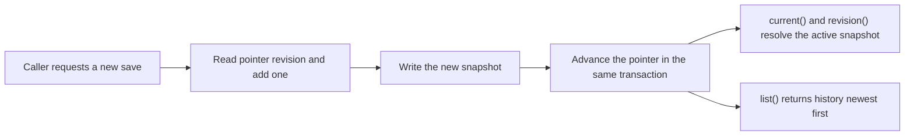

# versions.ts

This small file answers one question for the rest of the app: *how do we keep a full history of a configuration while still having exactly one "current" version?* `Versions` stores numbered snapshots of any record that carries a `revision` number, plus a single pointer key naming the active revision. It is the shared engine behind settings history and prompt configuration history. If you are new to the project, read this file to understand how those two features stay consistent and how old revisions remain readable.

## Whole-unit functional diagram

A save reads the pointer, asks the caller to build the next snapshot, stores that snapshot under its own revision key, and only then moves the pointer — all inside one `Store.atomic` transaction. Readers then either look up the pointer to find the active snapshot or list the family to get the whole history.

<!-- {
  "mermaid_info": {
    "name": "Versioned snapshot save and read flow",
    "nodes": [
      {
        "id": "save_001",
        "name": "Caller requests a new save",
        "path": "src/app/versions.ts",
        "hint": "save() is the public entry point and receives a factory that builds the next snapshot",
        "isJumpable": true,
        "position": { "startLine": 21, "endLine": 28 },
        "references": []
      },
      {
        "id": "bump_002",
        "name": "Read pointer revision and add one",
        "path": "src/app/versions.ts",
        "hint": "revision() reads the pointer key and falls back to 0 before the first save",
        "isJumpable": true,
        "position": { "startLine": 13, "endLine": 14 },
        "references": []
      },
      {
        "id": "snapshot_003",
        "name": "Write the new snapshot",
        "path": "src/app/versions.ts",
        "hint": "The snapshot is written under the family key for its revision number",
        "isJumpable": true,
        "position": { "startLine": 24, "endLine": 24 },
        "references": []
      },
      {
        "id": "pointer_004",
        "name": "Advance the pointer in the same transaction",
        "path": "src/app/versions.ts",
        "hint": "The pointer record is updated inside the same atomic block as the snapshot",
        "isJumpable": true,
        "position": { "startLine": 25, "endLine": 25 },
        "references": []
      },
      {
        "id": "read_005",
        "name": "current() and revision() resolve the active snapshot",
        "path": "src/app/versions.ts",
        "hint": "current() uses the pointer to fetch the active snapshot; undefined before the first save",
        "isJumpable": true,
        "position": { "startLine": 15, "endLine": 20 },
        "references": []
      },
      {
        "id": "list_006",
        "name": "list() returns history newest first",
        "path": "src/app/versions.ts",
        "hint": "list() enumerates the family, sorts by descending revision and applies an optional limit",
        "isJumpable": true,
        "position": { "startLine": 31, "endLine": 33 },
        "references": []
      }
    ]
  }
} -->

    
        <a target="_self" href="#src/app/versions.ts:1?class=graph" style="color: inherit; text-decoration: none;">Graph: Versioned snapshot save and read flow</a>
    

## At a glance

- **Primary role**: State storage — the class owns how versioned records are written to and read from the key-value table, and which one counts as current.
- **Secondary roles**: Domain rules — it also encodes the versioning policy: revisions only grow, history is kept, and only one snapshot is "current".
- **Confidence**: High — the whole file was read, together with its `Store`, `Prompts`, `migration` and `kv.ts` usages.

## What this file does

- Provides one reusable way to store any record that has a `revision` field as a series of numbered snapshots instead of a single mutable row.
- Keeps a separate pointer record so "the current version" is a cheap single lookup rather than a scan of history.
- Makes a save all-or-nothing: the new snapshot and the pointer move together, so a failed save cannot leave a half-updated current version.
- Separates "store a snapshot" from "make it current", which lets a caller seed a baseline revision without changing what users see as active.
- Gives callers a newest-first history list with an optional limit, which is what settings history and prompt history pages display.
- Is deliberately narrow: it depends only on the four store operations it needs (`get`, `set`, `keys`, `atomic`), so it can be reused by `Store`, `Prompts` and the schema migration.

In practice the same class backs settings history in 
<a target="_self" href="#src/app/store.ts:184-199?class=code" style="color: inherit; text-decoration: none;">store.ts:184-199</a>
, prompt revisions in 
<a target="_self" href="#src/app/prompts.ts:136-140?class=code" style="color: inherit; text-decoration: none;">prompts.ts:136-140</a>
, and the schema-11 settings migration in 
<a target="_self" href="#src/app/migration.ts:165-177?class=code" style="color: inherit; text-decoration: none;">migration.ts:165-177</a>
.

## Key functions or classes

### `Versions<V>`

The class itself: constructed with a store-shaped dependency, the pointer key, and the key family that holds snapshots.

    
        <a target="_self" href="#src/app/versions.ts:10-34?class=code" style="color: inherit; text-decoration: none;">Code: src/app/versions.ts:10-34</a>
    

### `save(make)`

Creates the next revision by calling your factory with `currentRevision + 1`, stores the returned snapshot, and advances the pointer — then returns the stored snapshot to the caller.

    
        <a target="_self" href="#src/app/versions.ts:21-28?class=code" style="color: inherit; text-decoration: none;">Code: src/app/versions.ts:21-28</a>
    

<code>revision()</code> reports the active revision number and returns <code>0</code> before anything is saved; <code>current()</code> fetches the snapshot that the pointer names, or <code>undefined</code> when there is none. 
<a target="_self" href="#src/app/versions.ts:13-20?class=code" style="color: inherit; text-decoration: none;">versions.ts:13-20</a>

### `get(revision)`

Reads one specific historical snapshot by number, without regard to which revision is current. 
<a target="_self" href="#src/app/versions.ts:20?class=code" style="color: inherit; text-decoration: none;">versions.ts:20</a>

### `keep(version)`

Stores a snapshot **without** advancing the pointer, used to record a baseline such as built-in defaults as revision 0. 
<a target="_self" href="#src/app/versions.ts:29-30?class=code" style="color: inherit; text-decoration: none;">versions.ts:29-30</a>

### `list(limit)`

Returns stored snapshots newest first, truncated to `limit` (unlimited by default), skipping any family key whose value cannot be read. 
<a target="_self" href="#src/app/versions.ts:31-33?class=code" style="color: inherit; text-decoration: none;">versions.ts:31-33</a>

## Main inputs and results

- **Inputs**: a storage dependency exposing `get`, `set`, `keys` and `atomic`; a pointer key typed as a number (`KV.settings.revision`, `KV.prompts.revision`); a key family that maps a revision number to a key (`KV.settings.version`, `KV.prompts.version`); and, for saving, a factory that builds the next snapshot from the revision number it is given.
- **Results**: `revision()` yields the active number (`0` before the first save); `current()` yields the active snapshot or `undefined`; `get(n)` yields any stored revision; `save()` returns the snapshot it just stored; `list()` returns snapshots ordered newest first.
- **Visible side effects**: the settings and prompt history screens can show past revisions, because every save leaves the previous snapshot in place and only the pointer moves.

## Stored state lifecycle

- **Stores**: one key-value record per revision, named through the family prefix (for example a `settings-version:`-style prefix), holding the full snapshot; plus a single number record — the pointer — naming the active revision.
- **Read path**: read on demand by whoever needs current configuration or history: `Store.settings()` and `settingsHistory()` read the settings family, while `Prompts.current()`, `version()` and `history()` read the prompt family. Nothing is cached in this class, so every call reflects the latest committed write.
- **Write path**: `save()` is the normal path and always appends revision `current + 1`; `keep()` writes a snapshot only, leaving the pointer untouched.
- **Visible result**: a user saves a configuration, and previous revisions stay viewable and comparable; before any save, callers see revision `0` and no snapshot, which higher layers translate into built-in defaults.

### Important persistence behavior

- **Atomicity**: the snapshot write and the pointer advance happen inside one `store.atomic` call, so a failure rolls back both and the pointer never names a snapshot that was not written.
- **Untouched history**: snapshots are keyed by revision number and `save` always moves forward, so ordinary saves never rewrite an earlier revision.
- **Trust in the factory**: `save` writes the snapshot under the `revision` field of the object the factory returned and then copies that same value into the pointer, so the factory is expected to use the revision number it is handed.
- **Malformed history is skipped, not fatal**: `list()` drops unreadable family entries, so a damaged snapshot shortens the history view rather than breaking it.

## Rules and decisions

- **Decision**: how do we keep a history of a configuration while still having one value that is "the settings" or "the prompts" right now? The answer is separate snapshot keys plus a pointer, instead of overwriting a row or scanning by timestamp.
- **Important conditions**: the next revision is always the pointer value plus one; `keep()` is the only way to write a snapshot that does not become current, and it is used to record a baseline such as revision `0`; a caller may ask for a bounded history via `list(limit)`.
- **Outcomes**: before the first save you get revision `0` with no snapshot; after the first save the newest snapshot is current and revision `1`; every stored revision stays readable by number.
- **Invariant**: the pointer only ever moves to the snapshot just written, and a stored revision is never silently replaced by a later save.

### Small example

When prompt configuration is first changed, `Prompts.save` persists the built-in defaults as revision `0` with `keep()` and then saves the team's edit as revision `1`, so history shows both "defaults" and the first custom version. The settings migration follows the same idea: it reconciles the newest stored revision with the current settings and only appends a new revision when the two differ.

---
name: versions.ts

update-time: 2026-11-02 10:42

description: This small file answers one question for the rest of the app: *how do we keep a full history of a configuration while still having exactly one "current" version?* `Versions` stores numbered snapshots of any record that carries a `revision` number, plus a single pointer key naming the active revision. It is the shared engine behind settings history and prompt configuration history. If you are new to the project, read this file to understand how those two features stay consistent and how old revisions remain readable.

---
