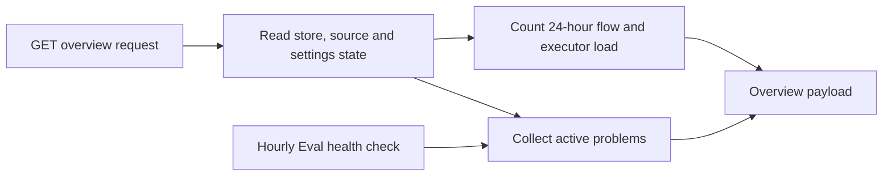

# overview.ts

This file builds the read-only data behind the operator's overview page: what is broken right now, which tickets are waiting for a human, how busy the Executor is, and how many Triggers flowed through the system in the last 24 hours. It is a projection layer — it reads the Store, Source registry and health map, then shapes one JSON-friendly object instead of changing anything. If you are debugging "why does the panel show this problem?", this is the file that decides what counts as a problem.

## Whole-unit functional flow

A panel poll reaches the `GET overview` route, which calls `overview()` with the current health map, Executor load and any setup problem. The builder reads stored state once, derives a list of operator-visible problems plus the 24-hour and Executor counters, and returns a single payload that the panel renders. `evalsHealth()` is the small side branch that periodically turns failing Evals into the `evals` health entry, which later feeds back into the problem list.

<!-- {
  "mermaid_info": {
    "name": "Overview view data flow",
    "nodes": [
      {
        "id": "request_001",
        "name": "GET overview request",
        "path": "src/app/http.ts",
        "hint": "The management route that requests the overview payload",
        "isJumpable": true,
        "position": { "startLine": 157, "endLine": 158 },
        "references": []
      },
      {
        "id": "reads_002",
        "name": "Read store, source and settings state",
        "path": "src/app/views/overview.ts",
        "hint": "Snapshot, settings, active threads and Source instances are read",
        "isJumpable": true,
        "position": { "startLine": 39, "endLine": 45 },
        "references": []
      },
      {
        "id": "problems_003",
        "name": "Collect active problems",
        "path": "src/app/views/overview.ts",
        "hint": "Setup, source, runtime, Eval and outgoing problems are assembled",
        "isJumpable": true,
        "position": { "startLine": 46, "endLine": 66 },
        "references": []
      },
      {
        "id": "stats_004",
        "name": "Count 24-hour flow and executor load",
        "path": "src/app/views/overview.ts",
        "hint": "Trigger statistics, judgments and ticket stages are counted",
        "isJumpable": true,
        "position": { "startLine": 67, "endLine": 70 },
        "references": []
      },
      {
        "id": "evals_006",
        "name": "Hourly Eval health check",
        "path": "src/app/runtime.ts",
        "hint": "Where evalsHealth() feeds the evals health entry",
        "isJumpable": true,
        "position": { "startLine": 156, "endLine": 156 },
        "references": []
      },
      {
        "id": "payload_005",
        "name": "Overview payload",
        "path": "src/app/views/overview.ts",
        "hint": "The returned overview object rendered by the panel",
        "isJumpable": true,
        "position": { "startLine": 71, "endLine": 79 },
        "references": []
      }
    ]
  }
} -->

    
        <a target="_self" href="#src/app/views/overview.ts:1?class=graph" style="color: inherit; text-decoration: none;">Graph: Overview view data flow</a>
    

## At a glance

- **Primary role — Presentation:** it turns low-level records into the view model the operator screen shows, including which conditions deserve a visible warning row.
- **Secondary role — Data contract:** its return type is the documented response shape of `GET overview`, consumed by the web panel through the API typings.
- **Confidence:** High — the whole file was read, together with its call sites in the HTTP route, the runtime health loop, the panel component that renders the payload, and the tests that pin the problem kinds.

## What this file does

- Builds the **problems** list — a discriminated set of operator warnings covering interrupted setup, no enabled Source, empty sender allowlists, Source health errors, a paused Executor, core runtime errors, Evals past their deadline, unavailable Evals, and replies that keep failing to send.
- Keeps that list honest about ownership: health entries owned by a Source kind are reported as Source errors, `sync:` entries belong to policy sync, and the aggregate `evals` entry is replaced by one row per failing Eval — so a single incident does not appear three times, and the generic `runtime-error` row only carries the service's own errors.
- Collects **tickets waiting for a person**, sorted newest first, each rendered with its reply link so the operator can act from the panel.
- Summarizes the **Executor**: running and queued slots from the caller, the configured worker maximum, and how many open tickets are currently idle.
- Counts the last **24 hours of trigger flow** — received, filtered, judged, accepted, still evaluating, and dropped replies — and echoes the current policy version.
- Exposes `evalsHealth()`, which converts recent undismissed unavailable Evals into a single health entry used by the runtime's periodic loop.

## Key functions or classes

### `unjudged`

Module-local helper that decides which Threads hold an undismissed `unavailable` Eval since a cut-off and were neither re-queued, still evaluating, nor followed by a newer decision; both the problem list and the health entry depend on it.

    
        <a target="_self" href="#src/app/views/overview.ts:13-24?class=code" style="color: inherit; text-decoration: none;">Code: src/app/views/overview.ts:13-24</a>
    

### `evalsHealth`

Reports `error` when any Thread has an unjudged unavailable Eval from the past hour, quoting the latest reason; otherwise reports `ready`.

    
        <a target="_self" href="#src/app/views/overview.ts:26-33?class=code" style="color: inherit; text-decoration: none;">Code: src/app/views/overview.ts:26-33</a>
    

### `overview`

The main entry point: assembles the problem list, pending-person tickets, Executor counts, 24-hour flow numbers and policy version into one object.

    
        <a target="_self" href="#src/app/views/overview.ts:38-79?class=code" style="color: inherit; text-decoration: none;">Code: src/app/views/overview.ts:38-79</a>
    

### `OverviewView`

The named type of the returned payload, derived from `overview` so the API contract follows the implementation automatically.

    
        <a target="_self" href="#src/app/views/overview.ts:80?class=code" style="color: inherit; text-decoration: none;">Code: src/app/views/overview.ts:80</a>
    

## Main inputs and results

- **Inputs:** a `ViewHost` (Store, Source registry and channel-link resolver), the current health map, the policy version string, the current `ExecutorLoad`, and an optional `SetupProblem` that must be surfaced first.
- **Results:** one `OverviewView` object with `problems`, `person`, `executor`, `flow` and `policyVersion`, serialized as the body of `GET overview`.
- **Visible side effects:** none — every read is a projection, so calling this repeatedly cannot change tickets, Threads, decisions or settings.

## What the user experiences

- **Presents:** the "Problems" section of the overview screen, the list of tickets waiting for the operator, the last-day flow counters (received, filtered, judged, accepted, dropped) and the Executor's running/queued/idle numbers.
- **Interaction:** the problem kinds are what make the panel actionable — an unavailable-Eval row offers requeue and dismiss, a paused Executor offers resume, setup and Source problems deep-link to their own settings pages. Those actions are served by other routes; this file supplies the rows that trigger them.
- **Prepared data:** a `snapshot(host)` view, the resolved settings, active Threads, Source instances and their health parts must all be available before the payload can be assembled.

### Important interaction states

- A setup problem halts the whole service and is listed first, while a Feishu-only check failure pauses just that Source.
- With no enabled *and* installed Source, a `no-source` row appears; an empty sender allowlist adds `no-allowed`, because no request could ever become a ticket.
- Evals past their deadline and unavailable Evals are shown as two different rows, since one may still finish and the other already failed without a later judgement.

## Information contract

- **Represents:** a point-in-time operator summary — warnings, human-blocked work, throughput over 24 hours and slot utilization.
- **Produced by:** `overview()` through the `GET overview` route, which supplies health, Executor counts and the current setup problem.
- **Consumed by:** the overview page in the web panel, which switches on each problem's `kind` to choose text, links and buttons; the response type is wired into the management API contract and reused as the panel's `Problem` type.
- **Behavior-shaping parts:** the `kind` discriminant of each problem entry determines rendering and available actions; `flow.dropped` is only shown when non-zero; `executor.maxWorkers` is read here from settings rather than from the Executor itself.

### Compatibility notes

`OverviewView` is inferred from the function's return value, so any field added or changed in `overview()` immediately becomes part of the documented route response and the panel's typings — there is no separate schema to update. Entries are additive in practice: the panel ignores unknown problem kinds it does not handle, so new problem types require a corresponding panel branch to become visible.

---
name: overview.ts

update-time: 2026-11-02 11:42

description: This file builds the read-only data behind the operator's overview page: what is broken right now, which tickets are waiting for a human, how busy the Executor is, and how many Triggers flowed through the system in the last 24 hours. It is a projection layer — it reads the Store, Source registry and health map, then shapes one JSON-friendly object instead of changing anything. If you are debugging "why does the panel show this problem?", this is the file that decides what counts as a problem.

---
