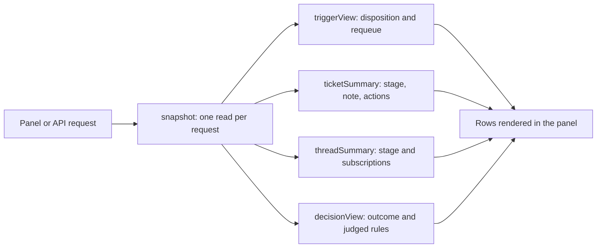

# records.ts

`records.ts` is the shared workshop where this project turns stored orchestrator state into rows a person can actually read. Everything the panel shows about Triggers, Tickets, Threads, Decisions and channel links is shaped here once and reused by the page-level views. If you are new to the codebase, treat this file as the answer to "what does the UI display for each record, and where does that display data come from?"

## Whole-unit functional diagram

A request first builds one `snapshot`, which caches the reads every row shares. Each record then gets a projection function that adds display text, lifecycle state and available actions, and those finished rows are what the panel renders.

<!-- {
  "mermaid_info": {
    "name": "How view rows are built from stored state",
    "nodes": [
      {
        "id": "request_001",
        "name": "Panel or API request",
        "path": "",
        "hint": "An incoming request for a list, a detail page or a search result",
        "isJumpable": false,
        "position": { "startLine": 0, "endLine": 0 },
        "references": []
      },
      {
        "id": "snapshot_002",
        "name": "snapshot: one read per request",
        "path": "src/app/views/records.ts",
        "hint": "Builds the shared per-request read context",
        "isJumpable": true,
        "position": { "startLine": 46, "endLine": 68 },
        "references": []
      },
      {
        "id": "trigger_003",
        "name": "triggerView: disposition and requeue",
        "path": "src/app/views/records.ts",
        "hint": "Projects a Trigger with where it went and what a person may do",
        "isJumpable": true,
        "position": { "startLine": 86, "endLine": 107 },
        "references": []
      },
      {
        "id": "ticket_004",
        "name": "ticketSummary: stage, note, actions",
        "path": "src/app/views/records.ts",
        "hint": "Projects a Ticket row with its stage, waiting note and available actions",
        "isJumpable": true,
        "position": { "startLine": 118, "endLine": 131 },
        "references": []
      },
      {
        "id": "thread_005",
        "name": "threadSummary: stage and subscriptions",
        "path": "src/app/views/records.ts",
        "hint": "Projects a Thread row with lifecycle stage and subscribed tickets",
        "isJumpable": true,
        "position": { "startLine": 164, "endLine": 177 },
        "references": []
      },
      {
        "id": "decision_006",
        "name": "decisionView: outcome and judged rules",
        "path": "src/app/views/records.ts",
        "hint": "Projects a Decision with its outcome, judged rules and source text",
        "isJumpable": true,
        "position": { "startLine": 196, "endLine": 209 },
        "references": []
      },
      {
        "id": "panel_007",
        "name": "Rows rendered in the panel",
        "path": "",
        "hint": "The JSON rows the browser panel displays",
        "isJumpable": false,
        "position": { "startLine": 0, "endLine": 0 },
        "references": []
      }
    ]
  }
} -->

    
        <a target="_self" href="#src/app/views/records.ts:1?class=graph" style="color: inherit; text-decoration: none;">Graph: How view rows are built from stored state</a>
    

## At a glance

- Primary role: Presentation — this file decides how each stored record looks to a person: its title, its one-line preview, its lifecycle stage, its waiting note, and which buttons make sense.
- Secondary roles: Data contract — the projection functions return the exact JSON shapes the browser panel expects, and those shapes are declared as the API response types.
- Confidence: High — every projection, stage rule and compatibility fallback was read directly in this file plus its helpers in `./text.ts` and `src/core`.

## What this file does

- **Gives each record one display form.** Triggers, Tickets, Threads, Decisions and channel links each get a single projection function, so the ticket list, the thread timeline and the overview all show the same shape for the same record.
- **Turns stored text into something readable.** Long messages become single-line previews, structured JSON payloads become key-value lines, and the question a person must answer stays as Markdown.
- **Says where a record stands.** A Thread gets a lifecycle stage and a Ticket gets an execution stage, both derived in priority order so the most urgent condition wins.
- **Explains why something is waiting.** A waiting Ticket carries a short note: the pending question, the delivery error, or the first line of a blocked/failed report.
- **Resolves names and links for display.** Sender display names come from the policy allowlists and the Source kind's unnamed label; channel links prefer a Trigger's specific URL when the source link points at one.
- **Shares the cost of a page.** One snapshot per request guarantees that a page's rows read their tickets, threads and settings once, and `page`, `dayAgo` and `newestFirst` give the list views a common paging and ordering convention.

## Key functions or classes

### `snapshot`

Builds the per-request context: Threads indexed by the Ticket they serve, rule names by id, sender names, and the follow-up owners lookup.

    
        <a target="_self" href="#src/app/views/records.ts:46-68?class=code" style="color: inherit; text-decoration: none;">Code: src/app/views/records.ts:46-68</a>
    

### `ownersOf`

Answers "which tickets' workers decide this person's follow-up" while reading each ticket and thread at most once, however many rows ask.

    
        <a target="_self" href="#src/app/views/records.ts:27-35?class=code" style="color: inherit; text-decoration: none;">Code: src/app/views/records.ts:27-35</a>
    

### `triggerView`

Projects a Trigger together with where it went — queued, evaluating, delivered, filtered, fanned out, handed back, or consumed by a Decision — and whether a person may send it to Eval again.

    
        <a target="_self" href="#src/app/views/records.ts:86-107?class=code" style="color: inherit; text-decoration: none;">Code: src/app/views/records.ts:86-107</a>
    

### `awaitingEval`

Lists the Triggers in a Thread's queue that still wait for an Eval, which is what the "pending" count in a Thread row actually measures.

### `ticketSummary`

Projects a Ticket row: open or ended, its stage, an optional waiting note, retry/stop availability, mandate strength, counts of assignments and inputs, the worker session id, and timestamps.

    
        <a target="_self" href="#src/app/views/records.ts:118-131?class=code" style="color: inherit; text-decoration: none;">Code: src/app/views/records.ts:118-131</a>
    

### `threadSummary`

Projects a Thread row: title, lifecycle stage, the latest message, subscribed tickets with their states, active evaluation details and any polling error.

    
        <a target="_self" href="#src/app/views/records.ts:164-177?class=code" style="color: inherit; text-decoration: none;">Code: src/app/views/records.ts:164-177</a>
    

### `channelLink`

Resolves where a channel link should point, substituting a Trigger's own URL when the source link refers to a Trigger.

### `decisionView`

Projects a Decision with its outcome, reason, judged rules (current rule names, matched flag and reason), optional direction details, and the truncated text of the Triggers it consumed.

    
        <a target="_self" href="#src/app/views/records.ts:196-209?class=code" style="color: inherit; text-decoration: none;">Code: src/app/views/records.ts:196-209</a>
    

## What the user experiences

- Presents: rows for the Thread lists and timeline, Ticket lists and pages, Decision lists, search results and the overview — each with a human title, a one-line preview, a stage badge and context counts.
- Interaction: `actions.requeue` on a Trigger offers a person a second try at Eval, and `actions.retry` / `actions.stop` on a Ticket reflect whether retrying or stopping is currently meaningful.
- Prepared data: a `ViewHost` — the store, the Source registry, and a link resolver — supplied by the HTTP layer; everything else (names, stages, previews, notes) is derived here.

### Important interaction states

- **Thread lifecycle** in priority order: polling `error`, `evaluating`, `queued`, `subscribed` by an open Ticket, `dormant` when only ended Tickets subscribe, or `unsubscribed`.
- **Ticket stage**: a person is needed (delivery, answer, review, blocked, failed), work is running or `queued`, the Ticket is `idle` between turns, or it has `ended`.
- **Waiting notes** appear only while a person is the blocker, and are flagged as errors for a failed delivery or failed report.
- **Decision outcome** can differ from the stored kind: an `ignore` Decision that observe mode would have accepted is shown as `wouldAccept`.

## Information contract

- Represents: the formatted rows exchanged between the server and the browser panel — one projection per record kind, plus shared envelopes such as `page`'s `items`, `total` and `next_offset`.
- Produced by: this file, called from the page-level views below it and from resources and the HTTP layer.
- Consumed by: the panel, through the response types declared in the API description; the list and detail views compose these rows rather than re-deriving them.
- Behavior-shaping parts: the stage strings, `state: open | ended`, `note.error`, `actions.requeue`, `next_offset`, and the disposition block on a Trigger all directly change what a person sees or can click.

### Compatibility notes

Older stored data is tolerated rather than rejected: assessment audit metadata is parsed with every field optional, so mismatched shapes degrade to "no information" instead of an error, and rule assessments recorded under an earlier field name are still shown. Rule names fall back to the rule id once a rule has been removed, and thread titles fall back to the first human message and finally to the thread key.

## Main inputs and results

- Inputs: a `ViewHost` (store, Source registry, channel link resolver) and stored records — Triggers with their dispositions, Tickets with assignments and reports, Threads with subscriptions and metadata, Decisions with audit metadata, and current policy settings.
- Results: plain JSON-ready objects — trigger rows with disposition, ticket rows with stage and actions, thread rows with lifecycle stage, decision rows with judged rules, and resolved channel links.
- Visible side effects: none directly; this file reads only. The requeue, retry and stop flags it sets are what the panel turns into controls, and the actions themselves happen elsewhere.

## Related reading

Page-level composition lives in 
<a target="_self" href="#src/app/views/threads.ts?class=code" style="color: inherit; text-decoration: none;">threads.ts</a>
, 
<a target="_self" href="#src/app/views/tickets.ts?class=code" style="color: inherit; text-decoration: none;">tickets.ts</a>
, 
<a target="_self" href="#src/app/views/overview.ts?class=code" style="color: inherit; text-decoration: none;">overview.ts</a>
 and 
<a target="_self" href="#src/app/views/sources.ts?class=code" style="color: inherit; text-decoration: none;">sources.ts</a>
; text sanitizing sits in 
<a target="_self" href="#src/app/views/text.ts?class=code" style="color: inherit; text-decoration: none;">text.ts</a>
 and the architectural overview is in 
<a target="_self" href="#docs/007-architecture.md?class=text" style="color: inherit; text-decoration: none;">007-architecture.md</a>
.

---
name: records.ts

update-time: 2026-11-02 11:47

description: `records.ts` is the shared workshop where this project turns stored orchestrator state into rows a person can actually read. Everything the panel shows about Triggers, Tickets, Threads, Decisions and channel links is shaped here once and reused by the page-level views. If you are new to the codebase, treat this file as the answer to "what does the UI display for each record, and where does that display data come from?"

---
