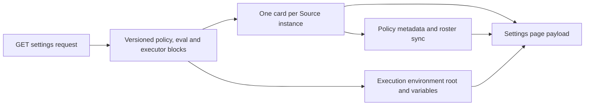

# settings.ts

`src/app/views/settings.ts` builds the read model for the management panel's Settings page. It gathers the stored configuration into three revisioned blocks, adds one editable card per Source instance with its form fields and policy metadata, and describes the execution environment where tickets run. The file only reads state — it never validates or saves a change — so it is the place to look when you want to know exactly what the panel is offered, and which revision number it must send back to save.

## Whole-unit functional diagram

A single read request fans out into three kinds of content: the versioned configuration blocks, the per-Source cards (some of which carry a policy section), and the execution-environment block. Everything is assembled into one plain object that the HTTP route serializes back to the browser.

<!-- {
  "mermaid_info": {
    "name": "Settings page payload assembly",
    "nodes": [
      {
        "id": "request_001",
        "name": "GET settings request",
        "path": "",
        "hint": "The panel asks the management API for the current settings page",
        "isJumpable": false,
        "position": { "startLine": 0, "endLine": 0 },
        "references": []
      },
      {
        "id": "blocks_002",
        "name": "Versioned policy, eval and executor blocks",
        "path": "src/app/views/settings.ts",
        "hint": "Reads stored settings and pairs each block value with its block revision",
        "isJumpable": true,
        "position": { "startLine": 24, "endLine": 29 },
        "references": []
      },
      {
        "id": "cards_003",
        "name": "One card per Source instance",
        "path": "src/app/views/settings.ts",
        "hint": "Maps each Source instance to identity, value, revision, form fields, restart-sensitive fields, labels and problems",
        "isJumpable": true,
        "position": { "startLine": 30, "endLine": 38 },
        "references": []
      },
      {
        "id": "policy_004",
        "name": "Policy metadata and roster sync",
        "path": "src/app/views/settings.ts",
        "hint": "Adds a Source's policy fields, explicit description, admission rows and external sync status",
        "isJumpable": true,
        "position": { "startLine": 10, "endLine": 18 },
        "references": []
      },
      {
        "id": "env_005",
        "name": "Execution environment root and variables",
        "path": "src/app/views/settings.ts",
        "hint": "Resolves the ticket working directory root and the declared environment variables",
        "isJumpable": true,
        "position": { "startLine": 39, "endLine": 39 },
        "references": []
      },
      {
        "id": "result_006",
        "name": "Settings page payload",
        "path": "",
        "hint": "The complete response consumed by the panel",
        "isJumpable": false,
        "position": { "startLine": 0, "endLine": 0 },
        "references": []
      }
    ]
  }
} -->

    
        <a target="_self" href="#src/app/views/settings.ts:1?class=graph" style="color: inherit; text-decoration: none;">Graph: Settings page payload assembly</a>
    

## At a glance

- **Primary role — Presentation**: this file decides what the Settings page shows: which blocks exist, what each Source card contains, how form fields are described, and how the environment section is worded.
- **Secondary role — Data contract**: the shape it returns is exported as `SettingsView` and declared as the `GET settings` response, so the panel's expectations are defined here even though the saving side lives elsewhere.
- **Confidence**: High — the file is short and fully readable, and its single caller plus its declared response type are verified in `src/app/http.ts` and `src/app/api.ts`.

## What this file does

- Publishes the whole page in one read: a `policyVersion` marker plus the `policy`, `eval` and `executor` configuration blocks, each paired with the revision an editor must echo back when saving.
- Builds one card per Source instance: kind identity, localized title and description, whether the kind is actually installed, the current `{ enabled, config }` value, the editable form field specs, and the configuration keys whose change forces a restart.
- Attaches Source-specific policy metadata — the policy form fields, the "what counts as an explicit request" description, admission rows derived from the Source's own config — and, when the kind supports it, the external roster sync plus that sync's current health.
- Reports why a particular Source is not working by attaching the setup problem that names it, and hands over the stored display labels used when picking names in row editors.
- Describes the execution environment: the directory root tickets work in (falling back to `<stateDir>/work`) and every declared environment variable, grouped by owner with a flag saying whether that owner is currently switched on.

Divergence from a whole-file picture is deliberate: nothing here writes. Revision checking, conflict errors, policy-effect recalculation and restarts all belong to the settings service that answers `PUT settings/:block`.

## What the panel shows and lets people change

- **Presents**: three top-level configuration blocks; a card per Source with its description, read-only setup facts, editable fields, label choices, policy form and possible problem message; and an environment section listing the working-directory root and the variable names with their descriptions.
- **Interaction**: the `revision` on each block and on each Source card is the token the editor sends with `PUT settings/:block`, so a save based on stale data is rejected instead of overwriting someone else's change. The `restarts` list tells the editor which edited fields will restart the process. The presence of `policy.sync` decides whether a "refresh from the source" action is offered at all, and its `ready` flag decides whether it can run right now.
- **Prepared data**: resolved stored settings, the registry of installed kinds and their instances, current health entries, the setup state (deployment facts and pending problems), and the machine's state directory.

### Important interaction states

- A Source that is stored in configuration but whose kind is no longer installed still appears on the page with `installed: false`, empty `fields`, empty description and its config preserved, so the panel can show it honestly rather than hiding it.
- A kind without a policy section produces no `policy` key, so its card simply has no policy form instead of an empty one.
- Only Sources named by a setup problem carry a `problem` field, which is how a global setup failure and a Source-specific one stay distinguishable on screen.
- Read-only facts come from the resolved deployment, which is undefined until setup completes, so those fields are empty on a not-yet-configured installation.

## Key functions or classes

### `settingsView`

Builds the complete settings-page payload from the store, the Source registry, health entries, setup state and the state directory.

    
        <a target="_self" href="#src/app/views/settings.ts:23-41?class=code" style="color: inherit; text-decoration: none;">Code: src/app/views/settings.ts:23-41</a>
    

### `policyOf`

Adds the policy part of a single Source card — its fields, its explicit-request description, admission rows when the kind derives them from config, and the sync descriptor with live health — or nothing at all when the kind has no policy section.

    
        <a target="_self" href="#src/app/views/settings.ts:10-18?class=code" style="color: inherit; text-decoration: none;">Code: src/app/views/settings.ts:10-18</a>
    

## Information contract

- **Represents**: `SettingsView` is the full state of the Settings page — the policy version, three `{ value, revision }` blocks, the array of Source cards, and the environment block. `SourceSettingsView` is one entry of that array.
- **Produced by**: `settingsView(...)` in this file, from the store's settings, block revisions and stored labels, the installed-kinds registry, the health map, the setup state and the state directory.
- **Consumed by**: the `GET settings` route in 
<a target="_self" href="#src/app/http.ts:161?class=code" style="color: inherit; text-decoration: none;">http.ts:161</a>
, whose declared response is `SettingsView` in 
<a target="_self" href="#src/app/api.ts:25?class=code" style="color: inherit; text-decoration: none;">api.ts:25</a>
; the panel then reuses the returned revisions when it calls `PUT settings/:block`. The two type aliases are declared at 
<a target="_self" href="#src/app/views/settings.ts:42-43?class=code" style="color: inherit; text-decoration: none;">settings.ts:42-43</a>
.
- **Behavior-shaping parts**: `revision` is the optimistic-concurrency token for a save; `installed` distinguishes a live kind from a leftover stored instance; `restarts` names the config keys that force a restart when changed; `fields` and `facts` drive the rendered form and its read-only values; `labels` feeds row pickers; `problem` explains a blocked Source; `policy.rows` and `policy.sync` decide which extra controls exist; `enabled` on each variable group reflects whether that owner is switched on; and `policyVersion` is the marker that changes only when work authorization changed.

### Compatibility notes

- Optional keys are omitted rather than set to null: `problem`, `policy`, `policy.rows`, `policy.sync` and individual `facts` entries appear only when data exists, so consumers must tolerate missing keys.
- `policyVersion` is derived only from authorization-relevant settings — policy rules, eval mode and per-source policy — so model, concurrency or pause changes leave it untouched (see 
<a target="_self" href="#src/policy.ts:116-118?class=code" style="color: inherit; text-decoration: none;">policy.ts:116-118</a>
).

## Main inputs and results

- **Inputs**: the `Store` (stored settings, per-block revisions, stored Source labels), the `SourceRegistry` (installed kinds, their instances, validated policy parts), the health map, the setup state (deployment facts plus pending problems), and the machine's state directory.
- **Results**: a plain object that the HTTP layer serializes as the panel's `GET settings` response, including the revision every editor needs to save safely.
- **Visible side effects**: none — the function only reads, so calling it never changes stored configuration, health, or running work.

---
name: settings.ts

update-time: 2026-11-02 11:45

description: `src/app/views/settings.ts` builds the read model for the management panel's Settings page. It gathers the stored configuration into three revisioned blocks, adds one editable card per Source instance with its form fields and policy metadata, and describes the execution environment where tickets run. The file only reads state — it never validates or saves a change — so it is the place to look when you want to know exactly what the panel is offered, and which revision number it must send back to save.

---
