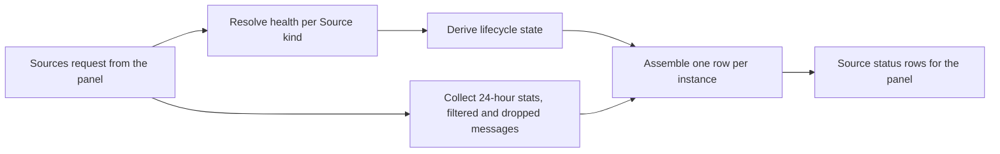

# sources.ts

This file builds the data behind the management panel's **Sources** screen. It takes the registered Source instances, the health reports those Sources publish, and the stored activity of the last 24 hours, and turns them into one display-ready row per Source: which lifecycle state it is in, what each of its health checks says, how many messages arrived or were filtered, and which replies were recently dropped. It contains no storage of its own and performs no actions — everything it produces is a read-only projection of state owned elsewhere, which is what makes it safe to call on every panel refresh.

## Whole-unit functional flow

The request for the Sources screen fans out into two independent reads — resolved health per Source kind and the stored 24-hour activity — and the lifecycle state is derived from the health parts before everything is merged into one row per registered instance.

<!-- {
  "mermaid_info": {
    "name": "Source status view flow",
    "nodes": [
      {
        "id": "request_001",
        "name": "Sources request from the panel",
        "path": "src/app/http.ts",
        "hint": "The management route that hands runtime state to this view",
        "isJumpable": true,
        "position": { "startLine": 160, "endLine": 160 },
        "references": []
      },
      {
        "id": "health_002",
        "name": "Resolve health per Source kind",
        "path": "src/app/views/sources.ts",
        "hint": "Maps each declared health entry name to its latest report",
        "isJumpable": true,
        "position": { "startLine": 13, "endLine": 21 },
        "references": []
      },
      {
        "id": "state_003",
        "name": "Derive lifecycle state",
        "path": "src/app/views/sources.ts",
        "hint": "Priority-ordered state for one Source instance",
        "isJumpable": true,
        "position": { "startLine": 33, "endLine": 40 },
        "references": []
      },
      {
        "id": "stats_004",
        "name": "Collect 24-hour stats, filtered and dropped messages",
        "path": "src/app/views/sources.ts",
        "hint": "Trigger counts, recently filtered triggers, and dropped replies",
        "isJumpable": true,
        "position": { "startLine": 44, "endLine": 49 },
        "references": []
      },
      {
        "id": "assemble_005",
        "name": "Assemble one row per instance",
        "path": "src/app/views/sources.ts",
        "hint": "Merges identity, state, health parts, stats and message lists",
        "isJumpable": true,
        "position": { "startLine": 50, "endLine": 56 },
        "references": []
      },
      {
        "id": "result_006",
        "name": "Source status rows for the panel",
        "path": "",
        "hint": "The abstract array the Sources screen renders",
        "isJumpable": false,
        "position": { "startLine": 0, "endLine": 0 },
        "references": []
      }
    ]
  }
} -->

    
        <a target="_self" href="#src/app/views/sources.ts:1?class=graph" style="color: inherit; text-decoration: none;">Graph: Source status view flow</a>
    

## At a glance

- **Primary role**: Presentation — the file is a view-model builder: it reads runtime state and produces exactly the rows the Sources screen shows, with localized titles, human-readable states and shortened message previews.
- **Secondary roles**: Data contract — the exported `SourceStatusView` type is the declared response of the `GET sources` API route and the only shape the web panel sees. Domain rules — the Source lifecycle state is decided here by a fixed priority order, including the rule that a stale "Off" report on an enabled Source counts as starting.
- **Confidence**: High — the whole file was read together with the health board definition, the Source registry, the store reads it consumes and the API contract that consumes its output.

## What this file does

- **Builds one row per Source instance**: every installed kind plus every stored configuration whose plugin is missing gets a row, so the operator can see an orphaned Source instead of having it silently disappear.
- **Reconciles declared health with reported health**: a Source kind declares the health entry names it owns; this file looks each one up and fills gaps, so a check that has not reported yet still appears as starting instead of vanishing.
- **Decides the state a person sees**: a single word per Source (`missing`, `off`, `error`, `setup`, `starting`, `paused`, `ready`) that summarises installation, the enable switch, setup problems and health reports.
- **Summarises the last 24 hours of traffic**: received and filtered counts plus the latest arrival time, drawn from one aggregate query over the trigger log.
- **Shows what was filtered away**: the five most recent filtered messages per Source within the window, each with who sent it, a short preview and the reason it was filtered.
- **Explains dropped replies**: replies the outbox gave up on during the same 24 hours, enriched with the ticket and thread they belonged to, so "the bot never answered" can be traced to a concrete conversation.

## Key functions or classes

### `sourcesStatus`

Builds the whole response: it takes the view host, the health map and the setup state, and returns one display row per Source instance. 
<a target="_self" href="#src/app/views/sources.ts:41-57?class=code" style="color: inherit; text-decoration: none;">sources.ts:41-57</a>

### `sourceHealth`

Resolves the display title and the ordered health parts of one instance, substituting a `starting` entry when a declared check has no report yet or its report is a stale "Off". 
<a target="_self" href="#src/app/views/sources.ts:13-21?class=code" style="color: inherit; text-decoration: none;">sources.ts:13-21</a>

### `sourceState`

{The single-word lifecycle state, computed in priority order from installation, the enable flag, setup problems and the health parts.} 
<a target="_self" href="#src/app/views/sources.ts:33-40?class=code" style="color: inherit; text-decoration: none;">sources.ts:33-40</a>

### `droppedReplies`

Lists the dropped replies of the last 24 hours, each with its ticket title and thread key when those can still be resolved.

### `problemOf`

Looks up the setup problem that applies to one Source id, which is how a deployment-wide failure and a single-Source failure stay distinguishable.

### `SetupState`

The three setup facts this view needs — resolved deployment, the global setup problem, and the Feishu-only problem — kept as one small input so callers can pass the whole setup picture at once.

## Main inputs and results

- **Inputs**: the view host (store, Source registry and the function that resolves channel links), the current health map keyed by entry name, and the setup state (deployment facts plus any global or Feishu-specific problem).
- **Results**: an array of status rows — id, localized title, installed and enabled flags, the lifecycle state, per-check health parts, an optional setup problem, 24-hour stats with a zeroed default, the recent filtered messages, and the dropped replies belonging to that Source.
- **Visible side effects**: none. The function only reads; the panel's writes (enabling a Source, saving its configuration, re-running the setup check) go through other routes.

## What the user experiences

- **Presents**: a card per Source with its name, an installation and enable indicator, one pluggable state word, every declared health check with its detail line, 24-hour received/filtered counts, a short list of recently filtered messages and recently dropped replies.
- **Interaction**: this file is read-only; what a person can change is upstream. Toggling a Source in Settings flips `enabled`, and re-running the setup check changes the setup problems — both then change what this view reports, for example from `starting` to `ready`.
- **Prepared data**: the health board must have current entries, the trigger log and outbox must be queryable, and the Source registry must be able to list instances. Sender display names come from the shared projection built by the `records.ts` snapshot, so a sender who is on the allowlist shows a name rather than a raw ID.

### Important interaction states

- **`missing`** — a configuration is stored for a Source kind whose plugin is not installed; the row is still shown so the operator knows the configuration exists, and the title falls back to the raw id.
- **`setup`** — a deployment-wide setup problem blocks everything; the row admits it is not the Source's own fault.
- **`error`** vs **`setup`** — a problem whose place names this Source, or any failed health check, wins over the global setup state, because the operator should fix what is specific to that Source first.
- **`starting`** — either no report yet, or a report claiming "Off" while the Source is enabled; the panel therefore never shows "Off" for a Source the operator just switched on.

## Information contract

- **Represents**: one Source's operational status for a single panel refresh — identity, lifecycle, check-by-check health, 24-hour volume and the message lists that explain the numbers.
- **Produced by**: `sourcesStatus` from runtime state, with the exported `SourceStatusView` type derived as one element of its return value.
- **Consumed by**: the `GET sources` route and, through the type-only management API contract, the web panel that renders the screen without bundling host code.
- **Behavior-shaping parts**: `state` drives which badge and wording the panel shows; `health` is an ordered array, not a map, so the panel renders checks in the order the Source kind declared them; `problem` is present only when a setup problem names this Source; `stats` is always present with a zeroed fallback; `dropped` is already narrowed to the Source's own messages.
- **Compatibility notes**: the health map may be missing entries at any time, so an absent entry is normal input, not an error — and health entries can also belong to the core runtime or to policy sync, which this file simply ignores because it only looks up names the kind declared.

## Rules and decisions

- **Decision**: given everything the runtime knows, is this Source working, waiting, broken, or switched off — expressed as one state a person can act on.
- **Important conditions**: the priority order is installation, then the enable flag, then Source-specific problems and failing checks, then a global setup problem, then any check still starting, then any paused check, otherwise ready. When a kind declares a health entry that is missing from the map, or whose code is `sourceOff` while the Source is enabled, the entry is read as `starting`.
- **Outcomes**: `missing`, `off`, `error`, `setup`, `starting`, `paused`, `ready`.
- **Invariant**: a state is only ever derived from what Sources and setup reported; this file never guesses readiness from configuration alone, and never invents a health entry a Source kind did not declare.

### Small example

If the deployment check fails, every installed Source reports `setup` and the panel points at one shared fix. If instead only the Feishu bot check fails, that problem's place is `feishu`, so the Feishu Source reports `error` while GitHub keeps its own state — and as soon as the operator enables a Source whose last report still says "Off", the row reads `starting` rather than `off`.

Related reading: the shared projection helpers this file builds on are in 
<a target="_self" href="#src/app/views/records.ts.info.md?class=text" style="color: inherit; text-decoration: none;">records.ts.info.md</a>
, and the wire contract the panel imports is 
<a target="_self" href="#src/app/api.ts:24?class=code" style="color: inherit; text-decoration: none;">api.ts:24</a>
.

---
name: sources.ts

update-time: 2026-11-02 11:43

description: This file builds the data behind the management panel's **Sources** screen. It takes the registered Source instances, the health reports those Sources publish, and the stored activity of the last 24 hours, and turns them into one display-ready row per Source: which lifecycle state it is in, what each of its health checks says, how many messages arrived or were filtered, and which replies were recently dropped. It contains no storage of its own and performs no actions — everything it produces is a read-only projection of state owned elsewhere, which is what makes it safe to call on every panel refresh.

---
