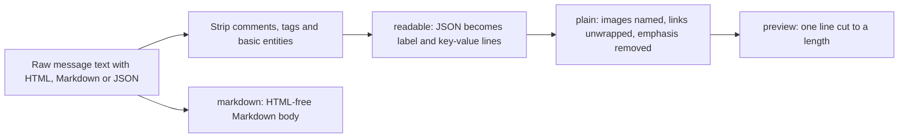

# text.ts

This file turns raw message text into something a person can safely read in the panel. Messages arrive carrying HTML tags, entity escapes, Markdown syntax, inline images and raw JSON payloads; here those are reduced to two finished forms — a single-line preview for lists and cards, and HTML-free Markdown for longer bodies. Every other module in `src/app/views/` depends on it, so the text people see across the overview, ticket, thread and source pages is formatted consistently.

## Text cleaning flow for view previews

The path on the top is the preview path: text is cleaned of HTML, JSON is expanded into readable lines, Markdown decoration is removed and the result is squeezed onto one line and truncated. The bottom edge is the separate body path, which keeps Markdown intact for content that is displayed in full.

<!-- {
  "mermaid_info": {
    "name": "Text cleaning flow for view previews",
    "nodes": [
      {
        "id": "raw_001",
        "name": "Raw message text with HTML, Markdown or JSON",
        "path": "",
        "hint": "The unprocessed text of a trigger, thread or ticket",
        "isJumpable": false,
        "position": { "startLine": 0, "endLine": 0 },
        "references": []
      },
      {
        "id": "strip_002",
        "name": "Strip comments, tags and basic entities",
        "path": "src/app/views/text.ts",
        "hint": "The shared HTML removal applied before every other form",
        "isJumpable": true,
        "position": { "startLine": 4, "endLine": 6 },
        "references": []
      },
      {
        "id": "readable_003",
        "name": "readable: JSON becomes label and key-value lines",
        "path": "src/app/views/text.ts",
        "hint": "JSON payloads, labelled or not, become lines",
        "isJumpable": true,
        "position": { "startLine": 29, "endLine": 34 },
        "references": []
      },
      {
        "id": "plain_004",
        "name": "plain: images named, links unwrapped, emphasis removed",
        "path": "src/app/views/text.ts",
        "hint": "Markdown reduced to readable characters",
        "isJumpable": true,
        "position": { "startLine": 7, "endLine": 13 },
        "references": []
      },
      {
        "id": "markdown_005",
        "name": "markdown: HTML-free Markdown body",
        "path": "src/app/views/text.ts",
        "hint": "Keeps Markdown syntax, removes HTML",
        "isJumpable": true,
        "position": { "startLine": 14, "endLine": 14 },
        "references": []
      },
      {
        "id": "preview_006",
        "name": "preview: one line cut to a length",
        "path": "src/app/views/text.ts",
        "hint": "The short form used by lists, cards and summaries",
        "isJumpable": true,
        "position": { "startLine": 35, "endLine": 35 },
        "references": []
      }
    ]
  }
} -->

    
        <a target="_self" href="#src/app/views/text.ts:1?class=graph" style="color: inherit; text-decoration: none;">Graph: Text cleaning flow for view previews</a>
    

## At a glance

- Primary role: Presentation — the file decides how message text looks once it reaches a view: which characters survive, how JSON is laid out, and how long a preview may be.
- Confidence: High — the source is short and self-contained, and its behaviour is pinned by assertions in `tests/views.spec.ts` and `tests/runtime.spec.ts`, with five sibling view modules importing it.

## What this file does

- Removes HTML before anything else, including HTML comments and tags that were escaped as entities, so a message can never inject markup into the panel.
- Collapses Markdown into readable plain text: images become the word `[image]`, links keep only their label, headings lose their `#` marks and emphasis marks disappear.
- Offers two shapes of the same text: a single-line `preview` for lists and cards, and `markdown` for a body that is displayed with its Markdown formatting still active.
- Expands JSON, with or without a leading `label:` prefix, into indented key-value lines so CI payloads and similar data read like a short report instead of one dense string.
- Provides a small guard for optional link-like values, so a view only renders a URL that is genuinely a non-empty string.

## Key functions or classes

### `preview(text, length = 160)`

The workhorse for lists and cards: it expands JSON, flattens the text to one line and truncates it to the requested length.

<a target="_self" href="#src/app/views/text.ts:35?class=code" style="color: inherit; text-decoration: none;">text.ts:35</a>

### `plain(text, lines = false)`

Produces Markdown-free text; with `lines` enabled it keeps line breaks, replaces list bullets with `• ` and normalises whitespace, otherwise it joins everything onto one line.

<a target="_self" href="#src/app/views/text.ts:7-13?class=code" style="color: inherit; text-decoration: none;">text.ts:7-13</a>

### `markdown(text)`

Returns the body text with HTML and image syntax removed but Markdown emphasis and lists preserved, for content shown as formatted Markdown.

<a target="_self" href="#src/app/views/text.ts:14?class=code" style="color: inherit; text-decoration: none;">text.ts:14</a>

### `readable(text)`

Detects text that is entirely JSON, or a short label followed by JSON, and renders it as a label plus key-value lines; anything else, including text that only looks like JSON, is returned unchanged.

<a target="_self" href="#src/app/views/text.ts:29-34?class=code" style="color: inherit; text-decoration: none;">text.ts:29-34</a>

### `attribute(value)`

Returns the value only when it is a non-empty string, so callers can offer an optional URL or error field without extra checks.

<a target="_self" href="#src/app/views/text.ts:36?class=code" style="color: inherit; text-decoration: none;">text.ts:36</a>

## What the user experiences

- Presents: short, clean one-line summaries of messages, reports and errors in lists, cards and timelines, plus longer text where Markdown is genuinely shown.
- Interaction: no controls of its own — it is applied while a view is built, so the visible effect is that a noisy incoming message appears as a tidy sentence in the panel.
- Prepared data: a raw string, usually a trigger's message, a ticket report summary, a delivery error or a thread fact value; `preview` and `markdown` need nothing else, and `preview` also accepts a desired length.

### Important interaction states

- Text that is not JSON passes through `readable` unchanged, so ordinary prose is never reformatted.
- Text that merely resembles JSON (for example `label: {not json}`) is shown as written rather than failing.
- JSON that does parse is shown as label and key-value lines, with nested objects on their own indented lines and arrays of simple values joined by `·`.
- `preview` always ends as a single line, so line breaks and long runs of whitespace in the original message never reach a row or card layout.

## Main inputs and results

- Inputs: message text, report summaries, error strings and metadata values taken from the app's stored triggers, tickets and threads; optionally a preview length.
- Results: sanitized strings — one-line previews of a given maximum length, Markdown bodies without HTML, JSON rendered as readable lines, or `undefined` when an optional string attribute is absent.
- Visible side effects: none beyond the panel's rendering; the functions are pure string transforms and store nothing.

The sibling view modules consume these helpers directly, for example 
<a target="_self" href="#src/app/views/records.ts?class=code" style="color: inherit; text-decoration: none;">records.ts</a>
, which uses all five exports, while the acceptance expectations live in 
<a target="_self" href="#tests/views.spec.ts:189-194?class=code" style="color: inherit; text-decoration: none;">views.spec.ts:189-194</a>
.

---
name: text.ts

update-time: 2026-11-02 11:44

description: This file turns raw message text into something a person can safely read in the panel. Messages arrive carrying HTML tags, entity escapes, Markdown syntax, inline images and raw JSON payloads; here those are reduced to two finished forms — a single-line preview for lists and cards, and HTML-free Markdown for longer bodies. Every other module in `src/app/views/` depends on it, so the text people see across the overview, ticket, thread and source pages is formatted consistently.

---
