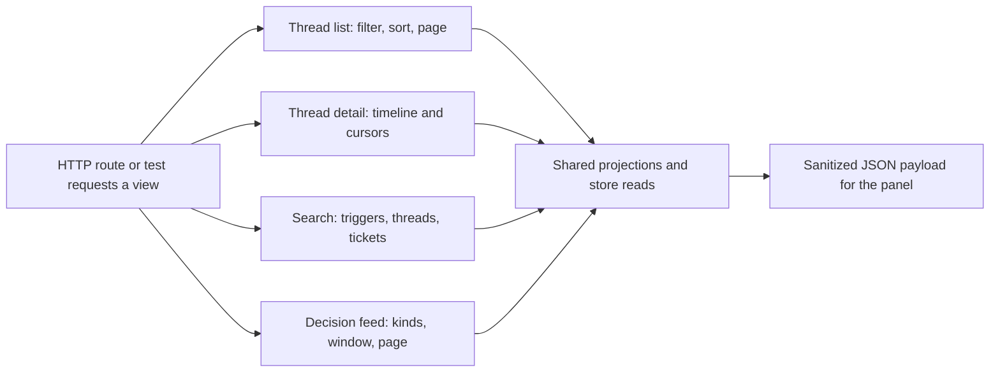

# threads.ts

This file builds the read models behind the panel's thread, search, and decision screens. It turns raw stored Triggers, Threads, Tickets, and Decisions into compact JSON: thread list rows, one thread's timeline, grouped search results, and a decision feed. Every function is read-only and receives a `ViewHost` (the Store, the Source registry, and a channel-link resolver), so the HTTP routes can render complete pages without touching storage logic themselves.

## Whole-unit functional flow

A panel request is parsed into filter and paging values, the matching view function reads through the Store's read queries, and the shared projection helpers in 
<a target="_self" href="#src/app/views/records.ts:46-68?class=code" style="color: inherit; text-decoration: none;">records.ts:46-68</a>
 flatten each record into display-ready fields. The result is a plain JSON object — no records are modified along any path.

<!-- {
  "mermaid_info": {
    "name": "Thread, search, and decision view flow",
    "nodes": [
      {
        "id": "request_001",
        "name": "HTTP route or test requests a view",
        "path": "src/app/http.ts",
        "hint": "Routes for search, threads, and decisions that call these view functions",
        "isJumpable": true,
        "position": { "startLine": 159, "endLine": 186 },
        "references": []
      },
      {
        "id": "threadlist_002",
        "name": "Thread list: filter, sort, page",
        "path": "src/app/views/threads.ts",
        "hint": "Applies the subscribed, evaluating, recent, or all filter and pages the rows",
        "isJumpable": true,
        "position": { "startLine": 9, "endLine": 23 },
        "references": []
      },
      {
        "id": "threaddetail_003",
        "name": "Thread detail: timeline and cursors",
        "path": "src/app/views/threads.ts",
        "hint": "Builds the oldest-first timeline with inline decisions and a backward cursor",
        "isJumpable": true,
        "position": { "startLine": 29, "endLine": 53 },
        "references": []
      },
      {
        "id": "search_004",
        "name": "Search: triggers, threads, tickets",
        "path": "src/app/views/threads.ts",
        "hint": "Matches triggers by text or reference, then groups threads and tickets",
        "isJumpable": true,
        "position": { "startLine": 59, "endLine": 88 },
        "references": []
      },
      {
        "id": "decisions_005",
        "name": "Decision feed: kinds, window, page",
        "path": "src/app/views/threads.ts",
        "hint": "Filters decisions by kind and time window with offset paging",
        "isJumpable": true,
        "position": { "startLine": 90, "endLine": 94 },
        "references": []
      },
      {
        "id": "projections_006",
        "name": "Shared projections and store reads",
        "path": "src/app/views/records.ts",
        "hint": "Snapshot helper plus trigger, thread, ticket, and decision projections",
        "isJumpable": true,
        "position": { "startLine": 46, "endLine": 68 },
        "references": []
      },
      {
        "id": "payload_007",
        "name": "Sanitized JSON payload for the panel",
        "path": "",
        "hint": "The response object a route returns to the panel",
        "isJumpable": false,
        "position": { "startLine": 0, "endLine": 0 },
        "references": []
      }
    ]
  }
} -->

    
        <a target="_self" href="#src/app/views/threads.ts:1?class=graph" style="color: inherit; text-decoration: none;">Graph: Thread, search, and decision view flow</a>
    

## At a glance

- Primary role: Presentation — the file is the view-model layer that decides what a person actually sees on the thread, search, and decision screens.
- Secondary roles: API boundary — it fixes the accepted input and returned shape of four panel endpoints; Orchestration — each view coordinates several store reads, projections, ordering rules, and paging cursors.
- Confidence: High — the whole file was read, together with its projection helpers, the store read queries, and the HTTP routes that call it.

## What this file does

- Lists Threads under the four panel filters (`subscribed`, `evaluating`, `recent`, `all`), always newest activity first, with page metadata.
- Renders one Thread's timeline oldest-first, carrying each Trigger's disposition, the Thread's Decisions, its subscribed Tickets, correlated Threads, and a cursor for loading earlier Triggers.
- Searches Triggers, Threads, and Tickets in one call, using a query string that may be plain text, an ID, a source-extracted reference, or a cached Feishu AppLink.
- Feeds the decision view, filtered by decision kind and optionally limited to the last 24 hours.
- Exports the return types (`ThreadListView`, `ThreadDetailView`, `SearchView`, `DecisionListView`) so the panel can be type-checked against the routes without importing host code.

## What the user experiences

- Presents: a thread list where each row carries a title, a lifecycle stage (error, evaluating, queued, subscribed, dormant, or unsubscribed), the latest Trigger preview, subscription and pending counts, and source facts; a timeline where each entry shows who sent it, when, a plain-text preview, and what happened to it; search results split into tickets, threads, and triggers; and decision rows with the rules that judged them.
- Interaction: switching the list filter, paging a list through `next_offset`, following `earlier` to load older Triggers, or changing the `around` anchor to jump the timeline to a specific Trigger. All of these are plain query parameters — the view recomputes rather than mutating anything.
- Prepared data: the Store, the Source registry, and the channel-link resolver must already be available, and every request first builds a snapshot so Threads, rule names, and sender names are read consistently across the rows of one page.

### Important interaction states

- `subscribed` is the default list filter and covers Threads with at least one open Ticket subscription; `recent` means activity within the last 24 hours; `all` shows everything.
- An unknown thread key produces no detail at all, which the route turns into a `404 Thread not found`.
- `earlier` is `null` when the timeline has reached its oldest Trigger, just as `next_offset` is `null` on the last list page.
- Tickets listed under `context` follow a Thread for context only, so they appear separately from the Tickets that hold a real subscription.
- An empty search query returns empty result sets instead of an error.
- Automated Triggers belonging to Threads that already appear as thread results are left out of the trigger results, and a Trigger whose own Thread record is missing shows the Source's filter reason instead of a thread title.

## Coordinated flow

1. An HTTP route in 
<a target="_self" href="#src/app/http.ts:159-186?class=code" style="color: inherit; text-decoration: none;">http.ts:159-186</a>
 validates and defaults the query values, then calls one of the four view functions.
2. The view asks the Store's read queries for its candidates — for example the subscribed Thread index, the active Thread set, a timeline slice, or a decision page — and wraps the host in a snapshot.
3. The projection helpers in 
<a target="_self" href="#src/app/views/records.ts:86-108?class=code" style="color: inherit; text-decoration: none;">records.ts:86-108</a>
 convert each record into the row a person sees, attaching disposition, ticket links, and cleaned text previews.
4. The view then applies its own ordering, de-duplication, and paging rules and hands back the finished object, which the route serializes unchanged.

### Important branching

- `before` and `around` are two ways to place the timeline window: `before` accepts an `at|id` cursor produced by the previous page, while `around` starts from a specific Trigger and includes it.
- Timeline cursors pair a timestamp with an ID, so several Triggers sharing the same second still page deterministically.
- Search fans out over several terms at once and de-duplicates the resulting Triggers by ID before ranking by time.

## Key functions or classes

### `threadList`

Maps a filter, offset, and limit into one page of Thread summaries with `total` and `next_offset`.

    
        <a target="_self" href="#src/app/views/threads.ts:9-23?class=code" style="color: inherit; text-decoration: none;">Code: src/app/views/threads.ts:9-23</a>
    

### `threadDetail`

Builds one Thread's page: fallback URL, context-only Tickets, correlated Threads, subscribed Tickets, reversed-to-chronological Decisions, and timeline rows with the `earlier` cursor; returns `undefined` when the key is unknown.

    
        <a target="_self" href="#src/app/views/threads.ts:29-53?class=code" style="color: inherit; text-decoration: none;">Code: src/app/views/threads.ts:29-53</a>
    

### `search`

Resolves the query through the Source registry and the cached AppLink entries, matches Triggers, Threads, and Tickets, and caps the response at ten tickets and twenty triggers.

    
        <a target="_self" href="#src/app/views/threads.ts:59-88?class=code" style="color: inherit; text-decoration: none;">Code: src/app/views/threads.ts:59-88</a>
    

### `decisionList`

Returns a newest-first page of Decisions for the requested kinds and optional `since` bound, plus `next_offset` when more remain.

    
        <a target="_self" href="#src/app/views/threads.ts:90-94?class=code" style="color: inherit; text-decoration: none;">Code: src/app/views/threads.ts:90-94</a>
    

## Main inputs and results

- Inputs: a `ViewHost` (Store, Source registry, channel-link resolver), plus the per-view values — a `ThreadFilter` with `offset` and `limit`; a thread key with `before`, `around`, and `limit`; a raw search query with cached AppLink entries; or a list of decision kinds with a `since` timestamp.
- Results: plain JSON objects whose shapes are exported as `ThreadListView`, `ThreadDetailView`, `SearchView`, and `DecisionListView`, including page metadata (`total`, `next_offset`) and the timeline cursor `earlier`.
- Visible side effects: none — the file only reads. Its observable effect is what the panel renders, including a not-found outcome for a missing Thread.

### Public contract

- Caller: the web panel (and the test suite) through the routes `GET search`, `GET threads`, `GET threads/:key`, and `GET decisions` declared in 
<a target="_self" href="#src/app/api.ts:20-46?class=code" style="color: inherit; text-decoration: none;">api.ts:20-46</a>
.
- Operation: read-only listing, detail, search, and decision retrieval.
- Accepted input: `filter` defaults to `subscribed` and `offset` to 0, with list limits defaulting to 20 (maximum 1000); thread detail defaults to 50 timeline entries (maximum 100) and accepts optional `before` and `around`; decisions default to 30 rows (maximum 200) with an optional comma-separated `kind` list and a `window=24h` option.
- Result: the JSON view object described above; an unknown thread key yields no object, which the route reports as a 404, and empty pages are expressed by `null` cursors rather than errors.

---
name: threads.ts

update-time: 2026-11-02 11:41

description: This file builds the read models behind the panel's thread, search, and decision screens. It turns raw stored Triggers, Threads, Tickets, and Decisions into compact JSON: thread list rows, one thread's timeline, grouped search results, and a decision feed. Every function is read-only and receives a `ViewHost` (the Store, the Source registry, and a channel-link resolver), so the HTTP routes can render complete pages without touching storage logic themselves.

---
