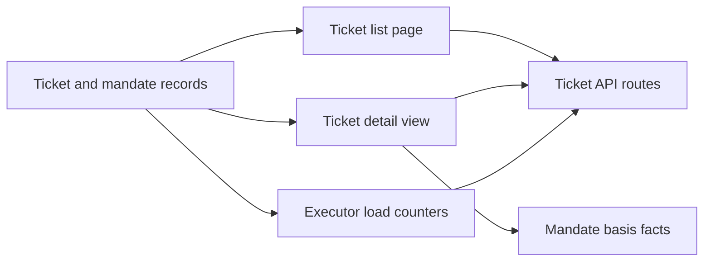

# tickets.ts

This file is the read side of the ticket feature in the management panel: it turns stored ticket records into plain data for the panel to render, and it never changes anything. It answers three questions a person or operator asks — which tickets are in each stage, what happened inside one ticket, and how busy the executor is — and it explains why the agent accepted a ticket in the first place. It sits between the store and the HTTP routes, so the panel never touches persisted records itself.

## How the views fit together

Stored tickets, decisions, triggers and threads are read once per request and projected into three shapes: a paged list of rows, one deep detail object, and a small pair of counters. The HTTP routes hand those shapes to the panel unchanged, so everything below is about what a person ends up seeing.

## At a glance

- **Primary role: Presentation** — it prepares user-visible view models: which tickets appear in each filter, what facts explain a ticket's mandate, which links and previews a page shows, and how busy the executor looks.
- **Confidence:** High — the whole file was read, together with the shared helpers it builds on (records.ts, text.ts), the HTTP routes that call it, and the panel components that consume its payloads.

## What this file does

- **Lists tickets by stage with paging.** A request asks for `open`, `person`, `working`, `idle` or `ended`; the result is newest-updated first with a total and a next-offset, so the panel can poll one page at a time without loading every ticket.
- **Builds one ticket's full page.** Title, stage, mandate, the decision that created it, its assignments, its inputs and the threads it follows — enough for a detail screen with several expandable sections.
- **Explains the mandate in plain facts.** `basisFacts` turns the stored admission basis into an ordered list of short, translatable facts (sender, bot, follow-up, admission cell, observation, accept mode, matched rules, legacy authority) instead of exposing raw policy internals.
- **Reports executor load.** One number for workers currently in an active turn and one for tickets queued for a slot, so the overview and status views can show utilization.
- **Sanitizes text for display.** Bodies and notes are turned into HTML-free Markdown, and trigger text into one-line previews, before they reach the browser.

## What a person sees on the ticket pages

- **Presents:** a filterable, paged ticket list where each row carries its stage, a one-line note about what it is waiting for, thread facts, and whether retry or stop is currently offered. The detail page carries the ticket's story: mandate and its basis facts, policy version, scope, the originating decision with its reason and rules, assignments with time spans, the inputs it received (newest first, each marked delivered or not), and followed threads.
- **Interaction:** rows in the `person` stage carry a link back to the conversation they came from, and assignments that actually started expose a worker session id so the panel can open that session. Both are links only; the actions themselves (`retry`, `stop`, `pause`) live in the HTTP routes, not here.
- **Prepared data:** every request starts from a `ViewHost` — the store, the source registry, and a function that resolves channel links. The view then builds a per-request snapshot that resolves rule names, sender display names and thread subscriptions once, so a page of rows stays cheap.

### Interaction states that change the display

- **Stage drives the row tone and the note.** The stage comes from the core classifier, so the note shown (waiting for an answer, a delivery error, a blocked or failed report) is never decided here.
- **A running assignment can end its turn.** When the worker's latest report is not `progress` and the ticket is no longer working, the payload adds `turnEndedAt` so the panel tags the report and ends the time span there instead of showing "now".
- **Legacy mandates look different.** Records accepted before mandates carried a basis get a `legacy` flag, which the panel uses to show a legacy scope label and hide the policy-version row.
- **Undelivered inputs are marked.** Each input carries `delivered`, so a message the worker never received is visible rather than silently included.
- **A currently matching `sender` fact is dropped by the panel** when it equals the mandate actor already shown on the status line; the fact list itself is ordered for reading, not by storage order.

## Key functions or classes

### `basisFacts`

Extracts the displayable admission facts of a mandate in reading order, deliberately leaving out the receiving scope (kept only for re-validation) and flagging legacy `authority` records.

    
        <a target="_self" href="#src/app/views/tickets.ts:18-34?class=code" style="color: inherit; text-decoration: none;">Code: src/app/views/tickets.ts:18-34</a>
    

### `ticketList`

Filters open or all tickets by stage, sorts them newest-first, pages them, and maps each one through `ticketRow`.

    
        <a target="_self" href="#src/app/views/tickets.ts:35-42?class=code" style="color: inherit; text-decoration: none;">Code: src/app/views/tickets.ts:35-42</a>
    

### `ticketRow`

Adds the optional conversation link to a list row when the ticket is waiting on a person.

### `executorLoad`

Combines the caller-supplied count of active workers with a count of open tickets whose stage is `working`/`queued`, yielding the two utilization numbers.

### `ticketDetail`

Assembles the whole detail payload, returning `undefined` for an unknown id so the route can answer 404; it reverses inputs, attaches trigger details with hand-back reasons, and marks context-only threads.

    
        <a target="_self" href="#src/app/views/tickets.ts:56-86?class=code" style="color: inherit; text-decoration: none;">Code: src/app/views/tickets.ts:56-86</a>
    

### `BasisFact`, `TicketListView`, `TicketDetailView`

The exported vocabulary and payload types: `BasisFact` names are the labels the panel translates, and the two view types are derived from the projection functions and re-exported by the API contract, so the panel and the host agree on the shape without duplicating it.

## Main inputs and results

- **Inputs:** a `ViewHost` (store, source registry, channel-link resolver) for the record-based views; a stage filter plus `offset`/`limit` for the list; a ticket id for the detail; and the current count of active worker sessions for load. Shared helpers from 
<a target="_self" href="#src/app/views/records.ts?class=code" style="color: inherit; text-decoration: none;">records.ts</a>
 supply the per-request snapshot, paging, row line and channel links, while 
<a target="_self" href="#src/app/views/text.ts?class=code" style="color: inherit; text-decoration: none;">text.ts</a>
 supplies Markdown and preview sanitizing.
- **Results:** a paged `{ items, total, next_offset }` of decorated rows; a detail object or `undefined`; and `{ running, queued }`. These are served by the ticket routes in 
<a target="_self" href="#src/app/http.ts:188-192?class=code" style="color: inherit; text-decoration: none;">http.ts:188-192</a>
 and rendered by the panel's execution list and ticket page.
- **Visible side effects:** none — the module only reads. Mutations such as retry, stop and pause are handled by other routes, and the payloads here merely tell the panel which controls to offer.

<!-- {
  "mermaid_info": {
    "name": "Ticket views from stored records to the panel",
    "nodes": [
      {
        "id": "store_001",
        "name": "Ticket and mandate records",
        "path": "src/app/store.ts",
        "hint": "Stored tickets read newest-first, all or open only",
        "isJumpable": true,
        "position": { "startLine": 233, "endLine": 242 },
        "references": []
      },
      {
        "id": "list_002",
        "name": "Ticket list page",
        "path": "src/app/views/tickets.ts",
        "hint": "Filters by stage, sorts newest-first, pages and decorates rows",
        "isJumpable": true,
        "position": { "startLine": 35, "endLine": 42 },
        "references": []
      },
      {
        "id": "detail_003",
        "name": "Ticket detail view",
        "path": "src/app/views/tickets.ts",
        "hint": "Assembles one ticket's mandate, decision, assignments, inputs and threads",
        "isJumpable": true,
        "position": { "startLine": 56, "endLine": 86 },
        "references": []
      },
      {
        "id": "basis_004",
        "name": "Mandate basis facts",
        "path": "src/app/views/tickets.ts",
        "hint": "Turns the admission basis into ordered, translatable display facts",
        "isJumpable": true,
        "position": { "startLine": 18, "endLine": 34 },
        "references": []
      },
      {
        "id": "load_005",
        "name": "Executor load counters",
        "path": "src/app/views/tickets.ts",
        "hint": "Running workers plus tickets queued for a slot",
        "isJumpable": true,
        "position": { "startLine": 52, "endLine": 55 },
        "references": []
      },
      {
        "id": "routes_006",
        "name": "Ticket API routes",
        "path": "src/app/http.ts",
        "hint": "Serves the list and detail payloads to the management panel",
        "isJumpable": true,
        "position": { "startLine": 188, "endLine": 192 },
        "references": []
      }
    ]
  }
} -->

    
        <a target="_self" href="#src/app/views/tickets.ts:1?class=graph" style="color: inherit; text-decoration: none;">Graph: Ticket views from stored records to the panel</a>
    

---
name: tickets.ts

update-time: 2026-11-02 11:47

description: This file is the read side of the ticket feature in the management panel: it turns stored ticket records into plain data for the panel to render, and it never changes anything. It answers three questions a person or operator asks — which tickets are in each stage, what happened inside one ticket, and how busy the executor is — and it explains why the agent accepted a ticket in the first place. It sits between the store and the HTTP routes, so the panel never touches persisted records itself.

---
