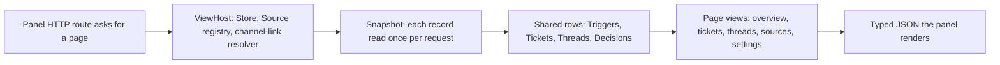

# views

The `views` directory builds the read models behind the management panel: plain, page-shaped JSON derived from stored orchestrator state, with nothing changed along the way. Seven small modules cover the panel's pages (overview, tickets, threads and search, sources, settings) plus the two pieces every page shares — the row builders in `records.ts` and the text formatter in `text.ts`. If a question starts with "why does the panel show this?", this directory is where the answer is decided.

## Whole-unit functional diagram

<!-- {
  "mermaid_info": {
    "name": "From stored state to a rendered panel page",
    "nodes": [
      {
        "id": "route_001",
        "name": "Panel HTTP route asks for a page",
        "path": "src/app/http.ts",
        "hint": "Routes build a ViewHost and call one view function per request",
        "isJumpable": true,
        "position": { "startLine": 111, "endLine": 119 },
        "references": []
      },
      {
        "id": "host_002",
        "name": "ViewHost: Store, Source registry, channel-link resolver",
        "path": "src/app/views/records.ts",
        "hint": "The three collaborators every view receives",
        "isJumpable": true,
        "position": { "startLine": 13, "endLine": 17 },
        "references": []
      },
      {
        "id": "snapshot_003",
        "name": "Snapshot: each record read once per request",
        "path": "src/app/views/records.ts",
        "hint": "Memoized reads for subscribed threads, policy rules and sender names",
        "isJumpable": true,
        "position": { "startLine": 46, "endLine": 68 },
        "references": []
      },
      {
        "id": "rows_004",
        "name": "Shared rows: Triggers, Tickets, Threads, Decisions",
        "path": "src/app/views/records.ts",
        "hint": "Trigger, ticket, thread and decision rows plus channel links",
        "isJumpable": true,
        "position": { "startLine": 86, "endLine": 210 },
        "references": []
      },
      {
        "id": "pages_005",
        "name": "Page views: overview, tickets, threads, sources, settings",
        "path": "src/app/views/overview.ts",
        "hint": "One function per panel page assembles the finished page payload",
        "isJumpable": true,
        "position": { "startLine": 38, "endLine": 79 },
        "references": []
      },
      {
        "id": "json_006",
        "name": "Typed JSON the panel renders",
        "path": "src/app/api.ts",
        "hint": "The route contract whose response types are these view results",
        "isJumpable": true,
        "position": { "startLine": 20, "endLine": 46 },
        "references": []
      }
    ]
  }
} -->

    
        <a target="_self" href="#src/app/views:1?class=graph" style="color: inherit; text-decoration: none;">Graph: From stored state to a rendered panel page</a>
    

A panel request never touches storage logic: `src/app/http.ts` hands the view function a `ViewHost`, the view reads through the Store's read queries, reuses the shared row builders, and returns one JSON object that the browser panel draws.

## At a glance

- **Main role**: presentation — these modules decide what an operator sees: which problems are listed, which stage a ticket is in, what a thread's timeline contains, and how raw message text reads in a card or list.
- **Confidence**: High — every function in the directory is called directly by a route in `src/app/http.ts` and its result is typed as a route response in `src/app/api.ts`; none of them writes state.

## What the panel shows

- **Presents**: a 24-hour operator overview, ticket lists by stage and one ticket's page, thread lists and a thread's timeline, search results across entities, a decision feed, per-Source status cards, and the Settings page with its editable blocks and per-Source forms.
- **Interaction**: the views never perform an action, but they advertise the ones a person may take — whether a Trigger can be requeued, whether a Ticket can be retried or stopped, which reply link belongs to a ticket waiting on a person — and they carry the revision number that a Settings save must send back.
- **Prepared data**: every view needs a `ViewHost` (the Store, the Source registry and a channel-link resolver); the overview additionally receives the health map, the policy version, the Executor load and an optional setup problem, while the Sources and Settings views receive health and setup state.

### Important interaction states

Each page view classifies records into a fixed ladder of states, and those ladders are what a reader of the panel actually reacts to:

- **Thread stage** in priority order: poll error, then evaluating, then queued, then subscribed by an open ticket, then dormant (ended tickets only), then unsubscribed.
- **Source state** in priority order: missing kind, off, error (setup problem or a failing health part), blocked on global setup, starting, paused, ready.
- **Ticket stage and its note**: a ticket in the `person` stage carries one line explaining what a person must do — the pending question, a delivery error, or the first line of the latest report.
- **Problems on the overview**: setup, no-source, no-allowed, Source errors, executor paused, runtime errors, overdue Evaluations, unavailable Evaluations, and failing outgoing replies, in that order.
- **Decision outcome**: an `ignore` decision that observe mode would have accepted is displayed as `wouldAccept` rather than `ignore`.

## Responsibilities and non-responsibilities

- **Responsible for**: reading state through the Store's read queries, shaping display-ready rows and page payloads, formatting message text for display, deriving lifecycle states and labels, paginating lists with a stable cursor, and describing what a person may do next.
- **Kept elsewhere**: writing state and performing actions (ticket retry/stop, trigger requeue, dismissing a decision, saving settings) live in the runtime engine and settings service reached from `src/app/http.ts`; persistence and its queries belong to `src/app/store.ts` and `src/app/store-read.ts`; Source health is produced by the Sources layer; rendering, colours and icons live in `src/client`.

## Important direct children

### `records.ts`

The shared vocabulary of every page: a `ViewHost`, one `snapshot()` per request that reads shared records only once, and the row builders for Triggers, Tickets, Threads, Decisions and channel links.

Open the guide for 
<a target="_self" href="#src/app/views/records.ts.info.md?class=text" style="color: inherit; text-decoration: none;">records.ts.info.md</a>
 for the full row-by-row reference.

### `text.ts`

Turns raw message text into the two forms the panel uses — a single-line preview and HTML-free Markdown — while reducing inline images and raw JSON payloads to something readable.

The complete formatting rules are in 
<a target="_self" href="#src/app/views/text.ts.info.md?class=text" style="color: inherit; text-decoration: none;">text.ts.info.md</a>
.

### `tickets.ts`

The ticket read side: list pages filtered by stage, a full ticket page (mandate, accepted-because facts, inputs, assignments, subscribed threads), and the Executor load figure.

See 
<a target="_self" href="#src/app/views/tickets.ts.info.md?class=text" style="color: inherit; text-decoration: none;">tickets.ts.info.md</a>
 for what each ticket page section contains.

### `threads.ts`

The thread, search and decision views: filtered thread lists, a cursor-paged timeline that can anchor on one trigger, grouped search across triggers/threads/tickets, and the decision feed.

Details are in 
<a target="_self" href="#src/app/views/threads.ts.info.md?class=text" style="color: inherit; text-decoration: none;">threads.ts.info.md</a>
.

### `sources.ts`

One display-ready row per Source instance: lifecycle state, each health check, the last day's received and filtered counts, recently filtered messages, and recently dropped replies — including the ticket and thread each dropped reply belongs to.

Read 
<a target="_self" href="#src/app/views/sources.ts.info.md?class=text" style="color: inherit; text-decoration: none;">sources.ts.info.md</a>
 for the state ladder and health resolution.

### `settings.ts`

The Settings page: three revisioned configuration blocks, one editable card per Source with its kind's form fields, restart-sensitive fields, labels and policy metadata, plus the execution environment.

See 
<a target="_self" href="#src/app/views/settings.ts.info.md?class=text" style="color: inherit; text-decoration: none;">settings.ts.info.md</a>
 for which revision belongs to which block.

### `overview.ts`

The operator landing page: what is broken right now, which tickets wait for a person, how busy the Executor is, and how many Triggers flowed through the system in the last 24 hours.

The problem list and flow metrics are explained in 
<a target="_self" href="#src/app/views/overview.ts.info.md?class=text" style="color: inherit; text-decoration: none;">overview.ts.info.md</a>
.

## How the children work together

1. A panel request reaches a route in `src/app/http.ts`, which builds a `ViewHost` from the Store, the Source registry and the channel-link resolver, then calls the one view function for that page.
2. The view opens a `snapshot()`, so shared facts — subscribed threads, policy rule names, sender display names, follow-up owners — are read once however many rows depend on them.
3. Page views layer on their own reads: the last 24 hours for counts and drops, the stage of every open ticket, the health map for Sources, setup state, and the Executor load handed in by the route.
4. `records.ts` row builders turn each record into a display row, and `text.ts` turns message text into a preview or HTML-free Markdown before it is embedded.
5. The view returns one JSON object — lists wrapped by the shared paging envelope, objects carrying their revision numbers — which the browser panel renders and, for editable pages, sends back with a save.

### Branching worth knowing

- **Paging**: list views share one envelope of `items`, `total` and `next_offset`; `null` in `next_offset` means the end. Thread timelines page backwards from a `before` cursor that pairs timestamp and id, so Triggers sharing a second still page deterministically, and an `around` trigger re-anchors the page.
- **Time windows**: the overview, Source counts and the `recent` thread filter all describe the last 24 hours, and the overview's `dropped` count matches the dropped-reply list by construction.
- **Optional arguments**: ticket pages need a real ticket and thread pages a real thread; a missing record is reported to the caller as "not found" by the route rather than returned as an empty page.

## The data the panel relies on

- **Represents**: a page of the management panel — the visible text, the derived states, the counts, the links, and the small set of flags describing what a person may do next.
- **Produced by**: the seven view modules, read-only from the Store, Source registry and health map.
- **Consumed by**: the panel through the type-only API contract in `src/app/api.ts`, which declares each route's response as the corresponding view result, and through the filter enums (`TICKET_FILTERS`, `THREAD_FILTERS`) shared with the client.
- **Behavior-shaping parts**: the state ladders above, the per-item action flags, the paging envelope, and the `revision` numbers on Settings blocks and Source cards — a save is rejected if the revision the panel sends back is stale.

### Compatibility notes

Read models tolerate records written by older versions: stored assessment audit metadata is parsed leniently and older `matches` entries are shown as matched rule assessments, pre-scope mandate records display their stored `authority` as a legacy fact, and a stale "Source off" health entry on an enabled Source is shown as starting instead of as an error.

## Recommended starting points

1. `records.ts` — the fastest way to learn what the panel can show at all, because every page composes these rows. Start with the `ViewHost` and `snapshot()` definitions at 
<a target="_self" href="#src/app/views/records.ts:13-68?class=code" style="color: inherit; text-decoration: none;">records.ts:13-68</a>
.
2. `overview.ts` — read one complete page end to end to see how a view gathers state, decides what counts as a problem, and returns a single payload at 
<a target="_self" href="#src/app/views/overview.ts:38-79?class=code" style="color: inherit; text-decoration: none;">overview.ts:38-79</a>
.
3. `text.ts` — small but touched by every other module, so it explains the text a person actually reads; open 
<a target="_self" href="#src/app/views/text.ts:7-35?class=code" style="color: inherit; text-decoration: none;">text.ts:7-35</a>
 before puzzling over odd-looking previews.
4. `tickets.ts` and `threads.ts` — the two largest page groups, best read after `records.ts`; their detail builders at 
<a target="_self" href="#src/app/views/tickets.ts:56-86?class=code" style="color: inherit; text-decoration: none;">tickets.ts:56-86</a>
 and 
<a target="_self" href="#src/app/views/threads.ts:29-53?class=code" style="color: inherit; text-decoration: none;">threads.ts:29-53</a>
 show how one record becomes one page.

---
name: views

update-time: 2026-11-02 11:54

description: The `views` directory builds the read models behind the management panel: plain, page-shaped JSON derived from stored orchestrator state, with nothing changed along the way. Seven small modules cover the panel's pages (overview, tickets, threads and search, sources, settings) plus the two pieces every page shares — the row builders in `records.ts` and the text formatter in `text.ts`. If a question starts with "why does the panel show this?", this directory is where the answer is decided.

---
