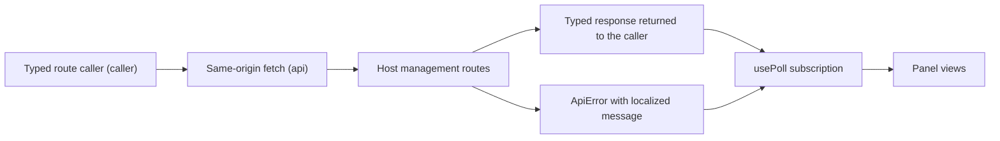

# api.ts

`src/client/api.ts` is the browser-side doorway to the orchestrator management API. Panel views never call `fetch` themselves: they ask a typed route caller for a named operation such as `GET tickets/:id`, and this file turns that request into a same-origin HTTP call, then either returns the typed response the host sent or throws an `ApiError` carrying a message already localized for the interface language. It also provides the polling hook that keeps panel panels live, plus the client-side type aliases and small option lists (decision filters) the views share.

## Whole-unit functional diagram

The main path starts when a view asks for a route: `caller` assembles the URL, query string and JSON body, `api` performs the request against the host's `/orchestrator/api/` prefix, and the host either answers with a typed payload or a structured failure. Failures are converted into an `ApiError` whose message comes from the caller-supplied message table, while `usePoll` repeatedly drives this path so a view can render fresh data or the latest error.

## At a glance

- Primary role: API boundary — it defines how panel code calls the management API and what a call accepts and returns.
- Secondary roles: Data contract — it also re-exposes the response shapes of the host contract as convenient client-side types, so views agree on the same data.
- Confidence: High — the file's request/response machinery, error conversion and exported type aliases are all readable in source, and its call sites (`provider.tsx`, `ticket.tsx`, `thread.tsx`, `eval.tsx`) confirm the intended usage.

## What this file does

- **Typed route calling.** `caller` accepts a route key from the host contract (`'GET tickets/:id'`) and the matching request values, so a typo in the operation name or a missing path parameter is a compile-time problem rather than a runtime 404.
- **One request pipeline.** Every call goes through `api`, which applies the `x-orchestrator-request: 1` marker header, serializes a JSON body only when one is supplied, and always parses the response body defensively.
- **Localized failure reporting.** Server failures are translated into the panel's own wording: setup problems, structured user-error codes, host-provided messages, "host not running", server errors and generic request failures are distinguished, and a completely unreachable host is flagged separately.
- **Live data without duplicate churn.** `usePoll` polls an endpoint while a view is mounted, slows down when the browser tab is hidden, keeps the last successful value across refreshes, and exposes a manual `reload` for use after a mutation.
- **Shared client vocabulary.** Route-derived view types (`StateView`, `TicketPageView`, `Settings`, `DroppedReply`, …) and the decision-filter constants give every panel module one place to import its shapes and filter values from.

## Key functions or classes

### `caller`

Builds the typed route caller used by the whole panel: it splits the operation key into method and path, fills `:param` placeholders, drops empty query values, and forwards any body.

    
        <a target="_self" href="#src/client/api.ts:108-117?class=code" style="color: inherit; text-decoration: none;">Code: src/client/api.ts:108-117</a>
    

### `api`

Performs a single management request and decides whether the caller gets a parsed value or a thrown `ApiError`, including the unreachable-host case.

    
        <a target="_self" href="#src/client/api.ts:33-58?class=code" style="color: inherit; text-decoration: none;">Code: src/client/api.ts:33-58</a>
    

### `usePoll`

A React hook that loads an endpoint on mount, re-loads on a timer, pauses cheaply when the tab is hidden, and returns `{ data, error, reload }`.

    
        <a target="_self" href="#src/client/api.ts:67-98?class=code" style="color: inherit; text-decoration: none;">Code: src/client/api.ts:67-98</a>
    

### `ApiError`

The single failure type views catch; it carries the HTTP status, structured details (validation issues, setup problem, user-error code, unreachable flag) and convenience `issues` / `missing` getters.

    
        <a target="_self" href="#src/client/api.ts:16-24?class=code" style="color: inherit; text-decoration: none;">Code: src/client/api.ts:16-24</a>
    

### `ApiMessages`

The message table a caller must supply, so the transport layer never hard-codes user-visible English and stays locale-neutral.

### `DECISION_FILTERS` and `DECISION_KINDS`

The decision-log filter tabs and the query value each tab sends to the host; `src/client/route.ts` and the Eval view both read these so the URL, the pills and the request stay consistent.

## Main inputs and results

- Inputs: a route key from the host contract (for example `'GET threads/:key'`) together with its path parameters, optional `query` object and optional `body`; for polling, a loader function, a dependency list and an interval (default 5000 ms).
- Results: the parsed typed view object for a successful call, or a thrown `ApiError` with a localized `message`, the HTTP `status` and structured `details`; `usePoll` returns `{ data, error, reload }` where `data` is the last successful value.
- Visible side effects: views refresh roughly every five seconds (about six times slower while the tab is hidden) and immediately when the tab becomes visible again, so operators see state changes without pressing anything; a failed fetch surfaces as an error banner, a toast, or a "not found" hint depending on the view.

## Public contract

- Caller: panel components and hooks — most centrally `PanelProvider` in `src/client/provider.tsx`, which creates one `call` function and shares it through context, but also feature views such as `ticket.tsx`, `thread.tsx`, `execution.tsx` and `eval.tsx`.
- Operation: perform one management API request by operation name and receive its typed response; additionally, subscribe to an endpoint on a timer and force a manual refresh.
- Accepted input: the operation key mirrors the host contract in `src/app/api.ts` (`'GET state'`, `'POST tickets/:id/retry'`, `'PUT prompts'`, …). Path placeholders must be supplied and are URL-encoded; `query` entries that are `undefined` or `''` are omitted rather than sent empty; a body is sent as JSON only when one is provided. Because the request type is derived from whether the operation declares a body or query, operations that need input reject a call without it at compile time.
- Result: the response payload of that operation (`ApiResponse<K>`), or an `ApiError`. The error message is chosen in a fixed order: a setup problem, then a recognized structured user-error code, then a message string supplied by the host, then "host not running" for an empty 404, then a generic server-error or request-failed message for other statuses. Validation issues arrive as a list of `{ path, message }` entries.

### Access or validation requirements

Requests are sent to the same origin under `/orchestrator/api/` and always carry the `x-orchestrator-request: 1` header that the host's route table requires; the host rejects anything else with 403. A failed `fetch` and an empty response both mark the failure as `unreachable`, which is why a 404 only means "record does not exist" when the host actually answered — that distinction drives the `missing` getter and the "not found" hints in `ticket.tsx` and `thread.tsx`.

## Information contract

- Represents: the response payloads of the management API, re-stated from the caller's point of view — board state and setup status, settings and source configuration, ticket and thread pages with their timelines, decision rows, prompt configuration, policy history, search results and overview problems.
- Produced by: the host routes in `src/app/http.ts`, whose view builders shape the JSON; the client sends the same contract's request half through `caller`.
- Consumed by: every panel view and side helper — for example `marks.ts` (row badges), `rows.tsx` (list lines), `settings-kit.tsx` (settings drafts), `prompt-config.ts` (prompt editor), `app.tsx` (search) — so a shape change in the host shows up as a type error here rather than a silent blank panel.
- Behavior-shaping parts: `setup` on the state view drives the setup/deployment screens; `load.running` and the decision-filter values change what the panel shows or requests; `next_offset` style paging fields power "load more"; `dropped` entries and `problems` become operator warnings; `TicketStage` is re-exported so views can talk about ticket stages without importing host code.

### Compatibility notes

The type aliases are the only knowledge the browser bundle has of the host contract: `src/app/api.ts` is imported with `import type`, so nothing from the server implementation is bundled. `SetupView`, `Settings` and `PromptConfig` are derived from parts of larger responses, which means they follow the host automatically but also that removing or renaming a part there breaks the panel at build time.

---
name: api.ts

update-time: 2026-11-02 10:45

description: `src/client/api.ts` is the browser-side doorway to the orchestrator management API. Panel views never call `fetch` themselves: they ask a typed route caller for a named operation such as `GET tickets/:id`, and this file turns that request into a same-origin HTTP call, then either returns the typed response the host sent or throws an `ApiError` carrying a message already localized for the interface language. It also provides the polling hook that keeps panel panels live, plus the client-side type aliases and small option lists (decision filters) the views share.

---
