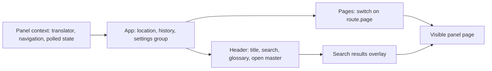

# app.tsx

`app.tsx` is the root shell of the dsh-superagent management panel: it draws the title bar, global search, glossary dialog, top-level tabs and the page body, and it owns the navigation state that decides which screen is visible. A first-time reader should start here to understand how the panel is framed and how a click turns into a different screen. The heavy content of each screen lives in sibling files; this file wires them together and keeps the page history.

## Whole-unit functional diagram

The panel context supplies the translator and the state needed to render; `App` turns that into a location with a back stack; the header and the page switcher are the two visible consumers, and clicking a search hit moves the same location so the chosen page replaces the current view.

## At a glance

- Primary role: Presentation — the file decides what a person sees in the panel frame and which control changes which visible screen.
- Secondary roles: Orchestration — it coordinates location history, tab switching and page dispatch before any page component renders.
- Confidence: High — the whole file was read together with the route and provider modules it depends on.

## What this file does

- Renders the panel frame: title, toolbar, tab strip and the `main` region that hosts the active page, all wrapped in the shared panel provider.
- Offers global search from the header, showing grouped hits for tickets, threads and triggers with the matching substring highlighted, and closing when the field is cleared, Escape is pressed, or the user clicks outside.
- Provides a glossary dialog that lists bilingual terms, a color-dot status legend and fixed value lists, choosing which language is shown first from the current interface language.
- Owns route history: opening a tab, pushing a new route, paging or filtering in place, and going back, with the location remembered between panel openings.
- Preserves the last visited settings group so the Settings tab reopens where the user left it.
- Dispatches the active route to the matching page component, including list-versus-detail variants and the loading or error placeholder shown while shared state is unavailable.

## What the user experiences

- Presents: a single panel with the plugin title, a search box, a glossary button, an "open master session" button, a horizontal tab strip (overview, source, trigger, eval, execution, settings) and the current page below it.
- Interaction: typing a query and submitting searches the host; clicking a result switches tabs and opens the matching ticket, thread or trigger; pressing Escape or clicking away dismisses results; the glossary opens as a modal dialog with a close button.
- Prepared data: the header's "open master session" button stays disabled until shared panel state reports a master session id, and the empty-search wording depends on whether stored setup information is available.

### Important interaction states

- Search shows one of two "nothing found" messages depending on stored setup information, and switches to a "capped results" message when the server returns a full page of matches.
- Filtered triggers appear in results without a link, showing the filter reason instead.
- When shared state fails before anything has loaded, the page area shows an alert with the error message; when state is already present, the error is a status banner above the tabs and the page keeps rendering.
- Navigating with `replace` keeps the current history entry, which is why changing a filter or a page number does not create a new back step.

## Coordinated flow

1. `App` reads its starting location from remembered session storage and subscribes to changes so each new location is written back.
2. User actions (tab click, result click, back navigation) produce a next route through the shared `move`/`navigate`/`back` helpers, which also carry the last visited settings group forward.
3. `App` passes the translator, session opener, navigation callbacks and back label into the shared provider, which polls host state and supplies the search call and error notifications.
4. `Pages` switches on the route page and renders the matching page component, passing filters, ids and the deployment form; the header renders the frame and its own search and glossary.
5. The page components own everything inside the page body, while route changes remain the shell's responsibility.

## Key functions or classes

### `App`

Root component: holds the location, remembers it, and provides navigation and back-label context to everything below.

<a target="_self" href="#src/client/app.tsx:173-188?class=code" style="color: inherit; text-decoration: none;">app.tsx:173-188</a>

### `Pages`

Renders the header and tab strip, scrolls the active tab into view, and selects the page component for the current route, including its loading and error placeholders.

<a target="_self" href="#src/client/app.tsx:141-170?class=code" style="color: inherit; text-decoration: none;">app.tsx:141-170</a>

### `Header`

The toolbar: search form with request ordering so stale responses are ignored, glossary button, and the master-session button that reports failures through a toast.

<a target="_self" href="#src/client/app.tsx:101-139?class=code" style="color: inherit; text-decoration: none;">app.tsx:101-139</a>

### `SearchResults`

Renders counted, grouped search hits and closes itself before navigating, so the chosen destination appears immediately.

<a target="_self" href="#src/client/app.tsx:68-99?class=code" style="color: inherit; text-decoration: none;">app.tsx:68-99</a>

### `Glossary`

The bilingual glossary dialog, built from the shared locale dictionaries and grouped term data.

<a target="_self" href="#src/client/app.tsx:27-55?class=code" style="color: inherit; text-decoration: none;">app.tsx:27-55</a>

### `Highlight`

Marks the matched part of a result title so the reader can see why the hit was returned.

<a target="_self" href="#src/client/app.tsx:57-61?class=code" style="color: inherit; text-decoration: none;">app.tsx:57-61</a>

## Main inputs and results

- Inputs: the `AppProps` values (`t` translator, `openSession` callback, `deploymentForm`), the remembered location restored from session storage, and user actions on the tabs, search field, results, and buttons.
- Results: the rendered panel with its active page, an updated location (route plus back stack) that is persisted for the next opening, a host search call for the typed query, and a session-opening request when the master-session button is used.
- Visible side effects: the panel reopens on the last visited page, Settings reopens at the last settings group, search or session failures surface as toast messages, and clicking a search hit changes the visible page.

## Supporting modules worth opening

The route types, tab list and history helpers live in 
<a target="_self" href="#src/client/route.ts?class=code" style="color: inherit; text-decoration: none;">route.ts</a>
; the shared contexts, polling and toast mechanism are in 
<a target="_self" href="#src/client/provider.tsx?class=code" style="color: inherit; text-decoration: none;">provider.tsx</a>
; and the browser-side entry that mounts this shell is 
<a target="_self" href="#src/client/index.tsx?class=code" style="color: inherit; text-decoration: none;">index.tsx</a>
.

---
name: app.tsx

update-time: 2026-11-02 10:48

description: `app.tsx` is the root shell of the dsh-superagent management panel: it draws the title bar, global search, glossary dialog, top-level tabs and the page body, and it owns the navigation state that decides which screen is visible. A first-time reader should start here to understand how the panel is framed and how a click turns into a different screen. The heavy content of each screen lives in sibling files; this file wires them together and keeps the page history.

---
