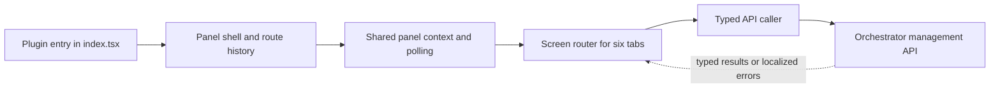

# `src/client` — the browser management panel

This directory is the entire browser-side user interface of `dsh-superagent`: a React panel that an operator opens inside the DSH web client to watch Sources, Threads, Decisions, Tickets and the Executor, and to change settings. It is what the host web client loads as a plugin; everything a person sees, clicks and types in the panel lives here. It deliberately does not decide policy or talk to Feishu/GitHub itself — it asks the orchestrator management API for typed data and renders the answer in the current interface language.

## Whole-unit functional diagram

A visitor arrives through the plugin entry, which registers the panel into the DSH host. The shell owns where the user is, the shared provider keeps live server state and notifications, and each tab is one screen that fetches through the typed caller instead of calling `fetch` itself.

## At a glance

- Main role: Presentation — this directory renders screens, controls, wording and formatting for a human operator; the server owns the decisions.
- Confidence: High — all 27 files are browser React/TypeScript, and the plugin entry registers UI slots (main panel, sidebar icon, Plugin Manager config view) rather than starting a service.

## Responsibilities and non-responsibilities

- Responsible for: the panel's screens and navigation between them; the shared visual kit (`controls.tsx`, `widgets.tsx`, `rows.tsx`); bilingual wording (`locales.ts`, `text.ts`) and status presentation (`marks.ts`); local, optimistic editing of settings forms before they are saved; and the client-side contract that turns named operations such as `GET tickets/:id` into same-origin HTTP requests.
- Kept elsewhere: orchestration and business rules (what counts as a problem, which ticket needs a human, how a decision is reached) live in `src/app` and `src/core`; source adapters and provider integrations live under `src/sources`; opening a DSH Session is delegated to `src/navigation.ts`; and the panel's own stylesheet `client.css` is injected at runtime rather than imported per component.

## Important direct children

### `index.tsx`

The browser-side entry point: it declares the host services it needs (`slots`, `locale`, `sessions`, `uiWorkspace`), registers the Chinese/English dictionaries, and contributes the main panel, the sidebar hammer icon and the Plugin Manager configuration view. It also wraps the app with the one behaviour that must sit above React — opening a known Session in the workspace while cancelling stale navigation attempts.

<a target="_self" href="#src/client/index.tsx?class=code" style="color: inherit; text-decoration: none;">index.tsx</a>

### `app.tsx`

The root shell: title bar with global search and glossary dialog, the six top-level tabs, and the switch that decides which screen the current route shows. It also owns route history — push, replace and back — and the rule that the Settings tab reopens at the group you last used.

<a target="_self" href="#src/client/app.tsx:172-188?class=code" style="color: inherit; text-decoration: none;">app.tsx:172-188</a>

### `provider.tsx`

The shared runtime layer: two React contexts (panel services and live server state), the poll loop over `GET state`, restart detection with a faster 1-second poll until the service answers again, toast messages, and the `useAction` helper every mutating control uses for busy state and error reporting.

<a target="_self" href="#src/client/provider.tsx:74-108?class=code" style="color: inherit; text-decoration: none;">provider.tsx:74-108</a>

### `api.ts`

The only place the panel performs HTTP: it builds the typed route caller, adds the `x-orchestrator-request` marker, converts rejections into an `ApiError` with a message already localized, and provides `usePoll` plus the client-side view types and decision filter lists.

<a target="_self" href="#src/client/api.ts:105-117?class=code" style="color: inherit; text-decoration: none;">api.ts:105-117</a>

### `route.ts`

The shared vocabulary of "where the user is": the tab list, the typed `Route`/`Location` shapes every page agrees on, route builders and labels, and the `sessionStorage` memory that restores your view after a reload while safely falling back to the overview page for damaged or outdated values.

<a target="_self" href="#src/client/route.ts:49-67?class=code" style="color: inherit; text-decoration: none;">route.ts:49-67</a>

### `controls.tsx`

The panel's box of UI primitives — buttons, tags, tabs, inputs, switches, dots, disclosure rows, modal and tooltip — rendered as `dt-*` markup with design-token colors and no data fetching. Every screen imports from here, so one keyboard or accessibility fix reaches the whole panel.

<a target="_self" href="#src/client/controls.tsx:1-10?class=code" style="color: inherit; text-decoration: none;">controls.tsx:1-10</a>

### `widgets.tsx`

Context-aware shared widgets (section headers, timestamps, Markdown-bearing text, confirm dialogs) so pages look and behave the same without each re-inventing headers or confirmation prompts.

<a target="_self" href="#src/client/widgets.tsx?class=code" style="color: inherit; text-decoration: none;">widgets.tsx</a>

### `draft.tsx`

The "edit a settings form without losing work" layer: an optimistic draft with `sessionStorage` persistence, a reducer that tracks clean/editing/saving/waiting-for-revision, a `SaveBar`, and a three-way merge that rebases your pending edits onto newer server revisions instead of overwriting them.

<a target="_self" href="#src/client/draft.tsx:1-65?class=code" style="color: inherit; text-decoration: none;">draft.tsx:1-65</a>

### `settings-kit.tsx`

The kit behind every settings screen: the settings context that loads the current configuration, `useBlockDraft` for turning edited values into a saved settings block, and schema-driven field renderers used by the Source, Eval and Execution settings pages.

<a target="_self" href="#src/client/settings-kit.tsx:23-55?class=code" style="color: inherit; text-decoration: none;">settings-kit.tsx:23-55</a>

### `settings.tsx`

The small Settings shell: the left-hand list of groups, the current group's title, and the decision of which screen to mount for `source`, `eval`, `execution`, `prompts` or `deployment`.

<a target="_self" href="#src/client/settings.tsx:13-38?class=code" style="color: inherit; text-decoration: none;">settings.tsx:13-38</a>

The feature screens then fill each tab: `overview.tsx` (waiting Tickets, active problems, 24-hour flow, Executor load), `source.tsx` (Source health and Source settings cards), `trigger.tsx` (Thread list with filters), `thread.tsx` (timeline with "load earlier"), `eval.tsx` (decision log and eval settings), `execution.tsx` (Executor status, pause/resume, and capacity settings), `ticket.tsx` (one Ticket's mandate, inputs, threads and retry/stop controls), `prompts.tsx` with `prompt-config.ts` (prompt editing, composed preview, revision history), and `deployment.tsx` (machine state directory and resource limits, also reused by the Plugin Manager).

The text and presentation helpers sit underneath all of them: `locales.ts` holds every `[Chinese, English]` pair keyed by a stable name, `text.ts` turns machine values into finished sentences, `marks.ts` maps raw domain states to labels, tones, dots and icons, `markdown.ts` parses a deliberately limited Markdown subset without ever interpreting raw HTML, and `css.d.ts` only teaches TypeScript what the `?raw` stylesheet import means.

## How the children work together

The DSH web client calls `apply`, which registers the locale dictionaries and three UI slots. The main slot mounts `Mounted` → `App`; `App` reads the stored location, wraps everything in `PanelProvider`, and renders `Pages`, which switches on `route.page` to the matching screen. Each screen asks the provider for its translator, typed caller and navigation, then polls its own endpoint through `usePoll`; `caller` builds the same-origin request, and `ApiError` comes back with wording the interface can show immediately. Shared controls, widgets, row renderers, marks and text helpers give every screen the same look and the same vocabulary.

## What the user experiences

- Presents: six tabs — Overview, Source, Trigger, Eval, Execution and Settings — plus a global search box, a bilingual glossary dialog, per-record detail pages, and status chips whose text and color come from one lookup table.
- Interaction: clicking a ticket or thread row navigates into its detail page; filter pills and "load more" change the list in place; operators can pause/resume the Executor, retry or stop a Ticket, requeue or dismiss a failed decision; settings fields save only what changed, with save/discard controls and a status line.
- Prepared data: `GET state` is polled by the provider before pages render (a loading hint or error message stands in until it arrives), each screen polls its own endpoint, and the translator must be bound before any label can be produced.

### Important interaction states

- Loading vs. error: the Overview, Execution and Settings screens show a waiting message until `GET state` succeeds; a later polling failure appears as a non-blocking banner while the last known data stays visible.
- Restart recovery: when a save or action restarts `dsh-superagent`, the panel polls faster, shows the outage, and on recovery bumps a counter so dependent views refetch instead of showing stale values.
- Unsaved settings: a form stays "editing" until saved; a concurrent server change triggers a three-way rebase that either merges silently or reports conflicting fields, and an unreadable or outdated stored draft is dropped rather than trusted.
- Read-only fallback: if the DSH host does not serve a writable configuration form, the Deployment screen still opens but explains why nothing can be saved.

## Public contract (the panel's API boundary)

- Caller: every screen in this directory; pages never call `fetch` directly and never hard-code a URL.
- Operation: `caller(messages)` returns a `Call` that takes a named operation such as `'GET overview'`, `'GET tickets/:id'`, `'PUT settings/:block'` or `'POST executor/pause'` and returns the typed response for that operation.
- Accepted input: path parameters are substituted into `:name` placeholders, query values that are empty or `undefined` are dropped, and an optional JSON `body` is sent for mutations. Every request carries the `x-orchestrator-request` header and goes to `/orchestrator/api/…`.
- Result: a typed payload on success, or a thrown `ApiError` with an already-localized message plus structured details — field issues, a setup problem, a user error code, or `unreachable`. The `missing` getter distinguishes a genuinely absent record from a host that did not answer, which matters during a restart.

## Stored state lifecycle

- Stores: the current route, its back stack (capped, most recent last) and the last-opened settings group under `dsh-superagent/route`; and per-block unsaved settings drafts under `dsh-superagent/draft/…`, including the server revision they were based on.
- Read path: `initialLocation` restores the session view when the panel mounts and validates every stored entry, silently falling back to the overview page when a value is damaged or names a tab that no longer exists; `useDraft` restores a pending draft for the block being edited.
- Write path: every navigation remembers the location; typing in a settings field updates the draft; saving sends the value with the revision it was based on and clears the draft on success.
- Visible result: a page reload returns a person to the same screen with unsaved edits intact, while the server remains the authority whenever the stored copy cannot be reconciled.

## How the flow begins (entry)

- Trigger: the DSH web client loads the plugin and calls `apply(ctx)`; the declared injections mean the slot registry, locale service, Session controller and workspace API are ready first.
- First meaningful step: dictionaries are registered, then three slots are contributed — `main` with the panel key, `sidebar.panellist` with the hammer icon, and `plugins.row.config` with the configuration view. `configForms` is read opportunistically, so a host without it gets a read-only Machine settings screen.
- Outcome: a Superagent icon appears in the sidebar and opens the management panel; the same screens are reachable as a Plugin Manager configuration page.

### How to invoke it

The registration is three `ctx.slots.register` calls plus `ctx.effect` for the dictionaries; there is no separate bootstrap command in this directory.

<a target="_self" href="#src/client/index.tsx:48-58?class=code" style="color: inherit; text-decoration: none;">index.tsx:48-58</a>

## Recommended starting points

1. `app.tsx` — the shell makes the whole layout legible: header, tabs, route switch, and the history rules you will see referenced everywhere else.
2. `api.ts` and `provider.tsx` — together they explain how any screen gets its data, its translator, its notifications and its reload behaviour.
3. `overview.tsx` — the first screen an operator sees, and a compact example of a polled page built from shared rows, widgets and marks.
4. `settings.tsx` → `settings-kit.tsx` → `draft.tsx` — follow this chain when you need to understand how a form edit becomes a saved settings block, and how unsaved work survives a reload.

    
        <a target="_self" href="#src/client/client.info.md?class=text" style="color: inherit; text-decoration: none;">Document: src/client/client.info.md</a>
    

<!-- {
  "mermaid_info": {
    "name": "Management panel flow",
    "nodes": [
      {
        "id": "plugin_001",
        "name": "Plugin entry in index.tsx",
        "path": "src/client/index.tsx",
        "hint": "Registers dictionaries and the three UI slots the host mounts",
        "isJumpable": true,
        "position": { "startLine": 48, "endLine": 58 },
        "references": []
      },
      {
        "id": "shell_002",
        "name": "Panel shell and route history",
        "path": "src/client/app.tsx",
        "hint": "Header, tabs, route state, and which screen is visible",
        "isJumpable": true,
        "position": { "startLine": 172, "endLine": 188 },
        "references": []
      },
      {
        "id": "context_003",
        "name": "Shared panel context and polling",
        "path": "src/client/provider.tsx",
        "hint": "Provides translator, typed caller, navigation, live state, toasts and restart detection",
        "isJumpable": true,
        "position": { "startLine": 74, "endLine": 108 },
        "references": []
      },
      {
        "id": "pages_004",
        "name": "Screen router for six tabs",
        "path": "src/client/app.tsx",
        "hint": "Maps each route to its feature screen and detail pages",
        "isJumpable": true,
        "position": { "startLine": 141, "endLine": 170 },
        "references": []
      },
      {
        "id": "api_005",
        "name": "Typed API caller",
        "path": "src/client/api.ts",
        "hint": "Turns a named operation into a same-origin request and localizes failures",
        "isJumpable": true,
        "position": { "startLine": 105, "endLine": 117 },
        "references": []
      },
      {
        "id": "host_006",
        "name": "Orchestrator management API",
        "path": "",
        "hint": "The server side that answers named operations with typed views or structured errors",
        "isJumpable": false,
        "position": { "startLine": 0, "endLine": 0 },
        "references": []
      }
    ]
  }
} -->

    
        <a target="_self" href="#src/client:1?class=graph" style="color: inherit; text-decoration: none;">Graph: Management panel flow</a>
    

---
name: client

update-time: 2026-11-02 11:48

description: This directory is the entire browser-side user interface of `dsh-superagent`: a React panel that an operator opens inside the DSH web client to watch Sources, Threads, Decisions, Tickets and the Executor, and to change settings. It is what the host web client loads as a plugin; everything a person sees, clicks and types in the panel lives here. It deliberately does not decide policy or talk to Feishu/GitHub itself — it asks the orchestrator management API for typed data and renders the answer in the current interface language.

---
