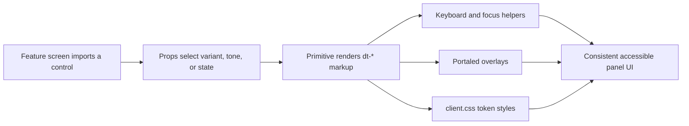

# controls.tsx

This file is the panel's shared box of UI primitives: buttons, tags, tabs, inputs, switches, status dots, disclosure rows, a modal, and a tooltip. Every feature screen in `src/client` imports from here instead of writing raw markup, so one change to a control's markup, keyboard behavior, or accessibility attributes reaches the whole panel at once. The file deliberately contains no data fetching or business logic — it only turns props into `dt-*` markup whose colors come from `--dsw-alias-*` design tokens defined in the stylesheet. If you want to know what a panel control looks like, which keys it responds to, or which prop to pass for a given visual state, this is the file to open.

## Whole-unit functional diagram

A screen passes props such as `variant`, `tone`, or a `DotState` into a primitive; the primitive emits fixed class names and ARIA attributes, and the shared helpers add arrow-key walking, focus trapping, and viewport-aware placement where the control needs them. The visual result is completed by the stylesheet rules, which map the same class names and state attributes onto design tokens.

<!-- {
  "mermaid_info": {
    "name": "Controls rendering and interaction flow",
    "nodes": [
      {
        "id": "trigger_001",
        "name": "Feature screen imports a control",
        "path": "",
        "hint": "A panel screen such as widgets.tsx or settings-kit.tsx imports the primitive it needs",
        "isJumpable": false,
        "position": { "startLine": 0, "endLine": 0 },
        "references": []
      },
      {
        "id": "props_002",
        "name": "Props select variant, tone, or state",
        "path": "src/client/controls.tsx",
        "hint": "Button variants and sizes, Tag tones, and DotState values choose the visible treatment",
        "isJumpable": true,
        "position": { "startLine": 54, "endLine": 70 },
        "references": []
      },
      {
        "id": "markup_003",
        "name": "Primitive renders dt-* markup",
        "path": "src/client/controls.tsx",
        "hint": "Each exported component emits stable class names and ARIA attributes",
        "isJumpable": true,
        "position": { "startLine": 49, "endLine": 169 },
        "references": []
      },
      {
        "id": "keys_004",
        "name": "Keyboard and focus helpers",
        "path": "src/client/controls.tsx",
        "hint": "Arrow/Home/End walking for tabs plus Tab trapping inside the modal",
        "isJumpable": true,
        "position": { "startLine": 72, "endLine": 82 },
        "references": []
      },
      {
        "id": "portal_005",
        "name": "Portaled overlays",
        "path": "src/client/controls.tsx",
        "hint": "Modal and InfoTip render into document.body with Escape and backdrop dismissal",
        "isJumpable": true,
        "position": { "startLine": 183, "endLine": 250 },
        "references": []
      },
      {
        "id": "styles_006",
        "name": "client.css token styles",
        "path": "src/client/client.css",
        "hint": "Rules for the local UI primitives, colored with --dsw-alias-* tokens",
        "isJumpable": true,
        "position": { "startLine": 186, "endLine": 260 },
        "references": []
      },
      {
        "id": "result_007",
        "name": "Consistent accessible panel UI",
        "path": "",
        "hint": "The category the reader observes: one uniform look and interaction model across screens",
        "isJumpable": false,
        "position": { "startLine": 0, "endLine": 0 },
        "references": []
      }
    ]
  }
} -->

    
        <a target="_self" href="#src/client/controls.tsx:1?class=graph" style="color: inherit; text-decoration: none;">Graph: Controls rendering and interaction flow</a>
    

## At a glance

- Presentation: every export is a React component that renders user-visible markup and turns props into class names and ARIA state.
- Secondary role — Data contract: the file also publishes the shared visual vocabulary (`IconName`, `TagTone`, `DotState`, and the `TabItem` shape) that other modules use to describe status without inventing their own values.
- Confidence: High — the full source was read, cross-checked against the primitive styles in 
<a target="_self" href="#src/client/client.css:186-260?class=code" style="color: inherit; text-decoration: none;">client.css:186-260</a>
 and against the import statements of twelve consumer files.

## What this file does

- **Supplies the everyday controls.** `Button` (three variants, two sizes, optional leading icon), `Input` (with optional icon slot), `Switch`, `Tag`, and `Pill` cover the recurring actions and labels on panel screens.
- **Provides a single inline icon set.** About forty named paths — navigation chevrons, status icons like `alert`/`blocked`/`queue`, and action icons like `trash`/`refresh`/`copy` — are exposed through `Icon` with a size prop and `aria-hidden`, so icons never need image assets or an external icon package.
- **Offers two tab styles with the same keyboard model.** `SegmentedTabs` is the page-level tab bar (it can re-emit the current value so callers can reset to the tab root, and it measures overflow to signal hidden tabs), while `SegmentedControl` is the compact segmented picker with a `disabled` mode.
- **Keeps state legible.** `StateDot` and `Dot` express `done`, `warning`, `ongoing`, `error`, and `idle`; the `ongoing` case swaps in an animated spinner, and a supplied `label` becomes an accessible image label.
- **Handles the harder interaction cases.** `DisclosureRow` is a keyboard-operable expand/collapse row whose leading icon turns into a chevron on hover or when open; `Modal` traps focus, closes on Escape or backdrop click, and returns focus to whatever opened it; `InfoTip` shows a portaled tooltip on hover, keyboard focus, or touch, and repositions it so it never leaves the viewport.
- **Stays style-agnostic.** No colors, sizes, or shadows live in the code; components only set `dt-*` classes and `data-*`/`aria-*` attributes that the stylesheet resolves against design tokens.

## Key functions or classes

### `Icon`

Renders one named SVG path from the built-in icon table at the requested pixel size, marked decorative for screen readers.

    
        <a target="_self" href="#src/client/controls.tsx:49-52?class=code" style="color: inherit; text-decoration: none;">Code: src/client/controls.tsx:49-52</a>
    

### `Button`

Produces a `<button>` whose variant, size, and icon slot are purely class-driven, defaulting to `type="button"` so panel forms do not submit unexpectedly.

    
        <a target="_self" href="#src/client/controls.tsx:56-60?class=code" style="color: inherit; text-decoration: none;">Code: src/client/controls.tsx:56-60</a>
    

### `SegmentedTabs`

The page-level tablist: it wires each tab to its panel through `id`/`panelId`, reports overflow so the stylesheet can fade the edges, and re-fires `onChange` when the already-selected tab is clicked.

    
        <a target="_self" href="#src/client/controls.tsx:85-112?class=code" style="color: inherit; text-decoration: none;">Code: src/client/controls.tsx:85-112</a>
    

### `SegmentedControl`

A compact set of mutually exclusive options that shares the same arrow-key behavior but ignores clicks on the option that is already selected.

    
        <a target="_self" href="#src/client/controls.tsx:113-125?class=code" style="color: inherit; text-decoration: none;">Code: src/client/controls.tsx:113-125</a>
    

### `StateDot`

Draws the status indicator for a `DotState`, switching to a rotating spinner while a state is ongoing.

    
        <a target="_self" href="#src/client/controls.tsx:141-148?class=code" style="color: inherit; text-decoration: none;">Code: src/client/controls.tsx:141-148</a>
    

### `DisclosureRow`

An expand/collapse row usable by mouse or keyboard, showing a caller-supplied summary in the collapsed state and the full content when open.

    
        <a target="_self" href="#src/client/controls.tsx:154-169?class=code" style="color: inherit; text-decoration: none;">Code: src/client/controls.tsx:154-169</a>
    

### `Modal`

An accessible dialog rendered into the document body, with a heading, optional description, body, and footer, plus focus trapping, Escape and backdrop dismissal, and focus restoration.

    
        <a target="_self" href="#src/client/controls.tsx:183-215?class=code" style="color: inherit; text-decoration: none;">Code: src/client/controls.tsx:183-215</a>
    

### `InfoTip`

A small icon button that opens a portaled tooltip on hover, keyboard focus, or touch, closing on Escape, scroll, or resize.

    
        <a target="_self" href="#src/client/controls.tsx:218-250?class=code" style="color: inherit; text-decoration: none;">Code: src/client/controls.tsx:218-250</a>
    

## What the user experiences

- **Presents:** buttons, tags, pills, tab bars, segmented pickers, text inputs, on/off switches, status dots, collapsible rows, a modal dialog, and an info tooltip — all with the same shape, spacing, and token-based colors on every screen.
- **Interaction:** clicking a tab or segment changes the selected view (the selected tab is the only one reachable with Tab, and arrow keys, Home, and End move between options); toggling a switch calls back with the flipped boolean; opening a modal moves focus inside and returns it on close; hovering a disclosure row previews the expand affordance.
- **Prepared data:** the caller must already know the current value (`value`/`checked`/`open`) and supply the label text; the file is fully controlled and holds no domain state of its own. Only transient view state — tooltip visibility and the tab-bar overflow measurement — lives inside the components.

### Important interaction states

- **Narrow containers:** when the tab bar overflows, a `data-more` marker (`start`, `end`, or `both`) triggers a gradient fade so hidden tabs are visible as content rather than a broken layout.
- **Disabled segmented control:** all options render disabled and keyboard walking is suppressed, so the selection cannot be changed.
- **Ongoing work:** a `DotState` of `ongoing` renders a spinner instead of a colored dot, and the stylesheet honors reduced-motion preferences.
- **Overlay edges:** the tooltip is measured before appearing and placed above the trigger when it fits, otherwise below, clamped horizontally to stay on screen.

## Information contract

- **Represents:** a small shared vocabulary for describing what a control or status looks like — icon names, tag tones (`outline`, `neutral`, `quiet`, `success`, `info`, `warning`, `danger`), dot states, and the `TabItem` record (`value`, `label`, `id`, `panelId`) that binds a tab to its panel.
- **Produced by:** this module, as exported types and constants — 
<a target="_self" href="#src/client/controls.tsx:48?class=code" style="color: inherit; text-decoration: none;">controls.tsx:48</a>
 for `IconName`, and 
<a target="_self" href="#src/client/controls.tsx:62-63?class=code" style="color: inherit; text-decoration: none;">controls.tsx:62-63</a>
 / 
<a target="_self" href="#src/client/controls.tsx:140?class=code" style="color: inherit; text-decoration: none;">controls.tsx:140</a>
 for `TagTone` and `DotState`.
- **Consumed by:** feature screens import the components directly (for example `widgets.tsx` uses `Modal`, `StateDot`, and `InfoTip`; `source.tsx` uses `Dot`, `Tag`, and `Switch`), while 
<a target="_self" href="#src/client/marks.ts:1-7?class=code" style="color: inherit; text-decoration: none;">marks.ts:1-7</a>
 imports only the types to map domain stages onto a `Mark` of label, tone, dot, and icon.
- **Behavior-shaping parts:** `tone` selects the tag color pair, `state` decides dot color versus spinner, `variant`/`size` change button weight and height, and `TabItem.id`/`panelId` are what connect a tab button to the panel it reveals.

## Main inputs and results

- **Inputs:** props from the calling screen — controlled values (`value`, `checked`, `open`), change callbacks, labels and close labels for accessibility, optional icons and footer content, plus the DOM attributes forwarded through `Button` and `Input`.
- **Results:** rendered elements with stable `dt-*` class names and ARIA attributes, and callbacks (`onChange`, `onToggle`, `onClose`) fired on user action; `Modal` returns nothing when closed, and overlay content is rendered into the document body rather than in place.
- **Visible side effects:** focus moves into an opened modal and back to the opener on close, the document-level Escape and Tab handling exists only while a modal is open, and the tooltip hides itself when the page scrolls or resizes.

---
name: controls.tsx

update-time: 2026-11-02 10:44

description: This file is the panel's shared box of UI primitives: buttons, tags, tabs, inputs, switches, status dots, disclosure rows, a modal, and a tooltip. Every feature screen in `src/client` imports from here instead of writing raw markup, so one change to a control's markup, keyboard behavior, or accessibility attributes reaches the whole panel at once. The file deliberately contains no data fetching or business logic — it only turns props into `dt-*` markup whose colors come from `--dsw-alias-*` design tokens defined in the stylesheet. If you want to know what a panel control looks like, which keys it responds to, or which prop to pass for a given visual state, this is the file to open.

---
