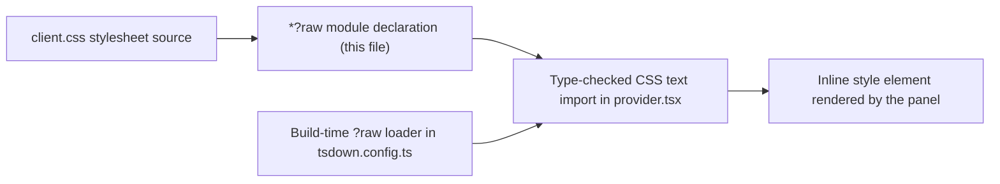

# css.d.ts

`src/client/css.d.ts` is a three-line type declaration that teaches TypeScript what a `?raw` import means. The panel's React provider imports its stylesheet as plain text (`import STYLES from './client.css?raw'`), and without this declaration that import would be a type error. The file contains no runtime code: it only describes the shape the bundler produces, so a first-time reader can treat it as the compile-time half of a two-part convention.

## Whole-unit functional diagram

The right-hand path is what the compiler sees and the middle path is what the bundler actually does; both must agree on one fact, that a `?raw` module default-exports a string.

<!-- {
  "mermaid_info": {
    "name": "Raw stylesheet import contract",
    "nodes": [
      {
        "id": "stylesheet_001",
        "name": "client.css stylesheet source",
        "path": "src/client/client.css",
        "hint": "The panel stylesheet file whose text is imported",
        "isJumpable": true,
        "position": { "startLine": 1, "endLine": 383 },
        "references": []
      },
      {
        "id": "declaration_002",
        "name": "*?raw module declaration (this file)",
        "path": "src/client/css.d.ts",
        "hint": "Ambient declaration giving every ?raw import a string default export",
        "isJumpable": true,
        "position": { "startLine": 2, "endLine": 5 },
        "references": []
      },
      {
        "id": "typed_import_003",
        "name": "Type-checked CSS text import in provider.tsx",
        "path": "src/client/provider.tsx",
        "hint": "The only current consumer, importing the stylesheet as text",
        "isJumpable": true,
        "position": { "startLine": 6, "endLine": 6 },
        "references": []
      },
      {
        "id": "bundler_004",
        "name": "Build-time ?raw loader in tsdown.config.ts",
        "path": "tsdown.config.ts",
        "hint": "Build plugin that resolves ?raw ids and emits the file contents as a string",
        "isJumpable": true,
        "position": { "startLine": 5, "endLine": 8 },
        "references": []
      },
      {
        "id": "panel_005",
        "name": "Inline style element rendered by the panel",
        "path": "src/client/provider.tsx",
        "hint": "The imported text is rendered inside a style element",
        "isJumpable": true,
        "position": { "startLine": 104, "endLine": 104 },
        "references": []
      }
    ]
  }
} -->

    
        <a target="_self" href="#src/client/css.d.ts:1?class=graph" style="color: inherit; text-decoration: none;">Graph: Raw stylesheet import contract</a>
    

## At a glance

- **Primary role**: Data contract — it fixes the agreed shape of a module boundary (a `?raw` import) that the compiler and the bundler both rely on.
- **Confidence**: High — the whole file is six lines, and its single consumer, the build loader, and the rendering site were all read directly.

## What this file does

- **Makes `?raw` imports compile.** Any specifier ending in `?raw` is accepted by TypeScript and typed as a module whose default export is a `string`.
- **Separates typing from loading.** This file says nothing about how the text is produced; the build-time loader in `tsdown.config.ts` performs the actual file read.
- **Keeps the stylesheet in one plain file.** Because `client.css` is imported as text rather than as a CSS module, the source stays ordinary CSS that can also be read and checked outside the browser bundle.
- **Covers every `?raw` import, not just CSS.** The pattern is a wildcard, so any future raw text import in the client folder inherits the same contract without another declaration.
- **Documents the convention in place.** The one-line comment states the intent, so a newcomer can see why a `.d.ts` file exists next to a stylesheet.

## Key declarations

### `declare module '*?raw'`

Opens an ambient module declaration for any specifier matching `*?raw` and gives it a single default export named `text` typed as `string`.

<a target="_self" href="#src/client/css.d.ts:2-5?class=code" style="color: inherit; text-decoration: none;">css.d.ts:2-5</a>

### `text` (default export)

The declared value that consumers receive; in practice it carries the full CSS source of the imported file. It is consumed at 
<a target="_self" href="#src/client/provider.tsx:6?class=code" style="color: inherit; text-decoration: none;">provider.tsx:6</a>
 and rendered as an inline style element at 
<a target="_self" href="#src/client/provider.tsx:104?class=code" style="color: inherit; text-decoration: none;">provider.tsx:104</a>
.

## Information contract

- **Represents**: the result of importing a file with the `?raw` query — the file's contents as plain text, delivered as a default export.
- **Produced by**: the client bundler configuration, whose `?raw` loader reads the target file from disk and emits it as a JSON-escaped string module (see 
<a target="_self" href="#tsdown.config.ts:5-8?class=code" style="color: inherit; text-decoration: none;">tsdown.config.ts:5-8</a>
).
- **Consumed by**: the panel provider, which injects the stylesheet text into the page so the client UI is styled without a separate CSS asset request.
- **Behavior-shaping parts**: only two facts matter — the import ends in `?raw`, and the default export is a `string`. There are no optional fields or variants to negotiate.

### Compatibility notes

The wildcard matches any `?raw` specifier, so the declaration is broader than stylesheets, while the build loader and test environment must also support the query for the import to work at runtime. The declaration itself has no runtime effect and adds no bundle weight.

## Main inputs and results

- **Inputs**: an import specifier ending in `?raw` written in a TypeScript or TSX file under the client sources, plus the ambient declaration in this file being visible to the compiler.
- **Results**: that import type-checks, and its default export is usable anywhere a `string` is accepted — here, as the content of a `<style>` element.
- **Visible side effects**: the panel appears with its intended styling; no file is written and no state is stored by this declaration.

---
name: css.d.ts

update-time: 2026-11-02 10:44

description: `src/client/css.d.ts` is a three-line type declaration that teaches TypeScript what a `?raw` import means. The panel's React provider imports its stylesheet as plain text (`import STYLES from './client.css?raw'`), and without this declaration that import would be a type error. The file contains no runtime code: it only describes the shape the bundler produces, so a first-time reader can treat it as the compile-time half of a two-part convention.

---
