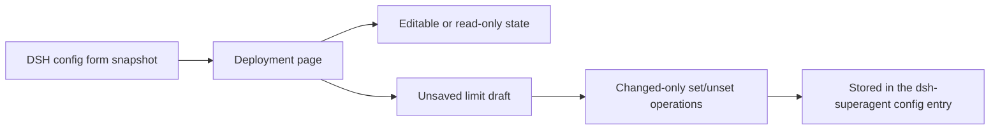

# deployment.tsx

This file renders the **Deployment** settings screen of `dsh-superagent` and is reused by two hosts: the management panel's Settings tab and the DSH Plugin Manager configuration page. It shows the machine's state directory, three editable resource limits, and — on the Plugin Manager page only — the repository and accounts derived from the Source settings. When DSH serves a writable configuration form, a save writes only the fields the person actually changed and takes effect without restarting; when it does not, the same screen becomes read-only with an explanation of why.

## Whole-unit functional diagram

A DSH configuration form snapshot is folded into the page's value model; the page then either offers editable number inputs backed by a draft or explains why it cannot. Submitting that draft diffs it against what was saved and sends only the changed keys to the host, which applies them immediately.

<!-- {
  "mermaid_info": {
    "name": "Deployment settings flow",
    "nodes": [
      {
        "id": "form_001",
        "name": "DSH config form snapshot",
        "path": "src/client/deployment.tsx",
        "hint": "usePageForm subscribes a DSH ConfigForm and exposes its snapshot plus mutate as a DeploymentForm",
        "isJumpable": true,
        "position": { "startLine": 26, "endLine": 30 },
        "references": []
      },
      {
        "id": "page_002",
        "name": "Deployment page",
        "path": "src/client/deployment.tsx",
        "hint": "DeploymentPage renders the intro, setup problem, optional accounts, state directory and limit inputs",
        "isJumpable": true,
        "position": { "startLine": 33, "endLine": 84 },
        "references": []
      },
      {
        "id": "readonly_003",
        "name": "Editable or read-only state",
        "path": "src/client/deployment.tsx",
        "hint": "The read-only hint ladder covers missing forms, memory mode, loading, unavailable and non-writable snapshots",
        "isJumpable": true,
        "position": { "startLine": 49, "endLine": 51 },
        "references": []
      },
      {
        "id": "draft_004",
        "name": "Unsaved limit draft",
        "path": "src/client/deployment.tsx",
        "hint": "useDraft tracks the edited values, revision and dirty/busy state for the three numeric limits",
        "isJumpable": true,
        "position": { "startLine": 38, "endLine": 39 },
        "references": []
      },
      {
        "id": "save_005",
        "name": "Changed-only set/unset operations",
        "path": "src/client/deployment.tsx",
        "hint": "The save callback diffs trimmed values against the base and builds set or unset operations for form.mutate",
        "isJumpable": true,
        "position": { "startLine": 40, "endLine": 46 },
        "references": []
      },
      {
        "id": "applied_006",
        "name": "Stored in the dsh-superagent config entry",
        "path": "src/client/deployment.tsx",
        "hint": "After a successful mutate the page notifies that settings were saved and reports the next revision without a restart",
        "isJumpable": true,
        "position": { "startLine": 43, "endLine": 45 },
        "references": []
      }
    ]
  }
} -->

    
        <a target="_self" href="#src/client/deployment.tsx:1?class=graph" style="color: inherit; text-decoration: none;">Graph: Deployment settings flow</a>
    

## At a glance

- **Primary role — Presentation**: the file builds the visible Deployment form: sections, number inputs, hints, the save bar, and the wording that explains read-only states.
- **Secondary role — Orchestration**: it also sequences the path from a form snapshot to a minimal write, then to the "saved" notification and the next revision.
- **Confidence**: High — the render tree, the save callback, the collaborator modules (`draft.tsx`, `provider.tsx`, `limits.ts`) and the panel test suite all agree on these behaviors.

## What the user experiences

- **Presents**: an intro line, a setup-problem banner when the host's startup check failed, an optional "Repository and accounts" block, a "This machine" section with the state directory, and a "Limits" section with three bounded number inputs.
- **Interaction**: typing in a limit makes the save bar appear; **Save** writes the change and **Discard** drops the draft. A refused change keeps the typed value on screen with an error message, and a change saved elsewhere is merged into the draft with a short notice.
- **Prepared data**: the page needs a setup snapshot (machine limits, state directory, derived accounts, setup problems) and a DSH form snapshot; without both, it still renders but cannot write.

### Important interaction states

- Inputs are editable only while the form snapshot reports `status === 'ready'` **and** `writable`; otherwise every input is disabled and no save bar appears.
- The read-only explanation is chosen in order: DSH offers no configuration forms at all → the browser is a remote one in `memory` mode → values are still loading → `dsh-superagent` is `unavailable` (for example, still starting) → the snapshot is merely not writable.
- Before writable values arrive, the displayed numbers come from the setup snapshot; the draft only rebases onto form values once they become writable, so an early edit is not thrown away.
- A failed setup check does not block the Limits section — these values apply without a restart, so they stay editable even while a setup problem banner is shown.

## What this file does

- **Reuses one screen in two places**: the Settings tab passes the panel-wide deployment form, while the Plugin Manager page wraps the same page in its own provider and adds the derived repository/account block.
- **Keeps limits inside the shared bounds**: each input is a whole-number field clamped by the shared `LIMITS` entry, so the form cannot offer values the host would reject.
- **Writes as little as possible**: on save, only keys whose trimmed value differs from the saved one are sent — as a numeric `set` when non-empty, or an `unset` when cleared — so concurrent edits on the other page are not overwritten.
- **Explains instead of hiding**: when writing is impossible, the page states the specific reason rather than showing a disabled form with no context.
- **Surfaces startup problems with a repair action**: a setup problem renders a localized message plus a re-check button that asks DSH to verify setup again.
- **Stays empty in Plugin Manager summary mode**, because DSH already shows the package description there.

## Coordinated flow

1. The Settings tab supplies `state.setup` plus the panel-wide form; `PluginConfig` instead mounts a `PanelProvider` and reads the polled state itself.
2. `DeploymentPage` decides whether the screen is editable from the form snapshot and picks the baseline values (form values when writable, the setup snapshot's machine values otherwise).
3. `useDraft` from 
<a target="_self" href="#src/client/draft.tsx:136-173?class=code" style="color: inherit; text-decoration: none;">draft.tsx:136-173</a>
 holds the edit, reports dirty/busy state, merges edits made elsewhere, and keeps the draft when a write is refused.
4. The page's save callback turns the draft into `set`/`unset` operations, calls `form.mutate(ops, revision)`, notifies the person that settings were saved, and reports the next revision with no restart requested.

### Important branching or concurrency

Two surfaces can edit the same config entry, so a draft that diverges from the newest revision is rebased and shown as "merged" before saving; the Plugin Manager test at 
<a target="_self" href="#tests/panel-deployment.spec.tsx:52-65?class=code" style="color: inherit; text-decoration: none;">panel-deployment.spec.tsx:52-65</a>
 shows only the locally changed field being written afterwards.

## Key functions or classes

### `DeploymentPage`

The screen itself: builds the sections, the read-only hint, the three limit inputs and the save bar from a setup snapshot plus a deployment form.

    
        <a target="_self" href="#src/client/deployment.tsx:33-84?class=code" style="color: inherit; text-decoration: none;">Code: src/client/deployment.tsx:33-84</a>
    

### `usePageForm`

Adapts a DSH `ConfigForm` into the smaller `ConfigPageForm` shape (`state` + `mutate`) the page expects, subscribing so the view follows form updates.

    
        <a target="_self" href="#src/client/deployment.tsx:26-30?class=code" style="color: inherit; text-decoration: none;">Code: src/client/deployment.tsx:26-30</a>
    

### `PluginConfig`

The Plugin Manager entry point: renders the page with its own provider and a 10-second state poll, and renders nothing in summary mode.

    
        <a target="_self" href="#src/client/deployment.tsx:96-98?class=code" style="color: inherit; text-decoration: none;">Code: src/client/deployment.tsx:96-98</a>
    

### `PluginPage`

Loads the panel state and chooses between the page, an error line, and a loading hint before handing the snapshot to `DeploymentPage`.

    
        <a target="_self" href="#src/client/deployment.tsx:87-94?class=code" style="color: inherit; text-decoration: none;">Code: src/client/deployment.tsx:87-94</a>
    

### `limitsOf` and the `MACHINE_LIMITS` list

Define which three keys this screen owns and normalize them into the string values the inputs need, whatever the form or setup snapshot actually contains.

    
        <a target="_self" href="#src/client/deployment.tsx:20-24?class=code" style="color: inherit; text-decoration: none;">Code: src/client/deployment.tsx:20-24</a>
    

## Main inputs and results

- **Inputs**: a `SetupView` (state directory, machine limits, derived accounts, setup and Feishu problems), a `DeploymentForm` (snapshot `value`/`revision`/`status`/`mode`/`writable` plus `mutate`), the panel translator, and the shared bounds from 
<a target="_self" href="#src/limits.ts:1-11?class=code" style="color: inherit; text-decoration: none;">limits.ts:1-11</a>
.
- **Results**: a rendered Deployment form, plus `mutate` calls shaped as `{ op: 'set', path: [key], value }` or `{ op: 'unset', path: [key] }` with the revision the draft was based on.
- **Visible side effects**: a "saved" toast after a successful write, an error line naming a refused change or a setup problem, and no restart prompt — these values are read on each use, so a saved limit applies at once. No draft key is passed to `useDraft` here, so an unsaved edit is not restored after the page is left.

Callers plug this screen in at 
<a target="_self" href="#src/client/settings.tsx:23?class=code" style="color: inherit; text-decoration: none;">settings.tsx:23</a>
 for the Settings tab and at 
<a target="_self" href="#src/client/index.tsx:56-57?class=code" style="color: inherit; text-decoration: none;">index.tsx:56-57</a>
 for the Plugin Manager slot.

---
name: deployment.tsx

update-time: 2026-11-02 10:49

description: This file renders the **Deployment** settings screen of `dsh-superagent` and is reused by two hosts: the management panel's Settings tab and the DSH Plugin Manager configuration page. It shows the machine's state directory, three editable resource limits, and — on the Plugin Manager page only — the repository and accounts derived from the Source settings. When DSH serves a writable configuration form, a save writes only the fields the person actually changed and takes effect without restarting; when it does not, the same screen becomes read-only with an explanation of why.

---
