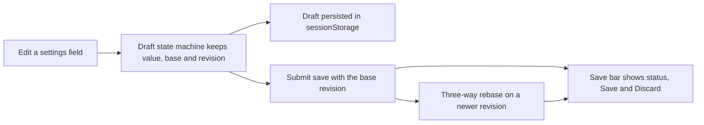

# draft.tsx

`src/client/draft.tsx` provides the shared "edit a settings form without losing work" layer for the management panel: a `useDraft` hook that keeps an optimistic local copy of a settings value, a `draftReducer` state machine that decides when that copy is clean, edited, saving or waiting for a new server revision, and a `SaveBar` component that renders save/discard controls plus status or error text. It also implements `merge3`, a three-way merge that rebases your pending edits onto newer server revisions instead of overwriting them. Settings blocks, the prompts editor, deployment limits and other configurable screens in `src/client` all consume this file rather than re-implementing draft handling.

## Whole-unit functional diagram

A field edit is turned into a draft that also remembers the value it started from and the revision it was based on. That draft is mirrored into `sessionStorage` so a page reload does not lose it, and saving sends the base revision to the server; when the server (or the next poll) reports a newer revision, `merge3` combines both sides and the result is reported through the save bar as merged, conflicted or invalid.

## At a glance

- Primary role: State storage — the file owns the life of an unsaved settings draft: where it lives, when it is restored, rebased or dropped, and when it is cleared.
- Secondary roles: Domain rules — it defines the merge policy for concurrent edits; Presentation — it renders the sticky save/discard bar and its messages.
- Confidence: High — the state machine, persistence effect, merge algorithm and save-bar rendering are all readable in this file, and four sibling screens import the hook and bar.

## What this file does

- Keeps an optimistic draft value separate from the last saved value, so editing a form never depends on a round trip to the server.
- Survives reloads: unsaved drafts are written to `sessionStorage` under the caller's `key` and restored as "draft restored" when the panel reopens.
- Never silently overwrites concurrent changes: when the saved revision advances while you are editing, pending edits are merged three-way by object key and by keyed list element (`id` / `chatId`).
- Reports outcomes honestly through notice kinds — merged, conflict (with the affected paths), invalid fields, failed request, unstored draft, rebasing — and localizes them with the panel translator.
- Handles the server's side of saving: a `409` triggers a reload and a rebase, structured validation issues mark the offending fields, and a save that restarts `dsh-superagent` asks the panel to watch the restart instead of reloading.
- Renders a save bar only when it is needed (dirty, busy, or showing an error) with Save/Discard buttons that are disabled while a save is in flight.

## Key functions or classes

### `useDraft`

The public hook: takes the saved value, its revision, a `save` callback, a `reload` callback and an optional storage `key`, and returns the current `value`, `meta`, `revision`, `dirty`/`busy` flags plus `edit`, `discard` and `submit` actions.

<a target="_self" href="#src/client/draft.tsx:136-173?class=code" style="color: inherit; text-decoration: none;">draft.tsx:136-173</a>

### `draftReducer`

The state machine behind the hook; it refuses edits while saving, holds a submitted value in `awaitingRevision` until the polled revision catches up, and rebases active edits when a newer revision arrives.

<a target="_self" href="#src/client/draft.tsx:80-108?class=code" style="color: inherit; text-decoration: none;">draft.tsx:80-108</a>

### `merge3`

The generic three-way merge used for rebasing; it returns `theirs` when your side is untouched, your value when the remote side is untouched, recurses through objects, and collects conflicting paths.

### `read`

Loads a stored draft for a key, discarding unreadable entries and drafts from older versions that lack the `base` value needed for merging.

### `saveBarText`

Turns the current phase and notice into the one status or error line the bar displays, with caller-supplied wording for merged/conflict/editing cases.

### `SaveBar`

The sticky bar itself: shows the localized status or an `alert` error, disables its buttons while a save is pending, and moves focus back to the surrounding settings block when it disappears.

<a target="_self" href="#src/client/draft.tsx:176-203?class=code" style="color: inherit; text-decoration: none;">draft.tsx:176-203</a>

## Stored state lifecycle

- Stores: one draft record per settings block — the pending `value`, the `base` value it was edited from, the revision that base came from, and optional caller metadata such as the selected prompt section.
- Read path: when a mounted component first calls `useDraft`, the hook reads the record for its `key` and starts in `editing` with a "restored" notice; callers such as the settings blocks build keys like `dsh-superagent/draft/<masterId>/<block>`.
- Write path: every change to the draft record re-writes the entry, and the entry is removed once the draft becomes clean (saved or discarded), so `sessionStorage` only ever holds genuine unsaved work.
- Visible result: a reload, navigation away or a closed tab does not lose unsaved settings edits; the bar shows "Unsaved · draft restored" and Save/Discard are immediately available.

### Important persistence behavior

Storage is best-effort. If writing the draft throws (for example when storage is full or blocked), the hook does not fail the edit — it raises an `unstored` notice so the person knows this edit will not survive a reload. Drafts whose stored shape cannot be merged (missing `base`, or a non-integer revision) are ignored rather than resurrected, so an incompatible old draft falls back to the saved server value.

## Rules and decisions

- Decision: what happens when the server value changed while a local draft was open — merge, keep, or report a conflict.
- Important conditions: if only one side changed a value, that side wins; identical changes collapse to one; arrays of records that all carry a unique `id` or `chatId` merge element by element, with locally added elements kept in their relative order; anything else that both sides changed differently is a conflict.
- Outcomes: a `merged` notice when the rebase produced a new draft, a `conflict` notice listing the affected paths when a removal collided with a modification or a value could not be reconciled, and a silent return to `clean` when the merge result equals the server value.
- Invariant: a save always carries the revision its base came from, and edits are ignored while a save is in flight, so the client can detect and recover from concurrent changes instead of overwriting them.

### Small example

You rename one prompt section while a colleague saves a different section. The poll reports a newer revision, the sections object merges key by key, only your renamed section survives as an edit, and the bar reports that the draft was merged at the new revision. If you had instead deleted a section that the newer revision edited, the merge keeps your deletion out of the result and lists that path as a conflict.

## What the user experiences

- Presents: a compact bar under a settings block with one status line (saved, draft kept, rebasing, merged) or a red error line for conflicts, invalid fields and request failures.
- Interaction: Save submits the draft — as a form submit when no `onSave` is supplied — and Discard drops the local draft; both are disabled while the value is clean or a save is in progress.
- Prepared data: the phase and notice from `draftReducer`, the `dirty`/`busy` flags from `useDraft`, the localized strings from the panel translator, and optional caller-supplied `words` or `status` overrides.

### Important interaction states

The bar is invisible when there is nothing to say, so a clean page shows no controls at all. While a save is pending it stays visible but inert; when it disappears, keyboard focus is returned to the surrounding settings block so tab navigation does not jump back to the top of the page. Errors use an assertive `alert` role, while informational status is announced politely.

## Main inputs and results

- Inputs: the last saved value and its revision, a `save(value, revision, base)` callback, a `reload()` callback, an optional storage key, the field edits dispatched through `edit`, and a submit event; errors arrive as 
<a target="_self" href="#src/client/api.ts:16?class=code" style="color: inherit; text-decoration: none;">api.ts:16</a>
 carrying status and validation issues.
- Results: the current `value` (submitted value first, then draft, then saved value), `dirty` and `busy` flags, the draft's revision, a `meta` object, and status/error text rendered by the bar.
- Visible side effects: the `sessionStorage` entry changes as drafts appear and clear, the panel is asked to watch a restart after a save that restarts the server, and the surrounding settings view refetches after a save or a rejected revision.

---
name: draft.tsx

update-time: 2026-11-02 10:43

description: `src/client/draft.tsx` provides the shared "edit a settings form without losing work" layer for the management panel: a `useDraft` hook that keeps an optimistic local copy of a settings value, a `draftReducer` state machine that decides when that copy is clean, edited, saving or waiting for a new server revision, and a `SaveBar` component that renders save/discard controls plus status or error text. It also implements `merge3`, a three-way merge that rebases your pending edits onto newer server revisions instead of overwriting them. Settings blocks, the prompts editor, deployment limits and other configurable screens in `src/client` all consume this file rather than re-implementing draft handling.

---
