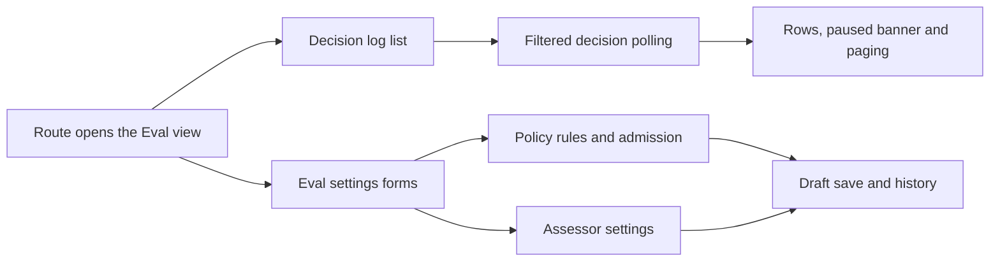

# eval.tsx

`eval.tsx` is the client-side home of the Eval stage in the management panel. It renders two related screens from one module: the decision log that shows what the agent accepted, stopped or ignored, and the settings forms where you write accept rules, decide which senders are admitted, and choose how evaluation itself behaves. Reading it is the quickest way to see how a policy edit in the browser becomes a saved settings block.

## Whole-unit flow

The decision-log half turns a route query into a polled `GET decisions` request and renders the returned rows; the settings half collects edits into per-block drafts and offers one save path per block. Both halves share the panel context for translations, API calls, navigation and notifications.

<!-- {
  "mermaid_info": {
    "name": "Eval status and settings flow",
    "nodes": [
      {
        "id": "route_001",
        "name": "Route opens the Eval view",
        "path": "src/client/app.tsx",
        "hint": "The panel resolves the eval page or the eval settings group before rendering these components",
        "isJumpable": true,
        "position": { "startLine": 153, "endLine": 154 },
        "references": []
      },
      {
        "id": "status_002",
        "name": "Decision log list",
        "path": "src/client/eval.tsx",
        "hint": "Export that renders the decision log with filters and paging",
        "isJumpable": true,
        "position": { "startLine": 15, "endLine": 39 },
        "references": []
      },
      {
        "id": "settings_003",
        "name": "Eval settings forms",
        "path": "src/client/eval.tsx",
        "hint": "Export that stacks the policy block, the eval block and the history disclosure",
        "isJumpable": true,
        "position": { "startLine": 219, "endLine": 225 },
        "references": []
      },
      {
        "id": "poll_004",
        "name": "Filtered decision polling",
        "path": "src/client/eval.tsx",
        "hint": "Translates the filter and window query into a polled decisions request",
        "isJumpable": true,
        "position": { "startLine": 17, "endLine": 21 },
        "references": []
      },
      {
        "id": "feedback_005",
        "name": "Rows, paused banner and paging",
        "path": "src/client/eval.tsx",
        "hint": "Loading state, decision rows, empty hint and the load-more control",
        "isJumpable": true,
        "position": { "startLine": 22, "endLine": 38 },
        "references": []
      },
      {
        "id": "policy_006",
        "name": "Policy rules and admission",
        "path": "src/client/eval.tsx",
        "hint": "Editable accept rules, per-source fields, roster sync and the admission matrix",
        "isJumpable": true,
        "position": { "startLine": 136, "endLine": 190 },
        "references": []
      },
      {
        "id": "eval_007",
        "name": "Assessor settings",
        "path": "src/client/eval.tsx",
        "hint": "Accept mode, evaluation timeout and assessor model fields",
        "isJumpable": true,
        "position": { "startLine": 192, "endLine": 217 },
        "references": []
      },
      {
        "id": "save_008",
        "name": "Draft save and history",
        "path": "",
        "hint": "Shared draft, save bar and configuration history behavior supplied by other client modules",
        "isJumpable": false,
        "position": { "startLine": 0, "endLine": 0 },
        "references": []
      }
    ]
  }
} -->

    
        <a target="_self" href="#src/client/eval.tsx:1?class=graph" style="color: inherit; text-decoration: none;">Graph: Eval status and settings flow</a>
    

## At a glance

- **Primary role**: Presentation — the file turns polled decision records and saved settings into two screens: a filterable decision log and a pair of editable settings forms with their own draft, save and history controls.
- **Confidence**: High — every exported component is read in full and traced to its mount points in the panel shell and the settings shell.

## What this file does

- Lists decisions with filter pills (`work`, `stop`, `ignore`, `unavailable`, `all`) that map to decision kinds, plus an optional last-24-hours window, keeping the current view in the URL query so it can be shared or revisited.
- Warns when evaluation is paused and links straight to the execution page where it can be resumed.
- Lets you curate accept rules as collapsible rows: enable switch, required name, required instruction with length bounds, duplicate and remove, plus an add-rule action.
- Edits per-source policy: source-declared fields, a roster-sync button for sources that support it, and a three-cell admission matrix that decides how listed and unlisted senders are treated.
- Configures evaluation behavior: accept mode (`off`, `observe`, `auto`), an evaluation timeout inside the allowed bounds, and the assessor model.
- Closes each block with a save bar over a persisted draft and a configuration-history disclosure scoped to the `policy` and `eval` blocks.

## What the user experiences

- **Presents**: a decision log with filter pills, a paused banner, decision rows and a load-more control; and a settings page made of a rules section, a per-source tabbed section with an admission table, a small evaluation section, and a history disclosure.
- **Interaction**: clicking a filter pill resets paging and rewrites the query; expanding a rule row reveals its editor; duplicating inserts a renamed copy right after the original; changing an admission cell updates that one combination; saving or discarding works through the save bar.
- **Prepared data**: the settings screens assume the shared settings provider has already loaded `GET settings`, and the decision log needs polled decision rows; both need the panel context for translations, API calls and navigation.

### Important interaction states

- While decisions load, a shared loading state replaces the list; when a poll fails, the error is shown instead, and an empty result becomes a short "none" hint rather than an empty list.
- The paused banner only appears when evaluation is paused, and it points at the execution page rather than trying to unpause from here.
- A rule row stays collapsed with its instruction as a preview line; if native form validation fails inside a collapsed rule, every rule is expanded so the invalid field becomes visible.
- The roster-sync button refuses to run while the policy block has unsaved edits — it shows a "save first" notice instead — and stays disabled until the source reports the sync target as ready. Its last ready timestamp or error detail is displayed next to it.
- Choosing `explicit` for an unlisted but addressed sender shows a warning icon in a fixed-width slot, so selecting a value never shifts the table columns.
- Saving disables the fieldset until the request finishes, and the save bar reflects unsaved, saving and conflict states from the shared draft layer.

## Key functions or classes

### `EvalStatus`

The exported decision-log view: polls decisions for the current filter and window, renders pills, the paused banner, rows and paging, and rewrites the URL query on every filter change. 
<a target="_self" href="#src/client/eval.tsx:15-39?class=code" style="color: inherit; text-decoration: none;">eval.tsx:15-39</a>

### `RuleRow`

Renders one accept rule as a disclosure row with an enabled dot, name and instruction editors, duplicate/remove actions and an enable switch. 
<a target="_self" href="#src/client/eval.tsx:42-68?class=code" style="color: inherit; text-decoration: none;">eval.tsx:42-68</a>

### `SourcePart`

Renders the policy part of one source: its declared fields, the optional roster-sync control with health, and either the admission matrix or a plain statement of how explicit requests are recognized. 
<a target="_self" href="#src/client/eval.tsx:71-96?class=code" style="color: inherit; text-decoration: none;">eval.tsx:71-96</a>

### `AdmissionTable`

Draws the admission matrix: one row per sender scope, one select per received cell, defaults for unset cells, restricted options per cell, and a warning when an unlisted addressed sender may make explicit requests. 
<a target="_self" href="#src/client/eval.tsx:100-134?class=code" style="color: inherit; text-decoration: none;">eval.tsx:100-134</a>

### `PolicyBlock`

Owns the policy draft: rule list mutations, per-source subtabs, expansion bookkeeping, invalid-field revealing, the policy version readout and the save bar. 
<a target="_self" href="#src/client/eval.tsx:136-190?class=code" style="color: inherit; text-decoration: none;">eval.tsx:136-190</a>

### `EvalBlock`

Owns the eval draft: the accept-mode selector, the bound timeout field (text while editing, converted to a number or left empty so the server rejects a blank required value) and the assessor model picker. 
<a target="_self" href="#src/client/eval.tsx:192-217?class=code" style="color: inherit; text-decoration: none;">eval.tsx:192-217</a>

### `EvalSettings`

The exported settings group that stacks the policy block, the eval block and a history disclosure covering both blocks, optionally focusing a policy version from the query. 
<a target="_self" href="#src/client/eval.tsx:219-225?class=code" style="color: inherit; text-decoration: none;">eval.tsx:219-225</a>

## Main inputs and results

- **Inputs**: the route query (`filter`, `window` for the log; `version` for the history focus), the panel-wide `paused` flag, translated strings and the API caller from the panel context, the already-loaded settings view, decision rows from `GET decisions`, and per-source policy metadata supplied by the settings view.
- **Results**: a rendered decision log or a rendered set of settings forms; changed URL queries on filter clicks; saved `policy` and `eval` blocks sent with the revision the draft was based on; a roster refresh through `POST policy-sync/:id` for sources that support it.
- **Visible side effects**: save, restart-required and "save first" notices, sync health text, the paused banner, and a history disclosure that opens and highlights the save that produced a referenced policy version.

---
name: eval.tsx

update-time: 2026-11-02 10:54

description: `eval.tsx` is the client-side home of the Eval stage in the management panel. It renders two related screens from one module: the decision log that shows what the agent accepted, stopped or ignored, and the settings forms where you write accept rules, decide which senders are admitted, and choose how evaluation itself behaves. Reading it is the quickest way to see how a policy edit in the browser becomes a saved settings block.

---
